# 第3章 模块化、对象和状态

即使在变化中,它也丝毫未变。

——赫拉克利特(Heraclitus)

变得越多,它就越是原来的样子。

——阿尔芬斯·卡尔(Alphonse Karr)

前面两章介绍了组成程序的各种基本元素,我们看到了如何把基本过程和基本数据组合起来,构造出复合的实体,也从中认识到,在克服大型系统的复杂性的问题上,抽象起着至关重要的作用。但是对于设计程序而言,这些手段还不够用,有效的程序综合还需要一些组织原则,它们应能指导我们系统化地完成系统的整体设计。特别需要一些能够帮助我们构造起模块化的大型系统的策略,也就是说,使这些系统能够“自然地”划分为一些具有内聚力的部分,使这些部分可以分别进行开发和维护。

有一种非常强有力的设计策略,特别适合用于构造那类模拟真实物理系统的程序,那就是基于被模拟系统的结构去设计程序的结构。对于有关的物理系统里的每个对象,我们构造起一个与之对应的计算对象;对该系统里的每种活动,我们在自己的计算系统里定义一种符号操作。采用这一策略时的希望是,在需要针对系统中的新对象或者新活动扩充对应的计算模型时,我们能够不必对程序做全面的修改,而只需要加入与这些对象或者动作相对应的新的符号对象。如果我们在系统的组织方面做得很成功,那么在需要添加新特征或者排除旧东西里的错误时,就只需在系统里的一些小局部中工作。

这样,在很大程度上,组织大型程序的方式会受到我们对于被模拟系统的认识的支配。在这一章里,我们要研究两种特点很鲜明的组织策略,它们源自对于系统结构的两种非常不同的“世界观”。第一种策略将注意力集中在对象上,将一个大型系统看成一大批对象,它们的行为可能随着时间的进展而不断变化。另一种组织策略将注意力集中在流过系统的信息流上,非常像电子工程师观察一个信号处理系统。

基于对象的途径和基于流处理的途径,都对程序设计提出了具有重要意义的语言要求。对于对象途径而言,我们必须关注计算对象可以怎样变化而又同时保持其标识。这将迫使我们抛弃老的计算的代换模型(见1.1.5节),转向更机械式的,理论上也更不容易把握的计算的环境模型。在处理对象、变化和标识时,各种困难的基本根源在于我们需要在这一计算模型中与时间搏斗。如果允许程序并发执行的可能性,事情就会变得更困难许多。流方式特别能够用于松解在我们的模型中对时间的模拟与计算机求值过程中的各种事件发生的顺序。我们将通过一种称为延时求值的技术做到这一点。

## 3.1 赋值和局部状态

我们关于世界的常规观点之一,就是将它看作聚集在一起的许多独立对象,每个对象都有自己的随着时间变化的状态。所谓一个对象“有状态”,也就是说它的行为受到它的历史的影响。例如一个银行账户就具有状态,对问题“我能取出100元钱吗?”的回答依赖于它的存入和支取的交易历史。我们可以用一个或几个状态变量刻画一个对象的状态,在它们之中维持着有关这一对象的历史,即能够确定该对象当前行为的充分的信息。在一个简单的银行系统里,我们可以用当前余额刻画一个账户的状态,而不必记住这个账户的全部交易历史。

在一个由许多对象组成的系统里,其中的这些对象极少会是完全独立的。每个对象都可能通过交互作用,影响其他对象的状态,所谓交互就是建立起一个对象的状态变量与其他对象的状态变量之间的联系。确实,如果一个系统中的状态变量可以分组,形成一些内部紧密结合的子系统,每个子系统与其他子系统之间只存在松散联系,此时将这个系统看作是由一些独立对象组成的观点就会特别有用。

对于一个系统的这种观点,有可能成为组织这一系统的计算模型的有力框架。要使这样的一个模型成为模块化的,就要求它能分解为一批计算对象,使它们能够模拟系统里的实际对象。每一个计算对象必须有它自己的一些局部状态变量,用于描述实际对象的状态。由于被模拟系统里的对象的状态是随着时间变化的,与它们相对应的计算对象的状态也必须变化。如果我们确定要通过计算机里的时间顺序去模拟实际系统里时间的流逝,那么我们就必须构造起一些计算对象,使它们的行为随着程序的运行而改变。特别是,如果我们希望通过程序设计语言里常规的符号名字去模拟状态变量,那么语言里就必须提供一个赋值运算符,使我们能用它去改变与一个名字相关联的值。

### 3.1.1 局部状态变量

为了说清楚这里所说的让一个计算对象具有随着时间变化的状态的意思,现在让我们来对从一个银行账户支取现金的情况做一个模拟。我们将用一个过程withdraw完成此事,它有一个参数amount表示支取的现金量。如果对应于给定的支取额,在相应的账户里尚有足够的余额,那么withdraw就返回支取之后账户里剩余的款额,否则withdraw将返回消息Insufficient funds(金额不足)。举例说,假定开始时账户里有100元钱,在不断使用withdraw的过程中我们可能得到下面的响应序列:

```scheme
(withdraw 25)
75

(withdraw 25)
50

(withdraw 60)
"Insufficient funds"

(withdraw 15)
35
```

在这里可以看到表达式(withdraw 25)求值了两次,但它产生的值却不同。这是过程的一种新的行为方式。到现在为止,我们看到的所有过程都可以看作一些可计算的数学函数的描述,对一个过程的调用将计算出相应函数作用于给定参数应得到的值,用同样的实际参数两次调用同一个过程,总会产生出相同的结果[^129]。

为了实现withdraw,我们可以用一个变量balance表示账户里的现金余额,并将withdraw定义为一个访问balance的过程。过程withdraw检查是否balance的值至少如amount所需的那么多,如果是,withdraw就从balance里减去amount并返回balance的新值;否则withdraw就返回消息Insufficient funds。下面是balance和withdraw的定义:

```scheme
(define balance 100)

(define (withdraw amount)
  (if (>= balance amount)
      (begin (set! balance (- balance amount))
             balance)
      "Insufficient funds"))
```

减少balance的工作由下面表达式完成:

```scheme
(set! balance (- balance amount))
```

其中使用了特殊形式set!,其语法是:

```scheme
(set! <name> <new-value>)
```

这里的`<name>`应是一个符号,`<new-value>`是任何表达式。set!将修改`<name>`,使它的值变成求值`<new-value>`得到的结果。在上面例子里,我们改变了balance的值,使它的新值等于从balance的原有值中减去amount后的结果[^130]。

在过程withdraw里还使用了begin特殊形式,用于描述对两个表达式的求值,在if的检测为真时首先减少balance的值,最后又返回balance的值。一般而言,对下面表达式的求值:

```scheme
(begin <exp₁> <exp₂> ... <expₙ>)
```

将导致表达式`<exp₁>`到`<expₙ>`按顺序求值,最后一个表达式`<expₙ>`的值又将作为整个begin形式的值返回[^131]。

虽然withdraw能像我们期望的那样工作,变量balance却表现出一个问题。按照上面的描述,balance是定义在全局环境里的一个名字,因此完全可以自由地被任何过程检查或者修改。如果我们能将balance做成为withdraw内部的东西,情况就会好得多,因为这将使withdraw成为唯一能直接访问balance的过程,任何其他过程都只能间接地(通过对withdraw的调用)访问balance。这样才能更准确地模拟有关的概念:balance是一个只由withdraw使用的局部状态变量,用于保存账户状态的变化轨迹。

我们可以通过下面方式重写出withdraw,使balance成为它内部的东西:

```scheme
(define new-withdraw
  (let ((balance 100))
    (lambda (amount)
      (if (>= balance amount)
          (begin (set! balance (- balance amount))
                 balance)
          "Insufficient funds"))))
```

这里的做法是用let创建起一个包含局部变量balance的环境,并使它约束到初始值100。在这个局部环境里,我们用lambda创建了一个过程,它以amount作为一个参数,其行为就像是前面withdraw的过程。通过对表达式的求值结果返回的过程就是new-withdraw,它的行为方式就像是withdraw,但其中的变量却是任何其他过程都不能访问的[^132]。

将set!与局部变量相结合,形成了一种具有一般性的程序设计技术,我们将一直使用这种技术去构造带有局部状态的计算对象。但是,采用这一技术也引起了一个严重的问题:当我们最早介绍过程概念时,也同时介绍了求值的代换模型(见1.1.5节),用它为过程调用的意义提供一种解释。那时我们说,应用一个过程应该被解释为,在将过程的形式参数用对应的值取代之后求值这一过程的体。现在就出现新的麻烦:一旦在语言里引进了赋值,代换就不再适合作为过程应用的模型了(我们将在3.1.3节看到其中的原因)。作为这种情况的一个结果,我们现在还没有办法在技术上理解为什么过程new-withdraw会有上面所说的行为方式。为了真正理解像new-withdraw这样的过程,我们需要为过程应用开发一个新模型。这一模型将在3.2节里介绍,那里还包括对set!和局部变量的解释。现在我们要首先检查new-withdraw所提出的问题的几种变形。

下面过程make-withdraw能创建出一种“提款处理器”。make-withdraw的形式参数balance描述了有关账户的初始余额值[^133]。

```scheme
(define (make-withdraw balance)
  (lambda (amount)
    (if (>= balance amount)
        (begin (set! balance (- balance amount))
               balance)
        "Insufficient funds")))
```

下面用make-withdraw创建了两个对象:

```scheme
(define W1 (make-withdraw 100))
(define W2 (make-withdraw 100))

(W1 50)
50

(W2 70)
30
```

```scheme
(W2 40)
"Insufficient funds"

(W1 40)
10
```

我们可以看到,W1和W2是相互完全独立的对象,每一个都有自己的局部状态变量balance,从一个对象提款与另一个毫无关系。

我们还可以创建出除了提款还能够存入款项的对象,这样就可以表示简单的银行账户了。下面是一个过程,它返回一个具有给定初始余额的“银行账户对象”:

```scheme
(define (make-account balance)
  (define (withdraw amount)
    (if (>= balance amount)
        (begin (set! balance (- balance amount))
               balance)
        "Insufficient funds"))
  (define (deposit amount)
    (set! balance (+ balance amount))
    balance)
  (define (dispatch m)
    (cond ((eq? m 'withdraw) withdraw)
          ((eq? m 'deposit) deposit)
          (else (error "Unknown request -- MAKE-ACCOUNT"
                       m))))
  dispatch)
```

对于make-account的每次调用将设置好一个带有局部状态变量balance的环境,在这个环境里,make-account定义了能够访问balance的过程deposit和withdraw,另外还有一个过程dispatch,它以一个“消息”作为输入,返回这两个局部过程之一。过程dispatch本身将被返回,作为表示有关银行账户对象的值。这正好就是我们在2.4.3节已经看到过的程序设计的消息传递风格,当然,这里将它与修改局部变量的功能一起使用。

过程make-account可以像下面这样使用:

```scheme
(define acc (make-account 100))

((acc 'withdraw) 50)
50

((acc 'withdraw) 60)
"Insufficient funds"

((acc 'deposit) 40)
90

((acc 'withdraw) 60)
30
```

对acc的每次调用将返回局部定义的deposit或者withdraw过程,这个过程随后被应用于给定的amount。就像make-withdraw一样,对make-account的另一次调用

```scheme
(define acc2 (make-account 100))
```

将产生出另一个完全独立的账户对象,维持着它自己的局部balance。

**练习3.1** 一个累加器是一个过程,反复用数值参数调用它,就会使它的各个参数累加到一个和数中。每次调用时累加器将返回当前的累加和。请写出一个生成累加器的过程make-accumulator,它所生成的每个累加器维持着一个独立的和。送给make-accumulator的输入描述了有关和数的初始值,例如:

```scheme
(define A (make-accumulator 5))

(A 10)
15

(A 10)
25
```

**练习3.2** 在对应用程序做软件测试时,能够统计出在计算过程中某个给定过程被调用的次数常常很有用处。请写出一个过程make-monitored,它以一个过程f作为输入,该过程本身有一个输入。make-monitored返回的结果是第三个过程,比如说mf,它将用一个内部计数器维持着自己被调用的次数。如果mf的输入是特殊符号how-many-calls?,那么mf就返回内部计数器的值;如果输入是特殊符号reset-count,那么mf就将计数器重新设置为0;对于任何其他输入,mf将返回过程f应用于这一输入的结果,并将内部计数器加一。例如,我们可能以下面方式做出过程sqrt的一个受监视的版本:

```scheme
(define s (make-monitored sqrt))

(s 100)
10

(s 'how-many-calls?)
1
```

**练习3.3** 请修改make-account过程,使它能创建一种带密码保护的账户。也就是说,应该让make-account以一个符号作为附加的参数,就像:

```scheme
(define acc (make-account 100 'secret-password))
```

这样产生的账户对象在接到一个请求时,只有同时提供了账户创建时给定的密码,它才处理这一请求,否则就发出一个抱怨信息:

```scheme
((acc 'secret-password 'withdraw) 40)
60

((acc 'some-other-password 'deposit) 50)
"Incorrect password"
```

**练习3.4** 请修改练习3.3中的make-account过程,加上另一个局部状态变量,使得如果一个账户被用不正确的密码连续访问了7次,它就将去调用过程call-the-cops(叫警察)。

### 3.1.2 引进赋值带来的利益

正如下面将要看到的,将赋值引进所用的程序设计语言,将会使我们陷入许多困难的概念问题的丛林之中。但无论如何,将系统看作是一集带有局部状态的对象,也是一种维护模块化设计的强有力技术。作为一个简单实例,现在考虑如何设计出一个过程rand,每次它被调用时就会返回一个随机选出的整数。

“随机选择”的意思并不清楚。其实,我们实际希望的就是,对rand的反复调用将产生出一系列的数,这一序列具有均匀分布的统计性质。我们不准备去讨论生成合适序列的方法,相反,现在假定我们已经有一个过程rand-update,它的性质就是,如果从一个给定的数x₁开始,执行下面操作:

x₂ = (rand-update x₁)  
x₃ = (rand-update x₂)

得到的值序列x₁, x₂, x₃, … 将具有我们所希望的性质[^134]。

我们可以将rand实现为一个带有局部状态变量x的过程,其中将这个变量初始化为某个固定值random-init。对rand的每次调用算出当前x值的rand-update值,将这个值返回作为随机数,并将它存入作为x的新值。

```scheme
(define rand
  (let ((x random-init))
    (lambda ()
      (set! x (rand-update x))
      x)))
```

当然,即使不用赋值,我们也可以通过简单地直接调用rand-update,生成同样的随机数序列。但是,这也就意味着程序中任何使用随机数的部分都必须显式地记住,需要将x的当前值送给rand-update作为参数。要想看看这样做会造成多少烦恼,现在考虑一下用随机数实现一种称为蒙特卡罗模拟的技术。

蒙特卡罗方法包括从一个大集合里随机选择试验样本,并在对这些试验结果的统计估计的基础上做出推断。举例来说,6/π²是随机选择的两个整数之间没有公共因子(也就是说,它们的最大公因子是1)的概率。我们可以利用这一事实做出π的近似值[^135]。为了逼近π的值,我们需要进行大量的试验。在每次试验中随机选择两个整数并检查它们的GCD是否为1。通过这一检查的次数比率将给出我们对6/π²的估计值,由它就可以得到π的近似值。

这一程序的核心是过程monte-carlo,它以做某个试验的次数,以及这个试验本身作为参数。有关试验用一个无参过程表示,返回的是每次运行的结果为真或假。monte-carlo运行这个试验指定的次数,它返回一个值,告知在所做的这些次试验中得到真的比例。

```scheme
(define (estimate-pi trials)
  (sqrt (/ 6 (monte-carlo trials cesaro-test))))

(define (cesaro-test)
   (= (gcd (rand) (rand)) 1))

(define (monte-carlo trials experiment)
  (define (iter trials-remaining trials-passed)
    (cond ((= trials-remaining 0)
           (/ trials-passed trials))
          ((experiment)
           (iter (- trials-remaining 1) (+ trials-passed 1)))
          (else
           (iter (- trials-remaining 1) trials-passed))))
  (iter trials 0))
```

现在让我们试一试不用rand,直接用rand-update完成同一个计算。如果我们不使用赋值去模拟局部状态,那么将不得不采取下面的做法:

```scheme
(define (estimate-pi trials)
  (sqrt (/ 6 (random-gcd-test trials random-init))))

(define (random-gcd-test trials initial-x)
  (define (iter trials-remaining trials-passed x)
    (let ((x1 (rand-update x)))
      (let ((x2 (rand-update x1)))
        (cond ((= trials-remaining 0)
               (/ trials-passed trials))
              ((= (gcd x1 x2) 1)
               (iter (- trials-remaining 1)
                     (+ trials-passed 1)
                     x2))
              (else
               (iter (- trials-remaining 1)
                     trials-passed
                     x2))))))
  (iter trials 0 initial-x))
```

虽然这个程序还是比较简单的,但它却在模块化上打开了一些令人感到很痛苦的缺口。在上面的第一个使用rand的程序里,我们可以将蒙特卡罗方法直接表述为一个通用过程monte-carlo,它以一个任意的experiment过程为参数。而在同一程序的第二版本中,由于没有随机数生成器的局部状态,random-gcd-test就必须显式地去操作随机数x1和x2,并通过一个迭代过程将x2送给rand-update作为新的输入。这种对于随机数的显式处理动作与积累检查结果的结构交织在一起。在这里,我们在当前的特定试验中使用了两个随机数,而其他蒙特卡罗试验里完全可能使用一个或者三个随机数。甚至在过程estimate-pi的最上层,也必须关心提供初始随机数的问题。由于内部的随机数生成器被暴露出来,进入了程序的其他部分,这就使我们很难将蒙特卡罗方法的思想孤立出来,使之可以应用于其他工作。在程序的第一个版本里,由于通过赋值将随机数生成器的状态隔离在过程rand的内部,因此就使随机数生成的细节完全独立于程序的其他部分了。

由上面蒙特卡罗方法实例展示出的一种具有普遍性的现象是:从一个复杂计算过程中一部分的观点看,其他部分都像是在随着时间不断变化,它们隐藏起自己的随时间变化的内部状态。假设我们希望写出一个计算机程序,反映这种系统分解,那么就需要让计算对象(例如银行账户和随机数生成器)的行为随着时间变化,用局部状态变量去模拟系统的状态,用对这些变量的赋值去模拟状态的变化。

[^129]: 实际上这话并不完全对。一个例外是1.2.6节的随机数生成器。另一个例外涉及到我们在2.4.3节引进的操作/类型表格,其中用同样参数两次调用get得到的值依赖于其间对put的调用。当然,在另一方面,在没有介绍赋值之前,我们将无法自己创建起这种过程。
[^130]: set!表达式的值由具体实现确定。通常只应该利用set!的影响而不用它的值。名字set!也反映了Scheme所用的一种命名约定:改变变量值(或者改变数据结构,在3.3节中将会看到)的操作都被给了一个以惊叹号结尾的名字。这类似于用问号结尾的名字表示谓词的习惯。
[^131]: 我们早已在程序里使用过begin,因为Scheme里的过程体本身就可以是表达式序列。还有,在cond表达式里每个子句中的`<consequent>`部分不仅可以是一个表达式,也可以是表达式的序列。
[^132]: 按照程序设计语言的行为,变量balance被称为是封装在new-withdraw过程里面。封装也反应了通常所谓隐藏原理的一般性系统设计原则:通过将系统中不同的部分保护起来,也就是说,只为系统中那些“必须知道”的部分提供信息访问,这样就可以使系统更模块化,更强健。
[^133]: 与上面new-withdraw的情况不同,我们不必在这里用let将balance做成局部变量,因为形式参数本身就是局部的。在3.2节讨论了求值的环境模型之后,这些就会更清楚了(另见练习3.10)。
[^134]: 实现rand-update的一种常见方法就是采用将x更新为ax+b取模m的规则,其中的a、b和m都是适当选出的整数。Knuth 1981的第3章里包含了有关随机数序列生成和建立其统计性质的深入讨论。请注意,rand-update是计算一个数学函数,两次给它同一个输入,它将产生出同一个输出。这样,如果“随机”强调的是序列中每个数与其前面的数无关的话,由rand-update生成的数序列肯定不是“随机的”。在“真正的随机性”与所谓伪随机序列(由定义良好的确定性计算产生出的但又具有适当统计性质的序列)之间的关系是一个非常复杂的问题,涉及到数学和哲学中的一些困难问题。Kolmogorov、Solomonoff和Chaitin为这些问题做出了很多贡献,从Chaitin 1975可以找到有关的讨论。
[^135]: 这个定理出自E.Cesàro,见Knuth 1981 4.5.2节的讨论和证明。

目前我们可能很想用下面的话作为这段讨论的总结：与所有状态都必须显式地操作和传递额外参数的方式相比，通过引进赋值和将状态隐藏在局部变量中的技术，我们能以一种更模块化的方式构造系统。可惜的是事情并不是这么简单，我们很快就会看到这一点。

**练习3.5** 蒙特卡罗积分是一种通过蒙特卡罗模拟估计定积分值的方法。考虑由谓词P(x, y)描述的一个区域的面积计算问题，该谓词对于此区域内部的点 (x, y) 为真，对于不在区域内的点为假。举例来说，包含在以 (5, 7) 为圆心半径为3的圆圈所围成的区域，可以用检查公式 (x−5)² + (y−7)² ≤ 3² 是否成立的谓词描述。要估计这样一个谓词所描述的区域的面积，我们应首先选取一个包含该区域的矩形。例如，以 (2, 4) 和 (8, 10) 作为对角点的矩形包含着上面的圆。需要确定的积分也就是这一矩形中位于所关注区域内的那个部分。我们可以这样估计积分值：随机选取位于矩形中的点 (x, y)，对每个点检查P(x, y)，确定该点是否位于所考虑的区域内。如果试了足够多的点，那么落在区域内的点的比率将能给出矩形中有关区域的比率。这样，用这一比率去乘整个矩形的面积，就能得到相应积分的一个估计值。

将蒙特卡罗积分实现为一个过程estimate-integral，它以一个谓词P，矩形的上下边界x1、x2、y1和y2，以及为产生估计值而要求试验的次数作为参数。你的过程应该使用上面用于估计π值的同一个monte-carlo过程。请用你的estimate-integral，通过对单位圆面积的度量产生出π的一个估计值。

你可能发现，有一个从给定区域中选取随机数的过程非常有用。下面的random-in-range过程利用1.2.6节里使用的random实现这一工作，它返回一个小于其输入的非负数[^136]。

```scheme
(define (random-in-range low high)
  (let ((range (- high low)))
    (+ low (random range))))
```

[^136]: MIT Scheme提供了这个过程。如果给的是精确整数（就像1.2.6中那样），它返回一个精确整数；而如果给它一个十进制数值（就像在这个练习里），它就返回一个十进制数值。

**练习3.6** 有时也需要能重置随机数生成器，以便从某个给定值开始生成随机数序列。请重新设计一个rand过程，使得我们可以用符号generate或者符号reset作为参数去调用它。其行为是：(rand ' generate) 将产生出一个新随机数，((rand ' reset) <new-value>) 将内部状态变量重新设置为指定的值*<new-value>*。通过这样重置状态，我们就可以重复生成同样的序列。在使用随机数测试程序，排除其中错误时，这种功能非常有用。

### 3.1.3 引进赋值的代价

正如在上面已经看到的，set!操作使我们可以去模拟带有局部状态的对象。然而，这一获益也有一个代价，它使得我们的程序设计语言不能再用1.1.5节介绍的过程应用的代换模型解释了。进一步说，任何具有"漂亮"数学性质的简单模型，都不可能继续适合作为处理程序设计语言里的对象和赋值的框架了。

只要我们不使用赋值，以同样参数对同一过程的两次求值一定产生出同样的结果，因此就可以认为过程是在计算数学函数。像我们在本书的前两章中所做的那样，不用任何赋值的程序设计称为函数式程序设计。

要理解赋值将怎样使事情复杂化了，现在考虑3.1.1节中make-withdraw过程的一个简化版本，其中不再关注是否有足够余额的问题：

```scheme
(define (make-simplified-withdraw balance)
  (lambda (amount)
    (set! balance (- balance amount))
    balance))

(define W (make-simplified-withdraw 25))

(W 20)
5

(W 10)
-5
```

请将这一过程与下面make-decrementer过程做一个比较，该过程里没有用set!：

```scheme
(define (make-decrementer balance)
  (lambda (amount)
    (- balance amount)))
```

make-decrementer返回的是一个过程，该过程从指定的量balance中减去其输入，但顺序调用时却不会像make-simplified-withdraw那样产生累积的结果:

```scheme
(define D (make-decrementer 25))

(D 20)
5

(D 10)
15
```

我们可以用代换模型解释make-decrementer如何工作。举例来说，让我们分析一下下面表达式的求值过程：

```scheme
((make-decrementer 25) 20)
```

首先简化组合式中的操作符，用25代换make-decrementer的体里的balance。这样就归约出了下面的表达式：

```scheme
((lambda (amount) (- 25 amount)) 20)
```

随后应用运算符，用20代换lambda表达式体里的amount：

```scheme
(- 25 20)
```

最后结果是5。

现在看看，如果将类似的代换分析用于make-simplified-withdraw，会出现什么情况：

```scheme
((make-simplified-withdraw 25) 20)
```

先简化其中的运算符，用25代换make-simplified-withdraw体里的balance，这样就归约出了下面的表达式[^137]：

```scheme
((lambda (amount) (set! balance (- 25 amount)) 25) 20)
```

现在应用其中的运算符，用20代换lambda表达式体里的amount：

[^137]: 我们没有代换set!表达式里的balance出现，因为在set!里的`<name>`并不求值。如果代换掉它，得到的 (set! 25 (- 25 amount)) 根本就没有意义。

```scheme
(set! balance (- 25 20)) 25
```

如果我们坚持使用代换模型，那么就必须说，这个过程应用的结果是首先将balance设置为5，而后返回25作为表达式的值。这样得到的结果当然是错误的。为了得到正确答案，我们将不得不对balance的第一个出现（在set!作用之前）和它的第二个出现（在set!作用之后）加以区分，而代换模型根本无法完成这件事情。

这里的麻烦在于，从本质上说，代换的最终基础就是，这一语言里的符号不过是作为值的名字。而一旦引进了set!和变量的值可以变化的想法，一个变量就不再是一个简单的名字了。现在的一个变量索引着一个可以保存值的位置，而存储在那里的值也是可以改变的。在3.2节里将会看到，在我们的计算模型里，环境将怎样扮演着"位置"的角色。

**同一和变化**

从这里暴露出的问题，远远不是简单地打破了一个特定计算模型，其意义要更深远得多。一旦将变化引进了我们的计算模型，许多以前非常简单明了的概念现在都变得有问题了。首先考虑两个物体实际上"同一"的概念。

假定我们用同样的参数调用make-decrementer两次，就会创建出两个过程：

```scheme
(define D1 (make-decrementer 25))
(define D2 (make-decrementer 25))
```

D1和D2是同一的吗？"是"是一个可以接受的回答，因为D1和D2具有同样的计算行为——都是同样的将会从其输入里减去25的过程。事实上，我们确实可以在任何计算中用D1代替D2而不会改变结果。

与此相对应的是调用make-simplified-withdraw两次：

```scheme
(define W1 (make-simplified-withdraw 25))
(define W2 (make-simplified-withdraw 25))
```

W1和W2是同一的吗？显然不是，因为对W1和W2的调用会有不同的效果，下面的交互显示出这方面的情况：

```scheme
(W1 20)
5

(W1 20)
-15

(W2 20)
5
```

虽然W1和W2都是通过对同样表达式 (make-simplified-withdraw 25) 的求值创建起来的东西，从这个角度可以说它们"同一"。但如果说在任何表达式里都可以用W1代替W2，而不会改变表达式的求值结果，那就不对了。

如果一个语言支持在表达式里"同一的东西可以相互替换"的观念，这样替换不会改变有关表达式的值，这个语言就称为是具有引用透明性。在我们的计算机语言里包含了set!之后，也就打破了引用透明性，就使确定能否通过等价的表达式代换去简化表达式变成了一个异常错综复杂的问题了。由于这种情况，对使用赋值的程序做推理也将变得极其困难。

一旦我们抛弃了引用透明性，有关计算对象"同一"的意义问题就很难形式地定义清楚了。实际上，在我们企图用计算机程序去模拟的现实世界里，"同一"的意义本身就是很难搞清楚的。一般而言，我们只能用如下方式确定两个看起来同一的事物是否确实是"同一个东西"：改变其中的一个对象，去看另一个对象是否也同样改变了。但是，如果不能通过观察"同一个"对象两次，看看一次观察中看到的某些对象性质与另一次不同，我们又怎么能说清楚一个对象是否"变化"了呢？所以，如果没有有关"同一"的某些先验观念，我们也就不可能确定"变化"，而不能看到变化的影响又无法确定同一性。

现在举例说明这一问题会如何出现在程序设计里。现在考虑一种新情况，假定Peter和Paul有银行账户，其中有100块钱。关于这一事实的如下模拟：

```scheme
(define peter-acc (make-account 100))
(define paul-acc (make-account 100))
```

和如下模拟之间有着实质性的不同：

```scheme
(define peter-acc (make-account 100))
(define paul-acc peter-acc)
```

在前一个情况里，有关的两个银行账户互不相同。Peter所做的交易将不会影响Paul的账户，反过来也一样。而对于后一种情况，显然，由于这里把paul-acc定义为与peter-acc是同一个东西，结果就使现在Peter和Paul共有一个共用的账户，如果Peter从peter-acc支取了一笔款，Paul就会看到在paul-acc里少了钱。在构造计算模型时，这两种相近但不同的情况就可能造成混乱。特别是其中共享账户的情形特别容易造成混乱，因为在这里，同一个对象（那个银行账户）具有两个不同的名字（peter-acc和paul-acc），如果我们想在程序里搜索出paul-acc可能被修改的所有位置，我们还必须记住，也需要检查那些修改peter-acc的地方[^138]。

[^138]: 一个计算对象可以通过多于一个名字访问的现象称为别名。共有银行账户的例子里展示的是别名的一种最简单情况。在3.3节里，我们还将看到一些更复杂的例子，例如"不同"数据结构共享某些部分。如果对一个对象的修改可能由于"副作用"而修改了另一"不同的"对象，因为这两个"不同"对象实际上只是同一个对象的不同别名，当我们忘记这一情况，程序里就可能出现错误。这种错误被称作副作用错误，是特别难以定位和分析的，因此某些人建议说，程序设计语言的设计应该不允许副作用或者别名（Lampson et al. 1981; Morris, Schmidt, and Wadler 1980）。

有了前面有关"同一"和"变化"的论述，如果Peter和Paul只能检查他们的银行账户，而不能执行修改余额的操作，那么看清这两个账户是否不同的问题就需要仔细讨论了。一般而言，如果我们绝不修改数据对象，那么就可以将一个复合数据对象完全看作是由其片段组成的一个整体。例如，一个有理数是完全由它的分子和分母确定的。如果出现了修改，这一观点也就不再合法了，此时复合数据对象有了一个"标识"，而它又是与组成这一对象的各片段都不同的东西。即使我们通过提款修改了一个账户的余额，这个账户仍然是"同一个"账户。与此相反，我们也可能有两个银行账户，它们具有相同的状态信息。这种复杂性是将银行账户看作一个对象而产生的结果，而不是程序设计语言的问题。例如，通常我们不将一个有理数看作具有标识的可修改对象，并不想修改其分子并保持"同一个"有理数。

**命令式程序设计的缺陷**

与函数式程序设计相对应的，广泛采用赋值的程序设计被称为命令式程序设计。除了会导致计算模型的复杂性之外，以命令式风格写出的程序还很容易出现一些不会在函数式程序中出现的错误。举例来说，现在重看一下1.2.1节里的迭代式求阶乘程序：

```scheme
(define (factorial n)
  (define (iter product counter)
    (if (> counter n)
        product
        (iter (* counter product)
              (+ counter 1))))
  (iter 1 1))
```

我们也可以不通过内部迭代循环传递参数，而是采用更命令式的风格，显式地通过赋值去更新变量product和counter的值：

```scheme
(define (factorial n)
  (let ((product 1)
        (counter 1))
    (define (iter)
      (if (> counter n)
          product
          (begin (set! product (* counter product))
                 (set! counter (+ counter 1))
                 (iter))))
    (iter)))
```

这样做不会改变程序产生的结果，但却会引进一个很微妙的陷阱。我们应该如何确定两个赋值的顺序呢？像上面那样写出的程序是正确的，但如果以相反顺序写这两个赋值：

```scheme
(set! counter (+ counter 1))
(set! product (* counter product))
```

就会产生出与上面不同的错误结果。一般而言，带有赋值的程序将强迫人们去考虑赋值的相对顺序，以保证每个语句所用的是被修改变量的正确版本。在函数式程序设计中，这类问题根本就不会出现[^139]。

[^139]: 这种看法也说明，大部分的引论性程序设计课程采用高度命令式风格教授，这确实是一件令人啼笑皆非的事情。这一情况可能源自20世纪60年代到70年代中流行的一种常见看法的残存遗迹，那种看法说调用过程的程序一定比执行赋值的程序效率更低（Steele (1977) 批驳了这一论断）。还有，这种情况也可能反应了另一种观点，认为让初学者一步步地看赋值比观察过程调用更容易。无论出于什么原因，它总是给初学程序设计的人们增加了关注"我应该把这个变量的赋值放在另一个之前呢还是之后"的负担，这会使程序设计复杂化，也使其中的主要思想变模糊了。

如果考虑有着多个并发执行的进程的应用程序，命令式程序设计的复杂性还会变得更糟糕。我们将在3.4节回到这个问题。现在首先需要解决的问题，当然是为涉及赋值的表达式提供一种计算模型，以便考察在模拟的设计中如何使用具有局部状态的对象。

**练习3.7** 考虑如练习3.3所描述的，由make-account创建的带有密码的银行账户对象。假定我们的银行系统中需要一种提供共用账户的能力。请定义过程make-joint创建这种账户。make-joint应该有三个参数：第一个是有密码保护的账户；第二个参数是一个密码，它必须与那个已经定义的账户的密码匹配，以使make-joint操作能够继续下去；第三个参数是新密码。make-joint用这一新密码创建起对那个原有账户的另一访问途径。例如，如果peter-acc是一个具有密码open-sesame的银行账户，那么

```scheme
(define paul-acc
  (make-joint peter-acc 'open-sesame 'rosebud))
```

将使我们可以通过名字paul-acc和密码rosebud对帐户peter-acc做现金交易。你可能希望修改自己对练习3.3的解，加入这一新功能。

**练习3.8** 在1.1.3节定义求值模型时我们说过，求值一个表达式的第一步就是求值其中的子表达式。但那时并没有说明应该按怎样的顺序对这些子表达式求值（例如，是从左到右还是从右到左）。当我们引进了赋值之后，对一个过程的各个参数的求值顺序不同可能就会导致不同的结果。请定义一个简单的过程f，使得对于 (+ (f 0) (f 1)) 的求值在对实际参数采用从左到右的求值顺序时返回0，而对实际参数采用从右到左的求值顺序时返回1。

## 3.2 求值的环境模型

我们在第1章引进复合过程时，采用求值的代换模型（见1.1.5节）定义了将过程应用于实际参数的意义。

- 将一个复合过程应用于一些实际参数，就是在用各个实际参数代换过程体里对应的形式参数之后，求值这个过程。

一旦我们把赋值引进程序设计语言之后，这一定义就不再合适了。特别是在3.1.3节我们已经论证了，由于赋值的存在，变量已经不能再看作仅仅是某个值的名字。此时一个变量必须以某种方式指定了一个"位置"，相应的值可以存储在那里。在我们的新求值模型里，这种位置将维持在称为环境的结构中。

一个环境就是框架（frame）的一个序列，每个框架是包含着一些约束的一个表格（可能为空），这些约束将一些变量名字关联于对应的值（在一个框架里，任何变量至多只能有一个约束）。每个框架还包含着一个指针，指向这一框架的外围环境。如果由于当前讨论的目的，将相应的框架看作是全局的，那么它将没有外围环境。一个变量相对于某个特定环境的值，也就是在这一环境中，包含着该变量的第一个框架里这个变量的约束值。如果在序列中并不存在这一变量的约束，那么我们就说这个变量在特定环境中是无约束的。

图3-1展示了一个简单的环境结构，其中包含了3个框架，分别用I、II和III标记。在这个图里，A、B、C和D都是环境指针，其中C和D指向同一个环境。变量z和x在框架II里约束，而变量y和x在框架I里约束。x在环境D里的值是3，x相对于环境B的值也是3。后一情况应按如下方式确定：我们首先检查序列中的第一个框架（框架III），在这里没有找到x的约束，因此继续前进到外围环境D并在框架II里找到了相应的约束。另一方面，x在环境A中的值就是7，因为序列中的第一个框架（框架II）里包含x与7的约束。相对于环境A，我们说在框架II里x与7的约束遮蔽了框架I里x与3的约束。

环境对于求值过程是至关重要的，因为它确定了表达式求值的上下文。实际上，我们完全可以说，在一个程序语言里的一个表达式本身根本没有任何意义。即使像 (+ 1 1) 这样极其简单的表达式，其解释也要依赖于有关的操作是在某个上下文里进行的，在那里 + 是表示加法的符号。这样，在现在讨论的求值模型中，我们将总说某个表达式相对于某个环境的求值。为了描述与解释器的交互作用，我们将始终假定存在着一个全局环境，它只包含着一个框架（没有外围环境），这个环境里包含着所有关联于基本过程的符号的值。例如，有关+是表示加法的符号这一观念，在这里的表现就是，符号+在全局环境中被约束到相应的基本加法过程。

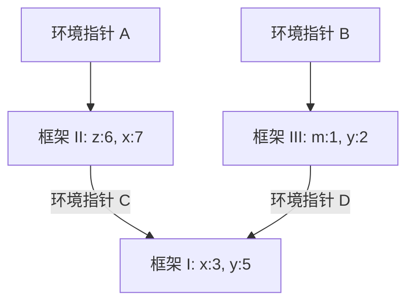

*图3-1 一个简单的环境结构*

### 3.2.1 求值规则

关于解释器如何求值一个组合式的问题，其整体描述仍然与我们在1.1.3节中第一次介绍时完全一样。

- 如果要对一个组合表达式求值：
  1) 求值这一组合式里的各个子表达式[^140]；
  2) 将运算符子表达式的值应用于运算对象子表达式的值。

现在我们要用求值的环境模型代替求值的代换模型，在这一模型里需要特别说明将一个复合过程应用于参数表示的是什么。

在求值的环境模型里，一个过程总是一个对偶，由一些代码和一个指向环境的指针组成。过程只能通过一种方式创建，那就是通过求值一个lambda表达式。这样产生出来的过程的代码来自这一lambda表达式的正文，其环境就是求值这个lambda表达式，产生出这个过程时的那个环境。举个例子，考虑在全局环境里求值下面的过程定义：

```scheme
(define (square x)
  (* x x))
```

过程定义的语法形式，不过是作为其基础的隐含lambda表达式的语法糖衣，上面的定义就像是写成下面等价的表示：

```scheme
(define square
  (lambda (x) (* x x)))
```

其中求值 (lambda (x) (* x x))，并将符号square约束于这一求值得到的结果，这些都是在全局环境中完成的。

图3-2展示的是求值这一define表达式的结果，这里的过程对象是一个序对，其代码部分描述的是一个带有一个形式参数x的过程，过程体是 (* x x)。过程对象的环境部分是一个指向全局环境的指针，因为产生这个过程的lambda表达式是在全局环境中求值的。这个定义在全局框架中加入了一个新约束，将上述过程对象约束于符号square。一般而言，define建立定义的方式就是将新的约束加入框架里。

[^140]: 赋值的存在给求值规则的步骤1引进一个微妙问题。正如练习3.8所述，赋值的存在使我们可以写出一些表达式，如果以不同的顺序对组合式中各个子表达式求值，它们就会产生出不同的值。这样，为了更精确些，我们就需要说明步骤1的特定顺序（例如从左到右）。然而，这种顺序应该总看作是一个实现细节，我们永远也不要去写依赖于特定顺序的程序。举例来说，如果用一个复杂的编译器去做程序的优化，它完全可能改变其中各子表达式的求值顺序。

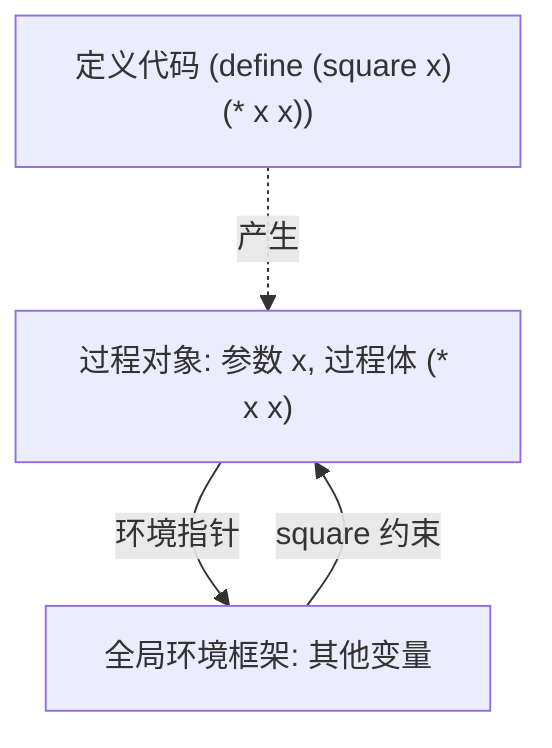

*图3-2 由在全局环境中求值 (define (square x) (* x x)) 而产生的环境结构*

我们已经看到了创建过程的有关情况，现在就可以描述过程的应用了。环境模型说明：在将一个过程应用于一组实际参数时，将会建立起一个新环境，其中包含了将所有形式参数约束于对应的实际参数的框架，该框架的外围环境就是所用的那个过程的环境。随后就在这个新环境之下求值过程的体。

为了演示这一规则的实施情况，图3-3展示了通过在全局环境里对表达式 (square 5) 求值而创建起来的环境结构，其中的square是图3-2里生成的过程。这一过程应用的结果是创建了一个新环境，在图中标记为E1。这个环境从一个框架开始，框架里包含着将这个过程的形式参数x约束于实际参数5。从这一框架引出的指针说明这个框架的外围环境就是全局环境。在这个地方之所以应该选择全局环境，是因为它就是作为square过程对象的一部分的那个环境。现在我们要在E1里求值过程的体 (* x x)。因为在E1里x的值是5，所以求值结果是 (* 5 5)，也就是25。

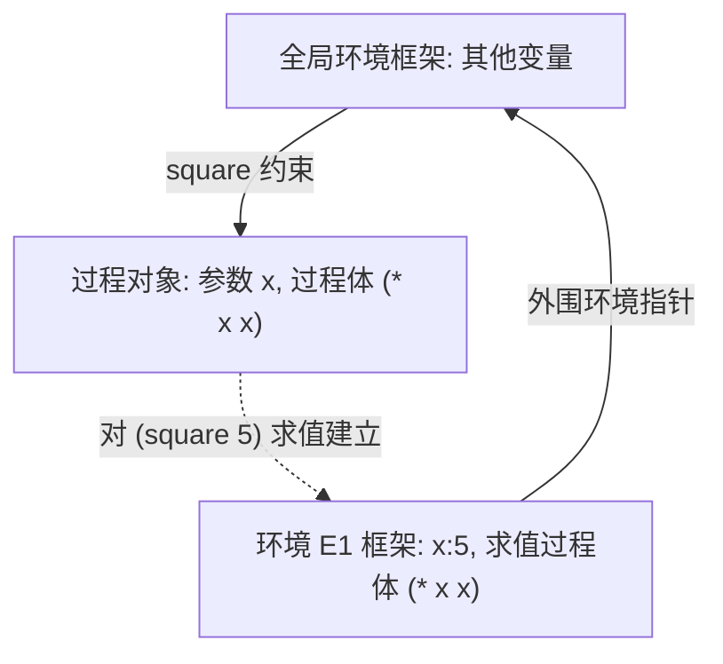

*图3-3 在全局环境里求值 (square 5) 创建出的环境*

我们可以把过程应用的环境模型总结为下面两条规则：

- 将一个过程对象应用于一集实际参数,将构造出一个新框架,其中将过程的形式参数约束到调用时的实际参数,而后在构造起的这一新环境的上下文中求值过程体。这个新框架的外围环境就是作为被应用的那个过程对象的一部分的环境。
- 相对于一个给定环境求值一个lambda表达式,将创建起一个过程对象,这个过程对象是一个序对,由该lambda表达式的正文和一个指向环境的指针组成,这一指针指向的就是创建这个过程对象时的环境。

我们也已经说明了,用define定义一个符号,也就是在当前环境框架里建立一个约束,并赋予这个符号指定的值[^141]。最后让我们来说明set!的行为方式,因为一开始就是由于这个操作的存在,迫使我们引进上述的环境模型。在某个环境里求值表达式 (set! <variable> <value>),要求我们首先在环境中确定有关变量的约束位置,而后再修改这个约束,使之表示这个新值。这也就是说,首先需要找到包含这个变量的约束的第一个框架,而后修改这一框架。如果该变量在环境中没有约束,set!将报告一个错误。

这些求值规则显然比代换规则复杂了许多,但也还是相当直截了当的。进一步说,虽然这一求值模型比较抽象,但它却为解释器对于表达式求值的过程提供了一个正确的描述。在第4章里我们将看到,这一模型如何能成为实现一个可以工作的解释器的蓝图。下面几节将要分析几个具有阐释意义的实例,以进一步揭示这一模型的各方面细节。

### 3.2.2 简单过程的应用

在1.1.5节里介绍代换模型时,我们展示了在有下面的过程定义之后,组合式 (f 5) 怎样求值得到136:

```scheme
(define (square x)
  (* x x))

(define (sum-of-squares x y)
  (+ (square x) (square y)))

(define (f a)
  (sum-of-squares (+ a 1) (* a 2)))
```

现在我们用环境模型来分析同一个实例。图3-4展示出在全局环境里对f、square和sum-of-squares的定义求值后创建起的三个过程对象,每个过程对象都由一些代码和一个指向全局环境的指针组成。

在图3-5里,我们看到的是由对 (f 5) 的求值创建起的环境结构。对于f的调用创建了一个新环境E1,它开始于一个框架,其中f的形式参数a被约束到实参5。我们需要在E1里求值f的体:

```scheme
(sum-of-squares (+ a 1) (* a 2))
```

在求值这个组合式时,首先需要求值其中的子表达式。第一个子表达式sum-of-squares以一个过程对象为值(请注意看这个值是如何找到的:首先在E1的第一个框架中找,这里没有包含sum-of-squares的约束。而后进入有关的外围环境,即全局环境,并在那里找到了图3-4所示的约束)。对另外两个表达式的求值是应用两个基本运算符+和*,通过求值组合式 (+ a 1) 和 (* a 2) 分别得到6和10。

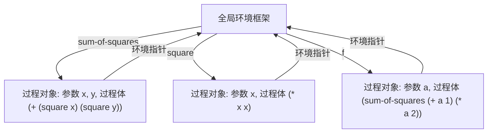

*图3-4 全局框架里的几个过程对象*

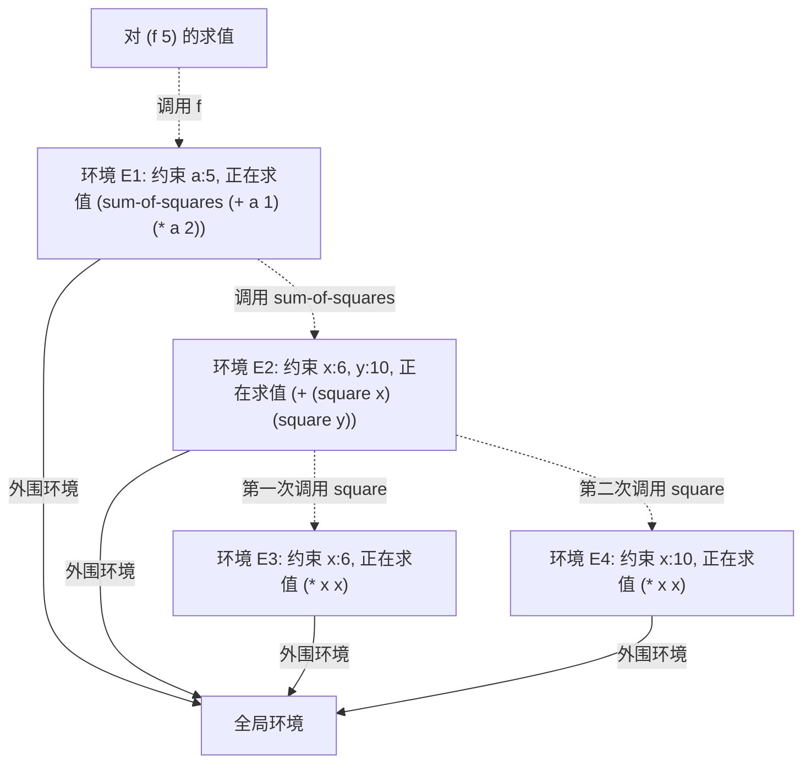

*图3-5 使用图3-4里的过程求值 (f 5) 创建的环境*

现在需要把过程对象sum-of-squares应用于实参6和10,这时得到的是一个新环境E2,形式参数x和y在其中约束于对应的实际参数。现在要做的就是在E2里求值组合式 (+ (square x) (square y))。这进一步要求我们求值 (square x),其中的square从全局环境中找到,而x是6。我们又需要设定另一个新环境E3,其中将x约束到6,并在这里求值square的体 (* x x)。作为sum-of-squares应用的另一部分,我们还必须求值子表达式 (square y),其中的y是10。这是对square的第二个调用,它创建起另一个环境E4,其中square的形式参数x约束到10。我们必须在E4里求值 (* x x)。

这里应注意的要点是,对于square的每个调用都会创建起一个包含着x的约束的新环境。我们可以看到,这里就是通过不同的框架,去维持所有名字为x的局部变量互不相同。还请注意,由square创建的每个框架都指向全局环境,因为这就是对应于square的过程对象所指定的环境。

各个子表达式求值后返回得到的值。对square的两个调用产生的值被sum-of-squares加起来,作为求值的结果返回。因为我们在这一段里关心的是环境结构,因此将不详细考察这些返回值如何在调用之间传递的问题。当然,这件事情也是求值过程中的一个重要方面,我们将在第5章回到这一问题。

**练习3.9** 在1.2.1节里,我们用代换模型分析了两个计算阶乘的函数,递归版本:

```scheme
(define (factorial n)
  (if (= n 1)
      1
      (* n (factorial (- n 1)))))
```

迭代版本:

```scheme
(define (factorial n)
  (fact-iter 1 1 n))

(define (fact-iter product counter max-count)
  (if (> counter max-count)
      product
      (fact-iter (* counter product)
                 (+ counter 1)
                 max-count)))
```

请说明采用过程factorial的上述版本求值 (factorial 6) 时所创建的环境结构[^142]。

### 3.2.3 将框架看作局部状态的展台

现在可以从环境模型出发,看看可以怎样用过程和赋值表示带有局部状态的对象。作为一个例子,还是考虑取自3.1.1节的由调用下面过程创建的"提款处理器":

```scheme
(define (make-withdraw balance)
  (lambda (amount)
    (if (>= balance amount)
        (begin (set! balance (- balance amount))
               balance)
        "Insufficient funds")))
```

让我们仔细看看下式的求值:

```scheme
(define W1 (make-withdraw 100))
```

而后做:

```scheme
(W1 50)
50
```

图3-6展示了在全局环境里定义make-withdraw过程的结果。这一求值产生出一个过程对象,其中包含着一个指向全局环境的指针。到目前为止,在这个实例里还没有出现任何与前面看过的实例不同的东西,除了过程体本身也是一个lambda表达式之外。

计算中的有趣现象出现在将过程make-withdraw应用于一个参数的时候:

```scheme
(define W1 (make-withdraw 100))
```

与平常一样,我们在开始时设置了环境E1,其中将形式参数balance约束到实参100,并在这一环境里求值make-withdraw的体,也就是那个lambda表达式。这一求值构造起一个新过程对象,其代码由这个lambda描述,而它的环境就是E1,也就是求值这个lambda生成该过程对象时的那个环境。这样做出的过程对象被作为调用make-withdraw的返回值,在全局环境里约束于W1,因为对这个define本身的求值是在全局环境里进行的。图3-7显示出这样做的结果得到的环境结构。

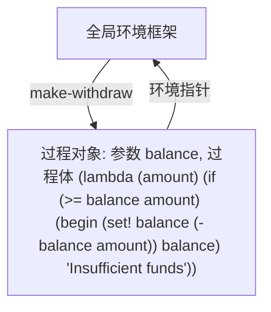

*图3-6 在全局环境里定义make-withdraw的结果*

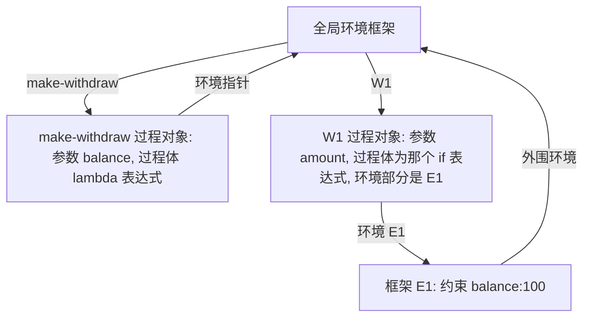

*图3-7 求值 (define W1 (make-withdraw 100)) 的结果*

现在让我们来分析将W1应用于一个参数时所发生的情况:

```scheme
(W1 50)
50
```

此时首先要构造出一个框架,W1的形式参数amount在其中约束到实参50。需要注意的最关键一点是,这个框架的外围环境并不是全局环境,而是环境E1,因为它才是由过程对象W1所指定的环境。现在我们需要在这个新环境里求值下面的过程体:

```scheme
(if (>= balance amount)
    (begin (set! balance (- balance amount))
           balance)
    "Insufficient funds")
```

这样做得到的环境结构如图3-8所示。在被求值的表达式里引用了amount和balance,其中的amount在环境里的第一个框架里找到,而balance则沿着外围环境指针向前在E1里找到。

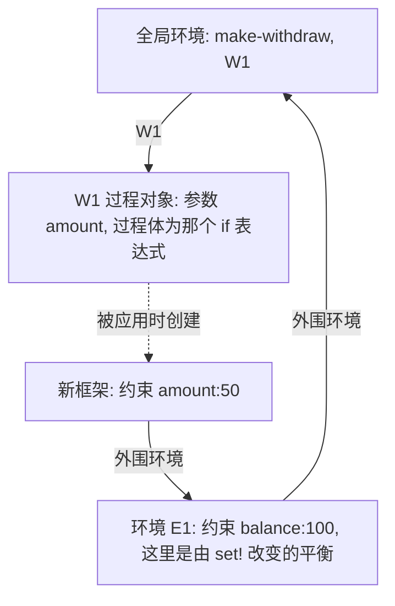

*图3-8 通过应用过程对象W1创建起的环境*

在执行set!时,位于E1里balance的约束就被修改了。对W1的调用完成时,balance是50,而包含着这个balance的框架仍由过程对象W1指着。约束amount的那个框架(我们曾经在其中执行了修改的balance代码)现在已经无关紧要了,因为构造它的过程已经结束,环境中的任何一部分都不再包含指向这个框架的指针。在下次W1被调用时,这一过程又会构造起另一个新框架,其中建立起amount的一个新约束,这一框架的外围环境还是E1。根据上面的分析,我们可以看到E1怎样起着保存过程对象的局部状态变量的"位置"的作用。图3-9展示的是调用W1之后的情景。

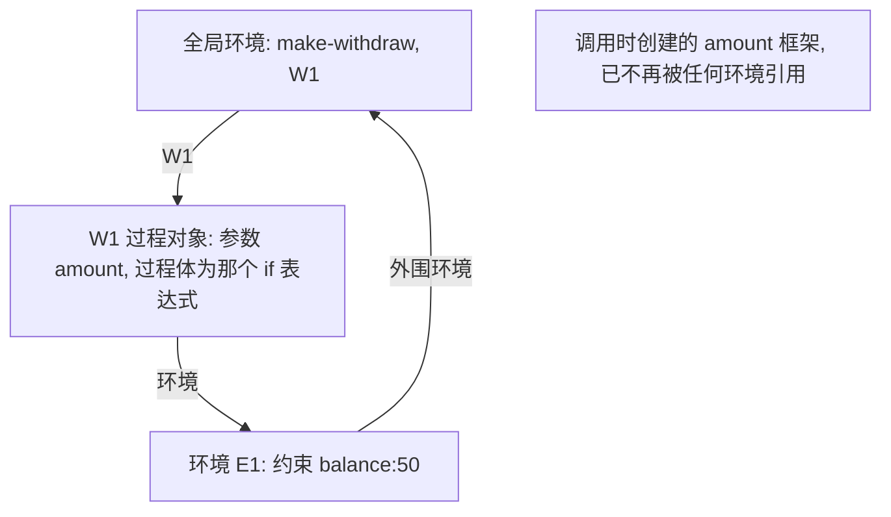

*图3-9 调用W1之后的环境*

现在来看我们通过再次调用make-withdraw,创建起第二个"提款"对象的情况:

```scheme
(define W2 (make-withdraw 100))
```

这样做产生出的环境结构如图3-10所示,其中显示了W2是另一个过程对象,也就是说,是一些代码和一个环境的序对。通过调用make-withdraw为W2创建起的环境是E2,它包含了一个框架,其中包含着它自己的对balance的局部约束。另一方面,W1和W2具有相同的代码,也就是在make-withdraw体内的那个lambda表达式所确定的代码[^143]。我们从这里就可以看到,为什么W1和W2在行为上完全是互相独立的对象。对W1的调用引用的是保存在E1里的状态变量balance,而对W2的调用引用的是E2里的balance。这样,修改一个对象的局部状态当然不会影响到另一个对象。

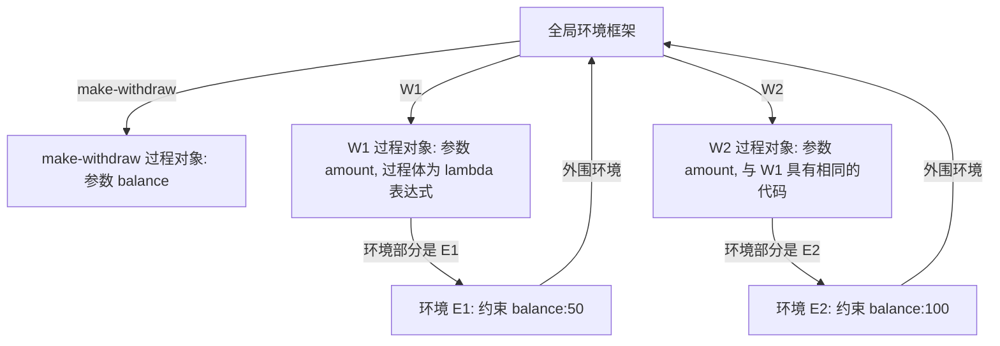

*图3-10 使用 (define W2 (make-withdraw 100)) 创建第2个对象*

**练习3.10** 在make-withdraw过程里,局部变量balance是作为make-withdraw的参数创建的。我们也可以显式地通过使用let创建局部状态变量,就像下面所做的:

```scheme
(define (make-withdraw initial-amount)
  (let ((balance initial-amount))
    (lambda (amount)
      (if (>= balance amount)
          (begin (set! balance (- balance amount))
                 balance)
          "Insufficient funds"))))
```

请重温1.3.2节,let实际上是一个过程调用的语法糖衣:

```scheme
(let ((<var> <exp>)) <body>)
```

它将被解释为

```scheme
((lambda (<var>) <body>) <exp>)
```

的另一种语法形式。请用环境模型分析make-withdraw的这个版本,画出像上面那样的图示,说明调用:

```scheme
(define W1 (make-withdraw 100))

(W1 50)

(define W2 (make-withdraw 100))
```

时的情况并阐释make-withdraw的这两个版本创建出的对象具有相同的行为。两个版本的环境结构有什么不同吗?

### 3.2.4 内部定义

1.1.8节介绍了过程可以有内部定义的思想,这样就引入了块结构,就像下面计算平方根的过程里的情况:

```scheme
(define (sqrt x)
  (define (good-enough? guess)
    (< (abs (- (square guess) x)) 0.001))
  (define (improve guess)
    (average guess (/ x guess)))
  (define (sqrt-iter guess)
    (if (good-enough? guess)
        guess
        (sqrt-iter (improve guess))))
  (sqrt-iter 1.0))
```

现在我们就可以利用上面介绍的环境模型,去考察为什么这些内部定义具有所需要的行为。图3-11所示的是在表达式 (sqrt 2) 求值中的一点,在那里,内部过程good-enough?被第一次调用,其中的guess等于1。

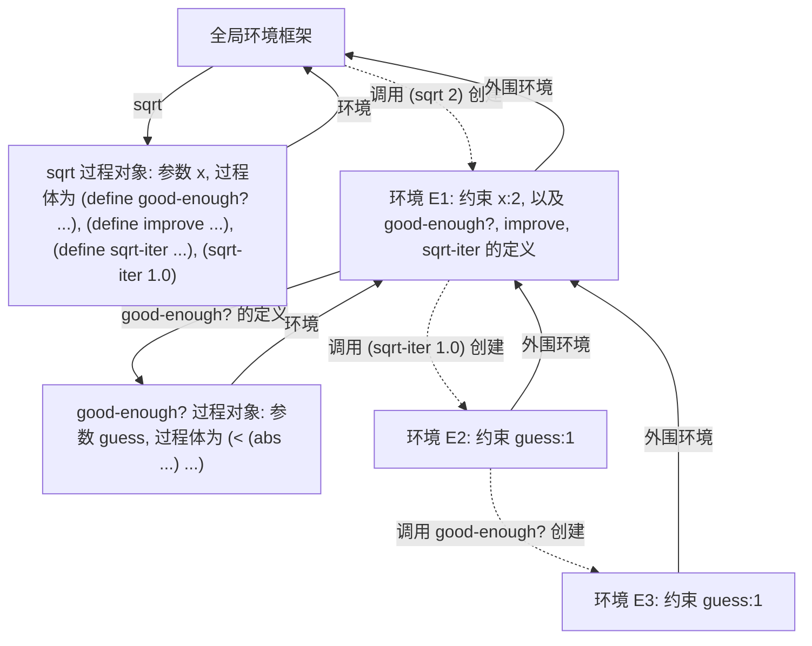

*图3-11 带有内部定义的sqrt过程*

请注意此时的环境结构。sqrt是全局环境里的一个符号,它被约束到一个过程对象,与之关联的环境就是全局环境。在sqrt被调用时,形成了一个新的环境E1,它将成为全局环境的下属。在这里,参数x约束到2,而后在E1里求值sqrt的体。由于sqrt体中的第一个表达式是:

```scheme
(define (good-enough? guess)
  (< (abs (- (square guess) x)) 0.001))
```

对这一表达式的求值在环境E1里定义出过程good-enough?。说得更准确一些,符号good-enough?被加入E1的第一个框架里,并被约束于一个过程对象,其关联环境是E1。与此类似,improve和sqrt-iter也在E1里定义为过程。为了简洁起见,在图3-11里只显示了约束于good-enough?的过程对象。

在定义好各个局部过程之后,表达式 (sqrt-iter 1.0) 被求值,还是在环境E1里。因此,调用在E1里约束于sqrt-iter的过程对象时,我们以1作为实际参数。这一调用创建了另一个环境E2,在其中sqrt-iter的形参guess被约束到1。sqrt-iter转而(从E2里)以guess的值作为实际参数调用good-enough?,这就建立了另一个环境E3,在这个环境里,(good-enough?的参数) guess被约束到1。虽然sqrt-iter和good-enough?里都有名字为guess的形参,但它们是两个不同的局部变量,位于不同的框架里。还有,E2和E3都以E1作为其外围环境,这是因为过程sqrt-iter和good-enough?都以E1作为自己的环境部分。这种情况造成的一个后果就是,出现在good-enough?体内部的符号x将引用出现在E1里的x约束,也就是原来sqrt被调用时的那个x的值。这样,环境模型已经解释清楚了以局部过程定义作为程序模块化的有用技术中的两个关键性质:

- 局部过程的名字不会与包容它们的过程之外的名字互相干扰,这是因为这些局部过程名都是在该过程运行时创建的框架里面约束的,而不是在全局环境里约束的。
- 局部过程只需将包含着它们的过程的形参作为自由变量,就可以访问该过程的实际参数。这是因为对于局部过程体的求值所在的环境是外围过程求值所在的环境的下属。

**练习3.11** 在3.2.3节里我们看到,环境模型能如何用于描述带有局部状态的过程的行为,现在我们又看到局部定义如何工作。一个典型的消息传递过程包含这两个方面。现在请考虑3.1.1节的银行账户过程:

```scheme
(define (make-account balance)
  (define (withdraw amount)
    (if (>= balance amount)
        (begin (set! balance (- balance amount))
               balance)
        "Insufficient funds"))
  (define (deposit amount)
    (set! balance (+ balance amount))
    balance)
  (define (dispatch m)
    (cond ((eq? m 'withdraw) withdraw)
          ((eq? m 'deposit) deposit)
          (else (error "Unknown request -- MAKE-ACCOUNT"
                       m))))
  dispatch)
```

请设法展示由下面交互序列生成的环境结构:

[^141]: 如果在当前框架中已经有了对这一变量的约束,那么该约束就会改变。这样做比较方便,因为它允许符号的重新定义,这当然也就意味着可以用define去修改符号的值,因此,在这里没有显式使用set!却带来了同样的问题。正因为如此,有些人觉得在出现重新定义时应该发出错误或者警告信息。
[^142]: 这种环境模型还不能澄清我们在1.2.1节的断言,那里说解释器使用了尾递归,只需要常量空间就可以执行像fact-iter这样的过程。我们将在5.4节讨论解释器的控制结构时处理尾递归问题。
[^143]: 究竟W1和W2是共享计算机里保存的同一段物理代码,还是各自维持自己的一份拷贝,则完全是一种实现细节。我们在第4章实现的解释器里采用共享代码的方式。

```scheme
(define acc (make-account 50))

((acc 'deposit) 40)
90

((acc 'withdraw) 60)
30
```

acc的局部状态保存在哪里?假定我们定义了另一个账户:

```scheme
(define acc2 (make-account 100))
```

这两个账户的局部状态又是如何保持不同的?环境结构中的哪些部分被acc和acc2共享?

## 3.3 用变动数据做模拟

第2章以复合数据作为构造具有多个部分的计算对象的方法,用于模拟真实世界里具有若干不同侧面的对象。在那章里,我们介绍了数据抽象的系统方法,根据这种方法,各种数据结构应该用构造函数(用于创建数据对象)和选择函数(用于访问复合数据对象中的各个部分)来描述。但是,我们现在又了解到了有关数据结构的另外一些情况,这是第2章中没有涉及的。为了模拟那些由具有不断变化的状态组成的系统,我们除了需要做复合数据对象的构造和成分选择之外,还可能需要修改它们。为了模拟具有不断变化的状态的复合对象,我们将设计出与之对应的数据抽象,使其中不但包含了选择函数和构造函数,还有包含一些称为改变函数的操作,这种操作能够修改有关的数据对象。举例来说,对银行系统的模拟就需要修改账户的余额。这样,表示银行账户的数据结构可能就需要接受下面的操作:

```scheme
(set-balance! <account> <new-value>)
```

它将根据给定的新值修改指定账户的余额。定义了改变函数的数据对象称为变动数据对象。

第2章引进了序对作为构造复合数据的通用"黏结剂"。我们在这一节的开始也首先定义对于序对的改变函数,使序对能够作为构造变动数据对象的基本构件。这些改变函数能够极大地提升序对的表达能力,使人能构造出(我们在2.2节里使用的)序列和树之外的其他数据结构。我们还要给出一些模拟的实例,其中使用了带有局部状态的对象的集合,以便模拟复杂系统的行为。

### 3.3.1 变动的表结构

针对序对的基本操作——cons、car和cdr——能用于构造表结构,或者选出表结构中的各个部分,但它们不能修改表结构。我们至今用过的其他表操作(例如append和list)也都是如此,因为它们都可以基于cons、car和cdr定义出来。要修改表结构就需要新的操作。

针对序对的基本改变函数是set-car!和set-cdr!。set-car!要求两个参数,其中的第一个参数必须是一个序对。set-car!修改这个序对,将它的car指针替换为指向set-car!的第二个参数的指针[^144]。

作为一个例子,我们假定x约束到表((a b) c d),y约束到表(e f),如图3-12所示。

[^144]: set-car!和set-cdr!的返回值依赖于具体实现。与set!一样,我们只应该利用它们的效果。

对表达式(set-car! x y)的求值将修改x约束的那个表,将它的car用y的值取代。这一操作的结果如图3-13所示。从这个图中,我们可以看到结构x被修改了,现在它将被打印为((e f) c d)。原来由被取代的指针标识的那个表示表(a b)的序对,现在已经从原来的结构中摘除了[^145]。

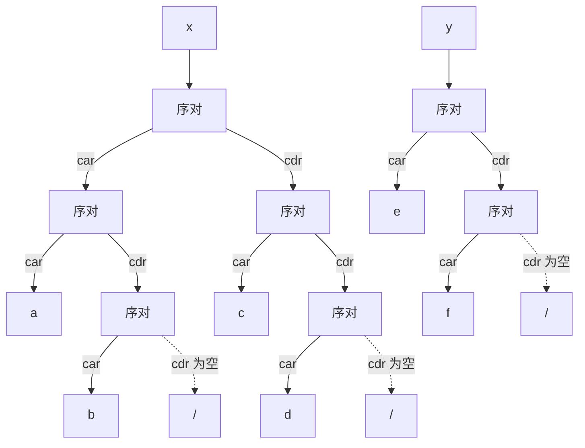

*图3-12 表x:((a b) c d)和y:(e f)*

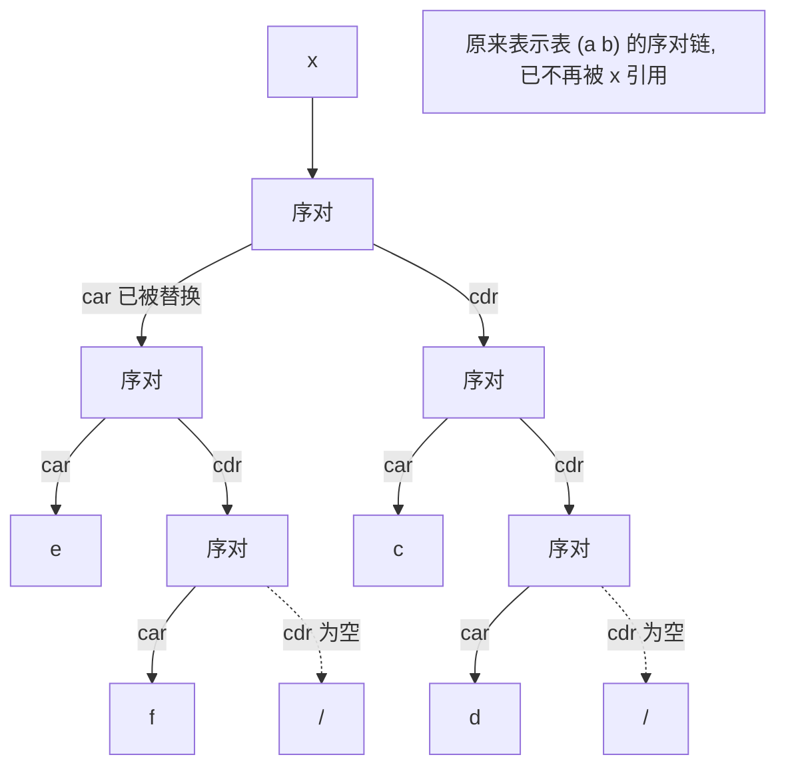

*图3-13 对图3-12的表做(set-car! x y)的效果*

我们可以对图3-13和图3-14做一个比较。图3-14展示的是执行(define z (cons y (cdr x)))的结果,其中x和y约束到图3-12表示的那样的两个表。这一求值使变量z约束到了由操作创建的一个新序对,而x约束的表并没有改变。

set-cdr!操作与set-car!类似,它们之间的差异就在于这里被取代的是序对的cdr指针,而不是car指针。对图3-12中的表执行(set-cdr! x y)的效果如图3-15所示。在这里,x的cdr指针被指向(e f)的指针取代。还有,原来作为x的cdr的表(c d),现在也已经从这一结构里摘掉了。

[^145]: 从这里可以看出,对于表的改变函数可能创建"废料",也就是一些东西,它们不再是任何可访问结构的部分。我们将在5.3.2节里看到,Lisp的存储管理系统中包含着一个废料收集器,它能弄清楚并回收由这种不再使用的序对所占据的存储。

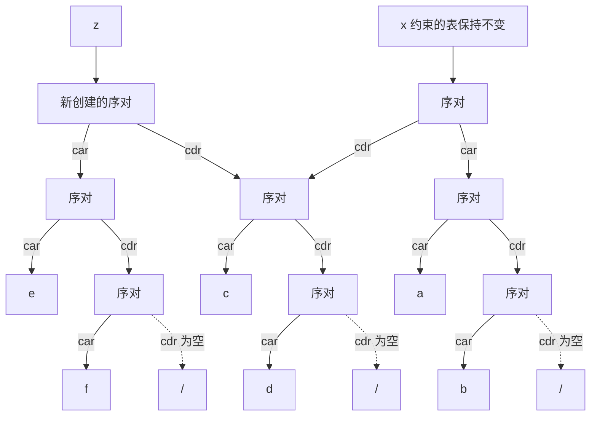

*图3-14 对图3-12的表做(define z (cons y (cdr x)))的效果*

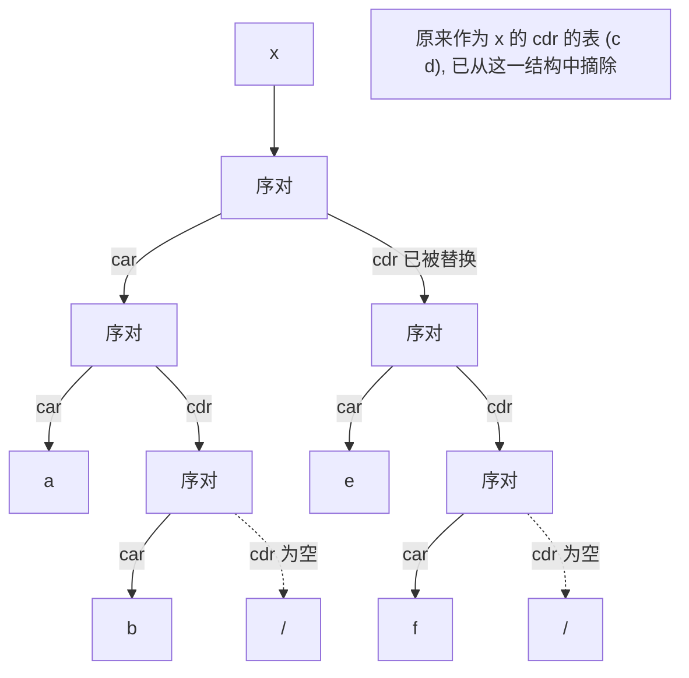

*图3-15 对图3-12的表做(set-cdr! x y)的效果*

cons通过创建新序对的方式构造新的表,而set-car!和set-cdr!则是修改现存的序对。cons可以用两个改变函数和一个过程get-new-pair实现,这个过程返回一个新序对,假定它不是任何现存表结构的组成部分。我们先取得一个序对,而后将它car和cdr的指针分别设置到指定对象,最后返回这个序对作为cons的结果[^146]。

```scheme
(define (cons x y)
  (let ((new (get-new-pair)))
    (set-car! new x)
    (set-cdr! new y)
    new))
```

**练习3.12** 下面是2.2.1节介绍过的拼接表的过程:

```scheme
(define (append x y)
  (if (null? x)
      y
      (cons (car x) (append (cdr x) y))))
```

[^146]: get-new-pair必须作为Lisp系统所需的存储管理功能中的一个操作,5.3.1节将讨论这一问题。

append通过顺序将x的元素cons到y上的方式构造出一个新表。过程append!与append类似,但它是一个改变函数而不是一个构造函数。它将表拼接起来的方式是将两个表粘起来,修改x的最后一个序对,使它的cdr现在变成y(对空的x调用append!将是一个错误)。

```scheme
(define (append! x y)
  (set-cdr! (last-pair x) y)
  x)
```

这里的last-pair是一个过程,它返回其参数中的最后一个序对:

```scheme
(define (last-pair x)
  (if (null? (cdr x))
      x
      (last-pair (cdr x))))
```

考虑下面的交互:

```scheme
(define x (list 'a 'b))

(define y (list 'c 'd))

(define z (append x y))

z
(a b c d)

(cdr x)
<response>

(define w (append! x y))

w
(a b c d)

(cdr x)
<response>
```

其中缺少的那两个<response>是什么?请画出盒子指针图形,解释你的回答。

**练习3.13** 考虑下面的make-cycle过程,其中使用了练习3.12定义的last-pair过程:

```scheme
(define (make-cycle x)
  (set-cdr! (last-pair x) x)
  x)
```

画出盒子指针图形,说明下面表达式创建起的z的结构:

```scheme
(define z (make-cycle (list 'a 'b 'c)))
```

如果我们试着去计算(last-pair z),那会出现什么情况?

**练习3.14** 下面过程相当有用,但也有些费解:

```scheme
(define (mystery x)
  (define (loop x y)
    (if (null? x)
        y
        (let ((temp (cdr x)))
          (set-cdr! x y)
          (loop temp x))))
  (loop x '()))
```

loop里用一个"临时"变量temp保存x的cdr原来的值,因为下一行里的set-cdr!将破坏这个cdr。请一般性地解释mystery做些什么。假定v通过(define v (list 'a 'b 'c 'd))定义,请画出v约束的表对应的盒子指针图形。假定现在求值(define w (mystery v)),请画出求值这个表达式之后结构v和w的盒子指针图形。v和w的值打印出来是什么?

**共享和相等**

在3.1.3节里,我们提出了由于引入赋值而产生的"同一"和"变化"的理论问题。当不同的数据对象共享某些序对时,这些问题就表现到现实中来了。例如,考虑由下面求值形成的结构:

```scheme
(define x (list 'a 'b))
(define z1 (cons x x))
```

正如图3-16所示,这里的z1是一个序对,其car和cdr都指向同一个序对x。这种z1的car和cdr共享x是cons的简单实现方式的自然结果。一般而言,用cons构造出的表结果总是序对的一个相互链接的结构,其中可能会有许多独立的序对被一些不同结构所共享。

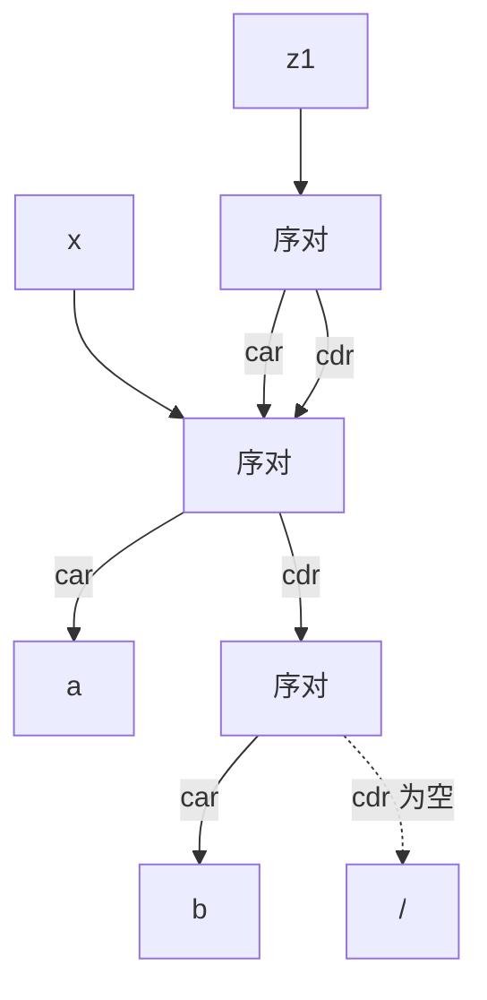

*图3-16 由(cons x x)形成的表z1*

与图3-16不同,图3-17展示的是由下式创建的结构:

```scheme
(define z2 (cons (list 'a 'b) (list 'a 'b)))
```

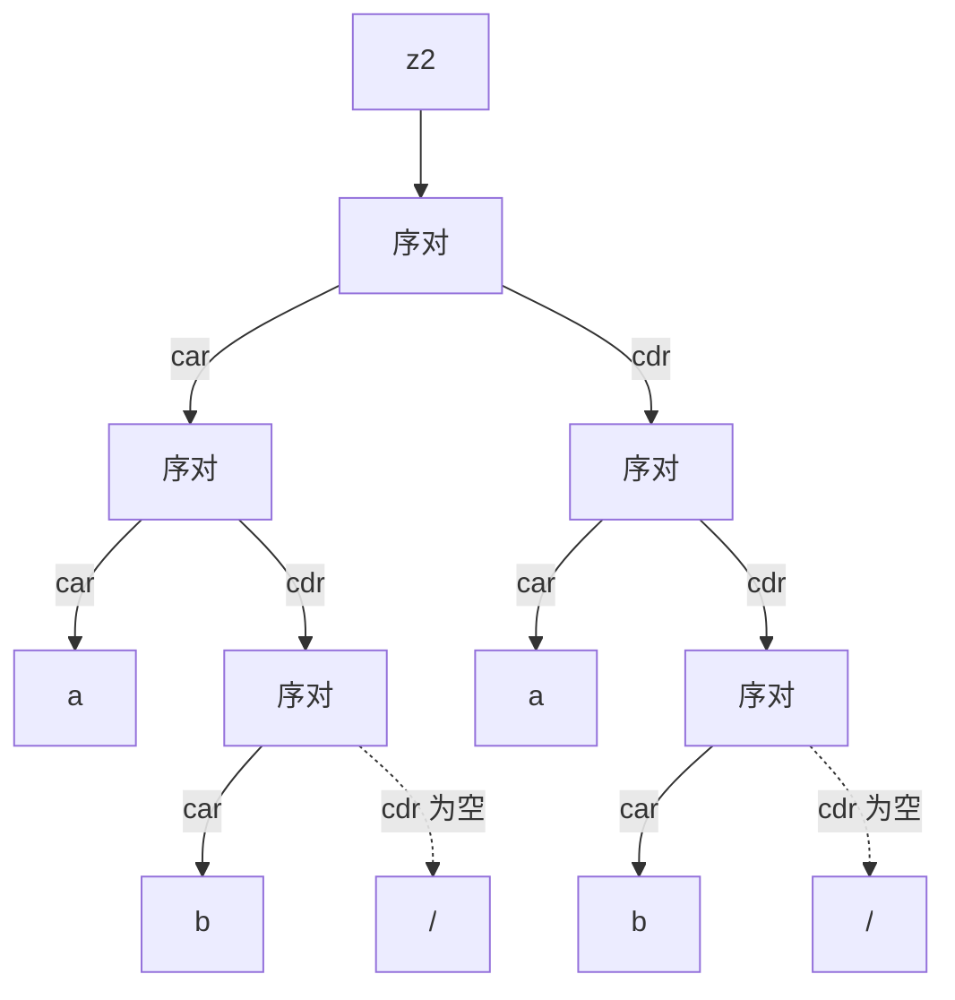

*图3-17 由(cons (list 'a 'b) (list 'a 'b))形成的表z2*

在这一结构中,两个表(a b)的各个序对互不相同,虽然其中的符号是共享的[^147]。

[^147]: 这两个序对不同,是因为对cons的每次调用总返回一个新序对。符号共享是因为在Scheme里对应每个名字的符号是唯一的。因为Scheme不提供改变符号的方式,因此这一共享是不可分辨的。请注意,正是这种共享使我们能用eq?比较符号,这个过程就是简单比较两个指针是否相等。

作为表考虑,z1和z2表示是"同一个"表((a b) a b)。一般而言,如果我们只用cons、car和cdr对各种表进行操作,其中的共享就完全不会被察觉。然而,如果允许改变表结构的话,共享的情况就会显现出来了。作为考察这种共享会产生什么影响的例子,现在考虑下面的过程,它将修改被它应用的那个结构的car:

```scheme
(define (set-to-wow! x)
  (set-car! (car x) 'wow)
  x)
```

[^148]: 在处理变动数据对象的共享问题时,最微妙的地方正好就反应了3.1.3节里提出的有关"同一"和"变化"的基本问题。我们在那里说过,如果希望这个语言里容许做修改,那么每个复合对象就必须有一个"标识",这应该是某种不同于构造起它的那些片段的东西。在Lisp里,我们所认为的"同一"也就是检查客体之间的eq?,采用指针相等的方式。这是因为在大部分Lisp实现里,一个指针本质上就是一个存储地址,在这里"解决"对象标识问题的方式,是假设数据对象"本身"也是一些信息,存储在计算机中某一些特定的存储位置。对于简单的Lisp程序而言,这也就是够了。但是这并不是解决计算模型中"同一"问题的一般性方法。

虽然z1和z2可以看作是"同样的"结构,将set-to-wow!应用于它们,就会产生不同的结果。对于z1而言,修改其car也就同时修改了它的cdr,因为在z1里的car和cdr是同一个序对。而对于z2,由于其car和cdr是不同的,所以set-to-wow!只修改了它的car:

```scheme
z1
((a b) a b)

(set-to-wow! z1)
((wow b) wow b)

z2
((a b) a b)

(set-to-wow! z2)
((wow b) a b)
```

检查表结构是否共享的一种方式是使用谓词eq?,这个谓词在2.3.1节里介绍过,是作为检查两个符号是否相同的手段。说得更一般些,实际上(eq? x y)检查x和y是否为同一个对象(也就是说,x和y作为指针是否相等)。这样,对于图3-16和图3-17所定义的z1和z2,(eq? (car z1) (cdr z1))是真而(eq? (car z2) (cdr z2))是假。

在下一节里我们可以看到,利用共享结构可以极大地扩展能够用序对表示的数据结构的范围。另一方面,共享也可能带来危险,因为对这种结构的修改将会影响那些恰好共享着被修改了的序对的结构。改变函数set-car!和set-cdr!的使用需要特别小心,除非我们很好地理解了数据对象的共享情况,否则使用改变函数就会造成意想不到的结果[^148]。

**练习3.15** 请画出盒子指针图形,解释set-to-wow!对于上面结构z1和z2的作用。

**练习3.16** Ben Bitdiddle决定写一个过程,统计任何一个表结构中的序对个数。"这太简单了,"他说,"任何表结构里序对的个数就是其car部分的统计值加上其cdr部分的统计值,再加上1,以计入当前这个序对"。所以Ben写出了下面过程:

```scheme
(define (count-pairs x)
  (if (not (pair? x))
      0
      (+ (count-pairs (car x))
         (count-pairs (cdr x))
         1)))
```

请说明这一过程并不正确。请画出几个表示表结构的盒子指针图,它们都正好由3个序对构成,而Ben的过程对它们将分别返回3,4,7,或者根本就不返回。

**练习3.17** 请设计出练习3.16中count-pairs过程的一个正确版本,使它对任何结构都能正确返回不同序对的个数。(提示:遍历有关的结构,维护一个辅助性数据结构,用它记录已经计算过的序对的轨迹。)

**练习3.18** 请写一个过程检查一个表,确定其中是否包含环,也就是说,如果某个程序打算通过不断做cdr去找出这个表的结尾,是否会陷入无穷循环。练习3.13构造了这种表。

**练习3.19** 重做练习3.18,采用一种只需要常量空间的算法(需要一种很聪明的想法)。

**改变也就是赋值**

在介绍复合数据时,我们在2.1.3节看到,序对可以纯粹地用过程来表示:

```scheme
(define (cons x y)
  (define (dispatch m)
    (cond ((eq? m 'car) x)
          ((eq? m 'cdr) y)
          (else (error "Undefined operation -- CONS" m))))
  dispatch)

(define (car z) (z 'car))

(define (cdr z) (z 'cdr))
```

这种认识对于变动数据也是对的,我们可以将变动数据对象实现为使用赋值和局部状态的过程。举例说,我们可以扩充上面的序对实现,采用与3.1.1节类似的方式,用make-account实现银行账户的方式处理set-car!和set-cdr!的问题。

```scheme
(define (cons x y)
  (define (set-x! v) (set! x v))
  (define (set-y! v) (set! y v))
  (define (dispatch m)
    (cond ((eq? m 'car) x)
          ((eq? m 'cdr) y)
          ((eq? m 'set-car!) set-x!)
          ((eq? m 'set-cdr!) set-y!)
          (else (error "Undefined operation -- CONS" m))))
  dispatch)

(define (car z) (z 'car))

(define (cdr z) (z 'cdr))

(define (set-car! z new-value)
  ((z 'set-car!) new-value)
  z)

(define (set-cdr! z new-value)
  ((z 'set-cdr!) new-value)
  z)
```

从理论上说,为了表现变动数据的行为,所需要的全部东西也就是赋值。只要将赋值纳入这一语言,我们就引出了所有的问题,不仅是赋值,而且也包括一般性的变动对象[^149]。

**练习3.20** 请画出显示下面一系列表达式的求值过程的环境图示:

[^149]: 而在另一方面,从实现的观点看,赋值要求我们去修改环境,而环境本身也是一个变动数据结构。这样,赋值和变动就具有同等的地位,可以相互实现。

```scheme
(define x (cons 1 2))

(define z (cons x x))

(set-car! (cdr z) 17)

(car x)
17
```

其中使用上面给出的序对的过程实现(请与练习3.11比较)。

### 3.3.2 队列的表示

利用改变函数set-car!和set-cdr!,我们可以用序对构造出一些单靠cons、car和cdr无法构造的数据结构。这一节将展示如何用序对表示一种称为队列的数据结构。3.3.3节将展示如何表示称为表格的数据结构。

一个队列是一个序列,数据项只能从一端插入(这称作队列的末端),只能从另一端删除(队列的前端)。图3-18显示的是一个初始为空的队列,而后插入数据项a和b,而后删除a,又插入c和d,再后又删除b。由于数据项是按照它们插入的顺序删除,因此队列有时也被称为FIFO(先进先出)缓冲区。

| 操作 | 结果的队列 |
|------|------------|
| `(define q (make-queue))` | |
| `(insert-queue! q 'a)` | a |
| `(insert-queue! q 'b)` | a b |
| `(delete-queue! q)` | b |
| `(insert-queue! q 'c)` | b c |
| `(insert-queue! q 'd)` | b c d |
| `(delete-queue! q)` | c d |

*图3-18 队列操作*

按照数据抽象的说法,队列可以看作是由下面一组操作定义的结构:

- 一个构造函数:

  `(make-queue)`

  它返回一个空队列(不包含数据项的队列)。

- 两个选择函数:

  `(empty-queue? <queue>)`

  检查队列是否为空。

  `(front-queue <queue>)`

  返回队列前端的对象,如果队列为空就报告一个错误。它不修改队列。

- 两个改变函数:

  `(insert-queue! <queue> <item>)`

  将数据项插入队列末端,返回修改过的队列作为值。

  `(delete-queue! <queue>)`

  删除队列前端的数据项,并返回修改后的队列作为值。如果删除之前队列为空就报告错误。

由于队列就是数据项的序列,我们当然可以将它表示为一个常规的表。这样,队列的前端就是表的car,向队列中插入数据项就是将一个项附加到表的最后,而从队列里删除一个项就是取这个表的cdr。但是这种表示是相当低效的,这是因为,为了插入一个数据项,我们就必须扫描整个表,直到到达表尾。由于扫描一个表的方法只有通过执行一系列的cdr操作,对于n个项的表,这种扫描就需要Θ(n)步。简单地修改一下表的表示方式,就可以克服这种缺点,使队列操作都只需Θ(1)步就能实现,也就是说,使所需的步数完全与队列的长度无关。

采用表的表示形式,引出的一个问题是为找到表尾需要扫描整个表。这里的原因就在于,表的标准表示方式是用一个序对的链,虽然这样可以很方便地提供一个表的开始指针,但却不能为我们提供访问表尾的方便方法。如果要避免这一缺陷,那就需要修改表示方式,将队列表示为一个表,并带有一个指向表的最后序对的指针。采用了这种方式,如果我们需要插入一个数据项时,那就只需考察这个尾指针,因此就可以避免对表的扫描了。

这样,队列被表示为一对指针front-ptr和rear-ptr,它们分别指向一个常规表中的第一个序对和最后一个序对。由于我们希望队列成为一个可标识对象,为此可以将这两个指针cons起来。这样,队列本身也将是两个指针的cons。图3-19显示了这种表示的情况。

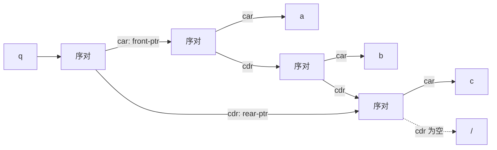

*图3-19 将队列实现为一个带有首尾指针的表*

为了定义出队列的各种操作,我们将使用下面几个过程,它们可以用于选择或者修改队列的前端和末端指针。

```scheme
(define (front-ptr queue) (car queue))

(define (rear-ptr queue) (cdr queue))

(define (set-front-ptr! queue item) (set-car! queue item))

(define (set-rear-ptr! queue item) (set-cdr! queue item))
```

现在我们就可以定义队列的各个实际操作了。如果一个队列的前端指针等于其末端指针,那么就认为这个队列为空:

```scheme
(define (empty-queue? queue) (null? (front-ptr queue)))
```

构造函数make-queue返回一个初始为空的表,也就是一个序对,其car和cdr都是空表:

```scheme
(define (make-queue) (cons '() '()))
```

在需要选取队列前端的数据项时,我们就返回由前端指针指向的序对的car:

```scheme
(define (front-queue queue)
  (if (empty-queue? queue)
      (error "FRONT called with an empty queue" queue)
      (car (front-ptr queue))))
```

要向队列中插入一个数据项,我们将按照图3-20中表明的方式,首先创建起一个新序对,其car是需要插入的数据项,其cdr是空表。如果这一队列原来是空的,那么就让队列的前端指针和后端指针都指向这个新序对。否则就修改队列中最后一个序对,使之指向这个新序对,而后让队列的后端指针也指向这个新序对。

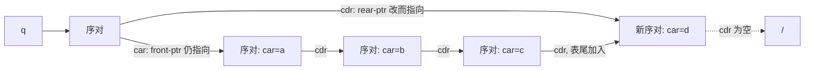

*图3-20 对图3-19的队列使用(insert-queue! q 'd)的结果*

```scheme
(define (insert-queue! queue item)
  (let ((new-pair (cons item '())))
    (cond ((empty-queue? queue)
           (set-front-ptr! queue new-pair)
           (set-rear-ptr! queue new-pair)
           queue)
          (else
           (set-cdr! (rear-ptr queue) new-pair)
           (set-rear-ptr! queue new-pair)
           queue))))
```

要从队列的前端删除一个数据项,我们只需要修改队列的前端指针,使它指向队列中的第二个数据项。通过队列中第一项的cdr指针就可以找到这个项(参见图3-21)[^150]:

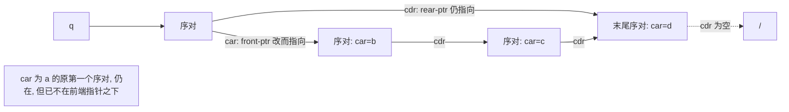

*图3-21 对图3-20的队列使用(delete-queue! q)的结果*

```scheme
(define (delete-queue! queue)
  (cond ((empty-queue? queue)
         (error "DELETE! called with an empty queue" queue))
        (else
         (set-front-ptr! queue (cdr (front-ptr queue)))
         queue)))
```

[^150]: 如果队列的第一个数据项也是最后一个,在删除之后前端指针将变成空表,这也就会使队列变成空的。此时不必去关心末端指针,虽然它还指着那个被删除的数据项。因为empty-queue?只看前端指针。

**练习3.21** Ben Bitdiddle决定对上面描述的队列实现做一些测试,他顺序地给Lisp解释器输入了下面的测试表达式:

```scheme
(define q1 (make-queue))

(insert-queue! q1 'a)
((a) a)

(insert-queue! q1 'b)
((a b) b)

(delete-queue! q1)
((b) b)

(delete-queue! q1)
(() b)
```

"不对",他抱怨说,"解释器的响应说明最后一个数据项被插入了队列两次,因为我把两个数据项都删除了,但是第二个还在那里。因此此时这个表不空,虽然它应该已经空了。"Eva Lu Ator说是Ben错误理解了所出现的情况。"这里根本没有数据项进入队列两次的事情",她解释说,"问题不过是Lisp的标准输出函数不知道应如何理解队列的表示。如果你希望能看到队列的正确打印结果,你就必须自己去为队列定义一个打印过程。"请解释Eva Lu说的是什么意思,特别是说明,为什么Ben的例子产生出那样的输出结果。请定义一个过程print-queue,它以队列为输入,打印出队列里的数据项序列。

**练习3.22** 除了可以用一对指针表示队列外,我们也可以将队列构造成一个带有局部状态的过程。这里的局部状态由指向一个常规表的开始和结束指针组成。这样,过程make-queue将具有下面的形式:

```scheme
(define (make-queue)
  (let ((front-ptr ...)
        (rear-ptr ...))
    <内部过程定义>
    (define (dispatch m) ...)
    dispatch))
```

请完成make-queue的定义,进而采用这一表示提供队列操作的实现。

**练习3.23** 双端队列(deque)也是一种数据项的序列,其中的数据项可以从前端或后端插入和删除。双端队列的操作包括构造函数make-deque,谓词empty-deque?,选择函数front-deque、rear-deque,改变函数front-insert-deque!、rear-insert-deque!、front-delete-deque!、rear-delete-deque!。请说明如何用序对表示双端队列,并给出各个操作的实现。所有操作都应该在Θ(1)步骤内完成[^151]。

[^151]: 请当心,不要让解释器试图去打印一个包含环的结构(参见练习3.13)。

### 3.3.3 表格的表示

在第2章里研究集合表示的各种方式时,我们曾经在2.3.3节提到过有关维护一个由标识关键码索引的记录表格的问题。在2.4.3节里实现数据导向的程序设计时,也大量地使用了二维表格,在其中存储着有关的信息,用两个关键码去提取。现在我们要考察如何用一种变动的表结构来实现表格。

我们首先考虑一维表格的问题,在这种表格里,每个值保存在一个关键码之下。我们要将这种表格实现为一个记录的表,其中的每个记录实现为由一个关键码和一个关联值组成的序对。将这些记录连接起来构成一个序对的表,让这些序对的car指针顺序指向各个记录。这些作为连接结构的序对就成为这一表格的骨架。为了在向表格里加入记录时能有一个可以修改的位置,我们将这种表格构造为一种带表头单元的表。带表头单元的表在开始处有一个特殊的骨架序对,其中保存着一个哑"记录"——目前在这里存放一个特殊符号*table*。图3-22显示了下面表格的盒子指针图。

```
a: 1
b: 2
c: 3
```

```mermaid
flowchart LR
    T["table"] --> H["头骨架序对"]
    H -->|"car"| ST["哑记录: 符号 *table*"]
    H -->|"cdr"| R1["记录序对"]
    R1 -->|"car"| KA["关键码 a"]
    R1 -->|"cdr"| V1["值 1"]
    R1 -.->|"骨架 cdr 链接"| R2["记录序对"]
    R2 -->|"car"| KB["关键码 b"]
    R2 -->|"cdr"| V2["值 2"]
    R2 -.->|"骨架 cdr 链接"| R3["记录序对"]
    R3 -->|"car"| KC["关键码 c"]
    R3 -->|"cdr"| V3["值 3"]
```

*图3-22 带表头单元的表*

为了从表格里提取信息,我们用了一个lookup过程,它以一个关键码为参数,返回与之相关联的值(如果在这个关键码之下没有值就返回假)。lookup是基于assoc操作定义的,这一操作要求一个关键码和一个记录的表作为参数。请注意,assoc根本不去看那个哑记录,它返回以给定关键码为car的那个记录[^152]。lookup检查由assoc返回的结果记录是否为假,而后返回该记录中的值(其cdr)。

```scheme
(define (lookup key table)
  (let ((record (assoc key (cdr table))))
    (if record
        (cdr record)
        false)))

(define (assoc key records)
  (cond ((null? records) false)
        ((equal? key (caar records)) (car records))
        (else (assoc key (cdr records)))))
```

要在一个表格里某个特定的关键码之下插入一个值,我们首先用assoc查看该表格里是否已经有以此作为关键码的记录。如果没有就cons起这个关键码和相应的值,构造出一个新记录,并将它插入到记录表的最前面,位于哑记录之后。如果表格里已经有了具有该关键码的记录,那么就将该记录的cdr设置为这个新值。表格的头单元为我们提供了一个明确的位置,使我们在插入新记录时能确定相应的修改位置[^153]。

[^152]: 由于assoc里用的是equal?,它能允许以符号、数值或者表结构作为关键码。

```scheme
(define (insert! key value table)
  (let ((record (assoc key (cdr table))))
    (if record
        (set-cdr! record value)
        (set-cdr! table
                  (cons (cons key value) (cdr table)))))
  'ok)
```

在构造一个新表格时,我们只需要创建起一个包含符号*table*的表:

```scheme
(define (make-table)
  (list '*table*))
```

**二维表格**

二维表格里的每个值由两个关键码索引。我们可以将这种表格构造为一个一维表格,其中的每个关键码又标识了一个子表格。图3-23中的盒子指针图表示的是下面表格:

```mermaid
flowchart LR
    T["table"] --> H["头骨架序对"]
    H -->|"car"| ST["符号 *table*"]
    H -->|"cdr"| E1["入口序对: 关键码 letters"]
    E1 -->|"子表格"| S1["子表格 letters"]
    S1 -->|"car"| R1["记录序对: (a 97)"]
    R1 -->|"顺序链接"| R2["记录序对: (b 98)"]
    R2 -.->|"cdr 为空"| N1["/"]
    H -->|"cdr 链接"| E2["入口序对: 关键码 math"]
    E2 -->|"子表格"| S2["子表格 math"]
    S2 -->|"car"| R3["记录序对: (+ 43)"]
    R3 -->|"顺序链接"| R4["记录序对: (- 45)"]
    R4 -->|"顺序链接"| R5["记录序对: (* 42)"]
    R5 -.->|"cdr 为空"| N2["/"]
```

*图3-23 一个二维表格*

```
math:
    +: 43
    -: 45
    *: 42
letters:
    a: 97
    b: 98
```

[^153]: 这样,第一个骨架序对也就成为代表这个表列"本身"的对象,也就是说,指向这个表列的指针就是指向这个序对的指针。这个骨架序对总代表着表列的开始。如果我们不采用这种安排方式,insert!过程每次向表列中加入一个新记录后,就需要返回表列的新起始位置。

这其中有两个子表格。(子表格并不需要特殊的头单元符号,因为标识子表格的关键码就能起到这一作用。)

在需要查找一个数据项时,我们先用第一个关键码确定对应的子表格,而后用第二个关键码在这个子表格里确定记录。

```scheme
(define (lookup key-1 key-2 table)
  (let ((subtable (assoc key-1 (cdr table))))
    (if subtable
        (let ((record (assoc key-2 (cdr subtable))))
          (if record
              (cdr record)
              false))
        false)))
```

如果需要将一个新数据项插入到一对关键码之下,我们首先用assoc去查看在第一个关键码下是否存在一个子表格。如果没有,那么就构造起一个新的子表格,其中只包含一个记录(key-2, value),并将这一子表格插入到表格中的第一个关键码之下。如果表格里已经有了对应于第一个关键码的子表格,那么就将新值插入该子表格,用的就是上面所述的在一维表格中插入的方法:

```scheme
(define (insert! key-1 key-2 value table)
  (let ((subtable (assoc key-1 (cdr table))))
    (if subtable
        (let ((record (assoc key-2 (cdr subtable))))
          (if record
              (set-cdr! record value)
              (set-cdr! subtable
                        (cons (cons key-2 value)
                              (cdr subtable)))))
        (set-cdr! table
                  (cons (list key-1
                              (cons key-2 value))
                        (cdr table)))))
  'ok)
```

**创建局部表格**

上面定义的lookup和insert!操作都以表格作为一个参数,这也使我们可以将它们用到包含多个表格的程序里。处理多个表格的另一种方式是为每个表格提供一对独立的lookup和insert!过程。为了能够这样做,我们可以用过程的方式表示表格,将表格表示为一个以局部状态的方式维持着一个内部表格的对象。在接到一个适当的消息时,这种"表格对象"将提供相应的过程,实现对内部表格的各种操作。下面就是一个采用这种方式表示二维表格的生成器:

```scheme
(define (make-table)
  (let ((local-table (list '*table*)))
    (define (lookup key-1 key-2)
      (let ((subtable (assoc key-1 (cdr local-table))))
        (if subtable
            (let ((record (assoc key-2 (cdr subtable))))
              (if record
                  (cdr record)
                  false))
            false)))
    (define (insert! key-1 key-2 value)
      (let ((subtable (assoc key-1 (cdr local-table))))
        (if subtable
            (let ((record (assoc key-2 (cdr subtable))))
              (if record
                  (set-cdr! record value)
                  (set-cdr! subtable
                            (cons (cons key-2 value)
                                  (cdr subtable)))))
            (set-cdr! local-table
                      (cons (list key-1
                                  (cons key-2 value))
                            (cdr local-table)))))
      'ok)
    (define (dispatch m)
      (cond ((eq? m 'lookup-proc) lookup)
            ((eq? m 'insert-proc!) insert!)
            (else (error "Unknown operation -- TABLE" m))))
    dispatch))
```

利用make-table,我们就能做出在2.4.3节里为做数据导向的程序设计而用的get和put操作了。它们的实现如下:

```scheme
(define operation-table (make-table))
(define get (operation-table 'lookup-proc))
(define put (operation-table 'insert-proc!))
```

过程get以两个关键码为参数,put以两个关键码和一个值为参数。这两个操作都访问同一个局部表格,这一表格被封装在由对make-table的调用创建起的对象里面。

**练习3.24** 在上面的表格实现里,对于关键码的检查用equal?比较是否相等(它被assoc调用)。这一检查方式并不一定总是合适的。举例来说,我们可能需要一个采用数值关键码的表格,对于这种表格,我们需要的不是找到对应数值的准确匹配,而是可以是一点容许误差的数值。请设计一个表格构造函数make-table,它以一个same-key?过程作为参数,用这个过程检查关键码的"相等"与否。make-table过程应该返回一个过程dispatch,可以通过它去访问对应于局部表格的lookup和insert!过程。

**练习3.25** 请推广一维表格和二维表格的概念,说明如何实现一种表格,其中的值可以保存在任意多个关键码之下,不同的值可能对应于不同数目的关键码。对应的lookup和insert!过程以一个关键码的表作为参数去访问这一表格。

**练习3.26** 为了在上面这样实现的表格中检索,我们就需要扫描这个记录表。从本质上说,这就是2.3.3节中的无序表表示方式。对于很大的表格,以其他方式构造表格可能更加高效。请描述一种表格实现,其中的(key, value)记录用二叉树形式组织起来。这要假定关键码能够以某种方式排序(例如,数值序或者字典序)。(请与第2章的练习2.66比较。)

**练习3.27** 记忆法(memoization,或称表格法,tabulation)是一种技术,采用这种技术的过程将把前面已经算出的一些值记录在局部状态里。这种技术可能大大改变一个程序的性能。在一个采用记忆法的过程里维持着一个表格,其中保存着前面已经做过的调用求出的值,以产生这些值的实际参数作为关键码。当这种过程被调用去计算某个值时,它首先检查有关的表格,看看相应的值是否已经在那里,如果找到了就直接返回这个值;否则就以正常方式计算出相应的值,并将它保存到这个表格里。作为记忆性过程的一个例子,让我们重温一下1.2.2节里计算斐波那契数的指数计算过程:

```scheme
(define (fib n)
  (cond ((= n 0) 0)
        ((= n 1) 1)
        (else (+ (fib (- n 1))
                 (fib (- n 2))))))
```

同一过程的带记录版本是:

```scheme
(define memo-fib
  (memoize (lambda (n)
             (cond ((= n 0) 0)
                   ((= n 1) 1)
                   (else (+ (memo-fib (- n 1))
                            (memo-fib (- n 2))))))))
```

其中的记录器定义为:

```scheme
(define (memoize f)
  (let ((table (make-table)))
    (lambda (x)
      (let ((previously-computed-result (lookup x table)))
        (or previously-computed-result
            (let ((result (f x)))
              (insert! x result table)
              result))))))
```

请为(memo-fib 3)的计算画出一个环境图,解释为什么memo-fib能以正比于n的步数计算出第n个斐波那契数。如果简单地将memo-fib定义为(memoize fib),这一模式还能工作吗?

### 3.3.4 数字电路的模拟器

设计复杂的数字系统,例如计算机,是一种非常重要的工程活动。数字系统都是通过连接一些简单元件构造起来的。虽然这些元件单独看起来功能都很简单,它们连接起来形成的网络就可能产生非常复杂的行为。对提出的电路设计做计算机模拟,是一种数字系统工程师广泛使用的重要工具。在这一节里,我们要设计一个执行数字逻辑模拟的系统。这一系统是通常称为事件驱动的模拟程序的一个典型代表,在这类系统里,一些活动("事件")引发另一些在随后时间发生的事件,它们又会引发随后的时间,并如此继续下去。

我们有关电路的计算模型将由一些对象组成,它们对应于构造电路时所用的那些基本构件。这里也有连线,它们能传递数字信号。一个数字信号在任何时刻都只能具有0或1这两个可能值之一。这里还有许多不同种类的功能块,它们连接着一些输入信号的连线和另外一些输出连线。这种功能块从它们的输入信号计算出相应的输出信号。输出信号有一个延迟,具体情况依赖于功能块的种类。例如,反门是一种基本功能块,它们对输入求反。如果一个反门的输入信号变为0,那么在一个反门延迟时间单位之后,这个反门就将其输出信号改变为1。如果一个反门的输入信号改变为1,那么在一个反门延迟时间单位之后,这个反门就将其输出信号改变为0。图3-24里画出了表示反门的符号。一个与门(如图3-24里所示)也是一个基本功能块,它有两个输入和一个输出,以其输入的逻辑与作为输出信号的值。也就是说,当一个与门的两个输入信号都变为1时,在一个与门延迟时间单位之后,该与门将产生1作为输出信号,否则其输出就是0。或门是另一种类似的功能块,以其输入的逻辑或作为输出信号的值。也就是说,当且仅当一个或门的两个输入信号之一为1时,其输出为1,否则其输出就是0。

*图3-24 数字逻辑模拟器的基本功能部件*(图中并排画出三种门的符号:反门为一个三角形,输入端带一条水平连线,输出端带一个小圆圈;与门为一个半圆形盒状符号,左侧两条输入水平线,右侧一条输出水平线;或门为一个带凹弧前缘的盾形符号,同样左侧两条输入线、右侧一条输出线。)

我们可以将一些基本功能部件连接起来,构造出更复杂的功能。为此只需将一些功能块的输出连线接到另一些功能块的输入。举个例子,图3-25展示的是一个半加器电路,其中包括一个或门、两个与门和一个反门。这一半加器有两个输入信号A和B,以及两个输出信号S和C。当恰好A和B之一为1时,S将变成1,而当A和B都为1时C变成1。从这个图形可以看出,由于延迟的存在,这些输出可能在不同的时间产生,有关数字电路设计的许多困难都源于此。

```mermaid
flowchart LR
    A["输入 A"] --> OR["或门"]
    B["输入 B"] --> OR
    OR -->|"信号 D"| AND2["与门"]
    A --> AND1["与门"]
    B --> AND1
    AND1 -->|"信号 C"| INV["反门"]
    INV -->|"信号 E"| AND2
    AND2 -->|"输出"| S["输出 S"]
    AND1 -->|"输出"| C["输出 C"]
```

*图3-25 半加器*(方框电路内:A和输入B经一个或门产生信号D;A和B经一个与门产生信号C;C经一个反门产生信号E;D和E再经一个与门产生输出S。)

我们现在要构造出一个程序,它能够模拟我们希望研究的各种数字逻辑电路。这一程序将构造出模拟连线的计算对象,它们能够"保持"信号。电路里的各种功能块用过程模拟,它们产生出信号之间的正确关系。

这一模拟中的一个最基本元素是过程`make-wire`,它用于构造连线。举例来说,我们可以像下面这样构造出6条连线:

```scheme
(define a (make-wire))
(define b (make-wire))
(define c (make-wire))
(define d (make-wire))
(define e (make-wire))
(define s (make-wire))
```

如果需要将一个功能块连到一组连线上,我们就调用一个构造这类功能块的过程,提供给该构造过程的实际参数就是连接到这一功能块的那些连线。例如,有了上面的连线,我们可以如下构造出与门、或门和反门,并将它们连接成图3-25所示的半加器:

```scheme
(or-gate a b d)
ok

(and-gate a b c)
ok

(inverter c e)
ok

(and-gate d e s)
ok
```

为了做得更好一点,我们还应该为这种操作命名,定义出一个过程`half-adder`,它能构造出这种电路,并将送给它的四条外部连线接到这个半加器上:

```scheme
(define (half-adder a b s c)
  (let ((d (make-wire)) (e (make-wire)))
    (or-gate a b d)
    (and-gate a b c)
    (inverter c e)
    (and-gate d e s)
    'ok))
```

做出这种定义的优点,就在于我们又可以用`half-adder`本身作为基本构件,去创建更复杂的电路。例如,图3-26显示的是一个全加器,它由两个半加器和一个或门组成[^154]。我们可以用如下方式构造出全加器:

```mermaid
flowchart LR
    A["输入 A"] --> HA1["半加器"]
    B["输入 B"] --> HA1
    B --> HA2["半加器"]
    CIN["输入 C_in"] --> HA2
    HA1 -->|"中间连线"| OR["or 或门"]
    HA2 -->|"中间连线"| OR
    HA2 -->|"输出"| SUM["SUM"]
    OR -->|"输出"| COUT["C_out"]
```

*图3-26 全加器*(方框内:输入A和输入B接第一个标着"半加器"的方框;B和输入C_in接第二个"半加器"方框;两个半加器各送出一条中间连线,第二个半加器的输出为SUM;两个半加器的中间连线再进入一个标着or的或门,其输出为C_out。)

```scheme
(define (full-adder a b c-in sum c-out)
  (let ((s (make-wire))
        (c1 (make-wire))
        (c2 (make-wire)))
    (half-adder b c-in s c1)
    (half-adder a s sum c2)
    (or-gate c1 c2 c-out)
    'ok))
```

将全加器定义为过程之后,我们就又可以利用它作为构件,去创建更复杂的电路了(例如,练习3.30)。

[^154]: 全加器是二进制数求和所用的基本电路元件。这里的A和B是两个被加数中对应位置上的二进制位,C_in是从被加位的右边来的进位。这一电路产生出的SUM是表示对应位置之和的二进制位,而C_out是传递给左边位置的进位。

从本质上看,模拟器为我们提供了一种工具,作为构造电路的一种语言。如果我们采纳有关语言的一般性观点,就像在1.1节里研究Lisp时所做的那样,那么就可以说,各种基本功能块形成了这个语言的基本元素,将功能块连接起来就是这里的组合方法,而将特定的连接模式定义为过程就是这里的抽象方法。

**基本功能块**

基本功能块实现一种"效能",使得在一根连线上的信号变化能够影响其他连线上的信号。为了构造出这些功能块,我们需要连线上的如下操作:

- `(get-signal ⟨wire⟩)` 返回连线上信号的当前值。
- `(set-signal! ⟨wire⟩ ⟨new-value⟩)` 将连线上的信号修改为新的值。
- `(add-action! ⟨wire⟩ ⟨procedure of no arguments⟩)` 它断言,只要在连线上的信号值改变,这里所指定过程就需要运行。这种过程是一些媒介,它们能够将相应连线上的值的变化传递到其他的连线。除这些过程之外,我们还要用一个过程`after-delay`,它的参数是一个时间延迟和一个过程,`after-delay`将在给定的时延之后执行这一指定过程。

利用这些过程,我们就可以定义基本的数字逻辑功能了。为了把输入通过一个反门连接到输出,我们应该用`add-action!`为输入线路关联一个过程,当输入线路的值改变时,这一过程就会执行。下面这个过程计算出输入信号的`logical-not`,在一个`inverter-delay`之后将输出线路设置为这个新值:

```scheme
(define (inverter input output)
  (define (invert-input)
    (let ((new-value (logical-not (get-signal input))))
      (after-delay inverter-delay
                   (lambda ()
                     (set-signal! output new-value)))))
  (add-action! input invert-input)
  'ok)

(define (logical-not s)
  (cond ((= s 0) 1)
        ((= s 1) 0)
        (else (error "Invalid signal" s))))
```

与门的情况稍微复杂一点,因为在这种门的两个输入之一变化后,相应的动作过程都必须运行。下面过程计算出输出线路上信号值的`logical-and`(利用一个类似于`logical-not`的过程),并在一个`and-gate-delay`之后设置新值,使之出现在输出线路上。

```scheme
(define (and-gate a1 a2 output)
  (define (and-action-procedure)
    (let ((new-value
           (logical-and (get-signal a1) (get-signal a2))))
      (after-delay and-gate-delay
                   (lambda ()
                     (set-signal! output new-value)))))
  (add-action! a1 and-action-procedure)
  (add-action! a2 and-action-procedure)
  'ok)
```

**练习3.28** 请将或门定义为一个基本功能块。你的`or-gate`构造函数应该和上面`and-gate`的构造函数类似。

**练习3.29** 构造或门的另一方式是将它作为一种复合的数字逻辑设备,用与门和反门构造出或门。请采用这种方式定义出`or-gate`。如何用`and-gate-delay`和`inverter-delay`表示这样定义的或门的延时?

**练习3.30** 图3-27展示的是通过串接起*n*个全加器组成的一个级联进位加法器。这是用于求*n*位二进制数之和的并行加法器的最简单形式。输入A₁, A₂, A₃, …, Aₙ与B₁, B₂, B₃, …, Bₙ是需要求和的两个二进制数(每个Aₖ和Bₖ都是0或者1)。这一电路产生出与之对应的和的*n*个二进制位S₁, S₂, S₃, …, Sₙ,以及这一求和的最终进位值C。请写出一个过程`ripple-carry-adder`生成这种电路,该过程应以各包含着*n*条线路的三个表——Aₖ、Bₖ和Sₖ——作为输入,还有另一线路C。级联进位加法器的主要缺点是需要等待进位信号向前传播。请设法确定,为了得到*n*位级联进位加法器的完整输出,我们将需要怎样的时延。请用与门、或门和反门的时延表示这种加法器的这一时延。

```mermaid
flowchart LR
    CIN["进位输入 C"] --> FA1["全加器 FA: 输入 A₁ B₁, 输出 S₁"]
    FA1 -->|"进位线 C₁"| FA2["全加器 FA: 输入 A₂ B₂, 输出 S₂"]
    FA2 -->|"进位线 C₂"| FA3["全加器 FA: 输入 A₃ B₃, 输出 S₃"]
    FA3 -->|"进位线……"| FAn["全加器 FA: 输入 Aₙ Bₙ, 输出 Sₙ"]
    ZERO["进位输入 Cₙ = 0"] --> FAn
    FAn -->|"进位输出"| COUT["Cₙ₋₁"]
```

*图3-27 一个对n位二进制数的逐位进位加法器*(一串全加器方框FA从左到右串接:最左FA的进位输入为C;每个FA有输入A₁B₁、A₂B₂、A₃B₃,……直至AₙBₙ,相邻FA之间用进位线C₁、C₂等连接;最右FA的进位输入为Cₙ=0;每个FA下方输出S₁、S₂、S₃,……直至Sₙ,最右FA的进位输出为Cₙ₋₁。)

**线路的表示**

在这种模拟中,一条线路也就是一个具有两个局部状态变量的计算对象:其中一个是信号值`signal-value`(其初始值取0),另一个是一组过程`action-procedures`,在信号值改变时,这些过程都需要运行。我们将采用消息传递的风格,把线路实现为一组局部过程和一个`dispatch`过程,它负责选取适当的局部操作,这也就是我们在3.1.1节里处理简单银行账户时的做法:

```scheme
(define (make-wire)
  (let ((signal-value 0) (action-procedures '()))
    (define (set-my-signal! new-value)
      (if (not (= signal-value new-value))
          (begin (set! signal-value new-value)
                 (call-each action-procedures))
          'done))

    (define (accept-action-procedure! proc)
      (set! action-procedures (cons proc action-procedures))
        (proc))

    (define (dispatch m)
      (cond ((eq? m 'get-signal) signal-value)
            ((eq? m 'set-signal!) set-my-signal!)
            ((eq? m 'add-action!) accept-action-procedure!)
            (else (error "Unknown operation -- WIRE" m))))
    dispatch))
```

局部过程`set-my-signal!`检查新的信号值是否实际改变了线路上的信号,如果真是这样,它就利用下面定义出的过程`call-each`运行每个动作过程。`call-each`逐个调用一个无参过程表中的每个过程:

```scheme
(define (call-each procedures)
  (if (null? procedures)
      'done
      (begin
        ((car procedures))
        (call-each (cdr procedures)))))
```

局部过程`accept-action-procedure!`将给定的过程加入需要运行的过程表,并运行这个新过程一次(参见练习3.31)。

一旦设置好局部的`dispatch`过程,就可以提供以下访问线路中局部操作的过程了[^155]:

```scheme
(define (get-signal wire)
  (wire 'get-signal))

(define (set-signal! wire new-value)
  ((wire 'set-signal!) new-value))

(define (add-action! wire action-procedure)
  ((wire 'add-action!) action-procedure))
```

线路具有随着时间变化的信号,并可以逐步连接到各种设备上,因此这是一种典型的变动对象。我们已经将它们模拟为带有局部状态变量的过程,这些局部变量能够通过赋值而修改。在创建一条新线路时,就会分配一集新的状态变量(通过`make-wire`里的`let`表达式),构造并返回一个新的`dispatch`过程,使我们可以掌握具有这些新状态变量的那个环境。

一条线路被所有连接在该线路上的各种设备所共享。这样,由一个设备交互所造成的变化就会影响到连接在这条线路上的其他设备。线路将变化通知与之连接的设备,采用的方式就是调用相关的动作过程,这些过程是在建立连接时提供的。

**待处理表**

为完成这一模拟器,剩下的东西就是`after-delay`了。这里的想法是维护一个称为待处理表的数据结构,其中包含着一个需要完成的事项的清单。对于这个待处理表,我们定义了如下操作:

- `(make-agenda)` 返回一个新的空的待处理表。
- `(empty-agenda? ⟨agenda⟩)` 在所给待处理表空时为真。
- `(first-agenda-item ⟨agenda⟩)` 返回待处理表里的第一个项目。
- `(remove-first-agenda-item! ⟨agenda⟩)` 修改待处理表,删除其中的第一个项目。
- `(add-to-agenda! ⟨time⟩ ⟨action⟩ ⟨agenda⟩)` 修改待处理表,加入一项,要求在特定时间运行给定的动作过程。
- `(current-time ⟨agenda⟩)` 返回当时的模拟时间。

我们要用的特定待处理表用`the-agenda`表示。过程`after-delay`向`the-agenda`里加入一个新元素:

```scheme
(define (after-delay delay action)
  (add-to-agenda! (+ delay (current-time the-agenda))
                  action
                  the-agenda))
```

有关的模拟用过程`propagate`驱动,它对`the-agenda`操作,顺序执行这一待处理表中的每个过程。一般而言,在模拟运行中,一些新的项目将被加入待处理表中。只要在这一待处理表里还有项目,过程`propagate`就会继续模拟下去:

```scheme
(define (propagate)
  (if (empty-agenda? the-agenda)
      'done
      (let ((first-item (first-agenda-item the-agenda)))
        (first-item)
        (remove-first-agenda-item! the-agenda)
        (propagate))))
```

**一个简单的实例模拟**

下面过程中将一个"监测器"放到一个线路上,用于显示模拟器的活动。这一过程告诉相应的线路,只要它的值改变了,就应该打印出新的值,同时打印当前时间和线路名字:

```scheme
(define (probe name wire)
  (add-action! wire
               (lambda ()
                 (newline)
                 (display name)
                 (display " ")
                 (display (current-time the-agenda))
                 (display "  New-value = ")
                 (display (get-signal wire)))))
```

[^155]: 这些过程只不过是语法糖衣,以便我们能用常规的过程语法形式去调用对象里的局部过程。能如此简单地交换"过程"和"数据"的角色也是很惊人的。例如,在写 `(wire 'get-signal)` 时,我们是把wire当作一个过程,用消息get-signal作为输入去调用它。换一种方式,`(get-signal wire)` 的形式促使我们将wire设想为作为过程get-signal的输入的数据对象。真实的情况是,在一个可以将过程当作对象的语言里,在"过程"和"数据"之间并没有本质性的差异,因此我们可以自由选择自己所需的语法糖衣,以便按自己选定的风格去做程序设计。

我们从初始化待处理表和描述各种功能块的延时开始:

```scheme
(define the-agenda (make-agenda))
(define inverter-delay 2)
(define and-gate-delay 3)
(define or-gate-delay 5)
```

现在定义4条线路,在其中的两条线路上安装监测器:

```scheme
(define input-1 (make-wire))
(define input-2 (make-wire))
(define sum (make-wire))
(define carry (make-wire))

(probe 'sum sum)
sum 0  New-value = 0

(probe 'carry carry)
carry 0  New-value = 0
```

下面我们将这些线路连接到一个半加器电路上(参见图3-25),将`input-1`上的信号设置为1,而后运行这个模拟:

```scheme
(half-adder input-1 input-2 sum carry)
ok

(set-signal! input-1 1)
done

(propagate)
sum 8  New-value = 1
done
```

在时间8,`sum`上的信号变为1。现在到了模拟开始之后的8个时间单位。在这一点上,我们可以将`input-2`上的信号设置为1,并让有关的值向前传播:

```scheme
(set-signal! input-2 1)
done

(propagate)
carry 11  New-value = 1
sum 16  New-value = 0
done
```

在时间11处`carry`变为1,在时间16处`sum`变成0。

**练习3.31** 在`make-wire`里定义的内部过程`accept-action-procedure!`描述的是,当一个新的动作过程加入线路时,这一过程应立即运行。请解释为什么需要这种初始动作。特别是,请追踪上面段落里的半加器例子,看看如果我们不这样做,而是将`accept-action-procedure!`定义为下面形式,那会出现什么情况:

```scheme
(define (accept-action-procedure! proc)
  (set! action-procedures (cons proc action-procedures)))
```

**待处理表的实现**

最后介绍待处理表数据结构的细节,这一数据结构里面保存着已经安排好,将在未来时刻运行的那些过程。

这种待处理表由一些时间段组成,每个时间段是由一个数值(表示时间)和一个队列(见练习3.32)组成的序对,在这个队列里,保存着那些已经安排好的,应该在这一时间段运行的过程。

```scheme
(define (make-time-segment time queue)
  (cons time queue))

(define (segment-time s) (car s))

(define (segment-queue s) (cdr s))
```

我们将用3.3.2节描述的队列操作完成在时间段队列上的操作。

待处理表本身就是时间段的一个一维表格。与3.3.3节所示的表格的不同之处,就在于这些时间段应该按照时间递增的顺序排列。此外,我们还需在待处理表的头部保存一个当前时间(即,此前最后被处理的那个动作的时间)。一个新构造出的待处理表里没有时间段,其当前时间是0[^156]:

```scheme
(define (make-agenda) (list 0))

(define (current-time agenda) (car agenda))

(define (set-current-time! agenda time)
  (set-car! agenda time))

(define (segments agenda) (cdr agenda))

(define (set-segments! agenda segments)
  (set-cdr! agenda segments))

(define (first-segment agenda) (car (segments agenda)))

(define (rest-segments agenda) (cdr (segments agenda)))
```

如果一个待处理表里没有时间段,那它就是空的:

```scheme
(define (empty-agenda? agenda)
  (null? (segments agenda)))
```

为了将一个动作加入待处理表,我们首先要检查这个待处理表是否为空。如果真是这样,那么就创建一个新的时间段,并将这个时间段装入待处理表里。否则我们就扫描整个的待处理表,检查其中各个时间段的时间。如果发现某个时间段具有合适的时间,那么就把这个动作加入与之关联的队列里。如果碰到了某个比需要预约的时间更晚的时间,那么就将一个新的时间段插入待处理表,插入这个位置之前。如果到达了待处理表的末尾,我们就必须在最后加上一个新的时间段。

```scheme
(define (add-to-agenda! time action agenda)
  (define (belongs-before? segments)
    (or (null? segments)
        (< time (segment-time (car segments)))))
  (define (make-new-time-segment time action)
    (let ((q (make-queue)))
      (insert-queue! q action)
      (make-time-segment time q)))
  (define (add-to-segments! segments)
    (if (= (segment-time (car segments)) time)
        (insert-queue! (segment-queue (car segments))
                       action)
        (let ((rest (cdr segments)))
          (if (belongs-before? rest)
              (set-cdr!
               segments
               (cons (make-new-time-segment time action)
                     (cdr segments)))
              (add-to-segments! rest)))))
  (let ((segments (segments agenda)))
    (if (belongs-before? segments)
        (set-segments!
         agenda
         (cons (make-new-time-segment time action)
               segments))
        (add-to-segments! segments))))
```

[^156]: 待处理表是一个带表头单元的表,就像3.3.3节的表格。但是因为这个表头中存放着当前时间,我们就不必为它加上哑的头单元了(例如表列所用的*table*符号)。

从待处理表中删除第一项的过程,应该删去第一个时间段的队列前端的那一项。如果删除使这个时间段变空了,我们就将这个时间段也从时间段的表里删去[^157]:

```scheme
(define (remove-first-agenda-item! agenda)
  (let ((q (segment-queue (first-segment agenda))))
    (delete-queue! q)
    (if (empty-queue? q)
        (set-segments! agenda (rest-segments agenda)))))
```

找出待处理表里第一项,也就是找出其第一个时间段队列里的第一项。无论何时提取这个项时,都需要更新待处理表的当前时间[^158]:

```scheme
(define (first-agenda-item agenda)
  (if (empty-agenda? agenda)
      (error "Agenda is empty -- FIRST-AGENDA-ITEM")
      (let ((first-seg (first-segment agenda)))
        (set-current-time! agenda (segment-time first-seg))
        (front-queue (segment-queue first-seg)))))
```

**练习3.32** 在待处理表中,在某个时间段里需要运行的过程都保存在一个队列里,这就使对于每个时间段中过程的调用能按照它们加入待处理表的次序进行(先进先出)。请解释必须采用这种顺序的理由。请特别追踪一个与门的行为,假设它的输入在一个时间段里从0,1变为1,0。请说明,如果我们将过程按照常规表的方式存入时间段,总是在表的前端插入和删除过程(后进先出),那么会出现什么情况。

[^157]: 请注意,这个过程里用的if表达式没有*<alternative>*部分。这种"单支if语句"用于确定某件事情做或不做,而不是在两个表达式中做选择。如果if表达式没有*<alternative>*,在谓词为假时返回值不确定。
[^158]: 按这种方式,当前时间将总是最近处理的动作的时间。将这一时间保存在待处理表的头部,将能保证即使与这一时间关联的时间段已经被删除,当前时间仍然是可用的。

### 3.3.5 约束的传播

在传统上,计算机程序总被组织成一种单向的计算,它们对一些事先给定的参数执行某些操作,产生出所需要的输出。但另一方面,我们也经常需要模拟一些由各种量之间的关系描述的系统。例如,某个机械结构的数学模型里可能包含着这样的一些信息:在一个金属杆的偏转量*d*与作用于这个杆的力*F*、杆的长度*L*、截面面积*A*和弹性模数之间的关系可以由下面方程描述:

*dAE = FL*

这种关系并不是单向的,给定了其中任意的4个量,我们就可以利用它计算出第5个量。然而,要将这种方程翻译到传统的程序设计语言,就会迫使我们选出一个量,要求基于另外的4个量去计算出它。这样,一个用于计算面积*A*的过程将不能用于计算偏转量*d*,虽然对于*A*和*d*的计算都出自这同一个方程[^159]。

在这一节里,我们要描绘一种语言的设计,这种语言将使我们可以基于各种关系进行工作。这一语言里的基本元素就是基本约束,它们描述了在不同量之间的某种特定关系。例如,`(adder a b c)` 描述的是量*a*、*b*和*c*之间必须有关系*a+b=c*,`(multiplier x y z)` 描述的是约束关系*xy=z*,而 `(constant 3.14 x)` 表示*x*的值永远都是3.14。

我们的语言里还提供了一些方法,使它们可以用于组合各种基本约束,以便去描述更复杂的关系。在这里,我们将通过构造约束网络的方式组合起各种约束,在这种约束网络里,约束通过连接器连接起来。连接器是一种对象,它们可以"保存"一个值,使之能参与一个或者多个约束。例如,我们知道在华氏温度和摄氏温度之间的关系是:

*9C = 5(F − 32)*

这样的约束就可以看作是一个网络(如图3-28所示),通过基本加法约束、乘法约束和常量约束组成。在这个图里,我们看到左边的乘法块有三个引线,分别标记为*m1*、*m2*和*p*。该乘法约束的这些引线以如下方式连接到网络的其他部分:引线*m1*连到连接器*C*,这个连接器将保存摄氏温度。引线*m2*接在连接器*w*,该连接器还连接着一个保存常量9的约束块。引线*p*被这一乘法块约束到*m1*和*m2*的乘积,它还连接到另一个乘法块的引线*p*。另一乘法块的*m2*连接到常量5,它的*m1*连接到另一加法块的一条引线上。

```mermaid
flowchart LR
    C["连接器 C"] -->|"m1"| MUL1["乘法块"]
    W["连接器 w"] -->|"m2"| MUL1
    W --> K9["常量块 9"]
    MUL1 -->|"p"| U["连接器 u"]
    U -->|"p"| MUL2["乘法块"]
    MUL2 -->|"m1"| V["连接器 v"]
    X["连接器 x"] -->|"m2"| MUL2
    X --> K5["常量块 5"]
    V -->|"a1"| ADD["加法块"]
    ADD -->|"s"| F["连接器 F"]
    Y["连接器 y"] -->|"a2"| ADD
    Y --> K32["常量块 32"]
```

*图3-28 用约束网络表示的关系9C = 5(F − 32)*

[^159]: 约束传播的概念首先出现在Ivan Sutherland的不可思议的前瞻性系统SKETCHPAD中(1963)。Alan Borning在Xerox Palo Alto研究中心开发一个基于Smalltalk语言的漂亮的约束传播系统(1977)。Sussman、Stallman和Steele将约束传播用于电子电路分析(Sussman and Stallman 1975; Sussman and Steele 1980),TK!Solver(Konopasek and Jayaraman 1984)是一个基于约束的扩展模拟环境。

由这样的网络完成的计算以如下方式进行:当某个连接器被给定了一个值时(由用户或者由它所连接的某个约束块),它就会去唤醒所有与之关联的约束(除了刚刚唤醒它的那个约束之外),通知它们自己有了一个新值。被唤醒的每个约束块将去盘点自己的连接器,看看是否存在足够的信息为某个连接器确定一个值。如果可能的话,该块就设置相应的连接器,而这个连接器又会去唤醒与之连接的约束,并这样进行下去。举例说,位于摄氏和华氏之间的变换常数*w*、*x*和*y*将立即被各个常量块分别设置为9、5和32。这些连接器唤醒网络中的加法约束和乘法约束,但是它们都确定了现在还没有足够的信息继续工作。如果用户(或者网络中的另外某个部分)为*C*设置了一个值(譬如说25),最左边的乘法约束就会被唤醒,它会把*u*设置为25·9=225。而后*u*就会唤醒第二个乘法约束,这一乘法约束将把*v*设置为45;*v*又会唤醒那个加法约束,该加法约束将把*F*设置为77。

**约束系统的使用**

为了使用上面给出了梗概的约束系统模型去执行温度计算,我们需要首先调用构造函数`make-connector`,创建起两个连接器*C*和*F*,而后将它们连接到一个适当的网络里:

```scheme
(define C (make-connector))
(define F (make-connector))
(celsius-fahrenheit-converter C F)
ok
```

创建上述网络的过程的定义如下:

```scheme
(define (celsius-fahrenheit-converter c f)
  (let ((u (make-connector))
        (v (make-connector))
        (w (make-connector))
        (x (make-connector))
        (y (make-connector)))
    (multiplier c w u)
    (multiplier v x u)
    (adder v y f)
    (constant 9 w)
    (constant 5 x)
    (constant 32 y)
    'ok))
```

这一过程建立起内部连接器*u*、*v*、*w*、*x*和*y*,调用基本约束的构造函数`adder`、`multiplier`和`constant`,并将它们按照图3-28所示的形式连接起来。就像3.3.4节描述的一样,以过程的方式描述几个元素的组合,也就自动地为语言提供了一种复合对象的抽象方法。

为了观察这个网络的活动,我们可以为连接器*C*和*F*安装上`probe`过程,这里使用的过程`probe`与前面在3.4.4节里监视线路的过程类似。在连接器上安装监视器,将导致每次给这个连接器一个值时,就会打印出一个消息:

```scheme
(probe "Celsius temp" C)
(probe "Fahrenheit temp" F)
```

下面我们将*C*设置为25。`set-value!`的第三个参数告诉*C*,这个指示直接来自`user`。

```scheme
(set-value! C 25 'user)
```
```scheme
Probe: Celsius temp = 25
Probe: Fahrenheit temp = 77
done
```

附在*C*上的监视器被唤醒并报告有关的值。*C*还将它的值像上面所说的那样沿着网络传播,这将使*F*被设置为77,最后也由*F*的监视器报告出来。

下面我们想试试为*F*设置一个新值,例如212:

```scheme
(set-value! F 212 'user)
Error! Contradiction (77 212)
```

这一连接器抱怨说它发现了一个矛盾:它的值现在是77,而别的什么地方想将它的值设置为212。如果我们真希望对新的值重新使用这一网络,那么就应该告诉*C*忘掉它原先的值:

```scheme
(forget-value! C 'user)
Probe: Celsius temp = ?
Probe: Fahrenheit temp = ?
done
```

*C*看到`user`现在要求自己撤销已有的值,而该值原来就是它设置的,因此就同意丢掉该值,正如监视器所报告的情况。这一信息也通知到网络的其余部分,有关消息最终传播到*F*,使它发现已经不该继续保持值77了。这样,*F*也就放弃了原来的值,如监视器所报告的那样。

现在*F*没有值了,此时我们完全可以将它设置为212:

```scheme
(set-value! F 212 'user)
Probe: Fahrenheit temp = 212
Probe: Celsius temp = 100
done
```

这一新值通过网络传播,最终迫使*C*具有值100,这一情况被附着在*C*上的监视器报告出来。从这里可以看到,同样的一个网络,在给定了*F*之后能用于计算*C*,在给定*C*后能算出*F*。这种非定向的计算是基于约束的系统的标志性特征。

**约束系统的实现**

约束系统用具有内部状态的过程对象实现,所用的方式很像3.3.4节里的数字电路模拟器。虽然约束系统里的基本对象在某些方面更复杂一些,但整个系统却更为简单,因为这里完全不需要关心待处理表和时间延迟等等问题。

连接器的基本操作包括:

- `(has-value? *<connector>*)`
  报告说这一连接器是否有值。
- `(get-value *<connector>*)`
  返回连接器当前的值。
- `(set-value! *<connector>* *<new-value>* *<informant>*)`
  通知说,信息源(informant)要求连接器将其值设置为一个新值。
- `(forget-value! *<connector>* *<retractor>*)`
  通知说,撤销源(retractor)要求连接器忘记其值。
- `(connect *<connector>* *<new-constraint>*)`
  通知连接器参与一个新约束。

连接器通过过程`inform-about-value`与各个相关约束通信,这一过程告知给定的约束,现在该连接器有了一个新值。过程`inform-about-no-value`告知有关的约束,现在该连接器丧失了自己原有的值。

过程`adder`在被求和连接器*a1*和*a2*与和连接器*sum*之间构造出一个加法约束。加法约束也实现为一个带有内部状态的过程(下面的过程`me`):

```scheme
(define (adder a1 a2 sum)
  (define (process-new-value)
    (cond ((and (has-value? a1) (has-value? a2))
           (set-value! sum
                       (+ (get-value a1) (get-value a2))
                       me))
          ((and (has-value? a1) (has-value? sum))
           (set-value! a2
                       (- (get-value sum) (get-value a1))
                       me))
          ((and (has-value? a2) (has-value? sum))
           (set-value! a1
                       (- (get-value sum) (get-value a2))
                       me))))
  (define (process-forget-value)
    (forget-value! sum me)
    (forget-value! a1 me)
    (forget-value! a2 me)
    (process-new-value))
  (define (me request)
    (cond ((eq? request 'I-have-a-value)
           (process-new-value))
          ((eq? request 'I-lost-my-value)
           (process-forget-value))
          (else
           (error "Unknown request -- ADDER" request))))
  (connect a1 me)
  (connect a2 me)
  (connect sum me)
  me)
```

过程`adder`将一个新的加法约束连接到指定连接器,并将这个加法约束作为自己的返回值。过程`me`就代表那个加法约束,它的活动方式就像是一个对完成局部过程分派的分派过程。下面的"语法界面"(参见3.3.4节里的脚注155)可以与上述分派过程结合使用:

```scheme
(define (inform-about-value constraint)
  (constraint 'I-have-a-value))

(define (inform-about-no-value constraint)
  (constraint 'I-lost-my-value))
```

当加法约束得到了通知,知道自己的一个连接器有了新值时,这个约束里的局部过程`process-new-value`就会被调用。此时,加法约束首先检查*a1*和*a2*是否都有了值,如果有的话,它就告诉*sum*将其值设置为两个加数之和。送给`set-value!`的informant参数是`me`,也就是这个加法对象本身。如果并非*a1*和*a2*都有了值,那么加法对象就检查是否*a1*和*sum*都已经有了值,如果情况真是这样,它就将*a2*设置为两者之差。最后,如果*a2*和*sum*都有值,就给了这个加法对象足够的信息去设置*a1*。如果加法对象被告知自己的一个连接器丧失了值,那么它就要求其所有连接器丢掉它们的值(实际上,只有那些被该加法对象设置值的连接器会丢掉值),而后再运行它的过程`process-new-value`。需要最后这一步的原因是,还可能有些连接器仍然有自己的值(也就是说,某个连接器过去所拥有的值原来就不是由这个加法对象设置的),这些值又可能需要通过这一加法对象传播。

乘法对象很像加法对象。如果两个因子之一是0,它就会把`product`设置为0,即使另一个因子现在还不知道。

```scheme
(define (multiplier m1 m2 product)
  (define (process-new-value)
    (cond ((or (and (has-value? m1) (= (get-value m1) 0))
               (and (has-value? m2) (= (get-value m2) 0)))
           (set-value! product 0 me))
          ((and (has-value? m1) (has-value? m2))
           (set-value! product
                       (* (get-value m1) (get-value m2))
                       me))
          ((and (has-value? product) (has-value? m1))
           (set-value! m2
                       (/ (get-value product) (get-value m1))
                       me))
          ((and (has-value? product) (has-value? m2))
           (set-value! m1
                       (/ (get-value product) (get-value m2))
                       me))))
  (define (process-forget-value)
    (forget-value! product me)
    (forget-value! m1 me)
    (forget-value! m2 me)
    (process-new-value))
  (define (me request)
    (cond ((eq? request 'I-have-a-value)
           (process-new-value))
          ((eq? request 'I-lost-my-value)
           (process-forget-value))
          (else
           (error "Unknown request -- MULTIPLIER" request))))
  (connect m1 me)
  (connect m2 me)
  (connect product me)
  me)
```

`constant`的构造函数简单地设置指定连接器的值。任何时候把`I-have-a-value`或者`I-lost-my-value`消息送到常量块都会产生一个错误。

```scheme
(define (constant value connector)
  (define (me request)
    (error "Unknown request -- CONSTANT" request))
  (connect connector me)
  (set-value! connector value me)
  me)
```

最后,监视器在指定连接器被设置或者取消值的时候打印出一个消息:

```scheme
(define (probe name connector)
  (define (print-probe value)
    (newline)
    (display "Probe: ")
    (display name)
    (display " = ")
    (display value))
  (define (process-new-value)
    (print-probe (get-value connector)))
  (define (process-forget-value)
    (print-probe "?"))
  (define (me request)
    (cond ((eq? request 'I-have-a-value)
           (process-new-value))
          ((eq? request 'I-lost-my-value)
           (process-forget-value))
          (else
           (error "Unknown request -- PROBE" request))))
  (connect connector me)
  me)
```

**连接器的表示**

连接器用带有局部状态变量`value`、`informant`和`constraints`的过程对象表示,`value`中保存这个连接器的当前值,`informant`是设置连接器值的对象,`constraints`是这一连接器所涉及的所有约束的表。

```scheme
(define (make-connector)
  (let ((value false) (informant false) (constraints '()))
    (define (set-my-value newval setter)
      (cond ((not (has-value? me))
             (set! value newval)
             (set! informant setter)
             (for-each-except setter
                              inform-about-value
                              constraints))
            ((not (= value newval))
             (error "Contradiction" (list value newval)))
            (else 'ignored)))
    (define (forget-my-value retractor)
      (if (eq? retractor informant)
          (begin (set! informant false)
                 (for-each-except retractor
                                  inform-about-no-value
                                  constraints)
                 'ignored)))
    (define (connect new-constraint)
      (if (not (memq new-constraint constraints))
          (set! constraints
                (cons new-constraint constraints)))
      (if (has-value? me)
          (inform-about-value new-constraint))
      'done)
    (define (me request)
      (cond ((eq? request 'has-value?)
             (if informant true false))
            ((eq? request 'value) value)
            ((eq? request 'set-value!) set-my-value)
            ((eq? request 'forget) forget-my-value)
            ((eq? request 'connect) connect)
            (else (error "Unknown operation -- CONNECTOR"
                         request))))
    me))
```

当出现了设置一个连接器的要求时,该连接器的局部过程`set-my-value`就会被调用。如果这一连接器当时并没有值,那么它就设置自己的值,并在`informant`里记录下要求设置当前值的那个约束[^160]。而后这一连接器将通知它所参与的所有约束,除了刚刚要求设置值的那个约束之外。这一工作通过下面的迭代过程完成,它将一个指定过程应用于一个表中的所有对象,除了一个给定的例外:

```scheme
(define (for-each-except exception procedure list)
  (define (loop items)
    (cond ((null? items) 'done)
          ((eq? (car items) exception) (loop (cdr items)))
          (else (procedure (car items))
                (loop (cdr items)))))
  (loop list))
```

当连接器被要求忘记自己的值时,它就会去运行局部过程`forget-my-value`。这个过程首先检查这一要求是否来自原先设置值的同一个对象。如果情况确实如此,连接器就通知它所参与的所有约束,告知它们自己的值已经没有了。

局部过程`connect`向约束表里加入一个新约束(如果它以前不在表里)。如果这个连接器已经有值,它就会将这一事实通知这个新约束。

连接器过程`me`完成对于内部过程服务的分派工作,它同时也作为这个连接器对象的代表。下面几个过程为分派提供了一个语法界面:

```scheme
(define (has-value? connector)
  (connector 'has-value?))

(define (get-value connector)
  (connector 'value))

(define (set-value! connector new-value informant)
  ((connector 'set-value!) new-value informant))

(define (forget-value! connector retractor)
  ((connector 'forget) retractor))

(define (connect connector new-constraint)
  ((connector 'connect) new-constraint))
```

[^160]: 这里的setter也可能不是约束。在前面有关温度的例子里,就用了`user`作为setter。

**练习3.33**　利用基本的加法，乘法和常量约束定义一个averager过程，它以三个连接a、b和c作为输入，建立起一个约束，使得c总是a和b的平均值。

**练习3.34**　Louis Reasoner想做一个平方器，也就是一种带有两条引线的约束装置，使得连接在它的第二条引线上的连接器b的值是其第一条引线上的值a的平方。他提出了用乘法约束定义这一设备的简单方法：

```scheme
(define (squarer a b)
  (multiplier a a b))
```

这一建议有一个严重缺陷，请给出解释。

**练习3.35**　Ben Bitdiddle告诉Louis，为了避免他在练习3.34中遇到的麻烦，一种方式是将平方器定义为一个新的基本约束。请填充Ben所给出的下面过程概要，实现这样的约束：

```scheme
(define (squarer a b)
  (define (process-new-value)
    (if (has-value? b)
        (if (< (get-value b) 0)
            (error "square less than 0 -- SQUARER" (get-value b))
            <alternative1>)
        <alternative2>))
  (define (process-forget-value) <body1>)
  (define (me request) <body2>)
  <其他定义>
  me)
```

**练习3.36**　假定我们要在全局环境里求值下面的表达式序列：

```scheme
(define a (make-connector))
(define b (make-connector))
(set-value! a 10 'user)
```

在对set-value!求值的某个时刻，需要在连接器的局部过程中求值下面表达式：

```scheme
(for-each-except setter inform-about-value constraints)
```

请画出表示上述表达式的求值环境的环境图。

**练习3.37**　与下面更具表达风格的定义相比，过程celsius-fahrenheit-converter显得过于麻烦了：

```scheme
(define (celsius-fahrenheit-converter x)
  (c+ (c* (c/ (cv 9) (cv 5))
          x)
      (cv 32)))

(define C (make-connector))
(define F (celsius-fahrenheit-converter C))
```

这里的c+、c*等等是算术运算的“约束”版。例如，c+以两个连接器为参数，返回另一个连接器，它与那两个连接器具有加法约束：

```scheme
(define (c+ x y)
  (let ((z (make-connector)))
    (adder x y z)
    z))
```

请定义模拟过程c-、c*、c/和cv（常量值），使我们可以利用它们定义出各种复合约束，就像前面有关反门的例子[^161]。

## 3.4 并发：时间是一个本质问题

我们已经看到了具有内部状态的计算对象作为模拟工具的威力。然而，正如3.1.3节提出的警告，这种威力也付出了代价：丢掉了引用透明性，造成了有关同一与变化问题中的模糊不清，还必须抛弃求值的代换模型，转而采用更复杂也难把握的环境模型。

潜藏在状态、同一、变化后面的中心问题是，引入赋值之后，我们就必须承认时间在所用的计算模型中的位置。在引入赋值之前，我们的所有程序都没有时间问题，也就是说，任何具有某个值的表达式，将总是具有这个值。与此相反，请回忆一下在3.1.1节开始介绍的，模拟从银行账户提款并返回最后余额的例子：

```scheme
(withdraw 25)
75

(withdraw 25)
50
```

在这里，连续地对同一个表达式求值，却产生出了不同的值。这种行为的出现就是因为一个事实：赋值语句的执行（在所讨论的情况中就是对balance的赋值）描绘出有关值变化的一些时刻，对一个表达式的求值结果不但依赖于该表达式本身，还依赖于求值发生在这些时刻之前还是之后。采用具有局部状态的计算对象建立模型，就会迫使我们去直面时间问题，并将它作为程序设计中一个必不可少的概念。

在构造与我们所感知的物理世界更加匹配的计算模型方面，我们还可以走得更远一些。现实世界里的对象并不是一次一个地顺序变化，与此相反，我们看到它们总是并发地活动，所有东西一起活动。所以，用一集并发执行的计算进程（为了与一般讨论并行计算与并发问题的文献保持一致，在这一节里，我们把术语process翻译为“进程”。实际上，这里的process与前面译为“计算过程”的process描述的是同样的现象，都是指一个计算活动的进展情况——译者注）模拟各种系统常常是很自然的。正如我们可以通过将模型组织为一些具有相互分离的局部状态的对象，使做出的程序更加模块化一样，将计算模型划分为一些能各自独立地并发演化的部分，常常也是很合适的。即使有关的程序是在一台顺序计算机上执行，在实际写程序时就像它们将被并发地执行那样，也能帮助程序员们避免那些并不必要的时间约束，因此也可能使程序更加模块化。

除了使程序更加模块化之外，并发计算还可能提供某种超越顺序计算的速度优势。顺序计算机每次只能执行一个操作，所以它执行一件任务所花费的时间量将正比于需要执行的操作的总数[^162]。然而，如果可能将一个问题分解为一些片段，这些片段之间相对独立，极少需要相互联系，那么就有可能将这些片段分配给不同的计算处理器，得到的速度提高就可能正比于可用的处理器数目了。

但是，在出现了并发的情况下，由赋值引入的复杂性问题将变得更加严重了。无论是因为真实世界确实如此，还是因为我们在计算机里这样做，并发执行的出现都会在我们对时间的理解中加入进一步的复杂性。

### 3.4.1 并发系统中时间的性质

从表面上看，时间似乎是非常简单的东西。它也就是强加在各种事件上的一个顺序[^163]。对于任何两个事件A和B，或者是A出现在B之前，或者A和B同时发生，或者A出现在B之后。譬如说，回到前面银行账户的例子。假设Peter从两人的共用账户里提款10元而Paul提款25元。这一账户的初始余额为100元，提款后账户余额为65元。根据两次提款的顺序不同，账户中余额的序列可以是100→90→65或者100→75→65。在银行系统的一个计算机实现里，余额的这种变化序列可以用对变量balance的一系列赋值来模拟。

在更加复杂的情况下，这样的观点也会成为问题。假设Peter和Paul，可能还有其他的人，都在通过遍布全世界的银行机器网络访问这个账户。那么余额的实际序列就将严格地依赖于这些访问的确切时间顺序，以及机器之间通信的各种细节。

事件顺序的非确定性，可能对并发系统的设计提出了严重的问题。举例说，假定由Peter和Paul进行的取款被实现为两个独立的进程，它们共享同一个变量balance，这两个计算进程都由3.1.1节给出的如下过程描述：

```scheme
(define (withdraw amount)
  (if (>= balance amount)
      (begin (set! balance (- balance amount))
             balance)
      "Insufficient funds"))
```

如果这两个进程独立地操作，那么Peter就可能去检查余额，而后企图提取出合法数量的一笔款。然而，Paul完全可能在Peter检查余额的时刻与Peter完成提款的时刻之间提取走了一笔钱，这样也就使Peter的事先检查变得不再合法了。

事情还可能变得更糟糕。考虑作为每个提款进程一部分的表达式：

```scheme
(set! balance (- balance amount))
```

这一表达式的执行包含三个步骤：1）取得变量balance的值；2）计算出新的余额；3）将变量balance设置为新值。如果Peter和Paul在提款过程中并发地执行这一语句，那么这两次提款在访问balance和将它设置为新值的动作就可能交错。

图3-29显示的时序图勾画了一个事件顺序，其中的balance在开始时是100，Peter取走了10，Paul取走了25，然而balance最后的值却是75。正如图中所示，出现这种异常情况的原因是，Paul将75赋值给balance的前提条件是，在减少之前balance的值是100。而当Peter将balance修改为90之后，上述前提已经变得不再合法了。对于银行系统而言，这当然是灾难性的错误，因为系统里款项的总量没有维持好。在这些交易之前，款项的总额是100元。在此之后，Peter有了10元，Paul有了25元，而银行还有75元[^164]。

```mermaid
sequenceDiagram
    participant P as Peter
    participant B as Bank
    participant Q as Paul
    Note over B: Bank 顶部余额为 $100
    P->>B: Access balance: $100
    Q->>B: Access balance: $100
    Note over P: new value: 100-10=90
    Note over Q: new value: 100-25=75
    P->>B: set! balance to $90
    Q->>B: set! balance to $75
    Note over B: 其结果指向 Bank 的 $75 圆圈
```

*图3-29 时序图，说明两次银行提款事件怎样交错就可能导致不正确的余额*

由这一实例表现出的一般性现象是，几个进程有可能共享同一个状态变量。使事情变得更加复杂的原因，就是多个进程有可能同时试图去操作这种共享的状态。对于银行账户的例子，在完成每次交易时，每个客户应该能像根本不存在其他客户那样进行自己的活动。当一个客户以某种依赖于余额的方式修改余额时，他应该能够假定，在立刻就要做修改的那个时刻，该余额的情况仍然还是他所设想的那样。

**并发程序的正确行为**

上面例子的情况非常典型，是可能潜藏在并发程序里的微妙错误。这一复杂性的根源，就在于这里出现了对不同进程之间共享的变量的赋值。我们已经知道，在写那些使用set!的程序时必须小心，因为一个计算的结果将依赖于其中的各个赋值发生的顺序[^165]。对于并发进程，我们对于赋值就更需要特别小心，因为在这里可能无法控制其他进程所做赋值的出现顺序。如果几个这样的修改可能并发出现（就像上面两个提款人访问一个共用账户的情况），我们就需要采用某些方式，以设法保证系统的行为是正确的。例如，在共用银行账户提款的情况中，我们必须保证总款项不变。为了使并发程序的行为正确，可能就需要对程序的并发执行增加一些限制。

对于并发的一种可能限制方式是规定，修改任意共享状态变量的两个操作都不允许同时发生。这是一个特别严厉的要求。对于分布式银行系统，这就要求系统设计者保证同时出现的只能有一个交易。这样做可能过于低效，也太保守了。图3-30中显示的是Peter和Paul共享同一个银行账户，而Peter自己还有一个私人账户。该图展示了从共享账户的两次提款（一次来自Peter，一次来自Paul）和对Paul的个人账户的一次存款[^166]。对于共享账户的两次取款决不能并发进行（因为两者需要访问和更新同一账户），而且Paul的存款和取款也决不能并发（因为两者都访问和更新Paul账户里的款项）。但是，允许Paul向自己的个人账户存款与Peter从他们的共享账户取款并发进行，则不会有任何问题。

```mermaid
sequenceDiagram
    participant PW as Peter的钱包
    participant B1 as 共享账户Bank1
    participant PQ as Paul的钱包
    participant B2 as Paul的个人账户Bank2
    Note over PW,B2: 初始: Peter $7, Bank1 $100, Paul $5, Bank2 $300
    PW->>B1: 第一个提款 W
    Note over PW: 钱包 $7 得出 $17
    Note over B1: 账户 $100 得出 $90
    PQ->>B2: 存款 D
    Note over PQ: 钱包 $5 得出 $0
    Note over B2: 账户 $300 得出 $305
    PQ->>B1: 第二个提款 W
    Note over B1: 账户 $90 得出 $65
    Note over PQ: 钱包 $0 得出 $25
    Note over PW,B2: 底行最终状态: Peter $17, Bank1 $65, Paul $25, Bank2 $305
```

*图3-30 并发地从共享账户Bank1取款和向个人账户Bank2存款*

对于并发的另一种不那么严厉的限制方式是，保证并发系统产生出的结果与各个进程按照某种方式顺序运行产生出的结果完全一样。这一要求中包含两个重要方面。首先，它并没有要求各个进程实际上顺序地运行，而只是要求它们产生的结果与假设它们顺序运行所产生出的结果相同。对于图3-30的例子，银行账户系统的设计者可以安全地允许Paul的存款和Peter的取款并发进行，因为这样做所造成的整体效果与这两个操作顺序出现的效果一样。第二点，一个并发程序完全可能产生多于一个“正确的”结果，因为我们只要求其结果与按照某种方式顺序化的结果相同。例如，假定Peter和Paul的共享账户里开始有100元，Peter存入40元，同时Paul并发地取出了账户中钱数的一半。顺序执行的结果可能使得账户里的余额变成70元或者90元（参见练习3.38）[^167]。

对于并发程序的正确执行，我们还可以提出一些更弱的要求。一个模拟扩散过程的程序（例如，在某个对象里面的热量流动）可以由一大批进程组成，每个进程代表空间中很小的一点体积，它们并发地更新自己的值。这里的每个进程都反复将自己的值更新为自己的原值和相邻进程的值的平均值。无论有关的操作按什么顺序执行，这种算法都能收敛到正确的解，因此也就不需要对于共享变量的并发使用提出任何限制了。

**练习3.38**　假定Peter、Paul和Mary共享一个共用的账户，其中开始有100元钱。按照并发方式执行下面的命令，Peter存入10元，Paul取出20元，而Mary取出了账户中款额的一半：

```scheme
Peter:    (set! balance (+ balance 10))
Paul:     (set! balance (- balance 20))
Mary:     (set! balance (- balance (/ balance 2)))
```

a) 请列出在完成了这3项交易之后balance的所有可能值。这里假定银行系统强迫这三个进程按照某种顺序方式运行。

b) 如果系统允许这些进程交错进行，还可能产生出另外一些值吗？请画出类似于图3-29的时序图，解释各个值将如何出现。

### 3.4.2 控制并发的机制

我们已经看到了处理并发进程的困难，这些困难的根源就在于需要考虑不同进程里各个事件之间相互交错的情况。举例来说，假定我们有两个进程，其中一个里面有顺序的三个事件(a, b, c)，另一个有顺序的三个事件(x, y, z)。如果这两个进程并发运行，对于它们的执行如何交错没有任何限制，那么就存在20种可能的事件排列，它们都与两个进程中各个事件的排列顺序相容：

```
(a, b, c, x, y, z)   (a, x, b, y, c, z)   (x, a, b, c, y, z)   (x, a, y, z, b, c)
(a, b, x, c, y, z)   (a, x, b, y, z, c)   (x, a, b, y, c, z)   (x, y, a, b, c, z)
(a, b, x, y, c, z)   (a, x, y, b, c, z)   (x, a, b, y, z, c)   (x, y, a, b, z, c)
(a, b, x, y, z, c)   (a, x, y, b, z, c)   (x, a, y, b, c, z)   (x, y, a, z, b, c)
(a, x, b, c, y, z)   (a, x, y, z, b, c)   (x, a, y, b, z, c)   (x, y, z, a, b, c)
```

作为设计这一系统的程序员，我们可能就必须考虑这20种排列中每一种的效果，检查是否每种排列的行为都是可以接受的。当进程和事件的数量进一步增加时，这一方式很快就会变得无法控制了。

另一种更实际的方法是，在设计并发系统时，设法做出一些一般性的机制，使我们可能限制并行进程之间的交错情况，以保证程序具有正确的行为方式。人们已经为此目的而开发了许多不同的机制。这一节里将讨论其中的一种：串行化组（serializer）。

**对共享变量的串行访问**

串行化就是实现下面的想法：使进程可以并发地执行，但是其中也有一些过程不能并发地执行。说得更准确些，串行化就是创建一些不同的过程集合，并且保证在每个时刻，在任何一个串行化集合里至多只有一个过程的一个执行。如果某个集合里有过程正在执行，而另一进程企图执行这个集合里的任何过程时，它就必须等待到前一过程的执行结束。

我们可以借助串行化去控制对共享变量的访问。举例说，如果我们希望基于某个共享变量已有的值去更新它，那么就应该将访问这一变量的现有值和给这一变量赋新值的操作都放入同一个过程里。而后设法保证，任何能给这个变量赋值的过程都不会与这个过程并发运行，方法是将所有这样的过程都放在同一个串行化集合里。这就保证了在访问一个变量和给它赋值之间，这一变量的值不会改变。

**Scheme里的串行化**

为了使上述机制更加具体化，假定我们已经扩充了所用的Scheme语言，加入了一个称为parallel-execute的过程：

```scheme
(parallel-execute <p1> <p2> ... <pn>)
```

这里的每个<p>必须是一个无参过程，parallel-execute为每个<p>创建一个独立的进程，该进程将应用<p>（没有参数）。这些进程都并发地运行[^168]。

作为使用这种机制的例子，考虑：

```scheme
(define x 10)

(parallel-execute (lambda () (set! x (* x x)))
                  (lambda () (set! x (+ x 1))))
```

这样就建立了两个并发计算进程，P₁要把x设置为x乘以x，而P₂要去增加x的值。在这些执行完成之后，x将具有下面5个可能值之一，具体结果将依赖于P₁和P₂中各个事件的交错情况：

101：P₁将x设置为100，而后P₂将x的值增加到101
121：P₂将x的值增加到11，而后P₁将x设置为x乘以x
110：P₂将x从10修改为11的动作出现在P₁两次访问x的值之间，这两次访问是为了求值表达式 (* x x)
11：P₂访问x，而后P₁将x设置为100，而后P₂又设置x
100：P₁访问x（两次），而后P₂将x设置为11，而后P₁又设置x

我们可以用串行化的过程给这里的并发性强加一些限制，通过串行化组实现这种限制。构造串行化组的方式是调用make-serializer，这一过程的实现将在后面给出。一个串行化组以一个过程为参数，它返回的串行化过程具有与原过程一样的行为方式。对一个给定串行化组的所有调用返回的串行化过程都属于同一个集合。

这样，与上面的例子不同，执行：

```scheme
(define x 10)

(define s (make-serializer))

(parallel-execute (s (lambda () (set! x (* x x))))
                  (s (lambda () (set! x (+ x 1)))))
```

只可能产生x的两种可能值101和121，其他几种可能性都被清除了，因为P₁和P₂的执行不会交错进行。

下面是取自3.1.1节的make-account过程的另一个版本，其中存款和取款操作已经做了串行化：

```scheme
(define (make-account balance)
  (define (withdraw amount)
    (if (>= balance amount)
        (begin (set! balance (- balance amount))
               balance)
        "Insufficient funds"))
  (define (deposit amount)
    (set! balance (+ balance amount))
    balance)
  (let ((protected (make-serializer)))
    (define (dispatch m)
      (cond ((eq? m 'withdraw) (protected withdraw))
            ((eq? m 'deposit) (protected deposit))
            ((eq? m 'balance) balance)
            (else (error "Unknown request -- MAKE-ACCOUNT"
                         m))))
    dispatch))
```

对于这个实现，两个进程就不会并发地在同一个账户中存款和取款，这样就清除了出现图3-29中所展示的错误的根源，那里出现错误是由于Peter修改账户余额的动作，出现在Paul访问这一余额以计算新值和实际执行赋值的动作之间。而另一方面，由于每个账户都有它自己的串行化组，因此对不同账户的存款和取款都可以并发地进行。

**练习3.39**　如果我们换用下面的串行化执行，上面正文中所示的5种并行执行结果中的哪一些还可能出现？

```scheme
(define x 10)

(define s (make-serializer))

(parallel-execute (lambda () (set! x ((s (lambda () (* x x))))))
                  (s (lambda () (set! x (+ x 1)))))
```

**练习3.40**　请给出下面的执行可能产生的所有x值：

```scheme
(define x 10)

(parallel-execute (lambda () (set! x (* x x)))
                  (lambda () (set! x (* x x x))))
```

如果我们改用下面的串行化过程,上述可能性中的哪些还会存在:

```scheme
(define x 10)

(define s (make-serializer))

(parallel-execute (s (lambda () (set! x (* x x))))
                  (s (lambda () (set! x (* x x x)))))
```

[^161]: 这种类表达式的表示形式比较方便，因为在这里可以不必去命名一个计算的中间表达式。我们原来的约束语言在形式上的麻烦，与许多语言中处理复合数据的操作时所遇到的麻烦完全一样。例如，如果我们希望计算乘积(a+b)·(c+d)，其中的变量都表示向量，我们可以采用“命令式风格”，用一些设置指定向量参数，但自己并不返回向量值的过程：

    ```scheme
    (v-sum a b temp1)
    (v-sum c d temp2)
    (v-prod temp1 temp2 answer)
    ```

    换一种方式，我们也可以用返回向量值的过程写表达式，因此就可以避免显式地提出temp1和temp2：

    ```scheme
    (define answer (v-prod (v-sum a b) (v-sum c d)))
    ```

    因为Lisp允许返回复合对象作为过程的值，因此我们就可以将上面的命令式风格的约束语言，变换为另一种表达式风格的语言（见上述练习）。在那些处理复合数据对象方面手段贫乏的语言里，例如Algol、Basic和Pascal（一个例外是在Pascal里显式使用指针变量），人们通常只能通过命令式风格去操作复合对象。看到了基于表达式风格的优点之后，有人可能会问，采用命令式风格实现系统（像我们在这一节里所做的这样）难道还有什么理由吗？这里的一个理由是，非表达式风格的约束语言为约束对象和连接器对象提供了句柄（例如，adder过程的值，如果我们希望为有关的系统扩充一些新操作，希望它们直接与这些约束通信，而不是通过连接器上的操作，这种句柄就会显得非常有用了。虽然在命令式的实现之上很容易实现基于表达式的风格，要想反过来做就非常困难了。

[^162]: 大部分真实的处理器每次执行若干个操作，它们采用一种称为流水线的策略。虽然这一技术能极大地提高硬件性能，它也只是用于加速顺序指令流的执行，还需要保持顺序程序的行为。

[^163]: 引一段写在剑桥建筑墙上的话：“时间是一种设施，发明它就是为了不让所有的事情都立即发生。”

[^164]: 对于这个系统，如果两个set!操作同时试图去修改余额，产生的情况可能更糟。在这种情况下，存储器里出现的实际数据就可能是两个进程所写信息的随机组合。大部分计算机都有对存储器基本写操作的互锁，以防止这种同时写入的情况发生。即使是这种看起来很简单的保护机制，也对于多处理计算机的设计实现提出了挑战，在那里，非常精巧的缓存一致性规程要求保证所有处理器对存储器的内容有一种统一观点，以提高存储器访问的速度，虽然事实上这些数据可能复制（缓存）在不同处理器里。

[^165]: 3.1.3节里的阶乘程序针对单个顺序进程阐述了这方面的情况。

[^166]: 图中各列分别显示了Peter的钱包，共用账户（Bank1），Paul的钱包，Paul的个人账户（Bank2），显示了它们在每次提款（W）和存款（D）前后的情况。Peter从Bank1取出10元，Paul向Bank2存入5元，而后又从Bank1取出25元。

[^167]: 有关这种看法的更形式化的说法是说并发程序具有内在的非确定性。也就是说，它们不能用单值函数描述，而只能用结果为一集可能值的函数描述。在4.3节里，我们将研究一种表述非确定性计算的语言。

[^168]: parallel-execute并不是标准Scheme的一部分，但是可以在MIT Scheme里实现它。在我们的实现中，新的并发进程也与原Scheme进程并发地执行。还有，在我们的实现里，由parallel-execute返回的值是一个特殊的控制对象，可以用于终止这个新创建的进程。

**练习3.41**  Ben Bitdiddle觉得像下面这样实现银行账户可能更好(其中带注释的行修改了):

```scheme
(define (make-account balance)
  (define (withdraw amount)
    (if (>= balance amount)
        (begin (set! balance (- balance amount))
               balance)
        "Insufficient funds"))
  (define (deposit amount)
    (set! balance (+ balance amount))
    balance)
  (let ((protected (make-serializer)))
    (define (dispatch m)
      (cond ((eq? m 'withdraw) (protected withdraw))
            ((eq? m 'deposit) (protected deposit))
            ((eq? m 'balance)
             ((protected (lambda () balance)))) ; serialized
            (else (error "Unknown request -- MAKE-ACCOUNT"
                         m))))
    dispatch))
```

因为允许非串行地访问银行账户可能导致不正常的行为。你同意Ben的观点吗?是否存在某种情况,能证明Ben所担心的问题?

**练习3.42**  Ben Bitdiddle建议说,在响应每个withdraw和deposit消息时创建一个新的串行化过程完全是浪费时间。他说,可以修改make-account,使得对protected的调用都可以在过程dispatch之外进行。这样,在每次要求去执行提款过程时,这个账户将总返回同一个串行化过程(它是与这个账户同时创建的)。

```scheme
(define (make-account balance)
  (define (withdraw amount)
    (if (>= balance amount)
        (begin (set! balance (- balance amount))
               balance)
        "Insufficient funds"))
  (define (deposit amount)
    (set! balance (+ balance amount))
    balance)
  (let ((protected (make-serializer)))
    (let ((protected-withdraw (protected withdraw))
          (protected-deposit (protected deposit)))
      (define (dispatch m)
        (cond ((eq? m 'withdraw) protected-withdraw)
              ((eq? m 'deposit) protected-deposit)
              ((eq? m 'balance) balance)
              (else (error "Unknown request -- MAKE-ACCOUNT"
                           m))))
      dispatch)))
```

这样的修改安全吗?特别是这样修改之后,在所允许的并发性方面,make-account的两个版本之间有什么不同?

**使用多重共享资源的复杂性**

串行化提供了一种非常强有力的抽象,能帮助我们将并发程序的复杂性孤立起来,使这种程序能够被小心地和(希望是)正确地处理。然而,如果只存在一个共享资源(例如一个银行账户),串行化的使用问题是相对比较简单的。但是如果存在着多项共享资源,并发程序设计就可能变得非常难以把握了。

为了展示可能出现的一种困难,现在假定我们希望交换两个账户的余额。我们首先访问每个账户以确定其中的余额,而后计算出这两个余额之间的差额,从一个账户里减去这一差额,而后将它存入另一个账户。我们可能如下实现这一工作[^169]:

[^169]: 我们已利用消息deposit可以接受负值的事实(这是我们银行系统里的严重错误)简化了exchange。

```scheme
(define (exchange account1 account2)
  (let ((difference (- (account1 'balance)
                       (account2 'balance))))
    ((account1 'withdraw) difference)
    ((account2 'deposit) difference)))
```

如果只有一个进程试图做这种交换,这一过程能够工作得很好。然而,假定Peter和Paul都能访问账户a1、a2和a3,在Peter要求交换a1和a2时,正好Paul也并发地要求交换a1和a3。虽然我们已对单个账户的存款和取款做了串行化(就像在上一节里所示的make-account过程),exchange还是可能产生不正确的结果。举例说,Peter可能已经算出了a1和a2的余额差,但是Paul却可能在Peter完成交换之前改变了a1的余额[^170]。为了得到正确的行为,我们就必须重新安排exchange过程,让它能在完成整个交换的期间锁住对于这些账户的任何其他访问。

[^170]: 如果这些账户开始时的值分别是10、20和30,那么在经过任意次交换之后,它们的值应该还是按照某种顺序的10、20和30。对于单个账户的存款串行化不足以保证这一点,见练习3.43。

得到这种效果的一种方式是用两个账户的串行化组将整个exchange过程串行化。为此我们就要重新安排对一个账户的串行化组的访问。请注意,我们在这里暴露了相关的串行化组,最后还是有意地打破了银行账户对象的模块化。下面的make-account版本等价于3.1.1节里的原始版本,除了其中有一个串行化组,它提供了对余额变量的保护。另外还将这个串行化组通过消息传递暴露出来了:

```scheme
(define (make-account-and-serializer balance)
  (define (withdraw amount)
    (if (>= balance amount)
        (begin (set! balance (- balance amount))
               balance)
        "Insufficient funds"))
  (define (deposit amount)
    (set! balance (+ balance amount))
    balance)
  (let ((balance-serializer (make-serializer)))
    (define (dispatch m)
      (cond ((eq? m 'withdraw) withdraw)
            ((eq? m 'deposit) deposit)
            ((eq? m 'balance) balance)
            ((eq? m 'serializer) balance-serializer)
            (else (error "Unknown request -- MAKE-ACCOUNT"
                         m))))
    dispatch))
```

我们可以用这个过程去完成存款和取款的串行化。当然,这里做出的东西不像前面的串行化账户,现在需要银行账户对象的每个用户承担起责任,通过显式的方式去管理串行化的问题,例如下面的例子[^171]:

[^171]: 练习3.45深入研究了为什么存款和取款不能继续由账户自动串行化的问题。

```scheme
(define (deposit account amount)
  (let ((s (account 'serializer))
        (d (account 'deposit)))
    ((s d) amount)))
```

以这种方式导出串行化组,就使我们有了足够的灵活性,可以实现串行化的交换程序。在这里,只需要将针对两个账户组合串行组,去串行化原来的exchange过程:

```scheme
(define (serialized-exchange account1 account2)
  (let ((serializer1 (account1 'serializer))
        (serializer2 (account2 'serializer)))
    ((serializer1 (serializer2 exchange))
     account1
     account2)))
```

**练习3.43**  假定在三个账户里的初始余额分别是10、20和30,现在有多个进程正在运行,交换这些账户中的余额。请论证,如果这些进程是顺序运行的,那么经过任何次并发交换,这些账户里的余额还将是按照某种顺序排列的10、20和30。请画出一个类似于图3-29中那样的时间图,说明如果采用本节中第一个版本的账户交换程序实现账户交换,那么这一条件就会被破坏。另一方面,也请论证,即使是使用这个exchange程序,在这些账户里的余额之和也仍然能得以保持不变。请画出一个时序图,说明如果我们不做各个账户上交易的串行化,这一条件就可能被破坏。

**练习3.44**  现在考虑从一个账户向另一账户转移款项的问题。Ben Bitdiddle说这件事可以通过下面过程完成,即使存在着多个人并发地在许多账户之间转移款项。在这里可以使用任何经过存款和取款交易串行化的账户机制,例如上面正文中的make-account版本。

```scheme
(define (transfer from-account to-account amount)
  ((from-account 'withdraw) amount)
  ((to-account 'deposit) amount))
```

Louis Reasoner说这里存在一个问题,因此需要使用更复杂精细的方法,例如在处理交换问题中所用的方法。Louis是对的吗?如果不是,那么在转移问题和交换问题之间存在着什么本质性的不同?(你应该假设from-account至少有amount那么多钱。)

**练习3.45**  Louis Reasoner认为我们的银行账户系统由于存款和取款不能自动串行化,已经变得毫无必要地过于复杂了,而且很容易弄错。他建议,make-account-and-serializer应该导出其中的串行化组(以便用在serialized-exchange一类过程里),而不仅是用串行化组去串行化账户和取款(像make-account所做的那样)。他建议将账户重新定义为下面的样子:

```scheme
(define (make-account-and-serializer balance)
  (define (withdraw amount)
    (if (>= balance amount)
        (begin (set! balance (- balance amount))
               balance)
        "Insufficient funds"))
  (define (deposit amount)
    (set! balance (+ balance amount))
    balance)
  (let ((balance-serializer (make-serializer)))
    (define (dispatch m)
      (cond ((eq? m 'withdraw) (balance-serializer withdraw))
            ((eq? m 'deposit) (balance-serializer deposit))
            ((eq? m 'balance) balance)
            ((eq? m 'serializer) balance-serializer)
            (else (error "Unknown request -- MAKE-ACCOUNT"
                         m))))
    dispatch))
```

而后还像原来的make-account那样处理存款:

```scheme
(define (deposit account amount)
  ((account 'deposit) amount))
```

请解释为什么Louis的推理是错误的。特别是考虑在调用serialized-exchange时会发生什么情况。

**串行化的实现**

我们将用一种更基本的称为互斥元(mutex)的同步机制来实现串行化。互斥元是一种对象,假定它提供了两个操作。一个互斥元可以被获取(acquired)或者被释放(released)。一旦某个互斥元被获取,对于这一互斥元的任何其他获取操作都必须等到该互斥元被释放之后[^172]。在我们的实现里,每个串行化组关联着一个互斥元。给了一个过程p,串行化组将返回一个过程,该过程将获取相应互斥元,而后运行p,而后释放该互斥元。这样就能保证,由这个串行化组产生的所有过程中,一次只能运行一个,这就是需要保证的串行化性质。

[^172]: 术语"mutex"是"mutual exclusion"的缩写形式。有关安排一种机制,使之能允许并发进程安全地共享资源的一般性问题称为互斥问题。我们的互斥元是信号量机制的一种简化形式(见练习3.47)。信号量机制由"THE"多道程序设计系统引进,这一系统是在Eindhoven技术大学开发的,用这所大学荷兰语的首字母命名(Dijkstra 1968a)。获取和释放操作原来被命名为操作P和V,来自荷兰语词汇passeren(通过)和vrijgeven(释放),参考了铁路系统所用的信号灯。Dijkstra的经典论文(1968b)是最早澄清并发控制中的各种问题的论文之一,其中阐述了如何利用信号量处理各种并发问题。

```scheme
(define (make-serializer)
  (let ((mutex (make-mutex)))
    (lambda (p)
      (define (serialized-p . args)
        (mutex 'acquire)
        (let ((val (apply p args)))
          (mutex 'release)
          val))
      serialized-p)))
```

互斥元是一个变动对象(这里将采用一个单元素的表,称它为一个单元),可以保存真或者假。在值为假时,这个互斥元可以被获取;当值为真时该互斥元就是不可用的,任何其他获取这一互斥元的进程都必须等待。

我们的互斥元构造函数make-mutex开始时将单元的内容初始化为假。为了获取一个互斥元,首先需要检查这个单元。如果互斥元可用,我们就将该单元设置为真并继续下去。否则就进入一个循环里等待,一次又一次地试图去获取这个互斥元,直到发现它可用为止[^173]。为释放一个互斥元,只需要将单元的内容设置为假:

[^173]: 在许多分时操作系统里,被互斥元阻塞的进程并不像上面所说的那样通过"忙等待"耗费时间。相反,系统在一个进程等待时将调度另一进程去运行,当互斥元变为可用时再唤醒那些被阻塞的进程。

```scheme
(define (make-mutex)
  (let ((cell (list false)))
    (define (the-mutex m)
      (cond ((eq? m 'acquire)
             (if (test-and-set! cell)
                 (the-mutex 'acquire))) ; retry
            ((eq? m 'release) (clear! cell))))
    the-mutex))

(define (clear! cell)
  (set-car! cell false))
```

test-and-set!检查单元并返回检查结果,除此之外,如果检查结果为假,test-and-set!在返回假之前还要将单元内容设置为真。我们可以用下述过程描述这种行为:

```scheme
(define (test-and-set! cell)
  (if (car cell)
      true
      (begin (set-car! cell true)
             false)))
```

不过,这样实现test-and-set!不能保证达到所需要的效果,因为这里有一个至关重要的细节,也是整个系统完成并发控制的核心:test-and-set!操作必须以原子操作的方式执行。也就是说,我们必须保证,一旦某进程检查了一个单元内容并发现它是假,该单元的内容就必须设置为真,而且必须在任何其他进程检查这个单元之前完成这一设置。如果没有这种保证,则互斥元就会失效,类似于图3-29里有关银行账户的方式(见练习3.46)。

test-and-set!的实际实现方式依赖于所用系统中运行并发进程的细节。例如,我们有可能是在一台顺序处理器上,采用在各进程间轮转的时间片机制执行一些并发进程,让每个进程运行很短一段时间,而后中断这一进程并转移到另一个进程去。在这种情况下,只需在检查和设置单元值之间禁止进行时间分片,test-and-set!就可以正确工作了[^174]。在另一类情况中,多处理器计算机则提供了专门指令,直接在硬件中支持原子操作[^175]。

[^174]: 在采用时间片模型的单处理器的MIT Scheme里,test-and-set!可以实现如下:

```scheme
(define (test-and-set! cell)
  (without-interrupts
   (lambda ()
     (if (car cell)
         true
         (begin (set-car! cell true)
                false)))))
```

without-interrupts在其参数的执行期间禁止时间片中断。

[^175]: 这种指令有许多变形,包括检查与设置,检查与清除,交换,比较与交换,装载并保存,条件存储等等。它们的设计必须与机器的处理器-存储接口相匹配。这里出现的一个问题是,如果两个处理器恰好完全同时试图获取一个资源,通过使用这种指令可以确定此时发生什么事情。这就要求有某种裁判机制,以确定哪个进程将得到控制。这种机制称为一个仲裁器,它通常借助于某个硬件设备工作。遗憾的是,可以证明,我们无法物理地构造出一个在100%时间里都能工作的公平的仲裁器,除非允许这个仲裁器用任意长的时间去做出决定。这种本质现象早就由14世纪法国哲学家Jean Buridan在他关于亚里士多德的《论天》的评注中观察到了。Buridan论述说,将一条完全理性的狗放在具有同样吸引力的两处食物来源之间,这条狗将会因饥饿而死,因为它没有能力决定首先往哪一边去。

**练习3.46**  假定我们用正文中所示的常规过程实现test-and-set!,没有企图使这一操作原子化。请画出一个像图3-29那样的时序图,说明如果允许两个进程同时访问互斥元,这个互斥元实现就会失败。

**练习3.47**  (大小为n)的信号量是一种推广的互斥元。像互斥元一样,信号量也支持获取和释放操作,但更一般些,它允许同时有最多n个进程获取。另外更多的获取有关信号量的进程就必须等待释放操作。请基于下述功能实现信号量:

a) 基于互斥元。

b) 基于原子的test-and-set!操作。

**死锁**

现在已经看了可以如何实现串行化,但也应该看到,即使采用了上面给出的过程serialized-exchange,在账户交换问题里还存在一个麻烦。现在设想Peter企图去交换账户a1和a2,同时Paul并发地企图去交换a2和a1。假定Peter的进程到达这样一点,此时它已经进入了保护a1的串行化进程,而正好在此之后,Paul的进程也进入了保护a2的串行化进程。现在Peter已经无法继续前进了(因为无法进入保护a2的串行化进程),他需要一直等到Paul退出保护a2的串行化进程。与Peter的情况类似,Paul也无法前进了,他需要等到Peter退出保护a1的串行化进程。这样每个进程都要无穷无尽地等待下去,等着另一个进程的活动,这种情况就称为死锁。在那些提供了对于多种共享资源的并发访问的系统里,总是存在着死锁的危险。

避免死锁的一种方式,是首先给每个账户确定一个唯一的标识编号,并且需要重写serialized-exchange,使每个进程总是首先设法进入保护具有较低标识编号的账户的过程。这种方式对于交换问题可行,但是还存在着另外一些情况,在那里需要更复杂的死锁避免技术,在另外一些地方则根本无法避免死锁(参见练习3.48和练习3.49)[^176]。

[^176]: Hayden (1987) 提出的避免死锁的一般性技术是获取共享资源,按顺序去获取它们,对于不可避免的死锁情况,就要求一种死锁复元方法,要求进程能"退出"死锁状态并重新去执行。死锁恢复机制广泛用于数据库管理系统中,有关这一问题的认真参见Gray and Reuter 1993,第四章。

**练习3.48**  请从细节上解释,为什么上面提出的避免死锁方法(例如,首先对账户编号,并使进程先试图获取编号较小的账户)能够避免交换问题中的死锁。请结合这一思想重写过程serialized-exchange(你需要修改make-account,使创建出的每个账户有一个编号,可以通过发送适当消息的方式访问该编号)。

**练习3.49**  请设法描述一种情形,使上述的避免死锁机制在这种情况中不能正常工作(提示:在交换问题中,每个进程都知道它下面需要访问的账户是哪些。请考虑一种情形,其中进程必须在访问了某些共享资源之后,才能确定它是否还需要访问其他的共享资源。)

**并发,时间和通信**

我们已经看到,在并发系统的程序设计中,为什么需要去控制不同进程访问共享变量的事件发生的顺序,也看到了如何通过审慎地使用串行化去完成这方面的控制。但是并发性的基本问题比这些更深刻,因为,从一种更基本的观点看,"共享状态"究竟意味着什么,这件事常常并不清楚。

像test-and-set!这样的机制,都要求进程能在任意时刻去检查一个全局性的共享标志。在实现新型高速处理器时,由于在那里需要采用各种优化技术,例如流水线与缓存,因此就不可能在每个时刻都保持存储器内容的一致性,此时完成上述的检查将很有问题,也必然非常低效。正因为这样,在当前的多处理器系统里,串行化方式正在被并发控制的各种新技术取代[^177]。

[^177]: 在执行的另一种方式是允许所有程序都可以无序并发进展的地方执行,但要建立一些同步点("屏障"),在这些程序点等待直到这些点的并发程序要到达。机器处理器提供了一些机器指令,使程序员可以在需要统一状态的检查上。例如,PowerPC提供两条为此目的的指令SYNC和EIEIO(强制输入输出的执行顺序,Enforced In-order Execution of Input/Output)。

共享变量的各方面问题也出现在大型的分布式系统里。例如,设想一个分布式的银行系统,其中的各个分行支行维护着银行余额的局部值,并且周期性地将这些值与其他分支所维护的值相互比较。在这样系统里,"账户余额"的值可能是不确定的,除非刚刚做了一次同步。如果Peter在他与Paul共用的一个账户里存入了一些钱,什么时候才能说这个账户的余额已经改变了——是在本地的分支银行修改了余额之后,还是在同步之后?进一步说,如果Paul从另一分支银行访问这个账户,如何在保证一致银行系统里对这种行为的"正确性"确定合理的约束?在考虑可能就保证Peter和Paul的各自行为,以及保证刚完成同步时刻的账户"状态"正确性。有关"真正"的账户余额或者几次同步之间事件发生的顺序,可能就是完全无关紧要,而且也没有意义的[^178]。

[^178]: 这可能看起来是一种奇怪的状态,但确实存在采用这种方式即系统。例如,信用卡账户的跨行付款通常采用按国家结算的方式,在不同国家的付款采用周期并户的方式。这样,一个账户在不同国家里的余额就完全可能不同。

这里的基本现象是不同进程之间的同步。建立起共享状态,或者使进程之间通信所产生的事件按照某种特定的顺序进行。从本质上说,在并发控制中,任何时间概念都必然与通信有内在的密切联系[^179]。有意思的是,时间与通信之间的这种联系也出现在相对论里,在那里的光速(可能用于同步事件的最快信号)是与时间和空间有关的基本常量。在处理时间和状态时,我们在计算模型领域所遭遇的复杂性,事实上,可能就是物理世界中最基本的复杂性的一种反映。

[^179]: 对于分布式系统,这种方法由Lamport提出(1978),也说明了如何通过通信建立一个"全局时钟",通过它就可以在分布式系统里建立起事件之间的秩序。

## 3.5 流

我们对采用赋值作为工具做模拟有了很好的理解,也看到了赋值所带来的复杂问题。现在是提出下面问题的时候了:我们能否走另一条路,以便避免这些问题中的某些东西。在这一节里,我们将基于一种称为流的数据结构,探索对状态进行模拟的另一条途径。正如下面将要看到的,流可能缓和状态模拟中的复杂性。

让我们先退回一步,重新考虑一下有关的复杂性来自何处。在试图模拟真实世界中的现象时,我们做了一些明显合理的决策:用具有局部状态的计算对象去模拟真实世界里具有局部状态的对象;用计算机里面随着时间的变化去表示真实世界里随着时间的变化;在计算机里,被模拟对象随着时间的变化是通过对那些模拟对象中局部变量的赋值实现的。

难道还有其他的办法吗?我们能够避免让计算机里的时间去对应于真实世界里的时间吗?我们必须让相应的模型随着时间变化,以便去模拟真实世界中的现象吗?如果以数学函数的方式考虑这些问题,我们可以将一个量x随着时间而变化的行为,描述为一个时间的函数x(t)。如果我们想集中关注的是一个个时刻的x,那么就可以将它看作一个变化着的量。然而,如果我们关注的是这些值的整个时间史,那么就不需要强调其中的变化——这一函数本身并没有改变[^180]。

[^180]: 物理学里有时也采用了这种观点,引进粒子的"世界线"(world lines)作为对运动做推理的一种工具。我们也已经提到过(在2.2.3节里),这是考虑信号处理系统的一种很自然的方式。下面将在3.5.3节里把流应用于信号处理。

如果用离散的步长去度量时间,那么我们就可以用一个(可能无穷的)序列去模拟一个时间函数。在这一节里,我们将看到如何用这样的序列去模拟变化,以这种序列表示被模拟系统随着时间变化的历史。为了做到这些,我们需要引进一种称为流的新数据结构。从抽象的观点看,一个流也就是一个序列。然而我们发现,把流直接表示为表(像在2.2.1节那样)并不能完全揭示流处理的威力。作为一种替代形式,我们将要引进一种延时求值的技术,它将使我们能够用流去表示非常长的(甚至是无穷的)序列。

流处理使我们可以模拟一些包含状态的系统,但却不需要利用赋值或者变动数据。这一情况会产生一些重要的结果,既有理论的也有实际的。因为我们可以构造出一些模型,它们能避免由于引进了赋值而带来的内在缺陷。但是,流框架也带来它自己的困难。有关哪种建模技术能够导致更模块化、更容易维护的系统的问题,仍然不会有最后的结论。

### 3.5.1 流作为延时的表

正如我们已经在2.2.3节里看到的,序列可以作为组合程序的一种标准界面。我们在前面已经构造起了一些对序列进行操作的功能强大的抽象机制,例如map、filter和accumulate,它们以简洁优雅的方式抓住了范围非常广泛的许多操作的共同特征。

不幸的是,如果我们将序列表示为表,获得这些优雅结果就需要付出严重低效的代价,无论是在计算的时间方面还是在空间方面。当我们将对于序列的操作表示为对表的变换时,在工作过程中的每一步,有关程序都必须去构造和复制各种数据结构(它们可能规模巨大)。

为了说明事情确实如此,我们来比较两个程序,它们都计算出一个区间里的素数之和。其中第一个程序用标准的迭代风格写出[^181]:

```scheme
(define (sum-primes a b)
  (define (iter count accum)
    (cond ((> count b) accum)
          ((prime? count) (iter (+ count 1) (+ count accum)))
          (else (iter (+ count 1) accum))))
  (iter a 0))
```

第二个程序完成同样的计算,其中使用了2.2.3节中的序列操作:

```scheme
(define (sum-primes a b)
  (accumulate +
              0
              (filter prime? (enumerate-interval a b))))
```

在执行计算时,第一个程序里只需要维持正在累积的和。与此相对比的是,只有等enumerate-interval构造完这一区间里所有整数的表之后,第二个程序里的过滤器才能开始做自己的检查工作。这一过滤器将产生出另一个表,在将这个表挤压到一起得到和数之前,还需要将这个表传递给accumulate。在第一个程序里,完全不需要这么大的中间存储,因为我们可以认为那里是在递增地枚举这个区间,产生出一个素数后就将它加入和数之中。

如果我们采用下面的表达式,通过序列方式去计算从10 000到1 000 000的区间里的第二个素数,这种低效情况就表现得太明显了:

```scheme
(car (cdr (filter prime?
                  (enumerate-interval 10000 1000000))))
```

这一表达式确实能找出第二个素数,但计算的开销则令人完全无法容忍。这里首先构造出了一个包含了差不多一百万个整数的表,通过过滤整个表的方式去检查每个元素是否为素数,而后抛弃掉几乎所有的结果。在更传统的程序设计风格中,我们完全可能交错进行枚举和过滤,并在找到第二个素数时立即停下来。

流是一种非常巧妙的想法,使我们可能利用各种序列操作,但又不会带来将序列作为表去操作而引起的代价。利用流结构,我们能得到这两个世界里最好的东西:如此形成的程序可以像序列操作那么优雅,同时能得到递增计算的效率。这里的基本想法就是做出一种安排,只是部分地构造出流的结构,并将这样的部分结构送给使用流的程序。如果使用者需要访问这个流的尚未构造出的那个部分,那么这个流就会自动地继续构造下去,但只做出足够满足当时需要的那一部分。这一做法造成了一种假象,就好像整个流都存在着一样。换句话说,虽然下面将要写出的各个程序都像是在处理完整的序列,但我们将要设计出流的一种实现,使得流的构造和它的使用能够交错进行,而这种交错又是完全透明的。

从表面上看,流也就是表,但是对它们进行操作的过程的名字不同。在这里有构造函数cons-stream,还有两个选择函数stream-car和stream-cdr,它们满足如下的约束条件:

```scheme
(stream-car (cons-stream x y))=x
(stream-cdr (cons-stream x y))=y
```

[^181]: 假定已经有谓词prime?(例如像1.2.6节里那样定义),用于检查一个数是否为素数。

这里有一个可识别的对象the-empty-stream,它绝不会是任何cons-stream操作的结果。这个对象可以用谓词stream-null?判断[^182]。有了这些东西,我们就可以像构造和使用表一样,去构造和使用流,用流去表示汇聚在一个序列里的一批数据了。特别是我们将用与第2章的各种表操作(如list-ref、map和for-each等)的类似方式去构造流[^183]:

```scheme
(define (stream-ref s n)
  (if (= n 0)
      (stream-car s)
      (stream-ref (stream-cdr s) (- n 1))))

(define (stream-map proc s)
  (if (stream-null? s)
      the-empty-stream
      (cons-stream (proc (stream-car s))
                   (stream-map proc (stream-cdr s)))))

(define (stream-for-each proc s)
  (if (stream-null? s)
      'done
      (begin (proc (stream-car s))
             (stream-for-each proc (stream-cdr s)))))
```

stream-for-each对于考察一个流非常有用:

```scheme
(define (display-stream s)
  (stream-for-each display-line s))

(define (display-line x)
  (newline)
  (display x))
```

为了使流的实现能自动地、透明地完成一个流的构造与使用的交错进行,我们需要做出一种安排,使得对于流的cdr的求值要等到真正通过过程stream-cdr去访问它的时候再做,而不是在通过cons-stream构造流的时候做。这一实现选择使我们回忆起2.1.2节有关有理数的讨论。在那里曾经提出,我们可以选择有理数的实现方式,其中简化分子与分母的工作可以在构造的时候完成,也可以在选取的时候完成。有理数的这样两种实现将产生出同一个数据抽象,但是不同的选择可能对效率产生影响。在流和常规表之间也存在着类似的关系。作为一种数据抽象,流与表完全一样。它们的不同点就在于元素的求值时间。对于常规的表,其car和cdr都是在构造时求值;而对于流,其cdr则是在选取的时候才去求值。

我们的流实现将基于一种称为delay的特殊形式,对于(delay 〈exp〉)的求值将不对表达式〈exp〉求值,而是返回一个称为延时对象的对象,它可以看作是对在未来的某个时间求值〈exp〉的允诺。和delay一起的还有一个称为force的过程,它以一个延时对象为参数,执行相应的求值工作。从效果上看,也就是迫使delay完成它所允诺的求值。下面将看到delay和force可以如何实现,现在我们先用它们来构造流。

[^182]: 在MIT实现里,the-empty-stream就等于空表'(),而stream-null?也就是null?。
[^183]: 这可能使你感到有些困惑。我们可以对流和表定义这些类似过程,正说明现在还缺乏某种更基础的抽象。遗憾的是,为了探索这种抽象,我们需要对求值过程做更细致的控制,而这种控制目前还做不到。我们将在3.5.4节里进一步讨论这个问题,在4.2节将开发出另一种框架,统一表和流。

cons-stream是一个特殊形式,其定义将使

```scheme
(cons-stream <a> <b>)
```

等价于

```scheme
(cons <a> (delay <b>))
```

这就表示我们将用序对来构造流。不过,在这里并不是将流的后面部分放进序对的cdr,而是把如果需要就可以计算出有关部分的允诺放在那里。现在,stream-car和stream-cdr已经可以定义为如下的过程了:

```scheme
(define (stream-car stream) (car stream))

(define (stream-cdr stream) (force (cdr stream)))
```

stream-car选取有关序对的car部分,stream-cdr选取有关序对的cdr部分,并求值这里的延时表达式,以获得这个流的后面部分[^184]。

**流实现的行为方式**

要想看看上述实现的行为方式,让我们先来分析一下在上面已经看到的那个“令人完全无法容忍”的素数计算,但现在是用流的方式重新写出:

```scheme
(stream-car
 (stream-cdr
  (stream-filter prime?
                 (stream-enumerate-interval 10000 1000000))))
```

我们将会看到它确实能有效工作。

计算开始于对参数10 000和1 000 000调用stream-enumerate-interval。这里的stream-enumerate-interval是类似于enumerate-interval(见2.2.3节)的流:

```scheme
(define (stream-enumerate-interval low high)
  (if (> low high)
      the-empty-stream
      (cons-stream
       low
       (stream-enumerate-interval (+ low 1) high))))
```

这样,由stream-enumerate-interval返回的结果就是通过cons-stream形成的[^185]:

```scheme
(cons 10000
      (delay (stream-enumerate-interval 10001 1000000)))
```

也就是说,stream-enumerate-interval返回一个流,其car是10 000,而其cdr是一个允诺,其意为如果需要,就能枚举出这个区间里更多的东西。这个流被送去过滤出素数,用的是与过程filter(见2.2.3节)类似的针对流的过程:

```scheme
(define (stream-filter pred stream)
  (cond ((stream-null? stream) the-empty-stream)
        ((pred (stream-car stream))
         (cons-stream (stream-car stream)
                      (stream-filter pred
                                     (stream-cdr stream))))
        (else (stream-filter pred (stream-cdr stream)))))
```

[^184]: 虽然stream-car和stream-cdr都可以定义为普通过程,但是cons-stream却必须是特殊形式。如果cons-stream也是过程,那么按照我们的求值模型,对(cons-stream 〈a〉 〈b〉)的求值就会自动地对〈b〉的求值,而这是我们不希望的事情。同样,delay也必须是特殊形式,而force可以是常规过程。
[^185]: 在这里,实际出现在延时表达式里的并不是写出的数值,实际出现的是原来的表达式,有关变量在一个环境里约束到适当的数值。举例说,(+ low 1)实际出现在写10 001的地方,其中low约束到10 000。

stream-filter检查流的stream-car(也就是当时那个序对的car,此时就是10 000)。因为这个数并非素数,stream-filter需要去进一步去检查它的输入流的stream-cdr。这里对于stream-cdr的调用迫使系统对延时的stream-enumerate-interval求值,这一次它返回:

```scheme
(cons 10001
      (delay (stream-enumerate-interval 10002 1000000)))
```

stream-filter现在关注的是这个流的stream-car,也就是10 001,它看到这个数也不是素数,因此就再次迫使求值stream-cdr,并如此进行下去,直至stream-enumerate-interval产生出素数10 007。这时stream-filter根据其定义返回:

```scheme
(cons-stream (stream-car stream)
             (stream-filter pred (stream-cdr stream)))
```

这时它也就是:

```scheme
(cons 10007
      (delay
        (stream-filter
         prime?
         (cons 10008
               (delay
                 (stream-enumerate-interval 10009
                                            1000000))))))
```

这一结果现在被送给我们原先的表达式里的stream-cdr,又迫使延时的stream-filter求值,它转而去迫使延时的stream-enumerate-interval的求值,直到它找到了下一个素数,在这里就是10 009。最后,这个结果被送给原来表达式的stream-car:

```scheme
(cons 10009
      (delay
        (stream-filter
         prime?
         (cons 10010
               (delay
                 (stream-enumerate-interval 10011
                                            1000000))))))
```

stream-car返回10 009,整个计算结束。在此期间只检查了为找到第二个素数所必须检查的那些数是否为素数,对有关区间的枚举也只进行到为满足素数过滤器的需要所必须做的地方。

一般而言,可以将延时求值看作一种“由需要驱动”的程序设计,其中流处理的每个阶段都仅仅活动到足够满足下一阶段需要的程度。我们已经完成的工作,也就是松弛了计算中事件发生的实际顺序与过程的表面结构的关系。这样写出的过程就像是这个流已经“不折不扣地完全”放在那里,而实际上,这一计算的执行是逐步进行的,就像传统程序设计一样。

**delay和force的实现**

虽然delay和force貌似很有魔力的操作,其实它们的实现却真是相当直截了当的。delay必须包装起一个表达式,使它可以在以后根据需要去求值。我们可以简单地通过将这一表达式作为一个过程的体来做到这一点。下面这样的特殊形式delay:

```scheme
(delay <exp>)
```

实际上不过是在下面形式的外面包装起一层语法糖衣:

```scheme
(lambda () <exp>)
```

而force也就是简单地调用由delay产生的那种(无参)过程,因此,可以将force实现为一个过程:

```scheme
(define (force delayed-object)
  (delayed-object))
```

这种实现已足以使delay和force按照上面所说的方式工作了。但是,在这里还存在一种很重要的优化,可以将它包括进来。在许多应用中,我们都需要多次地迫使同一个延时对象求值(参见练习3.57)。解决这种问题的办法就是设法采用一种构造延时对象的方法,使它们在第一次被迫求值之后能保存起求出的值。随后再次遇到被迫求值时,这些对象就可以直接返回自己保存的值,而不必重复进行计算。换句话说,我们可以将delay实现为一种特殊的记忆性过程,类似于练习3.27中所描述的。做到这一点的一种方法是采用下面过程,它以一个(无参)过程为参数,返回该过程的记忆性版本。这种记忆性过程在第一次运行时将计算出的结果保存起来。在随后再遇到求值时,它就简单返回已有的结果:

```scheme
(define (memo-proc proc)
  (let ((already-run? false) (result false))
    (lambda ()
      (if (not already-run?)
          (begin (set! result (proc))
                 (set! already-run? true)
                 result)
          result))))
```

此后就可以设法定义delay,使得(delay 〈exp〉)等价于

```scheme
(memo-proc (lambda () <exp>))
```

而force的定义与前面完全一样[^186]。

[^186]: 除了本节所提出的方法之外,还有许多方法可以实现流。使流成为实用技术的关键是延时求值。在Algol 60语言里,按名调用参数机制是一种内在特征。利用该机制实现流的问题首先由Landin(1965)所描述。Friedman and Wise (1976)将针对流的延时求值引进了Lisp。在他们的实现里,cons总延时求值它的各个参数,因此表也就自动地成为了流。记忆性过程也称为按需调用。Algol社团更愿意称我们原来的延时对象为按名调用槽,而称后面的优化版本为按需调用槽。

**练习3.50** 请完成下面的定义,这个过程是stream-map的推广,它允许过程带有多个参数,类似于2.2.3节的脚注78。

```scheme
(define (stream-map proc . argstreams)
  (if (<?? (car argstreams))
      the-empty-stream
      (<??
       (apply proc (map <?? argstreams))
       (apply stream-map
              (cons proc (map <?? argstreams))))))
```

**练习3.51** 为了更仔细地观察延时求值的情况,我们将使用下面过程,它在打印其参数之后简单地返回它:

```scheme
(define (show x)
  (display-line x)
  x)
```

解释器对于顺序地求值下面各个表达式的响应是什么[^187]?

```scheme
(define x (stream-map show (stream-enumerate-interval 0 10)))

(stream-ref x 5)

(stream-ref x 7)
```

**练习3.52** 考虑下面的表达式序列:

```scheme
(define sum 0)

(define (accum x)
  (set! sum (+ x sum))
  sum)

(define seq (stream-map accum (stream-enumerate-interval 1 20)))
(define y (stream-filter even? seq))
(define z (stream-filter (lambda (x) (= (remainder x 5) 0))
                         seq))

(stream-ref y 7)

(display-stream z)
```

在上面每个表达式求值之后sum的值是什么?求值其中的stream-ref和display-stream表达式将打印出什么响应?如果我们简单地将(delay 〈exp〉)实现为(lambda () 〈exp〉),而不使用memo-proc所提供的优化,这些响应会有什么不同吗?请给出解释。

[^187]: 如练习3.51和练习3.52这样的练习,在检查我们对于delay怎样工作的理解方面很有价值。在另一方面,让延时求值和打印混在一起——更糟糕的是,与赋值混在一起——也是特别容易迷惑人的,因此在传统上,计算机语言课程的教师常常在考试里用本节里这样问题去拷问学生。应该说,写出依赖于这类狡晦细节的程序是极其丑陋的程序设计风格。流处理的部分威力就在于使我们能忽略程序中各个事件的实际发生顺序。然而,这恰好就是有赋值时我们无法做到的事情,因为赋值迫使我们必须去考虑时间和变化。

### 3.5.2 无穷流

前面我们已经看到如何做出一种假象,使我们可以像对待完整的实体一样去对流进行各种操作,即使在实际上只计算出了有关的流中必须访问的那一部分。我们可以利用这种技术有效地将序列表示为流,即使对应的序列非常长。更令人吃惊的是,我们甚至可以用流去表示无穷长的序列。例如,考虑下面有关正整数的流的定义:

```scheme
(define (integers-starting-from n)
  (cons-stream n (integers-starting-from (+ n 1))))

(define integers (integers-starting-from 1))
```

这确实是有意义的,因为integers将是一个序对,其car就是1,而其cdr是产生出所有从2开始的整数的允诺。这是一个无穷长的流,但在任何给定时刻,我们都只检查到它的有关部分,因此我们的程序将永远也不会知道整个的无穷序列并不在那里。

我们可以利用integers定义出另一些无穷流,例如所有不能被7整除的整数的流:

```scheme
(define (divisible? x y) (= (remainder x y) 0))

(define no-sevens
  (stream-filter (lambda (x) (not (divisible? x 7)))
                 integers))
```

而后就可以简单地通过访问这个流的元素的方式,找出不能被7整除的整数:

```scheme
(stream-ref no-sevens 100)
117
```

就像可以定义integers一样,我们也可以定义斐波那契数的无穷流:

```scheme
(define (fibgen a b)
  (cons-stream a (fibgen b (+ a b))))

(define fibs (fibgen 0 1))
```

这样定义出的fibs是一个序对,其car是0,而其cdr是一个求值(fibgen 1 1)的允诺。当我们求值延时表达式(fibgen 1 1)时,它又将产生出一个序对,其car是1,而其cdr是一个求值(fibgen 1 2)的一个允诺,如此下去。

要想看一个更令人激动的例子,我们可以推广前面的no-sevens实例,采用一种通常称为厄拉多塞筛法[^188],构造出素数的无穷流。为此我们将从整数2开始,因为这是第一个素数。为了得到其余的素数,就需要从其余的整数中过滤掉2的所有倍数。这样就留下了一个从3开始的流,而3也就是下一个素数。现在我们再从这个流的后面部分过滤掉所有3的倍数,这样就留下一个以5开头的流,而5又是下一个素数。我们可以这样继续下去。换句话说,这种方法就是通过一个筛选过程构造出各个素数,该过程可描述如下:对流S做筛选就是形成一个流,其中的第一个元素就是S的第一个元素,得到其随后的元素的方式是从S的其余元素中过滤掉S的第一个元素的所有倍数,而后再对得到的结果进行筛选。这一过程很容易用流操作描述:

```scheme
(define (sieve stream)
  (cons-stream
   (stream-car stream)
   (sieve (stream-filter
           (lambda (x)
             (not (divisible? x (stream-car stream))))
           (stream-cdr stream)))))
```

[^188]: 厄拉多塞是公元前3世纪希腊亚历山大的哲学家。他由于第一个给出了地球的圆周的精确估计而闻名于世。他的计算方式是观察夏至日正午影子的角度。虽然厄拉多塞筛法历史如此之悠久,但仍成为专用硬件“筛”的基础,直至最近都一直是确定大素数存在的有力工具。直到20世纪70年代,这类方法才被1.2.6节讨论过的概率算法的成果所超越。

```scheme
(define primes (sieve (integers-starting-from 2)))
```

如果现在希望找到某个特定素数,只需要提出以下要求:

```scheme
(stream-ref primes 50)
233
```

一件很有意思的事情是仔细看看由sieve形成的信号处理系统,如图3-31中所示的“Henderson图”[^189]。输入流馈入“反cons”,分解出这个流的首元素和流的其余元素,用这个首元素去构造一个可除性过滤器,该流的其余部分穿过这个过滤器,这个过滤器的输出再馈入另一个筛块,而后将原来的首元素cons到这个内部筛的输出上,形成最终的输出流。这样,不仅这个流是无穷的,信息处理器也是无穷的,因为在这个筛里还包含着另一个筛。

```mermaid
flowchart LR
    subgraph SB[“sieve 大方框”]
      DEC[“反cons 分解器”]
      DEC -.->|”car: 首元素”| CONS[“cons”]
      DEC -->|”cdr”| FIL[“filter: not divisible?”]
      FIL --> S2[“sieve 递归方框”]
      S2 --> CONS
    end
    IN[“输入流”] --> DEC
    CONS --> OUT[“整个系统的输出流”]
```

*图3-31 将素数筛看作一个信号处理系统*

**隐式地定义流**

上面的integers和fibs流是通过描述“生成”过程的方式定义的,这种过程一个个地计算出流的元素。描述流的另一种方式是利用延时求值隐式地定义流。举个例子,下面表达式将ones定义为1的一个无穷流:

```scheme
(define ones (cons-stream 1 ones))
```

这种定义方式就像是在定义一个递归过程:这里的ones是一个序对,它的car是1,而cdr是求值ones的一个允诺。对于其cdr的求值又给了我们一个1和求值ones的一个允诺,并这样继续下去。

通过使用诸如add-streams一类的操作,我们还可以做一些更有趣的事情。add-streams操作产生出两个给定流的逐对元素之和[^190]:

```scheme
(define (add-streams s1 s2)
  (stream-map + s1 s2))
```

现在我们可以用如下方式定义整数流integers:

```scheme
(define integers (cons-stream 1 (add-streams ones integers)))
```

这样定义出的integers是一个流,其首元素是1,其余部分是ones与integers之和。这样,integers的第二个元素就是1加上integers的第一个元素,也就是2;integers的第三个元素是1加上integers的第二个元素,也就是3;如此继续下去。这一定义可行,是因为在任一点上,都已经生成出了integers流的足够部分,这就使我们可以将它馈回这一定义,去产生出下一个整数。

[^189]: 这种图是用Peter Henderson的名字命名的。Henderson是第一个画出这种类型的图的人,以此作为一种思考流处理的方式。这里的每条实线代表需传输值的流,从car发出的虚线表明这是一个值而不是一个流。
[^190]: 这里使用了来自练习3.50的推广的stream-map。

我们可以用同样的风格定义出斐波那契数:

```scheme
(define fibs
  (cons-stream 0
               (cons-stream 1
                            (add-streams (stream-cdr fibs)
                                         fibs))))
```

这个定义说fibs是一个以0和1开始的流,而这个流的其余部分都可以通过加起流fibs和移动了一个位置的fibs而得到:

```
      1  1  2  3  5  8 13 21 ... = (stream-cdr fibs)
  0   1  1  2  3  5  8 13 ... = fibs
0  1   1  2  3  5  8 13 21 34 ... = fibs
```

scale-stream是描述这种流定义的另一个有用过程。这个过程将一个给定的常数乘到流中的每个项上:

```scheme
(define (scale-stream stream factor)
  (stream-map (lambda (x) (* x factor)) stream))
```

例如:

```scheme
(define double (cons-stream 1 (scale-stream double 2)))
```

生成出2的各个幂:1, 2, 4, 8, 16, 32, …。

素数流的另一定义方式是从整数出发,通过检查是否为素数的方式过滤它们。这里需要以第一个素数2作为开始:

```scheme
(define primes
  (cons-stream
   2
   (stream-filter prime? (integers-starting-from 3))))
```

这个定义并不像它初看起来那么直截了当,因为检查一个数n是否素数的方式,就是检查n能否被所有小于等于√n的素数(而不是用所有这样的整数)整除:

```scheme
(define (prime? n)
  (define (iter ps)
    (cond ((> (square (stream-car ps)) n) true)
          ((divisible? n (stream-car ps)) false)
          (else (iter (stream-cdr ps)))))
  (iter primes))
```

这是一个递归定义,因为primes是基于谓词prime?定义出来的,而在这个谓词本身的定义中又使用了流primes。这一过程能行的原因是,在计算中的任一点,流primes都已经生成出的足够多的部分,足以满足我们检查下面的任何数是否素数的需要。也就是说,在检查任何一个数n是否素数时,或者n不是素数(这时存在着一个已经生成的素数能够整除它),或者n是素数(这时,已经生成过一个素数——也就是说,已经生成过一个小于n但是大于√n的素数)[^191]。

**练习3.53** 请不要运行程序,描述一下由下面程序定义出的流里的元素:

```scheme
(define s (cons-stream 1 (add-streams s s)))
```

**练习3.54** 请定义一个与add-streams类似的过程mul-streams,对于两个输入流,它按元素逐个生成乘积。用它和integers流一起完成下面流的定义,其中的第n个元素(从0开始数)是n+1的阶乘:

```scheme
(define factorials (cons-stream 1 (mul-streams <??> <??>)))
```

**练习3.55** 请定义函数partial-sums,它以流S为参数,返回的流中的元素是S₀, S₀+S₁, S₀+S₁+S₂, …。例如,(partial-sums integers)应该生成流1, 3, 6, 10, 15, …。

**练习3.56** 这是一个非常著名的问题,首先由R. Hamming提出。问题是要按照递增的顺序不重复地枚举出所有满足条件的整数,这些整数都没有2、3和5之外的素数因子。完成此事的一种明显方法是简单地检查每一个整数,看看它是否有2、3和5之外的素数因子。但这样做极其低效,因为随着整数变大,它们之中满足要求的数也会变得越来越少。换一种看法,让我们将所需的流称作S,看看有关它的下述事实:

- S从1开始。
- (scale-stream S 2)的元素也是S的元素。
- 这一说法对于(scale-stream S 3)和(scale-stream 5 S)也都对。
- 这些也就是S的所有元素了。

现在需要做的就是将所有这些来源的元素组合起来。为此我们先定义一个函数merge,它能将两个排好顺序的流合并为一个排好顺序的流,并删除其中的重复:

```scheme
(define (merge s1 s2)
  (cond ((stream-null? s1) s2)
        ((stream-null? s2) s1)
        (else
         (let ((s1car (stream-car s1))
               (s2car (stream-car s2)))
           (cond ((< s1car s2car)
                  (cons-stream s1car (merge (stream-cdr s1) s2)))
                 ((> s1car s2car)
                  (cons-stream s2car (merge s1 (stream-cdr s2))))
                 (else
                  (cons-stream s1car
                               (merge (stream-cdr s1)
                                      (stream-cdr s2)))))))))
```

而后就可以利用merge,以如下方式构造出所需的流了:

```scheme
(define S (cons-stream 1 (merge <??> <??>)))
```

请在上面<??>标记的位置填充所缺的表达式。

**练习3.57** 当我们用基于add-streams过程的fibs定义计算出第n个斐波那契数时,需要执行多少次加法?请证明,如果我们简单地用(lambda () <exp>)实现(delay <exp>),又不用3.5.1节给出的memo-proc过程所提供的优化,那么所需的加法将会指数倍地增加[^192]。

**练习3.58** 请给下面过程所计算的流的一种解释:

```scheme
(define (expand num den radix)
  (cons-stream
   (quotient (* num radix) den)
   (expand (remainder (* num radix) den) den radix)))
```

(这里的quotient是求两个整数的整数商的基本函数)。(expand 1 7 10)会顺序产生出哪些元素?(expand 3 8 10)会产生哪些元素?

**练习3.59** 在2.5.3节里,我们说明了如何实现一个多项式算术系统,其中将多项式表示为项的表。我们可以按类似方式处理幂级数,例如,将

eˣ = 1 + x + x²/2 + x³/(3·2) + x⁴/(4·3·2) + ⋯
cos x = 1 − x²/2 + x⁴/(4·3·2) − ⋯
sin x = x − x³/(3·2) + x⁵/(5·4·3·2) − ⋯

表示为无穷的流。我们将级数a₀ + a₁x + a₂x² + a₃x³ + ⋯表示为流,流的元素就是级数的系数a₀, a₁, a₂, a₃, …。

a) 级数a₀ + a₁x + a₂x² + a₃x³ + ⋯的积分是级数:

c + a₀x + (1/2)a₁x² + (1/3)a₂x³ + (1/4)a₃x⁴ + ⋯

这里的c是任意常数。请定义过程integrate-series,它以一个表示幂级数的流a₀, a₁, …为参数,返回这个幂级数的积分中各个非常数项的系数的流a₀, (1/2)a₁, (1/3)a₂, …。(因为返回的结果中不包含常数项,因此它不是幂级数。如果要对它们使用integrate-series,我们可以用cons加上一个常数项。)

b) 函数x ↦ eˣ是自身的导数。这也意味着eˣ和eˣ的积分是同一个级数,除了常数项之外。而常数项应该是e⁰ = 1。根据这种情况,我们可以按如下方式生成eˣ的级数:

```scheme
(define exp-series
  (cons-stream 1 (integrate-series exp-series)))
```

我们知道sin的导数是cos,而且cos的导数是负的sin,请说明如何根据这些事实,生成sin和cos的级数:

```scheme
(define cosine-series
  (cons-stream 1 <??>))

(define sine-series
  (cons-stream 0 <??>))
```

**练习3.60** 像练习3.59里那样将幂级数表示为系数的流之后,级数的和就可以直接用过程add-streams实现了。请完成下面级数乘积过程的定义:

```scheme
(define (mul-series s1 s2)
  (cons-stream <??> (add-streams <??> <??>)))
```

你可以利用公式sin²x + cos²x = 1,用练习3.59定义的那些级数检验你定义出的过程。

**练习3.61** 令S是一个常数项为1的幂级数(练习3.59),假定我们现在希望找出1/S的幂级数,也就是说,找出一个级数X,使得S·X = 1。将S写成S = 1 + S_R,其中S_R是S常数项后面的部分。而后我们就可以按下面方式解出X:

```
S · X = 1
(1 + S_R) · X = 1
X + S_R · X = 1
X = 1 − S_R · X
```

换句话说,X是那样的一个幂级数,其常数项为1,而其高阶的那些项可以由S_R求负后乘以X而得到。请利用这一思想写出一个过程,使它能对常数项为1的幂级数S计算出1/S。你需要使用练习3.60的mul-series。

**练习3.62** 请利用练习3.60和练习3.61的结果定义一个过程div-series,完成两个幂级数的除法。div-series应该能对任何两个级数工作,只要作为分母的级数具有非0的常数项(如果它的常数项为0,div-series应该报错)。请说明,如何利用div-series和练习3.59的结果产生出正切函数的幂级数。

### 3.5.3 流计算模式的使用

带有延时求值的流可能成为一种功能强大的模拟工具,能提供局部状态和赋值的许多效益。进一步说,这种机制还能避免将赋值引入程序设计语言所带来的一些理论困难。

流方法极富有启发性,因为借助于它去构造系统时,所用的模块划分方式可以与采用赋值、围绕着状态变量组织系统的方式不同。例如,我们可以将整个的时间序列(或者信号)作为关注的目标,而不是去关注有关状态变量在各个时刻的值。这将使我们能更方便地组合与比较来自不同时刻的状态成分。

**系统地将迭代操作方式表示为流过程**

1.2.1节介绍了迭代过程,这种工作过程也就是不断地更新一些状态变量。现在我们知道,状态可以表示为值的"没有时间的"流,而不是一组不断更新的变量。现在让我们采用这一观点,重新去看1.1.7节的平方根过程。请回忆一下,那里的思想就是生成出一个序列,其元素是x的平方根的一个比一个更好的猜测值,采用的方法是反复应用一个改进猜测的过程:

```scheme
(define (sqrt-improve guess x)
  (average guess (/ x guess)))
```

在原来的sqrt过程里,我们用某个状态变量的一系列值表示这些猜测。换一种方式,我们也可以生成一个无穷的猜测序列,从初始猜测1开始[^193]:

```scheme
(define (sqrt-stream x)
  (define guesses
    (cons-stream 1.0
                 (stream-map (lambda (guess)
                               (sqrt-improve guess x))
                             guesses)))
  guesses)

(display-stream (sqrt-stream 2))
1.
1.5
1.4166666666666665
1.4142156862745097
1.4142135623746899
...
```

我们可以生成出这个流中越来越多的项,以得到越来越好的猜测。如果喜欢的话,我们也可以写一个过程,使它能不断生成项,直至得到足够好的答案为止(另见练习3.64)。

可以按照同样方式处理的另一个迭代是生成π的近似值,这一过程基于下面的交替级数,我们在1.3.1节已经见过的它:

π/4 = 1 − 1/3 + 1/5 − 1/7 + ⋯

我们首先生成上述级数(各个奇数的倒数,其符号是交替的)之和的流,逐步取得越来越多的项之和(利用练习3.55的partial-sums过程),并将得到的结果除以4:

```scheme
(define (pi-summands n)
  (cons-stream (/ 1.0 n)
               (stream-map - (pi-summands (+ n 2)))))

(define pi-stream
  (scale-stream (partial-sums (pi-summands 1)) 4))

(display-stream pi-stream)
4.
2.666666666666667
3.466666666666667
2.8952380952380956
3.3396825396825403
2.9760461760461765
3.2837384837384844
3.017071817071818
...
```

这样就给出了一个逐步逼近π的流。这一逼近收敛得非常慢,序列中的8项只能将π值界定到3.284和3.017之间。

到现在为止,我们对状态的流的使用方式与做状态变量更新还没有多大差别。但是,流确实提供了一些机会,使我们可以采用一些非常有趣的技巧。举例来说,我们可以用一个序列加速器对流做一个变换,这种加速器可以将一个逼近序列变换为另一个新序列,该新序列也收敛到与原序列同样的值,只是收敛速度快得多。

这种加速器中的一个应该归功于瑞士数学家利昂哈德·欧拉,这一加速器对于交错级数(具有交错符号的项的级数)的部分和工作得特别好。按照欧拉的技术,假设Sₙ是原有的和序列的第n项,那么加速序列的形式就是:

Sₙ₊₁ − (Sₙ₊₁ − Sₙ)²/(Sₙ₋₁ − 2Sₙ + Sₙ₊₁)

也就是说,如果原序列采用一个值的流表示,变换后的序列可以如下给出:

```scheme
(define (euler-transform s)
  (let ((s0 (stream-ref s 0))            ; Sₙ₋₁
        (s1 (stream-ref s 1))            ; Sₙ
        (s2 (stream-ref s 2)))           ; Sₙ₊₁
    (cons-stream (- s2 (/ (square (- s2 s1))
                          (+ s0 (* -2 s1) s2)))
                 (euler-transform (stream-cdr s)))))
```

我们可以用对π的逼近序列来说明欧拉加速器的效果:

```scheme
(display-stream (euler-transform pi-stream))
3.166666666666667
3.1333333333333337
3.1452380952380956
3.13968253968254
3.1427128427128435
3.1408813408813416
3.142071817071818
3.1412548236077655
...
```

还可以做得更好些,因为我们甚至可以去加速由前面的加速得到的序列,或者递归地加速下去,如此等等。也就是说,我们可以构造出一个流的流(一种我们称为表列的结构),其中的每个流都是前一个流的变换结果:

```scheme
(define (make-tableau transform s)
  (cons-stream s
               (make-tableau transform
                             (transform s))))
```

这样得到的表列具有如下形式:

```
S₀₀  S₀₁  S₀₂  S₀₃  S₀₄  ...
     S₁₀  S₁₁  S₁₂  S₁₃  ...
          S₂₀  S₂₁  S₂₂  ...
               ...
```

最后取出表列中每行的第一项,这样就可以形成一个序列:

```scheme
(define (accelerated-sequence transform s)
  (stream-map stream-car
              (make-tableau transform s)))
```

我们可以用逼近π的序列来展示这一"超级加速器":

```scheme
(display-stream (accelerated-sequence euler-transform
                                      pi-stream))
4.
3.166666666666667
3.142105263157895
3.141599357319005
3.1415927140337785
3.141592653975927
3.1415926535911765
3.141592653589778
...
```

结果非常令人振奋。取出序列的8项,就产生出π的直至14位数字的正确值。如果我们用的是原来的逼近序列,那么将需要计算10¹³数量级的项才能达到同样精确程度(也就是说,需要展开足够多的项,使一个项的绝对值小于10⁻¹³)。如果不使用流,我们也可以实现这些加速技术,但流的描述形式特别优美而又方便,因为整个状态序列就像一个数据结构一样,可以通过一集统一的操作直接地随意使用。

**练习3.63** Louis Reasoner问为什么sqrt-stream过程没采用下述更加直截了当的形式写出,其中根本不用局部变量guesses:

```scheme
(define (sqrt-stream x)
  (cons-stream 1.0
               (stream-map (lambda (guess)
                             (sqrt-improve guess x))
                           (sqrt-stream x))))
```

Alyssa P. Hacker对所说过程的这个版本的评价是,它过于低效,因为其中执行了一些多余的操作。请解释Alyssa的回答。如果我们的delay直接采用(lambda () <exp>)实现,而不用memo-proc所提供的优化(见3.5.1节),这两个版本在效率方面还会有差异吗?

**练习3.64** 请写出过程stream-limit,它以一个流和一个数(当作容许误差)作为参数,检查这个流,直至发现连续两项之差的绝对值小于给定容许误差。这时该过程返回后一个项。利用这一过程,我们就可以用下面方式计算出满足给定误差的平方根:

```scheme
(define (sqrt x tolerance)
  (stream-limit (sqrt-stream x) tolerance))
```

**练习3.65** 用级数:

ln 2 = 1 − 1/2 + 1/3 − 1/4 + ⋯

参照上面计算π的方式,计算出逼近2的自然对数的三个序列。这些序列的收敛速度怎么样?

**序对的无穷流**

在2.2.3节里,我们看到过如何通过序列范型去处理传统的嵌套循环,将其作为定义在序对的序列上的计算过程。如果将这一技术推广到无穷流,我们就可以写出一些很不容易用循环表示的程序,因为要想那样做,就必须对无穷集合做"循环"。

举例说,假设我们希望推广2.2.3节的prime-sum-pairs过程,生成所有整数序对(i, j)的流,其中有i≤j而且i+j是素数。如果int-pairs是所有满足i≤j的整数序对(i, j)的序列,那么我们的需求就很简单了[^194]:

```scheme
(stream-filter (lambda (pair)
                 (prime? (+ (car pair) (cadr pair))))
               int-pairs)
```

现在问题就转化为流int-pairs的生成。更一般些,假定我们现在有了两个流S = (Sᵢ)和T = (Tᵢ),设想下面的无穷矩形阵列:

```
(S₀, T₀)  (S₀, T₁)  (S₀, T₂)  ...
(S₁, T₀)  (S₁, T₁)  (S₁, T₂)  ...
(S₂, T₀)  (S₂, T₁)  (S₂, T₂)  ...
...
```

我们需要的是生成一个流,其中包含了在这一阵列中位于对角线及其上方的所有序对,即如下的这些序对:

```
(S₀, T₀)  (S₀, T₁)  (S₀, T₂)  ...
          (S₁, T₁)  (S₁, T₂)  ...
                    (S₂, T₂)  ...
                    ...
```

(如果S和T都是整数的流,那么这就是我们所需的int-pairs流。)

我们把这个一般性的流称为(pairs S T),并认为它由三部分组成:序对(S₀, T₀),第一行里的所有其他序对,以及其余的序对[^195]:

```
(S₀, T₀) | (S₀, T₁)  (S₀, T₂)  ...
---------+---------------------
         | (S₁, T₁)  (S₁, T₂)  ...
         |           (S₂, T₂)  ...
         |           ...
```

可以看到,这一分解的第三部分(那些不在第一行的序对)正是(递归地)由(stream-cdr S)和(stream-cdr T)形成的那些序对。还可以看到其第二部分(第一列其余序对)就是:

```scheme
(stream-map (lambda (x) (list (stream-car s) x))
            (stream-cdr t))
```

这样我们就可以按照如下方式构成所需的序对流了:

```scheme
(define (pairs s t)
  (cons-stream
   (list (stream-car s) (stream-car t))
   (<按某种方式组合>
    (stream-map (lambda (x) (list (stream-car s) x))
                (stream-cdr t))
    (pairs (stream-cdr s) (stream-cdr t)))))
```

为了完成这一过程,我们还必须选择一种方式,通过它组合起两个内部的流。一种想法是采用与2.2.1节中append过程类似的流过程:

[^191]: 最后一点并不容易看到,它依赖于事实pₙ₊₁ ≤ pₖ²(这里的pₖ表示第k个素数)。像这样形式的估计是很难建立的。欧几里得在古代证明了素数有无穷多个,其中证明了pₙ₊₁ ≤ p₁p₂…pₙ + 1,直到1851年都没人得到比这更好的结果,那年俄罗斯数学家P. L. Chebyshev证明出对于任何n都有pₙ₊₁ ≤ 2pₙ,这一结果是1845年提出的一个猜想,称为Bertrand猜想。在Hardy和Wright 1960的22.3节可以找到对这个问题的证明。

[^192]: 这一练习说明了按需调用与练习3.27所描述的常规记忆方法有密切联系。在那个练习里,我们利用赋值构造了一个显式的表列。这里的按需调用流能够有效地自动构造出这种表列,将值存入流的前面强迫做出的那部分里。

[^193]: 不能用let去建立局部变量guesses的约束,因为guesses的值依赖于guesses本身。参见练习3.63。

[^194]: 正像2.2.3节一样,我们在这里将整数的序对表示为两个元素的表,而不是表示为Lisp的序对。

[^195]: 有关为什么选择这种分解的考虑,请参考练习3.68。

```scheme
(define (stream-append s1 s2)
  (if (stream-null? s1)
      s2
      (cons-stream (stream-car s1)
                   (stream-append (stream-cdr s1) s2))))
```

然而,对于无穷流而言,这一做法完全不适用,因为它要在取到第一个流的所有元素之后,才去结合进第二个流的元素。特别是如果我们试图用如下方式生成所有正整数的序对:

```scheme
(pairs integers integers)
```

结果得到的流将会试图首先生成出第一个元素等于1的所有序对,因此也就根本不会产生出以其他整数作为第一个元素的序对了。

为了处理无穷的流,我们需要设计另一种组合顺序,以保证只要这个程序运行的时间足够长,那么最终就能得到流中的每一个元素。做到这一点的一种很美妙的方式是采用下面的interleave过程[^196]:

```scheme
(define (interleave s1 s2)
  (if (stream-null? s1)
      s2
      (cons-stream (stream-car s1)
                   (interleave s2 (stream-cdr s1)))))
```

因为interleave交替地从两个流中取元素,这样,即使第一个流是无穷的,第二个流里每个元素最终都能在这样交错得到的流里有自己的位置。

现在,我们已经可以通过如下方式生成所需的流了:

```scheme
(define (pairs s t)
  (cons-stream
   (list (stream-car s) (stream-car t))
   (interleave
    (stream-map (lambda (x) (list (stream-car s) x))
                (stream-cdr t))
    (pairs (stream-cdr s) (stream-cdr t)))))
```

**练习3.66** 请仔细检查流 (pairs integers integers),你能对各个序对放入在流中顺序做出任何一般性的说明吗?比如说,在序对 (1, 100) 之前大约有多少个序对?在序对 (100, 100) 之前呢?(如果你能在这里做出精确的数学描述,那当然更好了。但如果觉得很难做好定量的回答,你也完全不必感到沮丧。)

**练习3.67** 请修改过程pairs,使 (pairs integers integers) 能生成所有整数序对 (i, j) 的流(不考虑条件 i≤j)。提示:你需要混合进去另一个流。

**练习3.68** Louis Reasoner认为从上述三个部分出发构造流,是把事情弄得过于复杂了。他建议不要把 (S₀, T₀) 与第一行的其他部分分开,而是直接对整个这一行工作,采用下面方式:

```scheme
(define (pairs s t)
  (interleave
   (stream-map (lambda (x) (list (stream-car s) x))
               t)
   (pairs (stream-cdr s) (stream-cdr t))))
```

这样做能行吗?请考虑一下,如果我们采用Louis对pairs的定义去求值 (pairs integers integers),那会出现什么情况。

**练习3.69** 请写一个过程triples,它以三个无穷流 S、T 和 U 为参数,生成三元组 (Sᵢ, Tⱼ, Uₖ) 的流,其中要求有 i≤j≤k。利用triples生成所有正的毕达哥拉斯三元组的流,也就是说,生成所有的三元组 (i, j, k),其中 i≤j,而且有 i²+j²=k²。

**练习3.70** 如果能够让生成的流中的序对按照某种有用的顺序排列,而不仅仅是顺便地任由某种实际交错过程产生,也可能是很有价值的事情。问题是要定义好一种方式,使我们能够说某个序对"小于"另一个,而后就可以采用某种类似于练习3.56里的merge过程的技术了。完成此事的一种方式是定义一个"权重函数" W(i, j),并规定当 W(i₁, j₁) < W(i₂, j₂) 时 (i₁, j₁) 就小于 (i₂, j₂)。请写出过程merge-weighted,它很像merge,但还多了一个参数weight,这是一个用于计算序对权重的过程,用于确定元素在归并所产生的流中出现的顺序[^197]。利用这个函数将pairs推广为过程weighted-pairs,这个过程的参数包括两个流,还有一个用于计算权重函数的过程。它按照给定的权重顺序生成出序对的流。请用你的过程生成出:

a) 所有正整数序对 (i, j) 的流,其中要求 i≤j,按照和数 i+j 的顺序排列。

b) 所有正整数序对 (i, j) 的流,其中要求 i≤j,而且这里的 i 或者 j 可以被2、3或者5整除,这些序对按照和数 2i+3j+5ij 的顺序排列。

**练习3.71** 可以以多于一种方式表达为两个立方数之和的数有时被称为Ramanujan数,以纪念数学家Srinivasa Ramanujan[^198]。序对的有序流为计算这些数的问题提供了一种非常优美的解决方案。为了能够找到所有能以两种不同方式写为两个立方之和的数,我们只需要以和数 i³+j³ 作为权重(见练习3.70)顺序地生成整数序对的流,而后在这个流里寻找具有同样权重的两个前后相邻排列的序对。请写一个过程生成Ramanujan数。第一个这样的数是1729,随后的5个数是什么?

**练习3.72** 请采用类似于练习3.71的方式,生成出所有满足下面条件的数的流:这些数都能够以三种不同方式表示为两个平方数之和(并请显示出它们的分解形式)。

**将流作为信号**

在开始有关流的讨论时,我们将它们描述为信号处理系统里的"信号"在计算中的对应物。事实上,我们可以采用流,以一种非常直接的方式为信号处理系统建模,用流的元素表示一个信号在顺序的一系列时间间隔上的值。举例来说,我们可以实现一个积分器或者求和器,对于输入流 x = (xᵢ),初始值 C 和一个小增量 dt,累积下面的和:

Sᵢ = C + Σ(j 从 1 到 i) xⱼ · dt

并返回值 S = (Sᵢ) 的流。下面的integral过程使我们回想起前面给出的整数流的"隐式风格的"定义(见3.5.2节)。

```scheme
(define (integral integrand initial-value dt)
  (define int
    (cons-stream initial-value
                 (add-streams (scale-stream integrand dt)
                              int)))
  int)
```

图3-32是对应于integral过程的信号处理系统的一个图示。输入流经过dt做尺度变换后送给一个加法器,加法器的输出又重新送回同一个加法器。位于int定义里的自引用,在图中的反应就是从加法器的输出到其一个输入的反馈循环。

```mermaid
flowchart LR
    IN["input 输入流"] --> SC["scale: dt"]
    SC --> ADD["add 加法器"]
    ADD --> CONS["cons"]
    IV["initial-value"] --> CONS
    CONS --> OUT["integral 输出流"]
    OUT -.->|"反馈"| ADD
```

*图3-32 将integral过程看作信号处理系统*

**练习3.73** 我们可以用流表示电流或者电压在时间序列上的值,用以模拟电子线路。举例说,假定有一个 RC 电路,它由一个阻值为 R 的电阻和一个容量为 C 的电容器串联而成。该电路对输入电流 i 的电压响应 v 由图3-33里的公式表示,其结构由对应的信号流图表示。

```mermaid
flowchart LR
    subgraph TOP["RC 串联电路"]
      I["电流 i"] --> R["电阻 R"]
      R --> C["电容 C"]
      V["电压 v, 取自电路两端"]
    end
    subgraph SFG["信号流图"]
      I2["输入 i"] --> SR["scale: R"]
      I2 --> SC["scale: 1/C"]
      SR -->|"Ri"| ADD["add 加法器"]
      SC --> INT["integral 积分器: 初始值 v0"]
      INT --> ADD
      ADD --> VOUT["输出 v"]
    end
```

v = v₀ + (1/C)·∫(从 0 到 t) i dt + Ri

*图3-33 一个RC电路与关联的信号流图*

请写出一个过程RC模拟这个电路。RC应该以 R、C 和dt的值作为输入,它应返回一个过程,该过程的输入是一个表示电流的流 i 和一个表示电容器初始电压值的 v₀,输出是表示电压的流 v。例如,你应该能通过求值 (define RC1 (RC 5 1 0.5)),用RC模拟一个 RC 电路,其中 R=5欧姆,C=1法,以0.5秒作为时间步长。这一表达式将定义出一个过程RC1,它以一个表示电流的时间序列的流和电容器的一个初始电压量为参数,能产生出表示电压的输出序列。

**练习3.74** Alyssa P. Hacker正在设计一个系统,以处理来自物理传感器的信号。她希望得到的一个重要特性就是一个描述了输入信号过零点的信号。也就是说,在输入信号从负值变成正值时这个结果信号应该是+1,而当输入信号由正变负时它应该是-1,其他时刻值为0(0输入的符号也假定为正)。例如,一个典型的输入信号及其相关的过零点信号应该是:

```
...1  2  1.5  1  0.5  -0.1  -2  -3  -2  -0.5  0.2  3  4 ...
... 0  0    0  0    0    -1   0   0   0     0    1  0 0 ...
```

在Alyssa的系统里,来自传感器的信号用流sense-data表示,流zero-crossings是对应的过零点流。Alyssa首先写出一个过程sign-change-detector,它以两个值作为参数,比较它们的符号产生出适当的0、1或者-1。而后她用下面方式构造出过零点流:

```scheme
(define (make-zero-crossings input-stream last-value)
  (cons-stream
   (sign-change-detector (stream-car input-stream) last-value)
   (make-zero-crossings (stream-cdr input-stream)
                        (stream-car input-stream))))

(define zero-crossings (make-zero-crossings sense-data 0))
```

Alyssa的上司Eva Lu Ator走过,提出说这一程序与下面的程序差不多,其中采用了取自练习3.50的stream-map的推广版本:

```scheme
(define zero-crossings
  (stream-map sign-change-detector sense-data <expression>))
```

请填充这里缺少的 *<expression>*,完成这一程序。

**练习3.75** 不幸的是,练习3.74中Alyssa的过零点检查程序被证明效果不好,因为来自传感器的噪声信号将导致一些虚假的过零点。硬件专家Lem E. Tweakit建议Alyssa对信号做平滑,在提取过零点之前过滤掉噪声。Alyssa接受了他的建议,决定先做每个感应值与前一感应值的平均值,而后在这样构造出的信号里提取过零点。她将这一问题解释给自己的助手Louis Reasoner,让他实现这一想法。Louis将Alyssa的程序修改为下面样子:

```scheme
(define (make-zero-crossings input-stream last-value)
  (let ((avpt (/ (+ (stream-car input-stream) last-value) 2)))
    (cons-stream (sign-change-detector avpt last-value)
                 (make-zero-crossings (stream-cdr input-stream)
                                      avpt))))
```

这并没有正确实现Alyssa的计划。请找出Louis留在其中的错误,改正它,但不要改变程序的结构。(提示:你将需要增加make-zero-crossings的参数的个数。)

**练习3.76** Eva Lu Ator对练习3.75中Louis的计划有一个批评意见,说他写出的程序不够模块化,因为其中的平滑运算和过零点提取操作混在一起了。举例说,如果Alyssa找到了另一种改善输入信号的更好方法,不应该修改这里的提取程序。请帮助Louis写一个过程smooth,它以一个流为输入,产生出另一个流,其中的每个元素都是输入流中顺序的两个元素的平均值。而后以smooth作为部件,以更模块化的方式实现这个过零点检测器。

### 3.5.4 流和延时求值

前一节里的最后一个过程integral,展示了我们可以怎样用流去模拟包含反馈循环的信号处理系统。图3-32中所示的加法器的反馈循环,是通过将integral的内部流int通过它本身定义的方式去模拟的:

```scheme
(define int
  (cons-stream initial-value
               (add-streams (scale-stream integrand dt)
                            int)))
```

解释器处理这种隐式定义的能力依赖于delay,它被结合在cons-stream里面。如果没有这个delay,解释器就不可能在完成对cons-stream的两个参数的求值之前构造出int,因为这将要求int已经定义好。一般说,在利用流去模拟包含循环的信号处理系统时,delay是至关重要的。如果没有delay,我们的模拟就不得不这样描述,其中要求对每个信号处理部件的输入都能在产生输出之前完成求值。这也就完全把循环排除在外了。

但是,对于带有循环的系统的流模拟,除了cons-stream所提供的"隐藏的"delay之外,可能还需要直接使用delay。举个例子,图3-34显示了一个解微分方程 dy/dt = f(y) 的信号处理系统,其中的 f 是一个给定函数。图中显示了一个映射部件将函数 f 应用于其输入信号的情况,它也连接在一个反馈循环里,循环中包含一个积分器,连接方式很像在模拟计算机中实际用于求解这种方程的电路形式。

```mermaid
flowchart LR
    Y0["初始值 y0"] --> INT["integral 积分器"]
    INT --> OUT["输出 y, 即为解"]
    OUT -->|"反馈"| MAP["map: f"]
    MAP -->|"将 f 应用于输入信号得到 dy"| INT
```

*图3-34 一个求解方程 dy/dt = f(y) 的"模拟计算机电路"*

假定给了 y 的一个输入值 y₀,我们可能企图采用下面过程模拟这个系统:

```scheme
(define (solve f y0 dt)
  (define y (integral dy y0 dt))
  (define dy (stream-map f y))
  y)
```

可是这一过程无法工作,因为在solve的第一行里对integral的调用要求dy已经定义,但这是到solve的第二行才做的事情。

换句话说,这一定义的意图确实是有意义的,因为从原则上说,我们有可能在不知道dy的情况下开始生成 y。实际上,integral和其他的许多流都有类似cons-stream的这种性质,我们可以在只有参数的一部分信息的情况下,开始生成出输出流的有关部分。
对于integral,输出流的第一个元素由initial-value描述,这样我们就可以在不求值积分对象dy的情况下生成出输出流里的第一个元素。一旦我们知道了 y 的第一个元素,位于solve第二行的stream-map就可以开始工作,生成出dy的第一个元素,这样就可以生成出 y 的下一个元素,并可以这样继续下去了。

为了利用这种想法,我们就需要重新定义integral,将被积的流看作一个延时参数。integral将在需要生成输出流第一个元素之后的元素时force积分对象的求值:

```scheme
(define (integral delayed-integrand initial-value dt)
  (define int
    (cons-stream initial-value
                 (let ((integrand (force delayed-integrand)))
                   (add-streams (scale-stream integrand dt)
                                int))))
  int)
```

现在我们只需在 y 的定义里延时求值dy,就可以实现solve过程了[^199]:

```scheme
(define (solve f y0 dt)
  (define y (integral (delay dy) y0 dt))
  (define dy (stream-map f y))
  y)
```

一般而言,integral的每个调用者现在都必须delay其被积参数。下面是展示solve过程工作情况的例子,希望在 y=1 处,初始条件为 y(0)=1 的情况下,计算微分方程 dy/dt = y 的解,这将计算出近似值 e ≈ 2.718。

```scheme
(stream-ref (solve (lambda (y) y) 1 0.001) 1000)
2.716924
```

**练习3.77** 上面所用的integral过程类似于在3.5.2节里整数无穷流的"隐式"定义。换一种方式,我们也可以给出的另一个定义,它更像integers-starting-from(也见3.5.2节):

```scheme
(define (integral integrand initial-value dt)
  (cons-stream initial-value
               (if (stream-null? integrand)
                   the-empty-stream
                   (integral (stream-cdr integrand)
                             (+ (* dt (stream-car integrand))
                                initial-value)
                             dt))))
```

在用于带循环的系统时,这个过程有着与开始integral版本一样的问题。请修改这个过程,使它将integrand看作延时参数,以便能用于上述的solve过程。

**练习3.78** 现在考虑设计一个信号处理系统,研究齐次二阶线性微分方程:

d²y/dt² − a·(dy/dt) − b·y = 0

输出流模拟 y,它由一个包含循环的网络生成。这是因为 d²y/dt² 的值依赖于 y 和 dy/dt 的值,而它们又都由被积式 d²y/dt² 所确定。图3-35显示了我们希望去编码的图形。请写出一个过程solve-2nd,它以常数 a、b 和dt, y 的初始值 y₀ 和 dy₀,以及 dy/dt 为参数,生成出 y 的一系列值的流。

```mermaid
flowchart LR
    DDY["输入 ddy"] --> I1["第一个 integral: 初始值 dy0"]
    I1 -->|"dy"| I2["第二个 integral: 初始值 y0"]
    I2 --> OUT["输出 y"]
    OUT -->|"y"| SB["scale: b"]
    I2 -->|"dy"| SA["scale: a"]
    SB --> ADD["add 加法器"]
    SA --> ADD
    ADD -->|"其输出 ddy 反馈"| I1
```

*图3-35 求解二次线性微分方程的信号流图*

**练习3.79** 请推广练习3.78里写出的过程solve-2nd,使之能用于求解一般的二次微分方程 d²y/dt² = f(dy/dt, y)。

**练习3.80** 串联RLC电路由一个电阻、一个电容器和一个电感串联组成,如图3-36所示。如果 R、L 和 C 分别是电路里的电阻值、电容量和电感量,那么由三个部件间的电压 (v) 和电流 (i) 关系由下面方程描述:

v_R = i_R·R

v_L = L·(di_L/dt)

i_C = C·(dv_C/dt)

```mermaid
flowchart LR
    R["电阻 R: 支路电流 iR, 电压 vR, 标注极性"]
    C["电容 C: 支路电流 iC, 电压 vC, 标注极性"]
    L["电感 L: 支路电流 iL, 电压 vL, 标注极性"]
    R -->|"串接"| C
    C -->|"串接"| L
    L -.->|"串接构成回路"| R
```

*图3-36 一个串行RLC电路*

电路连接导致下面的关系:

i_R = i_L = −i_C

v_C = v_L + v_R

请组合这些方程,证明电路的状态 (v_C 和 i_L) 可以由以下微分方程描述:

dv_C/dt = −i_L/C

di_L/dt = (1/L)·v_C − (R/L)·i_L

表示这一微分方程系统的信号流图如图3-37所示。

```mermaid
flowchart LR
    DVC["dvc"] --> I1["第一个 integral: 初始值 vC0"]
    I1 -->|"输出 vC"| SL["scale: 1/L"]
    SL -->|"沿左侧馈入"| ADD["add 加法器"]
    I2["第二个 integral: 初始值 iL0"] -->|"iL 输出反馈"| SM1["scale: -1/C"]
    I2 -->|"iL 输出反馈"| SM2["scale: -R/L"]
    SM1 -->|"得到 dvc"| I1
    SM2 --> ADD
    ADD -->|"输出 diL"| I2
```

*图3-37 求解串行RLC电路的信号流图*

请写出一个过程RLC,它以电路的 R、L、C 和时间增量dt为参数,按类似于练习3.73中过程RC的方式,RLC应该生成一个过程,该过程以状态变量的初始值 v_C0 和 i_L0 为参数,生成出状态 v_C 和 i_L 的流的一个序对(用cons)。利用RLC生成一对流,模拟一个 RLC 电路的行为,其中 R=1欧,C=0.2法,L=1亨,dt=0.1秒,初始值 i_L0=0安培, v_C0=10伏特。

**规范求值序**

本节中的实例说明,显式使用delay和force能够提供很大的编程灵活性,但同样实例也显示出这种做法可能如何导致程序变得更加复杂。举例来说,新的integral过程给了我们模拟带有循环的系统的能力,但现在我们就必须记住,调用integral时必须用一个延时参数,每个使用integral的过程都必须注意这一问题。从效果上看,我们已经构造出了两类过程:常规的过程和要求延时参数的过程。一般说,如果创建了不同种类的过程,就将迫使我们同时去创建不同种类的高阶过程[^200]。

[^196]: 这一组合顺序所需的性质可以精确地陈述如下:应该有一个两参数的函数 f,使对应于第一个流的元素 i 和第二个流的元素 j 的那个序对出现在输出流中,作为其中的第 f(i, j) 个元素。使用interleave达到这一效果的技巧是David Turner教给我们的,他在语言KRC (Turner 1981) 里使用了这种技术。
[^197]: 需要对权重函数提出以下要求:当沿着序对阵列的任何一行向右,或者沿着任何一列向下时,序对的权重一定增加。
[^198]: 引用哈代有关Ramanujan的传略 (Hardy 1921):"那是Littlewood先生(我认为)说的,'每一个正整数都是他的朋友'。记得有一次我去看他,他当时正因病住在Puney。我刚刚坐的出租车号码是1729,我说这个数实在没趣,但愿这不是一个坏兆头。他回答道:"不,这是一个非常有趣的数,它是能以两种不同方式表达为两个立方数之和的最小的数。""利用带权数的序对生成Ramanujan数的技巧是Charles Leiserson告诉我们的。
[^199]: 这一过程并不保证能在所有Scheme实现中工作,但在每一个实现中,都有它的一个简单变形可以工作。问题出在Scheme实现中对内部定义的处理方式的细微差异上(参见4.1.6节)。
[^200]: 这是常规强类型语言(如Pascal)在处理高阶过程时所遇到的困难情况在Lisp里的一种小小反应。在那些语言里,程序员必须刻画每个过程的参数和结果的数据类型:数、逻辑值、序列等等。因此我们就无法表述某些抽象,例如用一个如stream-map那样的高阶过程"将给定过程proc映射到一个序列里的每个元素"。相反,我们将需要对每种参数和结果数据类型的不同组合定义不同的映射过程,各自应用于特定的proc。在出现了高阶函数的情况下,维持一种实际的"数据类型"概念就变成了一个很困难的问题。语言ML阐明了处理这一问题的一种方法 (Gordon, Milner, and Wadsworth 1979),其中的"多态数据类型"包含着数据类型间高阶变换的模式。这就使程序员不必显式声明ML里的大部分过程的数据类型。ML包含一种"类型推导"机制,用于从环境中归纳出新定义的过程的数据类型。

为了避免需要两类不同过程,一种方式是让所有过程都用延时参数。我们可以采纳一种求值模型,其中所有过程参数都自动延时,只有在实际需要它们的时候(例如,当基本操作需要它们的时候)才强迫参数求值。这样做,就把我们的语言转到了采用规范序的方式,在1.1.5节介绍求值的代换模型时曾第一次介绍过这一概念。转到规范序求值,能得到一种简化延时求值使用方式的统一的优雅途径,如果我们关心的只是流处理,这将是一种应该采用的非常自然的策略。在研究了求值器之后,我们将在4.2节里看看怎样将所用的语言变换到那种样子。不幸的是,把延时包含到过程调用中,将会对我们设计依赖于事件顺序的程序的能力造成极大损害,例如使用赋值、变动数据、执行输入输出的程序等等。甚至在cons-stream里的那个delay也会产生极大的迷惑作用,如练习3.51和练习3.52所示。目前所有的人都知道,变动性和延时求值在程序设计语言里结合得非常不好,设计出某些方式,适当地处理这两种东西,仍然是一个很活跃的研究领域。

### 3.5.5 函数式程序的模块化和对象的模块化

正如我们在3.1.2节里所看到的,引进赋值的主要收益就是使我们可以增强系统的模块化,把一个大系统的状态中的某些部分封装,或者说"隐藏"到局部变量里。流模型可以提供等价的模块化,同时又不必使用赋值。为了展示这方面的情况,我们可以重新实现前面在3.1.2节考察过的π的蒙特卡罗估计,这次从流的观点出发来做。

这里的一个关键性的模块化问题,就是我们希望将一个随机数生成器的内部状态隐蔽起来,隔离在使用随机数的程序之外。我们从过程rand-update开始,它所提供的一系列值就是所需的随机数,用它作为一个随机数生成器:

```scheme
(define rand
  (let ((x random-init))
    (lambda ()
      (set! x (rand-update x))
      x)))
```

在这一流描述中,我们根本看不到什么随机数生成器。在这里只有一个随机数的流,通过对rand-update的一系列顺序调用产生:

```scheme
(define random-numbers
  (cons-stream random-init
               (stream-map rand-update random-numbers)))
```

我们用它构造出在random-numbers流中顺序的数对上的Cesàro试验的输出流:

```scheme
(define cesaro-stream
  (map-successive-pairs (lambda (r1 r2) (= (gcd r1 r2) 1))
                        random-numbers))

(define (map-successive-pairs f s)
  (cons-stream
   (f (stream-car s) (stream-car (stream-cdr s)))
   (map-successive-pairs f (stream-cdr (stream-cdr s)))))
```

现在将cesaro-stream馈入monte-carlo过程,该过程生成出一个可能性估计的流。得到的结果被变换到一个估计π值的流。这一版本的程序里根本不需要用参数去告诉它试多少次,如果去查看pi流里更后面的值,我们就可以得到π的更好估计(也就是执行更多的试验)。

```scheme
(define (monte-carlo experiment-stream passed failed)
  (define (next passed failed)
    (cons-stream
     (/ passed (+ passed failed))
     (monte-carlo
      (stream-cdr experiment-stream) passed failed)))
  (if (stream-car experiment-stream)
      (next (+ passed 1) failed)
      (next passed (+ failed 1))))

(define pi
  (stream-map (lambda (p) (sqrt (/ 6 p)))
              (monte-carlo cesaro-stream 0 0)))
```

这一方法也相当模块化,因为这里仍然构造出了一个一般性的monte-carlo过程,它可以处理任何试验。而且这里没有赋值,也没有局部状态。

**练习3.81** 练习3.6讨论了推广随机数生成器,使人可以重置随机数序列,以便生成出"随机"数的可重复序列。请做出这种生成器的一个流模型,它对一个表示需求的输入流操作,或者是generate一个新随机数,或者是将序列reset为某个特定值,进而生成所需的随机数流。在你的解中不要使用赋值。

**练习3.82** 以流的方式重新做练习3.5里的蒙特卡罗积分,estimate-integral的流版本将不需要参数告知执行试验的次数,相反,它将生成一个表示越来越多试验次数的估值流,

**时间的函数式程序设计观点**

现在回到有关对象和状态的问题,这是本章开始提出的,现在让我们从一种新的角度去看它们。引进赋值和变动对象,就是为了提供一种机制,以便能模块化地构造出程序,去模拟具有状态的系统。我们构造了包含内部状态变量的计算对象,用赋值去修改这些变量。我们利用对应计算对象的时序行为去模拟现实世界中的各种对象的时序行为。

现在已经看到,流为模拟具有内部状态的对象提供了另一种方式。可以用一个流去模拟一个变化的量,例如某个对象的内部状态,用流表示其顺序状态的时间史。从本质上说,这里的流将时间显式地表示了出来,因此就松开了被模拟的世界里的时间与求值过程中事件发生的顺序之间的紧密联系。确实,由于delay的出现,在模型中被模拟的时间与求值中事件发生的顺序之间已经没有什么关系了。

为了进一步对比这两种模拟方式,让我们重新考虑一个"取款处理器"的实现,它管理着一个银行账户的余额。在3.1.3节里,我们实现了这一处理器的一个简化版本:

```scheme
(define (make-simplified-withdraw balance)
  (lambda (amount)
    (set! balance (- balance amount))
    balance))
```

调用make-simplified-withdraw将生成出这种计算对象,每个这种对象里都有局部变量balance,其值将在对这个对象的一系列调用中逐步减少。这些对象以amount为参数,返回一个新的余额值。我们可以设想,银行账户的用户送一个输入序列给这种对象,由它得到一系列返回值,显示在某个显示屏幕上。
换一种方式,我们也可以将一个提款处理器模拟为一个过程,它以一个余额值和一个提款流作为参数,生成账户中顺序余额的流:

```scheme
(define (stream-withdraw balance amount-stream)
  (cons-stream
   balance
   (stream-withdraw (- balance (stream-car amount-stream))
                    (stream-cdr amount-stream))))
```

stream-withdraw实现了一个具有良好定义的数学函数,其输出完全由输入确定。当然,这里假定了输入amount-stream是由用户送来的顺序值构成的流,作为结果的余额流将被显示出来。这样,从送入这些值并观看结果的用户的角度看,这一流过程的行为与由make-simplified-withdraw创建的对象并没有什么不同。当然,在这种流方式里没有赋值,没有局部状态变量,因此也就不会有我们在3.1.3节所遇到的种种理论困难。但是这个系统也有状态!

这确实是极其惊人的。虽然stream-withdraw实现了一个具有良好定义的数学函数,其行为根本不会变化,用户看到的却是在这里与一个改变着状态的系统交互。消除这一悖论的一种方式是认识到,正是由于用户方的时态的存在,为这个系统赋予了状态特性。如果用户从自己的交互问题上后退一步,以余额流的方式思考问题,而不是去看个别的交易,这个系统看上去就是无状态的了[^201]。

从一个复杂过程中的一部分的观点出发,其他的部分看起来正在随着时间变化,它们有着隐藏的随时间变化的局部状态。如果我们希望去写程序,在计算机里用某种结构去模拟现实世界中的这类自然分解(就像我们从自己的观点,将它看作世界的一个部分那样),那么就会做出一些不是函数式的计算对象——它们必须随着时间不断变化。我们用局部状态变量去模拟状态,用对这些变量的赋值模拟状态的变化。在这样做的时候,就是在用计算执行中的时间去模拟我们所在的世界里的时间,也就是把"对象"弄进了计算机。

用对象来做模拟是威力强大的,也很直观,这一情况的主要根源,就在于它非常符合我们对自己身处其中并与之交流的世界看法。然而,正如在读完这一章的整个过程中我们已经反复看到的,这种模型也产生了对于事件的顺序,以及同步多个进程的棘手问题。避免这些问题的可能性推动着函数式程序设计语言的开发,这类语言里根本不提供赋值或者变动对象。在这样的语言里,所有过程实现的都是它们的参数上的定义良好的数学函数,其行为不会变化。函数式途径对于处理并发系统特别有吸引力[^202]。

但是,另一方面,如果我们贴近观察,就会看到与时间有关的问题也潜入了函数式模型之中。一个特别麻烦的领域出现在我们希望设计交互式系统的时候,特别是如果需要去模拟一些独立对象之间的交互。举个例子,我们再次考虑允许共用账户的银行系统的实现。普通系统里将使用赋值和状态,在模拟Peter和Paul共享一个账户时,我们让Peter和Paul将他们的交易请求送到同一个银行账户对象,就像在3.1.3节里所看到的那样。从流的观点看,在这里根本就没有什么"对象",我们已经说明了可以用一个计算过程去模拟银行账户,该过程在一个请求交易的流上操作,生成一个系统响应的流。我们也同样能模拟Peter和Paul有着共用账户的事实,只要将Peter的交易请求流与Paul的交易请求流归并,并把归并后的流送给那个银行账户过程,如图3-38所示。

```mermaid
flowchart LR
    P["Peter 的请求流"] --> M["归并"]
    Q["Paul 的请求流"] --> M
    M --> BA["银行账户"]
    BA --> OUT["输出流"]
```

*图3-38 一个共用账户,通过合并两个交易请求流的方式模拟*

这种处理方式的麻烦就在于归并的概念。通过简单交替地从Peter的请求中取一个,而后从Paul的请求中取一个的方式根本不行。假定Paul很少访问这个账户,我们将很难强迫Peter等待Paul对账户的访问,而后才能进行自己的第二次访问。无论这种归并如何实现,它都必须在某种由Peter和Paul可以看到的"真实时间"的约束之下交错归并这两个交易流,这就是说,如果Peter和Paul会面了,他们总可以一致地认为,某些交易已经在这次会面之前做了,其他交易将在这次会面之后做[^203]。这正好是在3.4.1节里我们不得不去处理的同一个约束条件,在那里我们发现需要引进显式同步,以确保在并发处理具有状态的对象的过程中,各个事件是按照"正确"顺序发生的。这样,虽然这里试图支持函数式的风格,但在需要归并来自不同主体的输入时,又要重新引入函数式风格致力于消除的同一个问题。

本章开始时提出了一个目标,那就是构造出一些计算模型,使其结构能够符合我们对于试图去模拟的真实世界的看法。我们可以将这一世界模拟为一集相互分离的、受时间约束的、具有状态的相互交流的对象,或者可以将它模拟为单一的、无时间也无状态的统一体。每种观点都有其强有力的优势,但就其自身而言,又没有一种方式能够完全令人满意。我们还在等待着一个大统一的出现[^204]。

[^201]: 物理中也类似,当我们观察一个正在移动的粒子时,我们说该粒子的位置(状态)正在变化。然而,从粒子的世界线的观点看,这里根本就不涉及任何变化。

[^202]: John Backus(Fortran的发明者)在1978年得到图灵奖时特别赞赏函数式程序设计。在他的授奖讲演中(Backus 1978)强烈地推崇函数式途径。Henderson 1980和Darlington, Henderson, and Turner 1982给出了有关函数式程序设计的很好综述。

[^203]: 请注意,一般地说,对于任意两个流,存在着多于一种可接受的交错顺序。这样,从技术上看,"归并"就是一个关系而不是一个函数——得到的回答并不是输入的确定性函数。我们已经提到过(脚注167),非确定性在处理并发方面是本质性的。这一归并关系展示了同样本质性的非确定性。在4.3节里我们将看到来自另一种观点的非确定性。

[^204]: 对象模型对世界的近似在于将其分割为独立的片断,函数式模型则不是沿着对象间的边界去做模块化。当"对象"之间不共享的状态远远大于它们所共享的状态时,对象模型就特别好用。这种对象观点失效的一个地方就是量子力学,在那里,将物体看作独立的粒子就会导致悖论和混乱。将对象观点与函数式观点合并可能与程序设计的关系不大,而是与基本认识论有关的论题。
