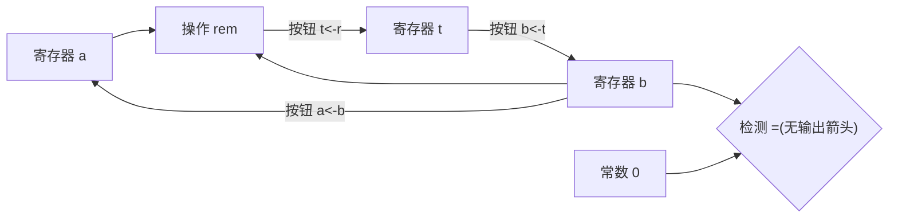
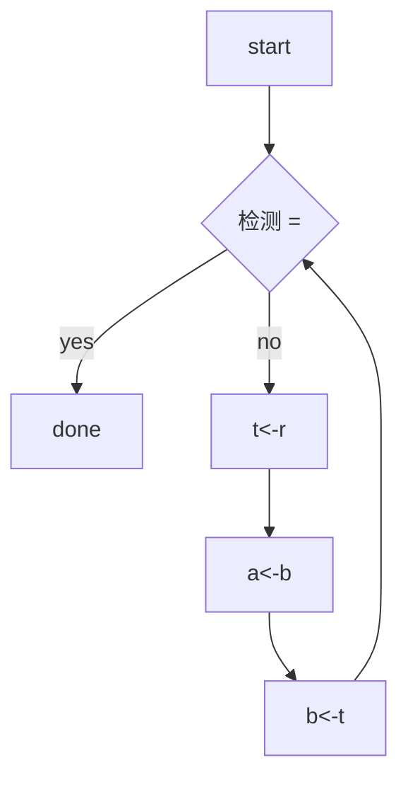
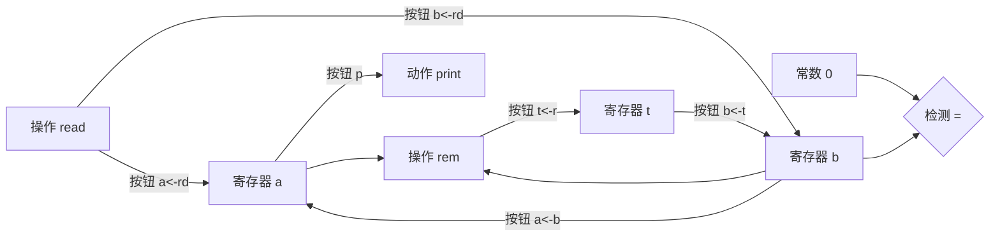
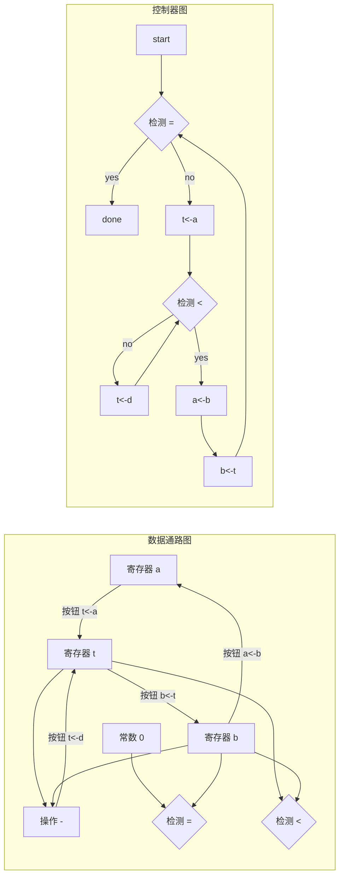
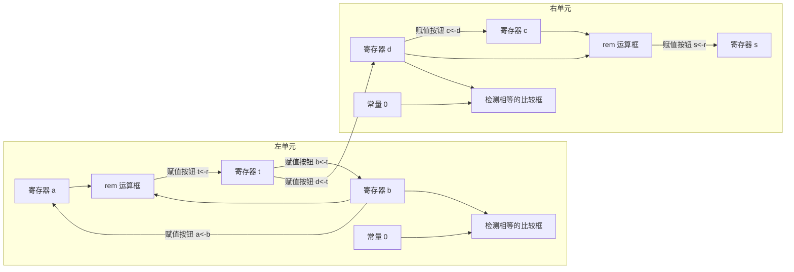
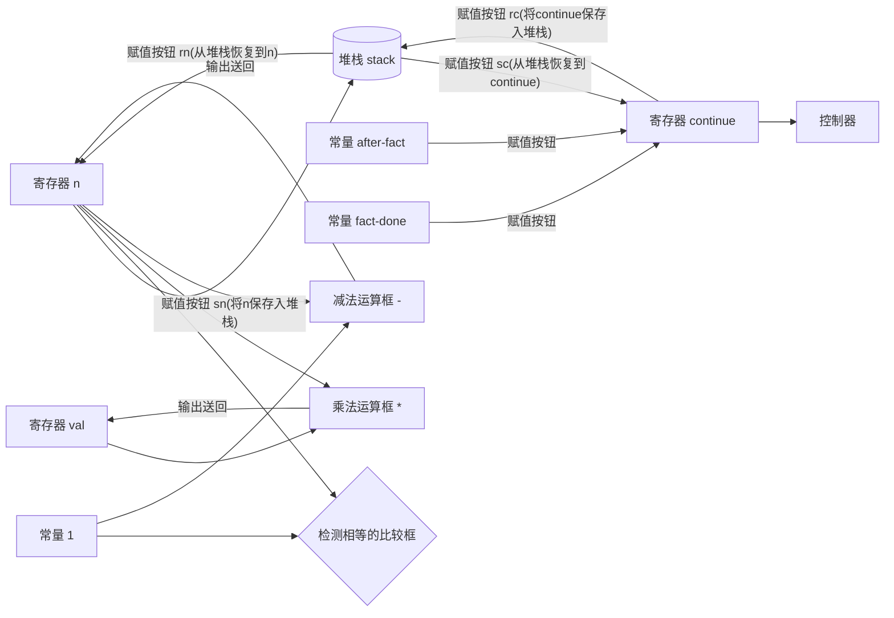

# 第5章 寄存器机器里的计算

> 我的目的是想说明,这一天空机器并不是一种天赐造物或者生命体,它只不过是钟表一类的机械装置(而那些相信钟表有灵魂的人却将这一工作说成是其创造者的荣耀),在很大程度上,这里多种多样的运动都是由最简单的物质力量产生的,就像钟表里所有活动都是由一个发条产生的一样。
>
> ——约翰尼斯·开普勒(给Herwart von Hohenburg的信,1605)

本书从研究计算过程,并用Lisp写出的过程描述它们开始。为了解释这些过程的意义,我们提出了一系列的求值模型:第1章的代换模型,第3章的环境模型,以及第4章的元循环模型。我们特别仔细地考察这个元循环模型,就是为了尽可能地揭开有关类Lisp语言的程序如何解释的神秘面纱。但是,即使是这个元循环解释器,也还遗留一些没有回答的问题,因为它无法阐释Lisp系统里的控制机制。举例来说,这个求值器不能解释子表达式的求值怎样返回一个值,以便送给使用这个值的表达式;该求值器也无法解释为什么有些递归过程能产生迭代型的计算过程(也就是说,只需要常量空间就可以求值),而另一些递归过程却生成递归型的计算。无法回答这些问题的原因在于,元循环求值器本身也是一个Lisp程序,并因此继承了基础Lisp系统的控制结构。为了提供有关Lisp求值器的控制结构的一个更完整的描述,我们就必须转到一个比Lisp本身更基本的层次上去工作。

在这一章里,我们将基于传统计算机的一步一步操作,描述一些计算过程。这类计算机也称为寄存器机器,它们能顺序地执行一些指令,对一组固定称为寄存器的存储单元的内容完成各种操作。寄存器机器的一条典型指令将一种基本操作作用于某几个寄存器的内容,并将作用的结果赋给另一个寄存器。我们对寄存器机器执行的计算过程的描述,看起来很像传统计算机的“机器语言”程序。当然,我们在这里不打算关注任何特定计算机的机器语言,而是要考察若干Lisp过程,并为执行每个过程设计一部特殊的寄存器机器。这样,我们可以把自己的工作看成是硬件结构设计师,而不是机器语言的计算机程序员。在这些寄存器机器的设计中,我们要开发出一些机制,以实现各种重要的程序设计结构,例如递归。我们还要给出一种能够用于描述寄存器机器设计的语言。在5.2节里,我们将要实现一个Lisp程序,它能够使用这样的描述去模拟我们所设计的机器。

我们的寄存器机器的大部分基本操作都非常简单。例如,有一个操作从两个寄存器里取出值后相加,产生结果后存入第三个寄存器。这样一个操作可以由很容易描述的硬件来执行。为了处理表结构,我们当然还要使用存储器操作car、cdr和cons,它们要求更精细的存储分配机制。我们将在5.3节里研究如何基于更基本的操作实现它们。

在已经积累了许多将简单过程构造为寄存器机器的经验之后,我们将在5.4节里设计一部机器,它能够执行由4.1节里的元循环求值器描述的算法。这一工作将填补起我们对于如何解释Scheme表达式的理解中的缺陷,为求值器里的控制机制提供一个显式模型。在5.5节里,我们将研究一个简单的编译器,它能将Scheme程序翻译为指令的序列,这种序列可以直接通过上述的求值器寄存器机器的寄存器和操作去执行。

## 5.1 寄存器机器的设计

要设计一部寄存器机器,我们必须设计好它的数据通路(寄存器和操作)和控制器,该控制器实现操作的顺序执行。为了展示一部简单寄存器机器的设计过程,让我们考察欧几里得算法,它用于计算两个整数的最大公约数(GCD)。正如我们在1.2.5节已经看到过的,欧几里得算法可以通过一个迭代计算过程执行,由下面的过程描述:

```scheme
(define (gcd a b)
  (if (= b 0)
      a
      (gcd b (remainder a b))))
```

如果一部机器要执行这一算法,它就必须维持好两个数a和b的变动轨迹,所以,让我们假定这两个数被保存在名字与它们相同的两个寄存器里。所需要的基本操作包括检查寄存器b的内容是否为0,计算寄存器a的内容除以寄存器b的内容得到的余数。余数操作是一个复杂的计算过程,但现在暂时假定我们有一个能计算余数的基本设备。在这个GCD算法的每次循环里,寄存器a的内容都必须用寄存器b的内容取代,而b的内容必须代以原来a的内容除以原来b的内容的余数。如果这些操作能在同一个时间完成,事情就会方便得多。但是在我们的寄存器机器模型里,假定每一步中只能给一个寄存器赋新值。为了完成上述代换,我们的机器里要使用第三个“临时性的”寄存器,称为t。(首先将余数放在寄存器t,而后将b的内容存入a中,最后再把保存在t里的余数存入b中。)

我们可以用数据通路图来展示这个机器中所需的寄存器和各种操作,如图5-1所示。在这个图里,寄存器(a、b和t)用矩形表示,给某个寄存器赋值的一种方式用一个箭头表示,箭头的后面画着一个×,从数源指向被赋值的寄存器。我们可以将这里的×看作一个按钮,在按压它的时候,就会允许这个值从数据源“流向”指定的寄存器。位于按钮旁边的名字用于表示相应的按钮。这些名字可以任意取,因此最好选用助记的名字(例如,用a<-b表示按压这一按钮将把寄存器b的内容赋值给寄存器a)。一个寄存器的数据源可以是另一个寄存器(就像赋值a<-b的情况),或者是一个操作的结果(如赋值t<-r的情况),或者是一个常数(一个不允许改变的内置的值,在数据通路图上用一个三角形表示,其中包含着这个常数)。

在数据通路图里,从常数或者寄存器内容出发计算出一个值的操作用一个梯形框表示,其中写着有关操作的名字。例如,在图5-1里用rem标记的梯形框表示一个计算余数的操作,它针对寄存器a和b的内容做计算,因为它们都连接在这个操作框上。有箭头(上面没有按钮的)从操作的输入寄存器和常量指向操作框,还有箭头从操作的输出连接到寄存器。检测用一个圆圈表示,其中写着检测的名字。例如,在这一GCD机器里有一个检测操作,它检测寄存器b的内容是否为0。一个检测同样也有从其输入寄存器和常量来的箭头,但没有输出箭头,检测的结果值将由控制器使用,并不用于数据通路。从整体上看,数据通路图表示了一部机器里所需要的寄存器和操作,以及它们之间的数据连接。如果我们将箭头看作连线,将×按钮看作开关,这种数据通路图很像是一部机器的线路图,就像这部机器可以用电子元件构造出来似的。



*图5-1 一部GCD机器的数据通路*

为了使这一数据通路图能够实现GCD的计算,其中的按钮就必须按照正确的顺序按动。我们用一个控制器图描述这种顺序,如图5-2所示。控制器图里的元素描述的是数据通路图里的部件应该如何操作。在控制器图里的矩形表示的是数据通路按钮的按压动作,其中的箭头表示从一个步骤到下一步骤的顺序。在这一图形里的菱形表示一次决策,随后有两个可以走的箭头,具体走哪一个要看菱形里标明的数据通路所检测的值。我们可以用一种物理类比来解释这个控制器:将这个图看作一个迷宫,其中有一个在里面滚的弹子。当弹子滚到一个盒子(矩形)里的时候,就会按压在这里盒子里标明的数据通路按钮;当弹子滚到一个决策结点时(例如这里对b=0的检测),它究竟从哪条路线离开将由指定检测的结果确定。综合在一起,这里的数据通路和控制器完全描述了一部计算GCD的机器。在寄存器a和b里安放了适当的值之后,控制器的启动(弹子的滚动)从标明start的位置开始。当控制器达到done时,就会看到在寄存器a里的GCD值。



*图5-2 一部GCD机器所用的控制器*

**练习5.1** 请设计一部寄存器机器,采用由下面过程所描述的迭代算法计算阶乘。请画出这一机器的数据通路图和控制器图。

```scheme
(define (factorial n)
  (define (iter product counter)
    (if (> counter n)
        product
        (iter (* counter product)
              (+ counter 1))))
  (iter 1 1))
```

### 5.1.1 一种描述寄存器机器的语言

数据通路图和控制器图很适合描述像GCD这样的简单机器,但如果用于描述大型机器,例如Lisp的解释器,这些图就会变得非常笨拙不便了。为了能够处理复杂的机器,我们将创造一种语言,它能以正文的形式表现出由数据通路图和控制器图所给出的所有信息。我们将从一种直接模仿这些图示的记法形式开始。

在定义一部机器的数据通路图时,我们需要描述其中的寄存器和各种操作。为了描述一个寄存器,我们需要给它取一个名字,并描述那些给它赋值的按钮。这里又需要给出每个按钮的名字,并描述在这些按钮的控制之下进入寄存器的数据源(这种数据源是一个寄存器,或一个常量,或一个操作)。为了描述一个操作,我们也需要给它一个名字,并描述好它的输入(寄存器或者常量)。

我们将一部机器的控制器定义为一个指令序列,另外再加上一些标号,它们标明了序列中的一些入口点。一条指令可以是下面几种东西之一:

- 数据通路图中的一个按钮,按压它将使一个值被赋给一个寄存器。(这对应于控制器图里的一个矩形框。)
- test指令,执行相应的检测。
- 有条件地转移到某个由控制器标号指明的位置的分支指令(branch指令),它基于前面检测的结果(检测和分支一起对应于控制器图里的菱形)。如果检测为假,控制器将继续序列中的下一条指令;否则控制器就将继续去做指定标号之后的下一条指令。
- 无条件分支指令(goto指令)指明继续执行的控制器标号。

机器将从控制器指令序列的开始处启动,直到执行达到序列末尾时停止。这些指令总按照它们列出的顺序执行,除非遇到分支指令改变控制流。

图5-3显示了用这种方式描述的GCD机器。这一实例只是为了说明了这种表示方式的通用性,因为GCD机器是一个非常简单的实例,其中的每个寄存器只有一个按钮,每个按钮和检测都只在控制器里使用了一次。

不幸的是,这种描述很难阅读。为了理解控制器里的指令,我们必须时常去参照查看按钮的名字和操作的名字;为了理解一个按钮究竟做了什么事情,我们又必须参照查看操作名字的定义。为此我们希望改变这种记法形式,把来自数据通路图和控制器图的描述组合到一起,使我们能在一起观看它们。

为了得到这种描述形式,我们将用按钮和操作的行为定义代替为它们任意取的名字。也就是说,不采用在一个地方(在控制器里)说“按压按钮t<-r”,并在另一个地方(在数据通路图里)说“按压t<-r将把操作rem的值赋给寄存器t”以及“操作rem的输入是寄存器a和b的内容”的方式,以后将(在控制器里)直接说:“按压那个按钮,将操作rem对寄存器a和b的内容算出的值赋给寄存器t”。与此类似,不是(在控制器里)说“执行=检测”并另外(在数据通路里)说“这个=检测是对寄存器b的内容和常量0操作”,而将说“对于寄存器b的内容和常量0做=检测。”我们将忽略掉数据通路描述,只留下控制器序列。这样,GCD机器就可以描述为下面的形式:

```scheme
(controller
 test-b
   (test (op =) (reg b) (const 0))
   (branch (label gcd-done))
   (assign t (op rem) (reg a) (reg b))
   (assign a (reg b))
   (assign b (reg t))
   (goto (label test-b))
 gcd-done)
```

(图5-3的框内先是数据通路描述,再是控制器描述:)

```scheme
(data-paths
 (registers
  ((name a)
   (buttons ((name a<-b) (source (register b)))))
  ((name b)
   (buttons ((name b<-t) (source (register t)))))
  ((name t)
   (buttons ((name t<-r) (source (operation rem))))))

 (operations
  ((name rem)
   (inputs (register a) (register b)))
  ((name =)
   (inputs (register b) (constant 0)))))

(controller
 test-b                            ; label
   (test =)                        ; test
   (branch (label gcd-done))       ; conditional branch
   (t<-r)                          ; button push
   (a<-b)                          ; button push
   (b<-t)                          ; button push
   (goto (label test-b))           ; unconditional branch
 gcd-done)                         ; label
```

*图5-3 一部GCD机器的规范描述*

与图5-3给出的形式相比,现在这种描述形式更容易阅读,但它也还有一些缺点:

- 对于大型机器而言,这种描述太啰唆,因为只要控制器指令序列中多次提到某个数据通路元素,该元件的完整描述就会反复地出现(在GCD实例里并没有出现这一问题,因为在这里,每个操作和按钮都只出现了一次)。进一步说,重复出现的数据通路描述将使机器中的实际数据通路结构变得模糊不清,对于大型的机器而言,到底有多少个寄存器、操作和按钮,它们之间如何连接的情况都将更难看清楚。
- 因为机器定义中的控制器指令看起来像Lisp的表达式,因此就使人很容易忘记它们并不是任意的Lisp表达式,只能表示合法的机器指令。举例来说,这里的操作只能直接对常量和寄存器的内容去做,不能作用于其他操作的结果。

虽然存在这些缺点,在这一章里我们还是准备始终采用这一寄存器机器语言,因为下面将更加关注对于控制器的理解,而较少注意数据通路里的元素和连接。当然,我们还是应该记住,对于设计实际机器而言,数据通路的设计是至关重要的。

**练习5.2** 请用这里的寄存器机器语言描述练习5.1的迭代型阶乘机器。

**动作**

我们现在要修改上述GCD机器,以便能把想求GCD的数输入给它,并使它能把结果从终端打印出来。我们并不想讨论如何使机器能够读入和打印,而是假定这些都可以作为基本操作使用(就像我们在Scheme里需要时就直接用read和display一样)[^286]。

[^286]: 这一假设掩盖了很多复杂问题。通常在Lisp系统的实现里,大部分工作就是完成读入和打印的工作。

read就像我们已经在用的那些操作,它产生出一个可以保存到寄存器里的值。但是read并不从任何寄存器取得输入,它所产生的值依赖于某些情况,而这些情况发生在我们所设计的机器的组成部分之外。我们允许机器的一些操作具有这种行为方式,并据此画出或者说明read的使用,就像所用的是一个能计算出值的操作一样。

另一方面,print与我们已经使用的任何操作都有本质性的不同:它并不产生任何可以存入寄存器的输出值。虽然print会产生一种效果,但这种效果却不是我们所设计的机器的一部分。下面把这类操作称为动作。在数据通路图上,动作的表示形式就像是一个能产生值的操作——用一个梯形,其中包含着这个动作的名字。应该有来自输入(寄存器或者常量)的箭头指向动作框,我们也为这些动作关联一个按钮,按压这个按钮将导致该动作的出现。为了使控制器可以按压动作的按钮,在这里增加一种新的称为perform的指令。这样,在控制器序列里,打印寄存器a的内容的动作用下面指令表示:

```scheme
(perform (op print) (reg a))
```

图5-4显示的是新的GCD机器的数据通路和控制器。这里我们没有让这一机器打印结果后就停止,而是让它重新开始,因此这部机器将反复地读入一对数,计算它们的GCD并打印出结果。这种结构很像我们在第4章讲的解释器里用的驱动循环。



下半部分是控制器:

```scheme
(controller
 gcd-loop
   (assign a (op read))
   (assign b (op read))
 test-b
   (test (op =) (reg b) (const 0))
   (branch (label gcd-done))
   (assign t (op rem) (reg a) (reg b))
   (assign a (reg b))
   (assign b (reg t))
   (goto (label test-b))
 gcd-done
   (perform (op print) (reg a))
   (goto (label gcd-loop)))
```

*图5-4 一部读输入并打印结果的GCD机器*

### 5.1.2 机器设计的抽象

我们经常需要定义一部包括某些“基本”操作的机器,这些操作本身实际上也非常复杂。举例说,在5.4和5.5节里,我们将要把Scheme的环境操作当作基本操作。这种抽象非常有价值,因为它使我们能忽略机器中一些部分的细节,将注意力集中到有关设计的其他方面。当然,我们能够将大量复杂事务隐藏起来,这并不意味着该机器的设计是不实际的。因为我们总能用一些更简单的基本操作来取代这些复杂的“基本操作”。

考虑上面的GCD机器,在这一机器里有一条指令,它计算寄存器a和b的内容的余数,并将结果赋值给寄存器t。如果我们希望在构造这一GCD机器时不用这种余数基本操作,那么就必须描述清楚如何利用更简单的操作计算出余数来,例如采用减法。我们确实能写出下面的能够找出余数的Scheme过程:

```scheme
(define (remainder n d)
  (if (< n d)
      n
      (remainder (- n d) d)))
```

这样,我们就可以用一个减法操作和一个比较检测,去代替GCD机器的数据通路里的余数操作。图5-5显示了这一细化后的机器的数据通路和控制器。原GCD控制器定义里的指令:

```scheme
(assign t (op rem) (reg a) (reg b))
```

现在被一个包含循环的指令序列取代了,如图5-6所示。



*图5-5 细化后的GCD机器的数据通路和控制器*

**练习5.3** 请设计一部机器,采用牛顿法计算平方根,如1.1.7节所描述的:

```scheme
(define (sqrt x)
  (define (good-enough? guess)
    (< (abs (- (square guess) x)) 0.001))
  (define (improve guess)
    (average guess (/ x guess)))
  (define (sqrt-iter guess)
    (if (good-enough? guess)
        guess
        (sqrt-iter (improve guess))))
  (sqrt-iter 1.0))
```

在开始时,请假设good-enough?和improve都是可用的基本操作。而后说明如何基于算术操作展开它们。请描述这些sqrt机器的设计,画出它们数据通路图,并用寄存器机器语言写出控制器的定义。

```scheme
(controller
 test-b
   (test (op =) (reg b) (const 0))
   (branch (label gcd-done))
   (assign t (reg a))
 rem-loop
   (test (op <) (reg t) (reg b))
   (branch (label rem-done))
   (assign t (op -) (reg t) (reg b))
   (goto (label rem-loop))
 rem-done
   (assign a (reg b))
   (assign b (reg t))
   (goto (label test-b))
 gcd-done)
```

*图5-6 针对图5-5中GCD机器的控制器指令序列*

### 5.1.3 子程序

在设计一部执行某种计算的机器时，我们常常更希望能对其中的一些部件做出一些安排，使计算中某些不同的部分可以共享这些部件，而不是重复描述这些部件。现在考虑一部包含着两个GCD计算的机器，一个找出寄存器a和b的内容的GCD，另一个找出寄存器c和d的内容的GCD。在开始时，我们可以假定已经有了一个gcd基本操作，而后再基于更基本的操作展开gcd的这两个实例。图5-7中只显示了结果机器的数据通路里与GCD有关的部分，没有显示它们与机器中其他部分的连接。这个图里还显示了这一机器的控制器序列里的相应部分。



图的下部是对应的控制器序列：

```scheme
gcd-1
  (test (op =) (reg b) (const 0))
  (branch (label after-gcd-1))
  (assign t (op rem) (reg a) (reg b))
  (assign a (reg b))
  (assign b (reg t))
  (goto (label gcd-1))
after-gcd-1
  ⋮
gcd-2
  (test (op =) (reg d) (const 0))
  (branch (label after-gcd-2))
  (assign s (op rem) (reg c) (reg d))
  (assign c (reg d))
  (assign d (reg s))
  (goto (label gcd-2))
after-gcd-2
```

*图5-7 一部完成两次GCD计算的数据通路和控制器的一部分*

在这一机器里有两个余数操作框和两个检测相等的框。如果重复出现的部件比较复杂，就像这里的余数框，这样做就不是构造这一机器的最经济方式了。我们希望能用同一个部件完成这两个GCD计算，以避免数据通路部件的重复出现，条件是这样做时不会影响更大的机器计算里的其他部分。如果在控制器到达gcd-2的时候，寄存器a和b里的值已经不再需要了（或者，如果为了保证安全，已经将这些值搬到了其他寄存器），我们就可以修改这部机器，使它在计算第二个GCD时也使用寄存器a和b，而不用寄存器c和d，就像在第一次计算GCD时那样。如果这样做，我们就会得到如图5-8所示的控制器序列。

```scheme
gcd-1
  (test (op =) (reg b) (const 0))
  (branch (label after-gcd-1))
  (assign t (op rem) (reg a) (reg b))
  (assign a (reg b))
  (assign b (reg t))
  (goto (label gcd-1))
after-gcd-1
  ⋮
gcd-2
  (test (op =) (reg b) (const 0))
  (branch (label after-gcd-2))
  (assign t (op rem) (reg a) (reg b))
  (assign a (reg b))
  (assign b (reg t))
  (goto (label gcd-2))
after-gcd-2
```

*图5-8 在一部机器中为两个不同GCD计算使用了同样的数据通路部件，这里是它的控制器序列的一部分*

这样我们就除去了重复的数据通路部件（因此数据通路又变回到图5-1的样子），但是在控制器里还是有两个有关GCD的序列，它们之间的差异仅仅在于入口标号不同。如果能将这样的两个序列代换为到同一个序列（一个gcd子程序）的不同分支，并能在该序列最后重新通过分支，回到主流指令序列中正确的位置，那当然就更好了。我们可以通过如下方式完成这一工作：在分支进入gcd之前，首先在特定的寄存器continue里存入一个区分值（例如0或者1），在gcd子程序结束时，让计算根据寄存器continue里的值决定是回到after-gcd-1还是after-gcd-2。图5-9显示了这样做之后的控制器序列里的相关部分，其中只包含了gcd指令的一个副本。

```scheme
gcd
  (test (op =) (reg b) (const 0))
  (branch (label gcd-done))
  (assign t (op rem) (reg a) (reg b))
  (assign a (reg b))
  (assign b (reg t))
  (goto (label gcd))
gcd-done
  (test (op =) (reg continue) (const 0))
  (branch (label after-gcd-1))
  (goto (label after-gcd-2))
  ⋮
;; Before branching to gcd from the first place where
;; it is needed, we place 0 in the continue register
(assign continue (const 0))
(goto (label gcd))
after-gcd-1
  ⋮
;; Before the second use of gcd, we place 1 in the continue register
(assign continue (const 1))
(goto (label gcd))
after-gcd-2
```

*图5-9 采用一个continue寄存器，避免像图5-8那样重复的控制器序列*

在处理很小的问题时，这是一种合理的方法，但如果在控制器序列里出现了许多GCD计算的实例，事情就会变得很难弄了。为了在gcd子程序完成之后确定转到哪里继续执行，我们就需要在控制器里所有使用gcd的地方加上做检测的数据通路和分支指令。实现子程序的另一种更有力的方法，是在寄存器continue里保存控制器序列里一个入口点的标号，用这个标号指明子程序结束时执行应从哪里继续下去。要实现这一策略，就需要在寄存器机器里的数据通路与控制器之间建立一类新的联系：这里必须有一种方式，能用于控制器序列里一个标号的值赋给一个寄存器，而所用的赋值方式又必须使这种值可以从寄存器里提取出来，用于确定继续执行的指定入口点。

为了实现这种能力，我们要扩充寄存器机器里assign指令的能力，允许将控制器序列里的标号作为值（作为一种特殊常量）赋给一个寄存器。还要扩充goto指令的能力，允许执行进程不仅可以从一个常量标号描述的入口点继续，还可以从一个寄存器的内容所描述的入口点继续下去。利用这些新的结构，我们就可以在gcd子程序的结束处放一条分支指令，要求转向保存在continue寄存器里的那个位置。这样做出的控制器序列如图5-10所示。

```scheme
gcd
  (test (op =) (reg b) (const 0))
  (branch (label gcd-done))
  (assign t (op rem) (reg a) (reg b))
  (assign a (reg b))
  (assign b (reg t))
  (goto (label gcd))
gcd-done
  (goto (reg continue))
  ⋮
;; Before calling gcd, we assign to continue
;; the label to which gcd should return.
(assign continue (label after-gcd-1))
(goto (label gcd))
after-gcd-1
  ⋮
;; Here is the second call to gcd, with a different continuation.
(assign continue (label after-gcd-2))
(goto (label gcd))
after-gcd-2
```

*图5-10 为continue寄存器做标号赋值，可以简化并推广图5-9中展示的策略*

如果一部机器里有多个子程序，那么可以采用多个继续寄存器（例如，gcd-continue，factorial-continue），也可以让所有子程序共享同一个continue寄存器。共享一个寄存器当然更经济一些，但是在出现一个子程序（sub1）调用另一个子程序（sub2）的情况下，我们就必须小心了。除非sub1在设置continue寄存器以便准备去调用sub2之前，事先保存了continue寄存器的内容，否则在sub1本身结束时就不知道该往哪里去了。下一节将开发一种用于处理递归的机制，它同样为解决子程序嵌套调用提供了一种更好的办法。

### 5.1.4 采用堆栈实现递归

有了至今所阐述的思想，我们已经可以通过描述有关的寄存器机器，实现所有的迭代计算过程了，其中用一个寄存器对应于计算过程中的一个状态变量。这种机器反复地执行一个控制器循环，并不断改变各个寄存器的内容，直至满足了某些结束条件。在控制器序列中的每一点，机器的状态（对应于迭代计算过程的状态）完全由这些寄存器的内容（对应于状态变量的值）所确定。

然而，要想实现递归计算过程，我们还需要增加新的机制。考虑下面计算阶乘的递归方法，我们在1.2.1节第一次看到它：

```scheme
(define (factorial n)
  (if (= n 1)
      1
      (* (factorial (- n 1)) n)))
```

正如从这一过程中可以看到的，在计算*n*!时将需要计算 (*n* - 1)!。用下面过程描述的另一部GCD机器

```scheme
(define (gcd a b)
  (if (= b 0)
      a
      (gcd b (remainder a b))))
```

也类似地需要去计算另一个GCD。但是，在这个gcd过程与上面的factorial之间有一点重要不同，这个gcd过程将原来的计算简化为一个新的GCD计算，而factorial则要求计算出另一个阶乘作为一个子问题。在这个GCD过程里，对于新的GCD计算的回答也就是原来问题的回答。为了计算下一个GCD，我们只需简单地将新的参数放进GCD机器的输入寄存器里，并通过执行同一个控制器序列，重新使用这个机器的数据通路。在机器完成了最后一个GCD问题的求解时，整个计算也就完成了。

但是，在阶乘（以及其他任何递归计算过程）的情形里，对于新的阶乘子问题的回答并不是对于原问题的回答。由 (*n* - 1)! 得到的值还必须乘以*n*，才能得到最后的结果。如果我们试图去模仿GCD设计，通过减少寄存器n的值并重新运行阶乘机器的方式求解这里的阶乘子问题，我们就会丧失n原来的值，也就无法再用它去乘计算结果了。这样我们就需要第二部阶乘机器去完成子问题的工作。而这第二个子问题本身又有一个阶乘子问题，它又要求第三部阶乘机器，并继续这样下去。因为每部阶乘机器里都需要包含另一部阶乘机器，完整的机器中将要包含着无穷嵌套的类似机器，这是不可能从固定的有限个部件构造起来的。

然而，我们还是可能将这一阶乘计算过程实现为一部寄存器机器，只要我们能做出一种安排，设法使每个嵌套的机器实例都使用同样的一组部件。也就是说，计算*n*!的机器应该用同样部件去完成计算针对 (*n* - 1)! 的子问题，去计算针对 (*n* - 2)! 的子问题，并如此下去。这是可能的，因为，虽然阶乘计算过程在执行中要求同一机器的无穷多个副本，但是在任何给定时刻，它所实际使用的只是这些副本中的一个。当这部机器遇到一个递归子问题时，它就可以挂起针对原问题的工作，重新使用同样物理部件去处理这个子问题，完成后再继续进行前面挂起的计算。

在处理子问题时，寄存器的内容与它们在原问题里的情况不同（在目前情况下，寄存器*n*的值减小了）。为了能够继续进行前面挂起的计算，机器必须把解决了子问题之后还需要的那些寄存器的内容保存起来，以便后来能恢复它们，以继续进行前面挂起的计算。对于阶乘问题，我们应该保存起n的原值，在完成对减小后n的寄存器的阶乘计算之后再恢复它[^287]。

由于对递归调用的嵌套深度并没有一个事先知道的界限，我们可能需要保存任意多个寄存器值。这些值需要以与它们的保存顺序相反的顺序存储起来，因为在嵌套的递归中，最后进入的那个子问题将首先结束。这就要求我们使用一个堆栈，或称为“后进先出”数据结构，用它保存寄存器的值。我们可以扩充寄存器机器语言，增加两种指令，将一个堆栈包括进来：将值放入堆栈用一个save指令，从堆栈中恢复一个值用restore指令。在将一系列值save到堆栈里之后，一系列的restore将以相反的顺序提取出这些值[^288]。

有了堆栈的帮助之后，我们就可以重复使用阶乘机器的数据通路的同一个副本，完成所有的阶乘子问题了。在重复使用对这个数据通路进行操作的控制器序列时，也存在类似的设计问题。为了重复地执行阶乘计算，这个控制器就不能像迭代计算过程那样简单地转回到开始的地方，因为在解决了 (*n* - 1)! 子问题之后，这部机器还必须将结果乘以*n*。控制器需要挂起它对*n*!的计算，去解决 (*n* - 1)! 子问题，而后再继续它对*n*!的计算。对阶乘计算的这种观点提示我们采用5.1.3节里描述的子程序机制，在那里使用了一个continue寄存器，以便在转到解决子问题的序列部分之后，还能回到它脱离主问题的那个位置继续下去。我们同样可以让阶乘子程序把返回的入口点保存到continue寄存器里。围绕着每个子程序调用，我们都需要做寄存器continue的保存和恢复，就像对寄存器n所做的那样，因为每一“层”阶乘计算都将使用同一个continue寄存器。这样，阶乘子程序在调用自己以开始解决一个子问题之前，必须将一个新值存入continue，但它后来还会需要那个老的值，以便能返回原来调用它以解决这个子问题的位置。

图5-11显示了实现这一递归的factorial过程的机器的数据通路和控制器。在这一机器里，有一个堆栈以及三个分别称为n、val和continue的寄存器。为了简化数据通路图，我们并没有给寄存器赋值按钮命名，而是只给堆栈操作按钮命了名（sc和sn保存寄存器内容，rc和rn恢复寄存器内容）。为了操作这部机器，我们在寄存器n里存入希望计算阶乘值的数，而后启动机器。当机器到达fact-done时计算结束，在寄存器val里将能找到对应回答。在相应的控制器序列里，每次递归调用之前都保存起n和continue，从调用返回时恢复它们。完成从一个调用返回的方式就是转到保存在continue里的位置。在机器启动时对continue做初始化，使得机器在最后能返回到fact-done。val寄存器里保存着阶乘计算的结果，在递归调用时并不保存它，因为val原来的内容在子程序返回后已经没有用了。此时只需要它的新值，是由这一次子计算产生出来的。



与数据通路对应的控制器序列如下：

```scheme
(controller
  (assign continue (label fact-done))     ; set up final return address
 fact-loop
   (test (op =) (reg n) (const 1))
   (branch (label base-case))
   ;; Set up for the recursive call by saving n and continue.
   ;; Set up continue so that the computation will continue
   ;; at after-fact  when the subroutine returns.
   (save continue)
   (save n)
   (assign n (op -) (reg n) (const 1))
   (assign continue (label after-fact))
   (goto (label fact-loop))
 after-fact
   (restore n)
   (restore continue)
   (assign val (op *) (reg n) (reg val))   ; val now contains n(n - 1)!
   (goto (reg continue))                   ; return to caller
 base-case
   (assign val (const 1))                  ; base case: 1! = 1
   (goto (reg continue))                   ; return to caller
 fact-done)
```

*图5-11 一部递归的阶乘机器*

虽然从原理上说阶乘计算需要一部无穷机器，图5-11所示的机器实际上却是有穷的，除了其中的堆栈之外，因为它是潜在无界的。当然，堆栈的任何特定物理实现都具有有穷的大小，这也将限制这一机器所能处理的递归调用深度。阶乘的这一具体实现展示了实现递归算法的通用策略：采用一部常规的寄存器机器，再增加一个堆栈。在遇到递归子程序时，只要某些寄存器的值在子问题求解完成后还需要用，就把它们的当前值存入堆栈。而后去求解递归的子问题，再恢复保存起来的寄存器值，并继续执行原来的主程序。continue寄存器的值必须保存，其他寄存器的值是否需要保存，就要看特定机器的情况，因为并不是所有的递归计算都需要各个寄存器原来的值，即使这些值在求解子问题的过程中修改了（见练习5.4）。

**双重递归**

现在让我们来考察一个更复杂的递归计算过程，有关斐波那契数的树型递归计算。这是在1.2.2节介绍过的：

```scheme
(define (fib n)
  (if (< n 2)
      n
      (+ (fib (- n 1)) (fib (- n 2)))))
```

与阶乘的情况类似，我们也可以把递归的斐波那契计算实现为一部寄存器机器，其中采用寄存器n、val和continue。这部机器比计算阶乘的机器更复杂一些，因为在这里的控制序列中有两个地方需要执行递归调用——一个计算Fib(*n* - 1)，另一个计算Fib(*n* - 2)。为了安排好其中的各个递归调用，我们需要保存起那些后来需要使用的寄存器值，而后将n寄存器设置为需要去递归计算Fib的数值（*n* - 1或*n* - 2），并将continue赋值为计算返回时应该转向的主序列入口点（分别为afterfib-n-1或者afterfib-n-2），而后转向fib-loop。在从递归调用返回时答案就在val里。图5-12显示了这一机器的控制器序列。

**练习 5.4** 请描述实现下面各个过程的寄存器机器。对于这里的每部机器，请写出它的控制器指令序列，并画出相应的数据通路图形。

a) 递归的指数计算：

```scheme
(define (expt b n)
  (if (= n 0)
      1
      (* b (expt b (- n 1)))))
```

b) 迭代的指数计算：

```scheme
(define (expt b n)
  (define (expt-iter counter product)
    (if (= counter 0)
        product
        (expt-iter (- counter 1) (* b product))))
  (expt-iter n 1))
```

```scheme
(controller
  (assign continue (label fib-done))
 fib-loop
   (test (op <) (reg n) (const 2))
   (branch (label immediate-answer))
   ;; set up to compute Fib(n-1)
   (save continue)
   (assign continue (label afterfib-n-1))
   (save n)                           ; save old value of n
   (assign n (op -) (reg n) (const 1)); clobber n to n-1
   (goto (label fib-loop))            ; perform recursive call
 afterfib-n-1                         ; upon return, val contains Fib(n-1)
   (restore n)
   (restore continue)
   ;; set up to compute Fib(n-2)
   (assign n (op -) (reg n) (const 2))
   (save continue)
   (assign continue (label afterfib-n-2))
   (save val)                         ; save Fib(n-1)
   (goto (label fib-loop))
 afterfib-n-2                         ; upon return, val contains Fib(n-2)
   (assign n (reg val))               ; n now contains Fib(n-2)
   (restore val)                      ; val now contains Fib(n-1)
   (restore continue)
   (assign val                        ; Fib(n-1) + Fib(n-2)
           (op +) (reg val) (reg n))
   (goto (reg continue))              ; return to caller, answer is in val
 immediate-answer
   (assign val (reg n))               ; base case: Fib(n) = n
   (goto (reg continue))
 fib-done)
```

*图5-12 一部计算斐波那契数的机器的控制器*

**练习 5.5** 请用手工模拟阶乘和斐波那契机器的计算过程，用某个非平凡的输入（需要执行至少一次递归调用）。说明执行中每个关键点上堆栈的内容。

**练习 5.6** Ben Bitdiddle注意到，在斐波那契机器的控制序列里有一个额外的save和一个额外的restore，可以将它们删去，得到一个更快速的机器。这些指令在哪里？

### 5.1.5 指令总结

在我们的寄存器机器语言里，一条控制器指令具有下述之一的形式，其中的每个\<inputᵢ\>或者是一个 (reg \<*register-name*\>)，或者是一个 (const \<*constant-value*\>)。

[^287]: 有人可能会说，在这里并不需要保存n的原值，因为再减小它并解决了子问题之后，我们可以再增大它去恢复到原来的值。虽然这种策略对于阶乘确实可行，但却不是一般可用的，因为一般而言，一个寄存器原来的值不一定能从它的新值计算出来。
[^288]: 在5.3节里，我们将看到如何基于更基本的操作实现堆栈。

下面指令是在5.1.1节介绍的:

```scheme
(assign <register-name> (reg <register-name>))
(assign <register-name> (const <constant-value>))
(assign <register-name> (op <operation-name>) <input₁> ... <inputₙ>)
(perform (op <operation-name>) <input₁> ... <inputₙ>)
(test (op <operation-name>) <input₁> ... <inputₙ>)
(branch (label <label-name>))
(goto (label <label-name>))
```

采用寄存器保存标号的指令是在5.1.3节讨论的:

```scheme
(assign <register-name> (label <label-name>))
(goto (reg <register-name>))
```

使用堆栈的指令在5.1.4节介绍:

```scheme
(save <register-name>)
(restore <register-name>)
```

我们至今已经见过的 `<constant-value>` 都是数值,后面还会用到字符串、符号和表。例如,`(const "abc")` 就是字符串 "abc"。`(const abc)` 是符号 abc,`(const (a b c))` 是表 `(a b c)`,而 `(const ())` 就是空表。

## 5.2 一个寄存器机器模拟器

为了取得对于寄存器机器设计的更好理解,我们必须测试自己设计出的机器,看看它能否按照预期的方式执行。测试一个设计的一种方法是手工模拟控制器的操作,如练习5.5中所说的那样。但是,如果这一机器不是特别简单,手工做就会特别冗长而枯燥。在这一节里,我们要为用寄存器机器语言描述的机器构造一个模拟器。这一模拟器是一个 Scheme 程序,其中包括四个界面过程。第一个过程根据一个寄存器机器的描述,为这部机器构造一个模型(一个数据结构,其中的各个部分对应于被模拟机器的各个组成部分),另外三个过程使我们可以通过操作这个模型,去模拟相应的机器:

```scheme
(make-machine <register-names> <operations> <controller>)
```

构造并返回机器的模型,其中包含了给定的寄存器、操作和控制器。

```scheme
(set-register-contents! <machine-model> <register-name> <value>)
```

将一个值存入给定机器的一个被模拟的寄存器里。

```scheme
(get-register-contents <machine-model> <register-name>)
```

返回给定机器里一个被模拟的寄存器的内容。

```scheme
(start <machine-model>)
```

模拟给定机器的执行,从相应控制器序列的开始处启动,直至到达这一序列的结束时停止。

作为说明这些过程如何使用的实例,我们可以定义下面的 `gcd-machine`,为5.1.1节的 GCD 机器定义一个模型:

```scheme
(define gcd-machine
  (make-machine
   '(a b t)
   (list (list 'rem remainder) (list '= =))
   '(test-b
       (test (op =) (reg b) (const 0))
       (branch (label gcd-done))
       (assign t (op rem) (reg a) (reg b))
       (assign a (reg b))
       (assign b (reg t))
       (goto (label test-b))
     gcd-done)))
```

`make-machine` 的第一个参数是一个寄存器名字的表,下一参数是一个表格(两个元素的表的表),其中的每个对偶包括一个操作的名字和实现这一操作(即,对于给定的同样输入值,能够产生出同样的输出值)的一个 Scheme 过程。最后一个参数描述了相应控制器,用一个标号和机器指令的表表示,就像在5.1节里那样。

为了用这一机器去计算 GCD,我们需要设置输入寄存器,启动这部机器,在模拟结束时检查计算结果:

```scheme
(set-register-contents! gcd-machine 'a 206)
done

(set-register-contents! gcd-machine 'b 40)
done

(start gcd-machine)
done

(get-register-contents gcd-machine 'a)
2
```

这个计算的运行速度比直接用 Scheme 写出的 gcd 过程慢得多,因为我们是在模拟低级的机器指令,例如 assign,而使用的却是比它高级得多的操作。

**练习5.7** 用这个模拟器检查你在练习5.4中设计的机器。

### 5.2.1 机器模型

由 `make-machine` 生成的机器模型被表示为一个包含局部变量的过程,其中采用了第3章里开发的消息传递技术。为了实现这一模型,`make-machine` 在开始时调用过程 `make-new-machine`,构造出所有寄存器机器的机器模型里都需要一些公共部分。由 `make-new-machine` 构造出的基本机器模型,从本质上说就是一个容器,其中包含了若干个寄存器和一个堆栈,还有一个执行机制,它一条一条地处理控制器指令。

在此之后,`make-machine` 将扩充这一基本模型(通过给它传递消息),把现在要定义的特殊机器的寄存器、操作和控制器加进去。它首先为新机器里需要提供的每个寄存器名字分配一个寄存器,并安装好这一机器所指定的各种操作。最后,它用一个汇编程序(在下面的5.2.2节讨论)把控制器列表变换为新机器所用的指令,并将它们安装为这一机器的指令序列。`make-machine` 返回修改后的机器模型作为值。

```scheme
(define (make-machine register-names ops controller-text)
  (let ((machine (make-new-machine)))
    (for-each (lambda (register-name)
                ((machine 'allocate-register) register-name))
              register-names)
    ((machine 'install-operations) ops)
    ((machine 'install-instruction-sequence)
     (assemble controller-text machine))
    machine))
```

**寄存器**

我们把一个寄存器表示为一个带有局部状态的过程,就像第3章里那样,`make-register` 过程创建这种寄存器,它们里面保存着一个值,可以访问或者修改:

```scheme
(define (make-register name)
  (let ((contents '*unassigned*))
    (define (dispatch message)
      (cond ((eq? message 'get) contents)
            ((eq? message 'set)
             (lambda (value) (set! contents value)))
            (else
             (error "Unknown request -- REGISTER"
                    message))))
    dispatch))
```

下面过程用于访问这些寄存器:

```scheme
(define (get-contents register)
  (register 'get))

(define (set-contents! register value)
  ((register 'set) value))
```

**堆栈**

我们把堆栈也表示为一个带有局部状态的过程。`make-stack` 过程创建起一个堆栈,其局部状态就是一个包含着这一堆栈里的数据项的表。堆栈接受的请求包括将一个数据项放入堆栈的 push,以及将数据项从堆栈里去掉并返回它的 pop。initialize 将堆栈初始化为空。

```scheme
(define (make-stack)
  (let ((s '()))
    (define (push x)
      (set! s (cons x s)))
    (define (pop)
      (if (null? s)
          (error "Empty stack -- POP")
          (let ((top (car s)))
            (set! s (cdr s))
            top)))
    (define (initialize)
      (set! s '())
      'done)
    (define (dispatch message)
      (cond ((eq? message 'push) push)
            ((eq? message 'pop) (pop))
            ((eq? message 'initialize) (initialize))
            (else (error "Unknown request -- STACK"
                         message))))
    dispatch))
```

下面过程用于访问堆栈:

```scheme
(define (pop stack)
  (stack 'pop))

(define (push stack value)
  ((stack 'push) value))
```

**基本机器**

过程 `make-new-machine` 如图5-13所示,它构造起一个对象,其内部状态包括了一个堆栈;另外还有一个初始为空的指令序列和一个操作的表,开始时这个表里只包含一个初始化堆栈的操作;还有一个寄存器的列表,初始时包含两个分别称为 flag 和 pc(表示"程序计数器",program counter)的寄存器。内部过程 allocate-register 用于向寄存器列表中加入新项,内部过程 lookup-register 在这个列表里查找寄存器。

寄存器 flag 用于控制被模拟机器的分支动作。test 指令设置 flag 的内容,表示检测的结果(真或者假)。branch 指令通过检查 flag 的内容确定是否需要转移。

在机器的运行中,pc 寄存器决定了指令的执行顺序。这一顺序由内部过程 execute 实现。在这个模拟模型里,每条机器指令就是一个数据结构,其中包含了一个无参过程,称为指令执行过程,调用这一过程就能模拟相应指令的执行。在模拟运行时,pc 总是指向指令序列里下一条需要执行的指令的开始位置。execute 取得这条指令,通过调用与之对应的指令执行过程,完成相应的执行。这一循环重复进行,直到再也没有需要执行的指令为止(也就是说,直到 pc 指向了指令序列的结束)。

作为操作的一部分,每个指令执行过程都将修改 pc,使之指向下一条需要执行的指令。branch 和 goto 指令直接修改 pc,使之指向一个新的位置,其他所有指令都简单地增加 pc 的值,使它指向序列中的下一条指令。可以看到,每次对 execute 的调用都将再次调用 execute,但这并不会产生一个无穷循环,因为指令执行过程的执行会改变 pc 的内容。

`make-new-machine` 返回一个 dispatch 过程,这一过程实现对内部状态的消息传递访问。请注意,启动这一机器就是把 pc 设置到指令序列的开始并调用 execute。

为了方便起见,一部机器除了有设置和检查寄存器内容的过程之外,我们还为 start 的操作提供另一个过程性界面,如5.2节开始时所描述的:

```scheme
(define (start machine)
  (machine 'start))

(define (get-register-contents machine register-name)
  (get-contents (get-register machine register-name)))

(define (set-register-contents! machine register-name value)
  (set-contents! (get-register machine register-name) value)
  'done)
```

```scheme
(define (make-new-machine)
  (let ((pc (make-register 'pc))
        (flag (make-register 'flag))
        (stack (make-stack))
        (the-instruction-sequence '()))
    (let ((the-ops
           (list (list 'initialize-stack
                       (lambda () (stack 'initialize)))))
          (register-table
           (list (list 'pc pc) (list 'flag flag))))
      (define (allocate-register name)
        (if (assoc name register-table)
            (error "Multiply defined register: " name)
            (set! register-table
                  (cons (list name (make-register name))
                        register-table)))
        'register-allocated)
      (define (lookup-register name)
        (let ((val (assoc name register-table)))
          (if val
              (cadr val)
              (error "Unknown register:" name))))
      (define (execute)
        (let ((insts (get-contents pc)))
          (if (null? insts)
              'done
              (begin
                ((instruction-execution-proc (car insts)))
                (execute)))))
      (define (dispatch message)
        (cond ((eq? message 'start)
               (set-contents! pc the-instruction-sequence)
               (execute))
              ((eq? message 'install-instruction-sequence)
               (lambda (seq) (set! the-instruction-sequence seq)))
              ((eq? message 'allocate-register) allocate-register)
              ((eq? message 'get-register) lookup-register)
              ((eq? message 'install-operations)
               (lambda (ops) (set! the-ops (append the-ops ops))))
              ((eq? message 'stack) stack)
              ((eq? message 'operations) the-ops)
              (else (error "Unknown request -- MACHINE"
                           message))))
      dispatch)))
```

*图5-13 过程 make-new-machine,它实现基本机器模型*

这些过程(以及5.2和5.3节里的许多其他过程)里都使用了下面过程,其中用给定的名字在一部给定的机器里查看有关寄存器的内容:

```scheme
(define (get-register machine reg-name)
  ((machine 'get-register) reg-name))
```

### 5.2.2 汇编程序

这一汇编程序将一部机器的控制器表达式序列翻译为与之对应的机器指令的表,每条指令都带着相应的执行过程。从整体上看,这个汇编程序很像我们在第4章里研究过的各种求值器——它有一个输入语言(目前情况下就是寄存器机器语言),以及对于这一语言里的每个类型必须执行的适当动作。

为每条指令生成一个执行过程的技术,也就是我们在4.1.7节里采用的,为加快求值器的速度,把分析工作与运行时的执行动作分离的技术。正如在第4章已经看到过的,对于 Scheme 表达式的大部分的有用分析,都可以在不知道变量实际值的情况下完成。与此类似,在这里,对寄存器机器语言表达式的许多有用分析,也可以在不知道机器寄存器的实际内容的情况下完成。举例来说,我们可以用指向寄存器对象的指针代替对寄存器的引用,可以用指向标号所指定的指令序列中的位置的指针代替对相应标号的引用。

在能够开始生成指令执行过程之前,这个汇编程序还必须知道所有标号的引用位置。为此它首先扫描控制器的正文,从指令序列中分辨出各个标号。在扫描这一正文的过程中,汇编程序构造起一个指令的表和另一个列表,列表里为每个标号关联一个指向指令表里的指针。汇编程序而后扩充这样得到的指令表,为每条指令插入一个执行过程。

过程 `assemble` 是这个汇编程序的主要入口,它以一个控制器正文和相应机器模型作为参数,返回存储在模型里的指令序列。assemble 调用 extract-labels,这个过程根据所提供的控制器正文构造出初始的指令表和标号列表。extract-labels 的第二个参数是一个过程,需要调用它去处理上面得到的结果。这个过程使用 `update-insts!` 生成指令执行过程,将其插入指令表里,并返回修改之后的表。

```scheme
(define (assemble controller-text machine)
  (extract-labels controller-text
   (lambda (insts labels)
     (update-insts! insts labels machine)
     insts)))
```

extract-labels 的参数是一个表 text(也就是控制器指令表达式的序列)和一个过程 receive。receive 将被用两个值调用:(1) 一个指令数据结构的表 insts,其中每个指令数据结构包含一条来自 text 的指令;(2) 一个名字为 labels 的表格,其中是来自 text 的各个标号,它们都关联于相应标号在表 insts 里的位置。

```scheme
(define (extract-labels text receive)
  (if (null? text)
      (receive '() '())
      (extract-labels (cdr text)
       (lambda (insts labels)
         (let ((next-inst (car text)))
           (if (symbol? next-inst)
               (receive insts
                        (cons (make-label-entry next-inst
                                                insts)
                              labels))
               (receive (cons (make-instruction next-inst)
                              insts)
                        labels)))))))
```

extract-labels 的工作方式是顺序扫描 text 里的各个元素,逐渐积累起 insts 和 labels。如果一个元素是个符号(因此就是一个标号),它就将适当的条目加入表格 labels,否则就把这个元素加入到 insts 表里[^289]。

`update-insts!` 修改指令表,原来这里只包含指令的正文,现在要加入对应的执行过程:

```scheme
(define (update-insts! insts labels machine)
  (let ((pc (get-register machine 'pc))
        (flag (get-register machine 'flag))
        (stack (machine 'stack))
        (ops (machine 'operations)))
    (for-each
     (lambda (inst)
       (set-instruction-execution-proc!
        inst
        (make-execution-procedure
         (instruction-text inst) labels machine
         pc flag stack ops)))
     insts)))
```

机器指令的数据结构也就是指令正文和对应的执行过程的对偶。在 extract-labels 构造这些指令时,这些执行过程还不能用。它们是后来由 `update-insts!` 插入的。

```scheme
(define (make-instruction text)
  (cons text '()))
```

[^289]: 在这里使用 receive 过程,是作为一种有效地返回两个值(labels 和 insts)的方式,这样就不必做出一个复合数据结构去保存它们。另一实现方式是返回这两个值的序对:

    ```scheme
    (define (extract-labels text)
      (if (null? text)
          (cons '() '())
          (let ((result (extract-labels (cdr text))))
            (let ((insts (car result)) (labels (cdr result)))
              (let ((next-inst (car text)))
                (if (symbol? next-inst)
                    (cons insts
                          (cons (make-label-entry next-inst insts) labels))
                    (cons (cons (make-instruction next-inst) insts)
                          labels)))))))
    ```

    汇编程序应该采用如下方式调用它:

    ```scheme
    (define (assemble controller-text machine)
      (let ((result (extract-labels controller-text)))
        (let ((insts (car result)) (labels (cdr result)))
          (update-insts! insts labels machine)
          insts)))
    ```

    你也可以认为,这里对 receive 的使用展示了一个返回多个值的优雅方法,或者简单地将它看成不过是一个程序设计技巧。向 receive 这样的参数被作为下一个被调用过程,这种过程通常称为"继续"过程。请回忆一下,在4.3.3节的 amb 求值器里实现回溯控制结构时,使用的也是这种继续过程。

```scheme
(define (instruction-text inst)
  (car inst))

(define (instruction-execution-proc inst)
  (cdr inst))

(define (set-instruction-execution-proc! inst proc)
  (set-cdr! inst proc))
```

我们的模拟器并不使用这些指令正文,但还是把它们保存在这里。将指令正文留到排除程序错误时,可能带来许多方便(见练习5.16)。

标号列表里的元素是序对:

```scheme
(define (make-label-entry label-name insts)
  (cons label-name insts))
```

下面过程用于在这个列表里查找条目:

```scheme
(define (lookup-label labels label-name)
  (let ((val (assoc label-name labels)))
    (if val
        (cdr val)
        (error "Undefined label -- ASSEMBLE" label-name))))
```

**练习5.8** 下面寄存器机器代码有歧义,因为其中的标号 here 有不止一个定义:

```scheme
start
  (goto (label here))
here
  (assign a (const 3))
  (goto (label there))
here
  (assign a (const 4))
  (goto (label there))
there
```

对于上面写出的模拟器,当控制到达 there 时,寄存器 a 的内容是什么?请修改过程 extract-labels,使汇编程序在发现同一标号用于指明两个不同位置时,能发出一个错误信号。

### 5.2.3 为指令生成执行过程

汇编程序调用 `make-execution-procedure`,为一条指令生成一个执行过程。这很像4.1.7节里求值器中的 analyze 过程。这一过程也基于指令的类型,把生成适当的执行过程的工作分派出去。

```scheme
(define (make-execution-procedure inst labels machine
                                  pc flag stack ops)
  (cond ((eq? (car inst) 'assign)
         (make-assign inst machine labels ops pc))
        ((eq? (car inst) 'test)
         (make-test inst machine labels ops flag pc))
        ((eq? (car inst) 'branch)
         (make-branch inst machine labels flag pc))
        ((eq? (car inst) 'goto)
         (make-goto inst machine labels pc))
        ((eq? (car inst) 'save)
         (make-save inst machine stack pc))
        ((eq? (car inst) 'restore)
         (make-restore inst machine stack pc))
        ((eq? (car inst) 'perform)
         (make-perform inst machine labels ops pc))
        (else (error "Unknown instruction type -- ASSEMBLE"
                     inst))))
```

对于这个寄存器机器语言里的每类指令，在这里都有一个生成器，其功能就是构造出适当的执行过程。这些过程的细节由相应寄存器机器语言里每条具体指令的语法和意义确定。我们采用数据抽象，将寄存器机器表达式的语法细节与通用的执行机制隔离开，就像前面对 4.1.2 节的求值器所采用的做法，这里用一些语法过程提取出一条指令里的各个部分，并对它们进行分类。

**assign 指令**

过程 make-assign 处理 assign 指令：

```scheme
(define (make-assign inst machine labels operations pc)
  (let ((target
         (get-register machine (assign-reg-name inst)))
        (value-exp (assign-value-exp inst)))
    (let ((value-proc
           (if (operation-exp? value-exp)
               (make-operation-exp
                value-exp machine labels operations)
               (make-primitive-exp
                (car value-exp) machine labels))))
      (lambda ()                ; execution procedure for assign
        (set-contents! target (value-proc))
        (advance-pc pc)))))
```

make-assign 用了几个选择函数，从 assign 指令里提取出目标寄存器的名字（指令的第二个元素）和值表达式（形成指令里剩余部分的表）：

```scheme
(define (assign-reg-name assign-instruction)
  (cadr assign-instruction))

(define (assign-value-exp assign-instruction)
  (cddr assign-instruction))
```

get-register 用寄存器名的名字去查找，产生对应的目标寄存器对象。如果有关的值是一个操作的结果，这个值表达式就被送给 make-operation-exp，否则就送给 make-primitive-exp。这些过程（下面给出）还要进一步分析值表达式，并为它生成一个执行过程。这是一个称为 value-proc 的无参过程，在模拟中，当需要为寄存器赋值生成实际的值时就会调用这个过程。请注意，查找寄存器名字和分析值表达式的工作，都只需在汇编时做一次，而不是在指令模拟时每次做。这样将节省工作，也是我们采用执行过程的原因。这一做法与 4.1.7 节的求值器里将程序分析工作从执行中分离出来有着直接的对应。

由 make-assign 返回的结果就是 assign 指令的执行过程。当这个过程被调用时（由机器模型的 execute 过程调用），它将用执行 value-proc 得到的结果设置目标寄存器的内容。而后通过运行下面过程更新 pc，使之指向下一条指令。

```scheme
(define (advance-pc pc)
  (set-contents! pc (cdr (get-contents pc))))
```

advance-pc 是每条指令的正常结束操作，除了 branch 和 goto 之外。

**test、branch 和 goto 指令**

make-test 以类似方式处理 test 指令。它提取出描述了需要检测的条件的表达式，并为它生成一个执行过程。在模拟时，对应于有关条件的过程被调用，检测结果赋给 flag 寄存器，而后更新 pc：

```scheme
(define (make-test inst machine labels operations flag pc)
  (let ((condition (test-condition inst)))
    (if (operation-exp? condition)
        (let ((condition-proc
               (make-operation-exp
                condition machine labels operations)))
          (lambda ()
            (set-contents! flag (condition-proc))
            (advance-pc pc)))
        (error "Bad TEST instruction -- ASSEMBLE" inst))))

(define (test-condition test-instruction)
  (cdr test-instruction))
```

branch 指令的执行过程检查 flag 寄存器的内容，或者是将 pc 的内容设置为分支的目标（如果需要执行分支），或者是简单地更新 pc（如果不要分支）。请注意，一条 branch 指令里所指定的目标必须是一个标号，make-branch 过程要求这件事。还请注意标号也是在汇编时查找，而不是在模拟 branch 指令的时候再查找。

```scheme
(define (make-branch inst machine labels flag pc)
  (let ((dest (branch-dest inst)))
    (if (label-exp? dest)
        (let ((insts
               (lookup-label labels (label-exp-label dest))))
          (lambda ()
            (if (get-contents flag)
                (set-contents! pc insts)
                (advance-pc pc))))
        (error "Bad BRANCH instruction -- ASSEMBLE" inst))))

(define (branch-dest branch-instruction)
  (cadr branch-instruction))
```

goto 指令的情况与分支类似，这里的目标可以用一个标号或者一个寄存器描述，而且也不需要检测条件。这里总将 pc 设置为新的目标位置。

```scheme
(define (make-goto inst machine labels pc)
  (let ((dest (goto-dest inst)))
    (cond ((label-exp? dest)
      (let ((insts
             (lookup-label labels
                           (label-exp-label dest))))
        (lambda () (set-contents! pc insts))))
      ((register-exp? dest)
       (let ((reg
              (get-register machine
                            (register-exp-reg dest))))
         (lambda ()
           (set-contents! pc (get-contents reg)))))
      (else (error "Bad GOTO instruction -- ASSEMBLE"
                   inst)))))

(define (goto-dest goto-instruction)
  (cadr goto-instruction))
```

**其他指令**

堆栈指令 save 和 restore 简单地指定寄存器使用堆栈，并且更新 pc：

```scheme
(define (make-save inst machine stack pc)
  (let ((reg (get-register machine
                           (stack-inst-reg-name inst))))
    (lambda ()
      (push stack (get-contents reg))
      (advance-pc pc))))

(define (make-restore inst machine stack pc)
  (let ((reg (get-register machine
                           (stack-inst-reg-name inst))))
    (lambda ()
      (set-contents! reg (pop stack))
      (advance-pc pc))))

(define (stack-inst-reg-name stack-instruction)
  (cadr stack-instruction))
```

最后一类指令由 make-perform 处理，它为需要执行的动作生成有关执行过程。在模拟时执行相应的动作过程并更新 pc。

```scheme
(define (make-perform inst machine labels operations pc)
  (let ((action (perform-action inst)))
    (if (operation-exp? action)
        (let ((action-proc
               (make-operation-exp
                action machine labels operations)))
          (lambda ()
            (action-proc)
            (advance-pc pc)))
        (error "Bad PERFORM instruction -- ASSEMBLE" inst))))

(define (perform-action inst) (cdr inst))
```

**子表达式的执行过程**

在为一个寄存器赋值（make-assign），或者为其他操作提供输入时（make-operation-exp，见下），可能需要使用一个 reg、label 或者 const 表达式的值。下面过程为这些表达式生成出一个执行过程，在模拟中产生出这些子表达式的值：

```scheme
(define (make-primitive-exp exp machine labels)
  (cond ((constant-exp? exp)
         (let ((c (constant-exp-value exp)))
           (lambda () c)))
        ((label-exp? exp)
         (let ((insts
                (lookup-label labels
                              (label-exp-label exp))))
           (lambda () insts)))
        ((register-exp? exp)
         (let ((r (get-register machine
                                (register-exp-reg exp))))
           (lambda () (get-contents r))))
        (else
         (error "Unknown expression type -- ASSEMBLE" exp))))
```

reg、label 和 const 表达式的语法形式由下面过程确定：

```scheme
(define (register-exp? exp) (tagged-list? exp 'reg))

(define (register-exp-reg exp) (cadr exp))

(define (constant-exp? exp) (tagged-list? exp 'const))

(define (constant-exp-value exp) (cadr exp))

(define (label-exp? exp) (tagged-list? exp 'label))

(define (label-exp-label exp) (cadr exp))
```

在 assign、perform 和 test 指令里，可能需要将一个机器操作（由一个 op 表达式描述）的应用到某些操作对象（由 reg 和 const 表达式描述）。下面过程为一个"操作表达式"（一个包含着一条指令里的操作和操作对象表达式的表）生成一个执行过程：

```scheme
(define (make-operation-exp exp machine labels operations)
  (let ((op (lookup-prim (operation-exp-op exp) operations))
        (aprocs
         (map (lambda (e)
                (make-primitive-exp e machine labels))
              (operation-exp-operands exp))))
    (lambda ()
      (apply op (map (lambda (p) (p)) aprocs)))))
```

操作表达式的语法由下面过程确定：

```scheme
(define (operation-exp? exp)
  (and (pair? exp) (tagged-list? (car exp) 'op)))

(define (operation-exp-op operation-exp)
  (cadr (car operation-exp)))

(define (operation-exp-operands operation-exp)
  (cdr operation-exp))
```

可以看到，这里对于操作表达式的处理很像 4.1.7 节的求值器里的 analyze-application 过程里对过程应用的处理。我们要为每个操作对象生成一个执行过程。模拟时将调用这些对应于操作对象的过程，得到它们的值，而后将模拟有关操作的 Scheme 过程应用于这些值。找出模拟过程的方式，就是用操作的名字到机器的操作表格里查找：

```scheme
(define (lookup-prim symbol operations)
  (let ((val (assoc symbol operations)))
    (if val
        (cadr val)
        (error "Unknown operation -- ASSEMBLE" symbol))))
```

**练习 5.9** 在上面对于机器操作的处理中，除了允许它们对常量和寄存器的内容进行操作外，还允许它们处理标号。请修改上述表达式处理过程，加上一个条件，要求这些操作只能用于寄存器和常量。

**练习 5.10** 请为寄存器机器指令设计一种新的语法形式，而后修改这个模拟器，使模拟器能采用你的新语法。你能实现你的新语法，而且在修改中除了语法过程之外不修改本节的模拟器里的任何部分吗？

**练习 5.11** 我们在 5.1.4 节引入 save 和 restore 时，并没有说明如果试图恢复一个并不是以前最后保存的寄存器，那会出现什么情况。例如下面的序列：

```scheme
(save y)
(save x)
(restore y)
```

对于这里 restore 的意义有几种合理的可能性：

a) (restore y) 把最后存入堆栈里的值放入 y，无论这个值原来来自哪个寄存器。这也是上面模拟器中的行为方式。请说明如何利用这种方式的优点，从 5.1.4 节（参见图 5-12）的斐波那契机器中删去一条指令。

b) (restore y) 把最后存入堆栈里的值放入 y，但只是在这个值原来确实来自 y 的情况下；否则就发出一个错误消息。请修改模拟器，使之按这种方式活动。你需要修改 save，使它不但把值存入堆栈，还要存入寄存器的名字。

c) (restore y) 把来自 y 的最后存入堆栈里的值放入 y，而不管在保存 y 之后又有哪些寄存器的值存入或者恢复。请修改模拟器，使它能按照这种方式活动。你将需要为每个寄存器关联一个堆栈，还需要修改 initialize-stack 操作，让它初始化所有的寄存器堆栈。

**练习 5.12** 这个模拟器可用于帮助我们确定为实现一个采用给定控制器的机器所需要的数据通路。请扩充这个汇编程序，将下面信息存储到机器模型里：

- 一个指令的表，其中删除了所有的重复，并按照指令的类型保存（assign、goto 等等）；
- 一个用于保存入口点的寄存器的表（其中没有重复），这些入口点都有 goto 指令引用；
- 一个使用了 save 或者 restore 的寄存器的表（其中没有重复）；
- 对于每个寄存器，一个对它的赋值来源的表（其中没有重复）。例如，对于图 5-11 的阶乘机器，寄存器 val 的赋值来源包括 (const 1) 和 ((op *) (reg n) (reg val))。

请扩充有关机器的消息传递界面，提供对这些新信息的访问机制。为了测试你的分析器，请定义图 5-12 的斐波那契机器，并检查所列出的各个表。

**练习 5.13** 请修改上面的模拟器，使它可以直接利用控制器序列去确定机器里需要哪些寄存器，不必另将一个寄存器表作为 make-machine 的参数；不采用在 make-machine 里预先分配这些寄存器的方式，你可以在汇编指令的过程中，第一次遇到一个寄存器时完成它的分配。

### 5.2.4 监视机器执行

模拟的用途不仅在于可用于验证所提出的机器的正确性，还能帮助度量机器的性能。举例说，我们可以在自己的模拟程序里安装一个"测量仪器"，记录在计算中使用堆栈操作的次数。要做好这件事，我们应该修改被模拟的堆栈，记录将寄存器保存到堆栈里的次数和堆栈达到的最大深度的轨迹，如下面所示。我们还需要在基本机器模型里增加一个操作，用于对应对于堆栈的统计数据，并在 make-new-machine 里将 the-ops 初始化为：

```scheme
(list (list 'initialize-stack
            (lambda () (stack 'initialize)))
      (list 'print-stack-statistics
            (lambda () (stack 'print-statistics))))
```

这里是 make-stack 的新定义：

```scheme
(define (make-stack)
  (let ((s '())
        (number-pushes 0)
        (max-depth 0)
        (current-depth 0))
    (define (push x)
      (set! s (cons x s))
      (set! number-pushes (+ 1 number-pushes))
      (set! current-depth (+ 1 current-depth))
      (set! max-depth (max current-depth max-depth)))
    (define (pop)
      (if (null? s)
          (error "Empty stack -- POP")
          (let ((top (car s)))
            (set! s (cdr s))
            (set! current-depth (- current-depth 1))
            top)))
    (define (initialize)
      (set! s '())
      (set! number-pushes 0)
      (set! max-depth 0)
      (set! current-depth 0)
      'done)
    (define (print-statistics)
      (newline)
      (display (list 'total-pushes  '= number-pushes
                     'maximum-depth '= max-depth)))
    (define (dispatch message)
      (cond ((eq? message 'push) push)
            ((eq? message 'pop) (pop))
            ((eq? message 'initialize) (initialize))
            ((eq? message 'print-statistics)
             (print-statistics))
            (else
             (error "Unknown request -- STACK" message))))
    dispatch))
```

练习 5.15 到 5.19 描述了其他一些在监视和排除程序错误方面很有用的特征，可以考虑将它们加入寄存器机器模拟器中。

**练习 5.14** 请度量由图 5-11 所示的阶乘机器对各种小的 n 值计算 n! 时，所执行的堆栈压入次数和最大深度。根据你得到的数据确定有关的公式，对于任何 n>1，基于 n 描述压入操作的次数和在计算 n! 时的最大堆栈深度。请注意，这两个公式都是 n 的线性函数，因此请设法确定其中的两个常数。为了打印统计数据，你将需要扩充这一阶乘机器，增加初始化堆栈和打印统计结果的指令。你还可能想修改有关机器，使它能反复地将值读入 n，计算其阶乘并打印结果（就像我们在图 5-4 里对 GCD 机器所做的那样），使你以后再也不必反复去调用 get-register-contents、set-register-contents! 和 start。

**练习 5.15** 给寄存器机器模拟器增加指令计数功能。也就是说，让这一机器模型维持所执行指令的数目。扩充这一机器模型，使它能接受一个新消息，打印出当时的指令计数值并将计数器重新设置为 0。

**练习 5.16** 扩充上述模拟器，提供指令追踪功能。也就是说，在每条指令被执行之前，让模拟器打印出这一指令的正文。让扩充后的机器模型能接受 trace-on 和 trace-off 消息，并能相应地打开或者关闭追踪功能。

**练习 5.17** 扩充练习 5.16 的指令追踪功能，使得在打印一条指令之前，模拟器先打印出在控制序列里正好位于这条指令之前的标号。在做这件事情时，请小心地保证它不会干扰了指令计数功能（练习 5.15）。你需要让模拟器保存必要的标号信息。

**练习 5.18** 请修改第 5.2.1 节里的 make-register 过程，使寄存器可以被追踪。寄存器应该能接受打开和关闭追踪的消息。当一个寄存器被追踪时，一旦给这个寄存器赋值，就会打印出寄存器的名字，寄存器原来的内容和当时将要赋值的新内容。请扩充机器模型的界面，以允许你打开或者关闭对任何特定寄存器的追踪。

**练习 5.19** Alyssa P. Hacker 希望在模拟器里有断点功能，以帮助她排除机器设计中的错误。你现在被雇佣来为她安装这种特征。她希望能够描述控制序列里的任何位置，使模拟器能停止在那里，并使她能够检测机器的状态。你需要实现一个过程：

```scheme
(set-breakpoint <machine> <label> <n>)
```

它将在第 n 条指令之前的给定标号后面设置一个断点。例如，

```scheme
(set-breakpoint gcd-machine 'test-b 4)
```

将在 gcd-machine 里给寄存器 a 赋值前安装一个断点。当模拟器到达这个断点时，它应打印那个标号和断点的偏移量，并停止指令的执行。这样 Alyssa 就可以用 get-register-contents 和 set-register-contents! 去操作被模拟机器的状态。此后她应该能让机器继续执行，用

```scheme
(proceed-machine <machine>)
```

她还应该可以用下面方式删除某个特定断点

```scheme
(cancel-breakpoint <machine> <label> <n>)
```

或者用下面方式删除所有断点：

```scheme
(cancel-all-breakpoints <machine>)
```

## 5.3 存储分配和废料收集

在 5.4 节里，我们将要说明如何把一个 Scheme 求值器实现为一部寄存器机器。为了简化这一讨论，下面将假定在我们的寄存器机器里可以安装好一个表结构存储器，其中对于表结构数据的基本操作都是机器的基本过程。当我们需要集中精力考虑 Scheme 解释器里的控制机制时，假定存在这样一个存储器是一种很有用的抽象，但这并没有反映当前计算机中实际的基本数据操作的情况。为了得到有关一个 Lisp 系统如何工作的一种更完整的认识，我们还必须去考察表结构怎样以一种与常规的计算机存储器相容的方式表示。

有关表结构的实现需要考虑两方面问题。首先是一个纯粹的表示问题：如何去表示 Lisp 序对的"盒子和指针"结构，其中只使用到典型计算机存储器的存储单元和寻址能力。第二个问题，是需要关心如何将对存储的管理作为一个计算过程。Lisp 系统的操作强烈地依赖于连续创建新数据对象的能力，包括那些被解释的 Lisp 过程里显式创建的各种对象，以及由解释器本身创建的对象，例如环境和参数表等等。如果计算机里有数量无穷的可以快速寻址的存储器，那么连续不断地创建新对象就不会有问题。但是，实际的计算机存储器只有有限的规模（实在可惜）。因此 Lisp 系统需要提供一种自动存储分配功能，以支撑一种无穷存储器的假象。当一个数据对象不再需要时，分配给它的存储就自动回收，并可用于构造新的数据对象。存在着多种能提供这样的自动存储分配的技术。我们将在这一节里讨论的方法称为废料收集。

### 5.3.1 将存储看作向量

常规计算机的存储器可以看作是一串排列整齐的小隔间，每个小隔间里可以保存一点信息。这里的每个小隔间有一个具有唯一性的名字，称为它的地址或者位置。典型的存储器系统提供了两个基本操作，一个能取出保存在一个特定位置的数据，另一个能将新的数据赋给指定的位置。我们可以做存储器地址的增量操作，以支持对某一组小隔间的顺序访问。更一般的情况是，许多重要的数据操作都要求将存储器地址也作为数据来看待和处理，以便可以将地址保存到存储位置里，并能在机器的寄存器里对它们做各种操作。表结构的表示就是这种地址算术的一个具体应用。

为了模拟计算机的存储器，我们采用一种新的数据结构，称为向量。抽象地看，一个向量也是一个复合数据对象，其中各个元素都可以通过一个整数下标访问，这种访问所需的时间量与具体下标无关[^290]。为描述存储器操作，我们用 Scheme 里的两个完成向量操作的过程：

- (vector-ref \<vector> \<n>) 返回向量里的第 n 个元素。
- (vector-set! \<vector> \<n> \<value>) 将向量里的第 n 个元素设置为指定值。

举例说，如果 v 是一个向量，那么，(vector-ref v 5) 将取得向量 v 里的第 5 个元素，而 (vector-set! v 5 7)把向量v里的第5个元素修改为7。[^291]对于计算机存储器而言,这种访问可以通过地址算术实现,其中采用描述一个向量在存储器里的开始位置的基址加上一个下标,这种下标描述的是向量里某个特定元素的偏移量。

[^290]: 我们也可以将存储器表示为数据项的表。但是这样做时，访问时间就不会与下标无关了，因为要访问其中的第 n 个元素需要做 n-1 次 cdr 操作。

**Lisp数据的表示**

我们可以用向量实现表结构存储器所需的基本序对结构。让我们设想计算机的存储器被分成了两个向量,the-cars和the-cdrs。这时我们就可以采用下面方式表示表结构了:指向序对的指针就是到这两个向量的下标,一个序对的car就是向量the-cars里具有指定下标的项,该序对的cdr部分就是向量the-cdrs里具有指定下标的项。我们还需要为那些不是序对的对象(例如数和符号)确定表示方式,需要有一种方式来区分是这种数据还是那种数据。完成这些事情的方法很多,但它们都可以归结为采用某种带类型的指针,也就是说,现在需要扩充指针的概念,使之包含有关数据类型的信息[^292]。数据类型使系统能辨别是指向序对的指针(它包括"序对"数据类型和一个到存储器向量的下标),还是指向其他种类的数据的指针(它包含有关某种数据类型的信息和某些用于表示该类型的数据的其他东西)。认为两个数据对象是同一个东西(eq?)的条件就是它们的指针相同[^293]。图5-14显示的是采用这种方法表示表((1 2) 3 4)的情况,这个表的盒子和指针表示也显示在图中。图中用字母前缀标明类型信息。这样,指向下标为5的序对的指针标的是p5,空表用指针e0表示,指向数4的指针标的是用n4。在盒子和指针图里,我们在每个序对的左下方标了一个向量下标,表示这个序对的car和cdr存储的地方。在the-cars和the-cdrs里空白的地方可能保存了其他数据结构的序对(在这里不关心它们)。

图5-14的上半部分是表 ((1 2) 3 4) 的盒子和指针图,每个序对方块的左下方标有其向量下标:根指针指向下标为1的序对;序对1的car指向下标为5的序对,cdr指向下标为2的序对;序对2的car指向数3(n3),cdr指向下标为4的序对;序对4的car指向数4(n4),cdr为空表(e0);序对5的car指向数1(n1),cdr指向下标为7的序对;序对7的car指向数2(n2),cdr为空表(e0)。图的下半部分是存储器向量表:

| Index | 0 | 1 | 2 | 3 | 4 | 5 | 6 | 7 | 8 | … |
|---|---|---|---|---|---|---|---|---|---|---|
| the-cars |  | p5 | n3 |  | n4 | n1 |  | n2 |  | … |
| the-cdrs |  | p2 | p4 |  | e0 | p7 |  | e0 |  | … |

*图5-14 表((1 2) 3 4)的方块指针图和存储器向量表示*

[^291]: 为完整起见,我们还要描述一个构造向量的make-vector操作。但在目前的应用里,我们只是使用向量去模拟计算机存储器的固定划分情况。
[^292]: 这与我们在第2章为处理通用操作而引进的"带标志数据"的思想完全一样。当然,在这里的数据类型位于基本的机器层面上,而不是在表的基础上构造出来的。
[^293]: 类型信息可以采用各种方式编码,具体做法依赖于Lisp系统的实现所在的机器细节。Lisp程序执行的效率在很大程度上依赖于所做出的这种选择有多么聪明,但是,想把好的选择形式化为一般性的设计原则却非常困难。实现带类型指针的最直接方式是在每个指针里都分配固定的一组二进制位作为类型域,用于做类型的编码。在设计这样的表示时,必须处理的重要问题包括下面这些:表示类型需要多少个二进制位?向量的下标必须有多大?用于对指针的类型域操作的基本机器指令的效率如何?有些机器为有效操作类型域提供了特殊的硬件,这种机器也被称为是带标志体系结构的机器。

指向一个数值的指针,例如n4,也完全可能同时包含着指明数值对象的类型信息以及数4的表示本身[^294]。如果需要处理的数值太大,无法在固定大小的指针空间里表示,可以用一个大数数据类型,此时就是让指针指向一个表,在其中存储这个大数里的各个部分[^295]。

一个符号也可以表示为一个带类型的指针,它指向一个字符序列,这个字符序列形成了该符号的输出表示形式。这一序列是由Lisp读入程序在输入时第一次遇到这一字符序列时构造起来的。因为我们希望同一个符号的两个实例被eq?认定为"同一个"符号,而希望eq?只是简单地检测指针相等,因此我们就必须保证,当读入程序两次看到同一个符号时,它一定能用同一个指针(指向相应的字符序列)表示这两个出现。为了做到这一点,读入程序一直维护着它所遇到的所有符号的一个表格,按照传统,这称为对象表(obarray)。当读入程序遇到了一个字符串,并考虑据此构造一个符号时,它就会去检查对象表,看看前面是否已经看到过同样的字符串。如果前面没看到过,它就用这一字符串构造出一个新符号(指向新的字符序列的带类型指针),并将这个指针加入对象表里。如果读入程序已经看到过这个字符串,它就直接返回保存在对象表里的符号指针。将字符串用这种唯一指针取代的过程称为加入(interning)一个符号。

**基本表操作的实现**

有了上面的表示方式,我们就可以将寄存器机器里的各个"基本"表操作代换为一个或者几个基本向量操作了。下面将使用两个寄存器the-cars和the-cdrs,用它们标识与之对应的内存向量,假定vector-ref和vector-set!是可以使用的基本向量操作。我们还要假定有对指针的算术操作(增加一个指针的值,用一个序对的指针作为向量的下标,或者加起两个数),它们都将自动地应用到带类型指针的下标部分。

举例说,我们可以让寄存器机器支持下面的指令:

```scheme
(assign ⟨reg₁⟩ (op car) (reg ⟨reg₂⟩))
(assign ⟨reg₁⟩ (op cdr) (reg ⟨reg₂⟩))
```

如果我们分别将它们实现为:

```scheme
(assign ⟨reg₁⟩ (op vector-ref) (reg the-cars) (reg ⟨reg₂⟩))
(assign ⟨reg₁⟩ (op vector-ref) (reg the-cdrs) (reg ⟨reg₂⟩))
```

指令:

```scheme
(perform (op set-car!) (reg ⟨reg₁⟩) (reg ⟨reg₂⟩))
(perform (op set-cdr!) (reg ⟨reg₁⟩) (reg ⟨reg₂⟩))
```

将实现为

```scheme
(perform
 (op vector-set!) (reg the-cars) (reg ⟨reg₁⟩) (reg ⟨reg₂⟩))
(perform
 (op vector-set!) (reg the-cdrs) (reg ⟨reg₁⟩) (reg ⟨reg₂⟩))
```

[^294]: 有关数值如何表示的决定,也确定了我们能否用eq?(它检测指针的相等)检测两个数值的相等与否。如果指针里包含的是数值本身,那么相等的数值就会有相同的指针值。但是如果指针里包含的是保存数的位置的下标,那么,要想保证相等的数也具有相同的指针,我们就需要小心安排,不能让同一个数存入多个位置里。
[^295]: 这就像是将一个数写成一个数字的序列,除了这里的每个"数字"有所不同之外,它的取值可以是位于0到某个可能保存在一个指针里的最大的数之间的一个值。
执行cons时需要分配一个闲置未用的下标,将cons的参数存入向量the-cars和the-cdrs里由这个下标确定的位置。我们还要假定有一个特殊的寄存器free,它保存着一个序对指针,总是指向下一个可用下标,而且我们可以增加这一指针的下标部分,以便找到下一个自由的位置[^296]。举例说,指令:

```scheme
(assign ⟨reg₁⟩ (op cons) (reg ⟨reg₂⟩) (reg ⟨reg₃⟩))
```

由下面的向量操作序列实现[^297]:

```scheme
(perform
 (op vector-set!) (reg the-cars) (reg free) (reg ⟨reg₂⟩))
(perform
 (op vector-set!) (reg the-cdrs) (reg free) (reg ⟨reg₃⟩))
(assign ⟨reg₁⟩ (reg free))
(assign free (op +) (reg free) (const 1))
```

操作eq?

```scheme
(op eq?) (reg ⟨reg₁⟩) (reg ⟨reg₂⟩)
```

简单检测寄存器的所有域是否相等,而像pair?、null?、symbol?和number?一类谓词都只检测指针的类型域。

**堆栈的实现**

虽然我们的寄存器机器里使用了堆栈,但在这里却不需要做任何特殊事情,因为堆栈可以用表来模拟。堆栈可以是一个用于保存值的表,由一个特定寄存器the-stack指向。这样,(save ⟨reg⟩)就可以实现为:

```scheme
(assign the-stack (op cons) (reg ⟨reg⟩) (reg the-stack))
```

类似地,(restore ⟨reg⟩)可以实现为:

```scheme
(assign ⟨reg⟩ (op car) (reg the-stack))
(assign the-stack (op cdr) (reg the-stack))
```

而 (perform (op initialize-stack))可以实现为:

```scheme
(assign the-stack (const ()))
```

这些操作都可以进一步基于上面给出的向量操作给出解释。在常规计算机体系结构里,堆栈另行分配为一个单独的向量常有很大优越性。采用这种做法,对于堆栈的压入和弹出操作都可以通过增加或者减少向量下标的方式实现。

**练习5.20** 请画出由下面表达式产生的表结构的盒子和指针表示,以及对应的存储器向量表示的图形(就像图5-4里那样)。

```scheme
(define x (cons 1 2))
(define y (list x x))
```

假定free指针开始时的值是p1。表示x和y的值的是哪些指针?

**练习5.21** 为下面过程实现寄存器机器。假定表结构存储操作可以作为机器的基本操作使用:

a) 递归的count-leaves:

```scheme
(define (count-leaves tree)
  (cond ((null? tree) 0)
        ((not (pair? tree)) 1)
        (else (+ (count-leaves (car tree))
                 (count-leaves (cdr tree))))))
```

b) 递归的count-leaves,带有一个显式的计数器:

```scheme
(define (count-leaves tree)
  (define (count-iter tree n)
    (cond ((null? tree) n)
          ((not (pair? tree)) (+ n 1))
          (else (count-iter (cdr tree)
                            (count-iter (car tree) n)))))
  (count-iter tree 0))
```

**练习5.22** 练习3.12和3.3.1节给出了一个append过程,它连接起两个表,构成一个新表;还有另一个过程append!,它直接将两个表粘到一起。请为实现这两个操作各设计一个寄存器机器,假定表结构存储操作是可用的基本操作。

### 5.3.2 维持一种无穷存储的假象

在5.3.1节所勾画的表示方式能够解决表结构的问题,当然这里还需要有一个前提,就是需要有无穷数量的存储。如果采用实际的计算机,我们最终总会用光所有用于构造新序对的自由空间[^298]。然而,典型计算中产生的大部分序对只是用于保存计算的中间结果,在这些结果被访问之后,有关的序对就不再有用了——它们变成了废料。例如,计算

```scheme
(accumulate + 0 (filter odd? (enumerate-interval 0 n)))
```

将构造起两个表:枚举出的表和对枚举进行过滤的结果表。在这里的累计工作完成之后,这两个表就都不需要了,为它们分配的存储可以回收。如果我们能做出一种安排,周期性地收集起所有的废料,而且对存储的这种重复使用的速度与构造新序对的速率大致差不多,那么我们就能维持一种假象,好像这里存在着无穷数量的存储器。

为了回收这些序对,我们必须有一种方式来确定原先分配的哪些序对已经不再需要了(这一说法实际上意味着它们的内容对今后的计算不再有影响了)。我们下面要考察的方法称为废料收集。废料收集是基于如下的认识:在Lisp解释过程中的任何时刻,有可能影响未来的计算过程的对象,也就是从当前机器寄存器里的指针出发,经过一系列car和cdr操作能够达到的那些对象[^299]。所有不能以这种方式访问的对象都可以回收了。

[^296]: 也有找自由存储的其他方式。举例说,我们也可以将所有未用的序对链接起来,形成一个自由表。在这里的自由位置是连续的(并因此可以通过增加指针值的方式访问),是因为这里采用了一种紧凑式的废料收集程序,我们将在5.3.2节看到有关的情况。
[^297]: 从本质上说,这就是基于set-car!和set-cdr!的cons实现,如3.3.1节所述。在那里的实现中所用的get-new-pair,现在通过free指针实现了。
[^298]: 这句话将来也可能不成立,因为存储器有可能变得足够大,以至在一部计算机的存在期间不可能用完它。举例说,一年里大约有3×10¹³微秒,因此如果我们每微秒做一次cons,大约需要有10¹⁵个存储单元就可以构造出一台机器,它可以运行30年而不会用光所有的存储器。按照今天的标准,这样的存储似乎太大了,但在物理上这并不是不可能的。而在另一方面,处理器的速度也在变得更快,明天的一台计算机可能有着一大批处理器,在一个内存上并行操作,因此使用存储的速度也可能远远快于上面的假定。
执行废料收集的方法也很多。我们将要在这里考察的方法称为停止并复制,其基本思想就是将存储器分成两半,分为"工作存储区"和"自由存储区"。当cons需要构造序对时,就在工作存储区里分配它们。当工作存储区满的时候就执行废料收集,确定位于工作存储器里的所有有用序对的位置,并将它们复制到自由存储区里的一些连续位置去。确定有用序对的方式是从机器的寄存器出发,追踪所有的car和cdr指针。因为我们不复制废料,因此可以预期还会剩下一部分自由存储,可供分配给新的序对。此外,原来工作存储区里也不再有有用的东西了,因为其中所有的序对都已复制。这样,如果我们交换工作存储区和自由存储区的角色,计算就可以继续进行下去。在新的工作存储区(也就是原来的自由存储区)里分配新的序对。当这一存储区满时,我们又可以将其中有用的序对复制到新的自由存储区(也就是原来的工作存储区)[^300]。

**停止并复制废料收集的实现**

现在我们要用自己的寄存器机器语言,给出这种停止并复制算法的更多细节。现在假定存在着一个称为root的寄存器,其中包括一个指针,它指向了一个结构,这结构最终能够指向所有可以访问的数据。这件事很容易安排,我们只需在废料收集即将开始时将机器里所有寄存器的内容保存到一个预先分配好的表里,并让root指向这个表[^301]。我们还假定,除了当前的工作存储区外,还存在着一个自由存储区,可以把有用的数据复制进去。当前工作存储区由两个向量组成,其基址分别存放在称为the-cars和the-cdrs的寄存器里,自由存储区的基址也存在寄存器new-cars和new-cdrs里。

当计算机算尽了当前工作存储区里的所有自由单元时,就触发了废料收集。也就是说,事情发生在某次cons操作企图去增加free指针,使它超出当前工作存储向量范围的时候。当废料收集完成时,root指针将指向新的存储区,从root出发可以访问的所有对象都已经移入新的存储区。而free指针指向新存储区里的下一个位置,新的序对将从那里分配。此外,工作存储区和自由存储区的角色也将交换——新的序对将在新的存储区里分配,从free指针所指的位置开始。(原来的)工作存储区现在变成了新的自由存储区,它将用于下一次废料收集。图5-15显示的是在一次废料收集之前和之后的存储安排情况。

图5-15由上下两部分组成。上半部分("废料收集之前"):上面的一个矩形表示工作存储区(the-cars和the-cdrs),其中标注"有用数据与废料混合",free指针从矩形下方指向其右端;下面的矩形表示空闲存储区(new-cars和new-cdrs),其中标注"空闲存储区"。下半部分("废料收集之后"):上面的矩形是new-cars和new-cdrs,其中标注"废弃存储区"(它成为新空闲存储区);下面的矩形是the-cars和the-cdrs,分为左右两段,左段标注"有用数据",右段标注"空闲区",free指针从矩形下方指向两段的分界处(它成为新工作存储区)。

*图5-15 废料收集过程完成存储区的重新配置*

废料收集过程中的状态控制也就是维持两个指针,free和scan。它们被初始化到新存储区的开始位置。在算法开始时,我们把root所指向的序对(根)重新分配到新存储区的开始位置。在复制了这个序对之后,root指针也将被调整为指向这一新位置,free指针的值被增加。此外,还要在这一序对原来的位置加上标记,说明这个位置的内容已经移走了。标记方法如下:在原序对的car位置里放一个特殊标记,表示这是一个已经移走的对象(按照传统,这种对象称为破碎的心)[^302],在其cdr位置里放一个前向指针,指向这个对象移动后的新位置。

在为根重新分配之后,废料收集程序就进入了它的基本循环。在这个算法的每一步,扫描指针scan(初始时指向重新分配的根)指向的是一个本身已经移入新存储区的对象,但它的car和cdr指针仍然指着老存储区里的对象。现在要重新分配这样的被指对象,并相应增加scan指针的值。为了重新分配一个对象(例如由我们正在扫描的那个序对的car指针指向的对象),我们需要检查它,看看这一对象是否已经移走(看这个对象的car位置是否存放着一个破碎的心标记)。如果该对象还没有移走,我们就将它复制到由free所指的位置,更新free,在这个对象的老位置里设置破碎的心标志和前向指针,并更新指向这个对象的指针(在现在的假设里,也就是正被扫描的序对里的car指针),使之指向刚刚确定的新位置。如果这一对象已经移走,那么就利用它的前向指针(可以从破碎的心中的cdr位置找到)替换正被扫描的序对里的指针。最终所有可访问的对象都完成了移动和扫描,此时scan指针将超过free指针,这一过程就结束了。

[^299]: 假定这里的堆栈是按5.3.1节所述的方式用表表示的,因此位于堆栈里的数据项都是可以通过堆栈寄存器访问的。
[^300]: 这一思想是Minsky最早开发的,作为MIT电子学实验室里的PDP-1上MacLisp系统的一部分。Fenichel和Yochelson(1969)进一步发展了这一思想,并将其用于Multics分时系统中的Lisp实现。后来Baker(1978)开发出这一思想的一个"实时"版本,其中并不需要在废料收集时计算停下来。Baker的思想又得到Hewitt、Lieberman和Moon的进一步发展(参见Lieberman和Hewitt 1983),以利用实际的中间结果。计算的一种纯□□是复杂结构,而另一种结构是标记法。Minsky-Fenchel-Yochelson算法已经是公认的复制存储收集的经典方法,因为它只需要检查存储器里的有用部分。标记-清扫方法的情况与此不同,那里的清扫器必须遍历检查存储区的所有部分,它比停止并复制方法□□。在废料收集阶段结束时,有用数据被复制到一片连续存储位置,所有的废料都被挤了出来。对于使用虚拟存储器的机器而言,这样可能带来很可观的性能提升,因为在这种系统里,访问非常分散的存储位置可能需要更多的换页操作。
[^301]: 这一废料收集器并不保存用于存储分配系统的寄存器——root、the-cars、the-cdrs,以及这一节里引进的其他寄存器。
[^302]: 术语破碎的心是David Cressey创造的,他写出了MDL的废料收集系统。MDL是20世纪70年代早期在MIT开发的一种Lisp方言。
我们可以用一部寄存器机器的指令序列描述这种停止并复制算法。重新分配一个对象的基本步骤由一个称为relocate-old-result-in-new的子程序完成。这个子程序的参数是指向需要移动的对象的指针,它来自一个称为old的寄存器。子程序为指定对象重新分配存储(在这一过程中,也就是增大free的值),将重新分配后的对象的地址放入另一个称为new的寄存器,最后利用分支指令,按照保存在寄存器relocate-continue里的入口点返回。在开始进行废料收集时,我们在初始化free和scan之后调用这个子程序,为root指针做重新分配。在完成了root的重新分配后,我们就将root指针设置到新的根位置,而后进入废料收集程序的主循环。

```scheme
begin-garbage-collection
  (assign free (const 0))
  (assign scan (const 0))
  (assign old (reg root))
  (assign relocate-continue (label reassign-root))
  (goto (label relocate-old-result-in-new))
reassign-root
  (assign root (reg new))
  (goto (label gc-loop))
```

在废料收集程序的主循环里,我们必须检查是否还存在着需要扫描的对象。完成此事的方式就是检查scan指针是否已经与free指针重合。如果这两个指针相等,那么所有可以访问对象都已完成了重新分配,现在就可以分支到gc-flip去了。在那里需要做一些清理工作,使我们能继续进行前面中断下来的计算。如果还有需要扫描的序对,我们就调用子程序,为下一个序对的car做重新分配(将那个指针car放入old),并设置relocate-continue寄存器,使子程序能够返回到更新car指针的位置。

```scheme
gc-loop
  (test (op =) (reg scan) (reg free))
  (branch (label gc-flip))
  (assign old (op vector-ref) (reg new-cars) (reg scan))
  (assign relocate-continue (label update-car))
  (goto (label relocate-old-result-in-new))
```

在update-car之后,我们修改被扫描的这个序对的car指针,而后去处理这个序对的cdr指针。这次完成重新分配之后返回到update-cdr。在对cdr的重新分配和更新之后,对于这一序对的扫描已经完成,此时就可以继续进行主循环了。

```scheme
update-car
  (perform
   (op vector-set!) (reg new-cars) (reg scan) (reg new))
  (assign old (op vector-ref) (reg new-cdrs) (reg scan))
  (assign relocate-continue (label update-cdr))
  (goto (label relocate-old-result-in-new))
update-cdr
  (perform
   (op vector-set!) (reg new-cdrs) (reg scan) (reg new))
  (assign scan (op +) (reg scan) (const 1))
  (goto (label gc-loop))
```

子程序relocate-old-result-in-new按如下方式重新分配对象:如果要求重新分配的对象(由old指向)不是序对,那么子程序就返回指向该对象的同一个指针,并且不做任何修改(在new里)。举例说,如果现在扫描到一个序对,其car部分是数4。如果我们像5.3.1节所言,将这个car部分表示为n4,那么我们当然希望"重新分配"后的car指针仍然是n4。如果情况不是这样(遇到的是序对),那么就必须执行重新分配操作。如果要求重新分配的位置里包含着一个破碎的心标记,那就说明该序对已经移走了,因此需要提取出其中的前向地址(从破碎的心里的cdr位置),并在new里返回这个地址。如果指针old指向的是一个尚未移动的序对,那就把这个序对移到新存储区里的第一个自由位置(由free指向),将破碎的心标志和前向指针存入这一序对的老位置,设置好这个破碎的心。relocate-old-result-in-new用寄存器oldcr保存由old指向的对象的car或者cdr[^303]。

```scheme
relocate-old-result-in-new
  (test (op pointer-to-pair?) (reg old))
  (branch (label pair))
  (assign new (reg old))
  (goto (reg relocate-continue))
pair
  (assign oldcr (op vector-ref) (reg the-cars) (reg old))
  (test (op broken-heart?) (reg oldcr))
  (branch (label already-moved))
  (assign new (reg free)) ; *new* location for pair
  ;; *Update* free *pointer*.
  (assign free (op +) (reg free) (const 1))
  ;; *Copy* the *car* and *cdr* *to* *new* memory.
  (perform (op vector-set!)
           (reg new-cars) (reg new) (reg oldcr))
  (assign oldcr (op vector-ref) (reg the-cdrs) (reg old))
  (perform (op vector-set!)
           (reg new-cdrs) (reg new) (reg oldcr))
  ;; *Construct* the *broken* *heart*.
  (perform (op vector-set!)
           (reg the-cars) (reg old) (const broken-heart))
  (perform
   (op vector-set!) (reg the-cdrs) (reg old) (reg new))
  (goto (reg relocate-continue))
already-moved
  (assign new (op vector-ref) (reg the-cdrs) (reg old))
  (goto (reg relocate-continue))
```

[^303]: 这一废料收集程序使用了一个低级谓词pointer-to-pair?,而没有用表结构操作pair?,这是因为在真实的系统里,有许多不同的东西都需要为了废料收集而当作序对来处理。举例说,在一个符合IEEE标准的Scheme系统里,一个过程对象也可能被实现为一类特别的"序对",它们就不会满足pair?谓词。如果只是为了模拟,那么我们就可以用pair?实现pointer-to-pair?。

在这一废料收集过程的最后,我们还需要交换老存储区和新存储区的角色,为此只需交换指针的值:将the-cars与new-cars交换,the-cdrs与new-cdrs交换。这样就已经做好了准备,可以在下次存储区耗尽时执行下一次废料收集了。

```scheme
gc-flip
  (assign temp (reg the-cdrs))
  (assign the-cdrs (reg new-cdrs))
  (assign new-cdrs (reg temp))
  (assign temp (reg the-cars))
  (assign the-cars (reg new-cars))
  (assign new-cars (reg temp))
```

## 5.4 显式控制的求值器

在5.1节里,我们看到如何将简单的Scheme程序变换为寄存器机器的描述。下面将要对一个更复杂的程序做这种变换。这里将要处理的就是4.1.1节到4.1.4节讨论的元循环求值器,该程序说明了一个Scheme解释器的行为可以怎样用一对过程eval和apply描述。在本节里,我们将要开发一个显式控制求值器,用以说明求值过程中所用的过程调用的参数传递的基础机制,说明如何基于寄存器和堆栈操作描述这种机制。除此之外,显式控制求值器还可以作为Scheme解释器的一种实现,而且,描述这一实现时所用的语言也非常接近常规计算机的本机机器语言。这个求值器可以在5.2节的寄存器机器模拟器上执行。换一个看法,它也可以用作构造一个机器语言的Scheme求值器实现的出发点,或者甚至是作为一个求值Scheme表达式的特殊机器的出发点。图5-16显示的就是这样一个硬件实现:一片作为Scheme求值器的硅芯片。这一芯片的设计者就是从描述一部寄存器机器的数据通路和控制器规范开始,类似于我们将在本节里描述的求值器,而后利用设计自动化工具程序,构造出集成电路的布线[^304]。

**寄存器和操作**

在设计显式控制求值器时,我们必须描述用于这部寄存器机器的各种操作。在采用抽象语法的方式描述元循环求值器时使用了一些过程,例如quoted? 和make-procedure。为了实现相应的寄存器机器,我们就需要将这些过程展开为基本的表结构操作序列,在我们的寄存器机器上实现这些操作。当然,这样做会使这个求值器变得非常长,使它的基本结构被许多细节弄得很不清楚。为使这一展示更清晰一些,我们将把4.1.2节中给出的语法过程,以及在4.1.3和4.1.4节给出的表示环境和其他运行时数据的过程,都作为这一寄存器机器的基本操作。如果要完整地描述这一求值器,使它能用低级的机器语言编程实现,或者在硬件中实现,我们就需要用更基本的操作取代这些操作,还要用到5.3节所解释的表结构实现。

我们的Scheme求值器寄存器机器里包含了一个堆栈和七个寄存器:exp、env、val、continue、proc、argl和unev。exp用于掌握住被求值的表达式,env里包含着这一求值的进行所在的环境。在求值结束时,val里包含着通过在指定环境里求值表达式得到的结果。continue寄存器用于实现递归,就像5.1.4节里所解释的那样(这一求值器需要调用其自身,因为对一个表达式的求值将要要求对其中的子表达式求值)。寄存器proc、argl和unev用在求值组合式的时候。

(此处为一幅显微照片,显示一片实现了一个Scheme求值器的集成电路芯片)

*图5-16 实现了一个Scheme求值器的芯片*

我们将不再画数据通路图去说明求值器里的寄存器与操作如何连接,也不准备罗列出这一机器中所有操作。这些都隐含在求值器的控制器里,下面要介绍它的各方面细节。

### 5.4.1 显式控制求值器的内核

这一求值器的核心部分是从eval-dispatch开始的指令序列,它对应于4.1.1节中描述的元循环求值器里的eval过程。当控制器从eval-dispatch开始工作时,它将在由env确定的环境里对由exp确定的表达式求值。当这一求值完成时,控制器将进入保存在寄存器continue里的入口点,而val寄存器里保存着表达式的值。就像元循环求值器里的eval一样,eval-dispatch的结构也是一个基于被求值表达式的类型的分情况分析[^305]。

```scheme
eval-dispatch
  (test (op self-evaluating?) (reg exp))
  (branch (label ev-self-eval))
  (test (op variable?) (reg exp))
  (branch (label ev-variable))
  (test (op quoted?) (reg exp))
  (branch (label ev-quoted))
  (test (op assignment?) (reg exp))
  (branch (label ev-assignment))
  (test (op definition?) (reg exp))
  (branch (label ev-definition))
  (test (op if?) (reg exp))
  (branch (label ev-if))
  (test (op lambda?) (reg exp))
  (branch (label ev-lambda))
  (test (op begin?) (reg exp))
  (branch (label ev-begin))
  (test (op application?) (reg exp))
  (branch (label ev-application))
  (goto (label unknown-expression-type))
```

**简单表达式的求值**

数和字符串(它们都是自求值的),变量,引号式和lambda表达式中都没有需要进一步求值的子表达式,对于它们,求值器简单地将正确的值放入val寄存器里,并从continue所描述的入口点继续执行下去。对简单表达式的求值由下面的控制器代码完成:

```scheme
ev-self-eval
  (assign val (reg exp))
  (goto (reg continue))
ev-variable
  (assign val (op lookup-variable-value) (reg exp) (reg env))
  (goto (reg continue))
ev-quoted
  (assign val (op text-of-quotation) (reg exp))
  (goto (reg continue))
ev-lambda
  (assign unev (op lambda-parameters) (reg exp))
  (assign exp (op lambda-body)  (reg exp))
  (assign val (op make-procedure)
              (reg unev) (reg exp) (reg env))
  (goto (reg continue))
```

请注意ev-lambda怎样利用unev和exp寄存器保存参数和lambda表达式的体,使它们可以作为参数,与env里的环境一起传递给make-procedure操作。

**过程应用的求值**

过程应用由组合式描述,其中包含了运算符和运算对象。这个运算符是一个子表达式,其值是一个过程;而运算对象是一些子表达式,它们的值就是这个过程应该作用于的实际参数。在元循环求值器里,eval处理过程应用的方式是递归地调用自己,去求值组合式里的每个元素,而后将结果送给apply,由它去执行实际过程应用。显式控制求值器也需要做同样的事情,那些递归调用都通过goto指令实现,还需要用堆栈保存起一些寄存器,以便在递归调用返回之后恢复它们。在每个调用之前,我们都需要仔细辨明哪些寄存器必须保存(因为后面还需要它们的值)[^306]。

在对过程应用求值时,我们首先求值运算符以产生出一个过程,这个过程后来要被应用于求值得到的那些实际参数。为了完成运算符的求值,我们需要将它移入exp寄存器并转回到eval-dispatch。位于env寄存器里的环境就是求值这个运算符时所需要的正确环境。但是我们还是需要保存起这一环境,以便将来用于运算对象的求值。在这里还必须把运算对象提取出来存入unev,并将它保存到堆栈里。还要设好continue,使得eval-dispatch能在运算符求值完毕之后回到ev-appl-did-operator。在做这件事情之前,必须先把continue的原值存入堆栈,这个值告诉控制器在完成过程应用之后应转向何处。

```scheme
ev-application
  (save continue)
  (save env)
  (assign unev (op operands) (reg exp))
  (save unev)
  (assign exp (op operator) (reg exp))
  (assign continue (label ev-appl-did-operator))
  (goto (label eval-dispatch))
```

在对于运算符子表达式的求值返回后,我们需要继续去求值组合式里的各个运算对象,并将求出的实际参数积累到一个表里,保存到argl中。为此,我们需要首先恢复未求值的运算对象及其求值环境,并将argl初始化为一个空表。而后将proc寄存器设置为求值运算符产生出的那个过程。如果当时没有运算对象,我们就直接转到apply-dispatch。如果有运算对象,那么就将proc保存到堆栈里,并开始执行参数求值循环[^307]。

```scheme
ev-appl-did-operator
  (restore unev)                  ; the operands
  (restore env)
  (assign argl (op empty-arglist))
  (assign proc (reg val))         ; the operator
  (test (op no-operands?) (reg unev))
  (branch (label apply-dispatch))
  (save proc)
```

每执行一次参数求值循环,完成对取自unev里的表里的一个参数的求值,并把结果积累到argl里。在求值一个运算对象时,我们也把它放入exp寄存器,并在设置continue寄存器后转到eval-dispatch,以便这个积累实际参数的阶段还能继续下去。在转移之前,还需要保存至今已积累起来的实际参数(保存在argl里),求值环境(保存在env),以及剩下的那些尚未求值的参数(保存在unev)。对于最后一个参数的求值是一种特别情况,由下面的ev-appl-last-arg处理。

```scheme
ev-appl-operand-loop
  (save argl)
  (assign exp (op first-operand) (reg unev))
  (test (op last-operand?) (reg unev))
  (branch (label ev-appl-last-arg))
  (save env)
  (save unev)
  (assign continue (label ev-appl-accumulate-arg))
  (goto (label eval-dispatch))
```

[^304]: 有关这个芯片及其设计方法的更多信息,可以参见Batali, et. al. 1982。
[^305]: 在这个求值器里,分派采用一系列test和branch指令描述。也可以换一种方式,采用一种数据导向的风格写出它来(在真实的系统里常常是这样),以避免执行一系列检测的需要,并能有利于定义新的表达式类型。一台特别为运行Lisp而设计的机器中很可能包含一条dispatch-on-type指令,它能有效地执行这种数据导向的分派工作。
[^306]: 在把用过程性语言(例如Lisp)描述的算法翻译为寄存器机器语言时,这个问题特别重要,其中的细枝末节很多。如果不采用只保存必须保存的东西的方式,我们也可以在每次递归调用之前保存所有寄存器(除了val之外)。这种方式称为堆栈方式,它当然能工作,但是却可能保存了一些并不必须保存的寄存器。对那种堆栈操作代价昂贵的系统,这样做可能对系统性能产生很大影响。将那些后面不再需要的检查保存起来,还可能维持了一些原本可以经过废料收集、回到自由空间重复使用的无用数据。
[^307]: 我们需要为4.1.3节里求值器的数据结构过程增加下面两个操作参数表的过程:

    ```scheme
    (define (empty-arglist) '())

    (define (adjoin-arg arg arglist)
      (append arglist (list arg)))
    ```

    还需要增加下面的语法过程,以检查组合式的最后参数:

    ```scheme
    (define (last-operand? ops)
      (null? (cdr ops)))
    ```

在完成了对一个运算对象的求值后,这个值就被累积到argl的表里,而后将这一参数从unev里尚未求值的运算对象表中删除,并继续对下面的参数求值。

```scheme
ev-appl-accumulate-arg
  (restore unev)
  (restore env)
  (restore argl)
  (assign argl (op adjoin-arg) (reg val) (reg argl))
  (assign unev (op rest-operands) (reg unev))
  (goto (label ev-appl-operand-loop))
```

最后一个参数的求值需要不同的处理方式。这次在转入eval-dispatch之前,已经不再需要保存环境和未求值参数的表了,因为在最后一个运算对象求值之后,它们也都不需要了。这样,我们将从这一求值返回到一个特殊的入口点ev-appl-accum-last-arg,在那里恢复实际参数表,并将新的实际参数放进去,恢复前面保存的过程并转去执行过程应用[^308]。

```scheme
ev-appl-last-arg
  (assign continue (label ev-appl-accum-last-arg))
  (goto (label eval-dispatch))
ev-appl-accum-last-arg
  (restore argl)
  (assign argl (op adjoin-arg) (reg val) (reg argl))
  (restore proc)
  (goto (label apply-dispatch))
```

参数求值循环的细节情况确定了解释器对组合式中各个运算对象的求值顺序(即,从左到右或者从右到左——见练习3.8)。元循环求值器并没有明确规定这一顺序,而是由它的实现所在的那个基础Scheme继承得到自己的控制结构[^309]。因为first-operand选择函数(用在ev-appl-operand-loop里,用于从unev提取顺序的各个运算对象)用car实现,而选择函数rest-operands用cdr实现,现在这个显式控制求值器将采用从左到右的顺序求值组合式里的各个运算对象。

**过程应用**

入口点apply-dispatch对应于元循环求值器的apply过程。在我们到达apply-dispatch的时候,寄存器proc里包含着需要应用的过程,argl里包含着过程将要去应用的已经求出值的实际参数表。保存起的continue值(最开始是返回到eval-dispatch,在ev-application保存的)在堆栈里,它告诉我们在得到了过程应用的结果之后应该返回到哪里。当这次应用完成后,控制器将转移到由保存起的continue值所确定的入口点,过程应用的结果存放在val里。就像元循环求值器里的apply一样,现在也有两种情况需要考虑,因为被应用的过程可能是基本过程,也可能是组合过程。

[^308]: 对最后参数采用这种特殊的优化处理方式,称为求表值的尾递归(见Wand 1980)。如果我们把对于第一个参数的求值也作为特殊情况对待,那么就可能使参数表的求值更加高效。因为这将使我们可以推迟对argl的初始化,直到做完第一个参数的求值,因此也避免了保存argl的工作。在5.5节的编译器执行了这种优化(请与5.5.3节的construct-arglist过程做一个比较)。
[^309]: 在元循环求值器里,运算对象的求值顺序是由4.1.1节中位于过程list-of-values里的cons对参数的求值顺序确定的(参见练习4.1)。

```scheme
apply-dispatch
  (test (op primitive-procedure?) (reg proc))
  (branch (label primitive-apply))
  (test (op compound-procedure?) (reg proc))
  (branch (label compound-apply))
  (goto (label unknown-procedure-type))
```

我们假定每个基本过程的实现方式都保证它能从argl获取自己的实际参数表,并将结果存入val里。为了描述这一机器如何处理基本过程,我们就必须提供一个控制器的指令序列,实现每一个基本过程,并为primitive-apply做好一种安排,使之能分派到由proc的内容确定的基本过程的指令序列。由于我们感兴趣的是求值过程的结构,而不是基本过程的细节,这里将不做上面所说的事情,而仅仅用一个apply-primitive-procedure操作,表示把proc里的过程应用于argl里的实际参数。为了能用5.2节的模拟器去模拟这个求值器,我们用了一个过程apply-primitive-procedure,它基于基础的Scheme系统去执行有关的过程应用,这与在前面4.1.4节元循环求值器里的做法一样。在计算出基本过程应用的值之后,我们恢复寄存器continue,并转到它所指定的入口点。

```scheme
primitive-apply
  (assign val (op apply-primitive-procedure)
              (reg proc)
              (reg argl))
  (restore continue)
  (goto (reg continue))
```

在应用一个组合过程时,这里采用的做法也与元循环求值器里相同。我们将构造起一个框架,其中把过程的形式参数约束于对应的实际参数,用这一框架扩充过程所携带的环境,并在这一扩充后的环境里求值构成过程体的表达式序列。有关表达式序列的求值问题由下面5.4.2节描述的ev-sequence处理。

```scheme
compound-apply
  (assign unev (op procedure-parameters) (reg proc))
  (assign env (op procedure-environment) (reg proc))
  (assign env (op extend-environment)
              (reg unev) (reg argl) (reg env))
  (assign unev (op procedure-body) (reg proc))
  (goto (label ev-sequence))
```

在这个解释器里,只有在compound-apply处需要给env寄存器赋一个新值。正如在元循环求值器里一样,这个新环境是在过程所携带的环境的基础上构造起来的,加入了实际参数表与相应的变量表的约束。

### 5.4.2 序列的求值和尾递归

在显式控制求值器里,位于ev-sequence的部分与元循环求值器里的eval-sequence过程类似。它处理过程体里或者显式的begin表达式里的表达式序列。

在求值显式的begin表达式时,我们先把被求值的表达式序列放入unev,将continue保存到堆栈里,而后转跳到ev-sequence。

```scheme
ev-begin
  (assign unev (op begin-actions) (reg exp))
  (save continue)
  (goto (label ev-sequence))
```

对于过程体里的隐式序列的处理,就是直接从compound-apply跳到ev-sequence。在这一点,所需的continue已经保存在堆栈里,这是由ev-application保存的。

位于ev-sequence的入口和ev-sequence-continue形成了一个循环,循环中顺序地求值序列里的一个个表达式。尚未求值的表达式表保存在unev。在对一个表达式求值之前,我们要检查这个序列里是否还有另外的表达式需要求值。如果有,那么就把剩下的未求值表达式(在unev里)和当时的环境(在env里)保存到堆栈,因为在求值那些表达式时还需要用这个环境。然后去调用eval-dispatch完成表达式的求值。从这一求值返回后,在ev-sequence-continue处恢复保存起来的两个寄存器。

对序列里最后一个表达式采用了不同的处理方式,由入口点ev-sequence-last-exp处理。因为到这时,求值完这个表达式后已经没有其他表达式了,因此在转入eval-dispatch之前就不需要保存unev和env。整个序列的值也就是最后这个表达式的值,因此,在对最后这个表达式的求值完成后已经不必再做其他事情,只需要从当时堆栈里保存的入口点继续下去(这是由ev-application或者ev-begin保存的)。此时不应该采用准备好continue为eval-dispatch做好返回这里的安排,而后从堆栈里恢复continue并从这个入口点继续的方式;而是在转到eval-dispatch前,直接从堆栈里恢复continue。这就使eval-dispatch在完成了这里的表达式求值之后,能够从continue里的那个入口点继续下去。

```scheme
ev-sequence
  (assign exp (op first-exp) (reg unev))
  (test (op last-exp?) (reg unev))
  (branch (label ev-sequence-last-exp))
  (save unev)
  (save env)
  (assign continue (label ev-sequence-continue))
  (goto (label eval-dispatch))
ev-sequence-continue
  (restore env)
  (restore unev)
  (assign unev (op rest-exps) (reg unev))
  (goto (label ev-sequence))
ev-sequence-last-exp
  (restore continue)
  (goto (label eval-dispatch))
```

**尾递归**

在第1章里我们说过,由例如下面过程描述的计算

```scheme
(define (sqrt-iter guess x)
  (if (good-enough? guess x)
      guess
      (sqrt-iter (improve guess x)
                 x)))
```

实际上是一个迭代过程。即使这个过程定义在语法上是递归的(基于它自身定义),从逻辑上说,求值器在从对sqrt-iter的一个调用转到下一个调用时,完全不必保存信息[^310]。如果一个求值器在执行像sqrt-iter这样的过程时,采用的方式能使在该过程继续调用自身时不需要增加存储,这种求值器就称为尾递归求值器。在第4章里求值器的元循环实现中,我们并没有描述清楚该求值器是否为尾递归的,因为那个求值器从基础Scheme系统继承了保存状态的机制。对于现在的显式控制求值器,我们当然就可以追踪全部的求值过程,仔细观察在过程调用时堆栈里的信息堆积情况。

我们这里的求值器确实是尾递归的,因为在求值一个序列里的最后一个表达式时,求值器是直接转到eval-dispatch,并没有把任何信息存入堆栈。这样,对于序列里最后一个表达式的求值——即使这是一次过程调用(就像在sqrt-iter里,过程体里的最后表达式也就是那里的if表达式,该表达式将归结到一个对sqrt-iter的调用)——也不会导致向堆栈里积累任何信息[^311]。

如果我们不想利用这一情况带来的益处(在这里完全不必保存信息),那么也可以采用如下方式实现eval-sequence,以同样方式统一处理序列里所有的表达式——将寄存器内容存入堆栈,求值表达式,返回时恢复寄存器。重复地这样做,直至完成所有表达式的求值[^312]。

```scheme
ev-sequence
  (test (op no-more-exps?) (reg unev))
  (branch (label ev-sequence-end))
  (assign exp (op first-exp) (reg unev))
  (save unev)
  (save env)
  (assign continue (label ev-sequence-continue))
  (goto (label eval-dispatch))
ev-sequence-continue
  (restore env)
  (restore unev)
  (assign unev (op rest-exps) (reg unev))
  (goto (label ev-sequence))
ev-sequence-end
  (restore continue)
  (goto (reg continue))
```

这看起来好像只是对前面有关序列求值的代码做了一点小变动,仅有的不同点就是对序列里最后一个表达式也像对其他表达式一样处理,使之穿过保存和恢复循环。对于任何表达式,修改后的解释器仍将给出同样的值。但是,对于尾递归实现而言,这一改动却是致命的,因为如果现在要返回,那就必须是在序列里的最后一个表达式完成求值之后,因为这时才能恢复所保存的(无用的)寄存器值。在嵌套的过程调用中,这些额外的保存值就会积累起来。由于这种情况,像sqrt-iter一类的过程所需的空间也就会正比于迭代的次数,而不再是常量空间了。这种差异可能变得非常重要,举例来说,在采用尾递归时,一个无穷循环也可以只通过过程调用机制来表述:

[^310]: 在5.1节里,我们已经看到过如何在一个寄存器机器里实现这种计算过程,那里并没有堆栈,计算过程的状态都保存在一组固定的寄存器里。
[^311]: 用在ev-sequence里的尾递归实现,是许多编译程序里所采用的一种有名的优化技术的变形。在编译一个过程时,如果这一过程的最后是一个过程调用,那么就可以用直接跳到该过程入口点来取代这个调用。像我们在本节中所做的这样,将这一策略构筑到解释器里,就为整个语言提供了统一的优化。
[^312]: no-more-exps?可以采用下面的定义:

    ```scheme
    (define (no-more-exps? seq) (null? seq))
    ```

```scheme
(define (count n)
  (newline)
  (display n)
  (count (+ n 1)))
```

如果没有尾递归,这个过程最终会用光所有的堆栈空间,而要想表述迭代型的计算,就必须有过程调用之外的其他机制了。

### 5.4.3 条件、赋值和定义

与元循环求值器的情况一样,这里对各种特殊形式的处理,也是通过有选择地求值表达式里的一些部分。对于if表达式,我们必须求值其谓词部分,并基于谓词的值确定是求值它的推论部分呢,还是求值它的替代部分。

在求值其谓词部分之前,我们需要把if表达式本身保存起来,以便后来可以从中提取出推论部分或者替代部分。我们也要保存当时的环境,后面求值推论部分或者替代部分时还需要用它。还要保存起continue,因为将来还要根据它返回到等着这个if的值的那个表达式去,继续进行该表达式的求值。

```scheme
ev-if
  (save exp)                     ; save expression for later
  (save env)
  (save continue)
  (assign continue (label ev-if-decide))
  (assign exp (op if-predicate) (reg exp))
  (goto (label eval-dispatch))   ; evaluate the predicate
```

当我们从对谓词的求值返回时,需要检查得到的值是真还是假,并根据这一检查的结果,把表达式的推论部分或者替代部分放入exp里,而后转向eval-dispatch。请注意,在这里重新恢复了env和continue,就是为设置好eval-dispatch,使之具有正确的环境以及接受if表达式值的正确继续位置。

```scheme
ev-if-decide
  (restore continue)
  (restore env)
  (restore exp)
  (test (op true?) (reg val))
  (branch (label ev-if-consequent))
ev-if-alternative
  (assign exp (op if-alternative) (reg exp))
  (goto (label eval-dispatch))
ev-if-consequent
  (assign exp (op if-consequent) (reg exp))
  (goto (label eval-dispatch))
```

**赋值和定义**

赋值由ev-assignment处理,当eval-dispatch在exp里遇到了赋值表达式,控制就会转到这里。位于ev-assignment的代码首先求出赋值中表达式部分的值,而后把这一新值装入环境里。这里假定set-variable-value!是一个可用的机器操作。

```scheme
ev-assignment
  (assign unev (op assignment-variable) (reg exp))
  (save unev)                    ; save variable for later
  (assign exp (op assignment-value) (reg exp))
  (save env)
  (save continue)
  (assign continue (label ev-assignment-1))
  (goto (label eval-dispatch))   ; evaluate the assignment value
ev-assignment-1
  (restore continue)
  (restore env)
  (restore unev)
  (perform
    (op set-variable-value!) (reg unev) (reg val) (reg env))
  (assign val (const ok))
  (goto (reg continue))
```

定义的处理方式与此类似:

```scheme
ev-definition
  (assign unev (op definition-variable) (reg exp))
  (save unev)                    ; save variable for later
  (assign exp (op definition-value) (reg exp))
  (save env)
  (save continue)
  (assign continue (label ev-definition-1))
  (goto (label eval-dispatch))   ; evaluate the definition value
ev-definition-1
  (restore continue)
  (restore env)
  (restore unev)
  (perform
    (op define-variable!) (reg unev) (reg val) (reg env))
  (assign val (const ok))
  (goto (reg continue))
```

**练习 5.23** 请扩充这个求值器,以处理cond、let等等的派生表达式(见4.1.2节)。你可以假定cond->if等等语法变换都是可用的机器操作,以"蒙混过关"[^313]。

[^313]: 这并不真的就是"蒙混过关"。在实际从空白开始实现时,我们很可能在用这种显式控制求值器先去解释一个Scheme程序,完成例如cond->if这样的源代码层次的变换,在实际执行前先运行这个程序。

**练习 5.24** 请将cond直接实现为一个新的特殊形式,而不是将它归结到if。你将不得不构造一个循环,顺序检查cond里各个子句的谓词,直至找到一个真的,而后用ev-sequence去求值这一子句中的动作序列。

**练习 5.25** 请基于4.2节的惰性求值器修改这个求值器,使它能采用正则顺序去求值。

### 5.4.4 求值器的运行

有了这个显式控制求值器之后,我们从第1章开始的一个开发也就到达了终点。在此期间,我们研究了求值过程的一系列越来越精确的模型。我们从相对非形式的代换模型开始,而后在第3章里将其扩充为一个环境模型,使我们能够处理状态和变化。在第4章的元循环求值器里,我们用Scheme本身作为语言,以便把表达式求值过程中环境结构的构造情况显式地表现出来。现在有了寄存器机器,我们已经更加仔细地观看了求值器里有关存储管理、参数传递和控制的机制。在每一个新的描述层次上,我们都提出了一些问题,并解决了一些意义含糊的情况,而在前面的对求值过程的处理不那么精确的层次上,这些根本就不会出现。为了理解显式控制求值器的行为,我们可以去模拟执行它,并监视其执行过程。

现在要为我们的求值器机器安装一个驱动循环,它扮演着4.1.4节里driver-loop过程的角色。这一求值器将反复打印出提示,读入一个表达式,通过转到eval-dispatch去求值这个表达式,最后打印出结果。下面的指令序列形成了这一显式控制求值器中控制器序列的最前面一部分[^314]:

```scheme
read-eval-print-loop
  (perform (op initialize-stack))
  (perform
    (op prompt-for-input) (const ";;; EC-Eval input:"))
  (assign exp (op read))
  (assign env (op get-global-environment))
  (assign continue (label print-result))
  (goto (label eval-dispatch))
print-result
  (perform
    (op announce-output) (const ";;; EC-Eval value:"))
  (perform (op user-print) (reg val))
  (goto (label read-eval-print-loop))
```

[^314]: 在这里,我们假定read和若干打印操作都可以作为机器的基本操作使用,这样的假定在模拟中很有用,但在实践中却是不实际的。这些操作实际上都是非常复杂。在实践中,我们同样需要基于低级的输入输出操作实现它们,这种低级操作的例子如将一个字符送到某设备,或者从某设备取一个字符。
    为了支持get-global-environment操作,我们定义:
    ```scheme
    (define the-global-environment (setup-environment))

    (define (get-global-environment)
      the-global-environment)
    ```

当我们在一个过程中遇到了错误时(例如,由apply-dispatch指明的"未知过程类型错误"),我们需要打印错误信息并返回到驱动循环[^315]。

```scheme
unknown-expression-type
  (assign val (const unknown-expression-type-error))
  (goto (label signal-error))

unknown-procedure-type
  (restore continue)    ; clean up stack (from apply-dispatch)
  (assign val (const unknown-procedure-type-error))
  (goto (label signal-error))

signal-error
  (perform (op user-print) (reg val))
  (goto (label read-eval-print-loop))
```

[^315]: 也存在一些特殊错误,我们可能更希望由解释器去处理它们。但这种事情不那么简单。请看练习5.30。

为了模拟的需要,我们在每次穿过这一驱动循环时都做一次堆栈的初始化,因为在出现错误(例如遇到未定义的变量)导致循环中断之后,堆栈有可能不空[^316]。

[^316]: 我们也可以仅仅在出现错误之后才去初始化堆栈。但是,在驱动循环里完成此事,能使我们更方便地监视求值器的执行,下面将讨论这方面的问题。

如果把从5.4.1节到5.4.4节的代码片段组合到一起,我们就构造出了一个求值器机器模型。现在就可以用5.2节里的寄存器机器模拟器去运行它了。

```scheme
(define eceval
  (make-machine
    '(exp env val proc argl continue unev)
    eceval-operations
    '(
      read-eval-print-loop
      <如上给出的完整的机器控制器>
      )))
```

我们还必须定义一些Scheme过程,去模拟这个求值器里使用的所有基本操作。这些也就是我们在4.1节定义元循环模拟器时所定义的那些过程,还有在5.4节的各个脚注里定义的那些过程。

```scheme
(define eceval-operations
  (list (list 'self-evaluating? self-evaluating)
        <eceval机器操作的完整列表>))
```

现在我们已经可以初始化有关的全局环境,并运行这个求值器了:

```scheme
(define the-global-environment (setup-environment))

(start eceval)

;;; EC-Eval input:
(define (append x y)
  (if (null? x)
      y
      (cons (car x)
            (append (cdr x) y))))

;;; EC-Eval value:
ok

;;; EC-Eval input:
(append '(a b c) '(d e f))
;;; EC-Eval value:
(a b c d e f)
```

当然,以这种方式求值表达式,所需的时间将远远长于我们直接把它们送给Scheme,因为在这个模拟过程中涉及许多层次。我们的表达式由显式控制求值器求值,这个求值器是通过一个Scheme程序模拟的,而那个程序本身又被Scheme解释器求值。

**监视求值器的执行性能**

模拟可以成为指导求值器的实际实现的一种有力工具。模拟不仅使人更容易去探索寄存器机器设计的各种变形,也使人更容易监视被模拟求值器的执行性能。举例说,性能中的一个重要因素就是求值器对于堆栈的使用是否非常有效。我们只需要用一个特殊的模拟器版本定义求值器寄存器机器,在其中收集有关堆栈使用的各种统计信息(见5.2.4节),并且在这个求值器的print-result入口点增加了一条打印统计信息的指令,就可以观察在求值各种表达式时堆栈操作的执行次数了:

```scheme
print-result
  (perform (op print-stack-statistics)); added instruction
  (perform
    (op announce-output) (const ";;; EC-Eval value:"))
  ...  ; same as before
```

与求值器的交互,现在看起来是下面的样子:

```scheme
;;; EC-Eval input:
(define (factorial n)
  (if (= n 1)
      1
      (* (factorial (- n 1)) n)))
(total-pushes = 3 maximum-depth = 3)
;;; EC-Eval value:
ok

;;; EC-Eval input:
(factorial 5)
(total-pushes = 144 maximum-depth = 28)
;;; EC-Eval value:
120
```

注意,求值器的驱动循环将在每次交互开始时重新初始化堆栈,因此,这样打印出的统计信息也就是在对前一表达式求值中所用的堆栈操作次数。

**练习 5.26** 请利用上述的受监视堆栈考察求值器的尾递归性质(见5.4.2节)。启动求值器并定义下面取自1.2.1节的迭代型factorial过程:

```scheme
(define (factorial n)
  (define (iter product counter)
    (if (> counter n)
        product
        (iter (* counter product)
              (+ counter 1))))
  (iter 1 1))
```

用一个比较小的n值运行这一过程。记录下对每个值计算n!时的最大堆栈深度和压栈次数。

a) 你会发现求值n!时的最大堆栈深度是与n无关的。这个深度是什么?

b) 根据你得到的数据确定一个公式,对于任何n≥1,它都基于n的值描述了在求值n!中所用的总的压栈操作次数。请注意,这里的次数应该是n的一个线性函数,因此你需要确定其中的两个常量。

**练习 5.27** 与练习5.26做一个比较,研究下面这个采用递归方式求阶乘的过程的行为:

```scheme
(define (factorial n)
  (if (= n 1)
      1
      (* (factorial (- n 1)) n)))
```

通过在受监视的堆栈上运行这一过程,确定对任何n≥1,在求值n!的过程中堆栈的最大深度和总的压栈次数,将它们描述为n的函数(这些函数仍然是线性的)。将你的试验结果总结在下面表里,在表中各个空格里填入基于n的适当表达式。

| | 最大深度 | 压栈次数 |
| --- | --- | --- |
| 递归的阶乘 |  |  |
| 迭代的阶乘 |  |  |

堆栈的最大深度是求值器在执行计算中所用存储空间量的一个度量,压栈次数则对应于求值所需的时间。

**练习 5.28** 请修改上面求值器的定义,像5.4.2节所说的那样修改eval-sequence,使求值器不再是尾递归的。重新运行你在练习5.26和练习5.27里做的试验,以此说明上面两个factorial过程版本现在需要的空间都随输入线性增长。

**练习 5.29** 请监视在树型递归的斐波那契计算中堆栈操作的情况:

```scheme
(define (fib n)
  (if (< n 2)
      n
      (+ (fib (- n 1)) (fib (- n 2)))))
```

a) 给出一个基于n的公式,描述对n≥2计算Fib(n)时所需的最大堆栈深度。提示:在1.2.2节我们曾经说过,这一过程所需的空间随着n线性增长。

b) 给出一个基于n的公式,描述对n≥2计算Fib(n)时所需的全部压栈操作次数。你将发现这一压栈次数(对应于计算所需的时间)将随着n指数地增长。提示:令S(n)是计算Fib(n)中所用的压栈次数,你应能论证,存在着某个与n无关的"开销"常数k,可以基于S(n-1)、S(n-2)和常数k写出一个表示S(n)的公式。请给出这个公式,并说明k是什么。而后说明S(n)可以表述为a Fib(n+1)+b,并请给出a和b的值。

**练习 5.30** 我们的求值器现在只能捕捉两类错误并发出信号——未知的表达式类型,以及未知的过程类型。其他错误将使这个求值器退出读入-求值-打印循环。当我们用寄存器机器模拟器运行这个求值器时,这些错误都只能由基础的Scheme系统去捕捉。这种情况类似于当用户程序出了一个错时计算机就会垮台[^317]。做好一个真正地处理错误的系统是一个大项目,但理解在这里会遇到什么问题,却很值得花一点时间。

[^317]: 非常遗憾,这正是常规的基于编译的语言系统(例如C)的普遍情况。在UNIX里出现这种情况时系统会"内核卸载",在DOS/Windows里它将变成大灾难。Macintosh机器将显示出一个爆炸的炸弹图画,并给人提供重新引导计算机的机会——如果你幸运的话。

a) 出现在求值过程中的错误,例如企图访问未约束的变量,可以通过修改查询操作的方式捕捉。可以让它在遇到这种情况时返回一个可辨认的条件码,要求这个条件码不是任何用户变量的可能值。这样,求值器就可以检查这一条件码,如果需要时就转到signal-error去。请在上面求值器里找出所有需要修改的地方,并设法更正之。为此需要做很多工作。

b) 更糟糕的是处理由基本操作的应用产生出错误信号的问题,例如要用0去除,或者企图去求一个符号的car。在专业水平的高质量系统里,系统将检查每个基本操作的应用,因为安全性也是这些基本操作的一部分。举个例子,在每次调用car之前都需要确认其参数确实是序对。如果参数不是序对,那么这一应用就会将一个可辨认的条件码返回给求值器,导致求值器报告一个错误。我们也可以在寄存器机器模拟器中安排好这些事情,在那里让每个基本过程检查自己的参数的可用性,在出问题时返回适当的可辨认的条件码。这样,求值器里的primitive-apply代码就可以检查这里的条件码,在需要时转到signal-error。请构造起这一结构并使之能够工作。这是一个很大的工作课题。

## 5.5 编译

5.4节的显式控制求值器是一部寄存器机器,它的控制器能解释Scheme程序。在这一节里,我们将要看到的是如何在一部控制器不是Scheme解释器的寄存器机器上运行Scheme程序。

显式控制求值器是一部通用机器——它可以执行用Scheme语言描述的任何计算过程。该求值器的控制器与它的数据通路和谐地相互配合,以执行所需要的计算过程。也就是说,这一求值器的数据通路也是通用的:只要给出一个适当的控制器,它们就足以执行我们所需要的任何计算[^318]。

[^318]: 这只是一个理论性的结论。我们并不想断言说,对于作为一种通用计算机而言,这一求值器的数据通路是特别方便的或者特别有效的数据通路集合。举例说,对于实现高性能的浮点计算,或者其中包含大量对二进制序列操作的计算,这组数据通路就不是很好。

作为商品的通用计算机也是寄存器机器,它们的组织形式也是围绕着一组寄存器和一组操作,这些东西构成了一个高效而又方便的数据通路集合。通用计算机的控制器也是一个寄存器机器语言的解释器,该语言与我们前面看到的东西类似。这样的一个语言被称为这台计算机的本机语言,或称为机器语言。用这种机器语言写出的程序就是指令的序列,它们使用这部机器的数据通路。例如,我们完全可以将显式控制求值器的指令序列看作是某台通用计算机的一个机器语言程序,而不是看作一部特定的解释器机器的控制器。

为了在高级语言和寄存器机器语言之间的鸿沟上架设起一座桥梁,存在着两种常见的策略。显式控制求值器展示的是一种称为解释的策略。此时我们用有关机器的本机语言写出一个解释器,它设法配置好这部机器,使它能够执行某个语言(称为源语言)的程序,而这一源语言可能与执行求值的机器的本机语言完全不同。这种源语言的基本过程被实现为一个子程序库,用给定机器的本机语言写出。被解释的程序(称为源程序)用一个数据结构表示。解释器遍历这种数据结构,分析源程序的情况。在这样做的过程中,它需要调用取自库的适当的基本子程序,以模拟源程序所要求的行为。

在这一节里,我们将要探讨另一种称为编译的策略。一个针对某种给定源语言和某种给定机器的编译器,能够将源程序翻译为用这部机器的本机语言写出的等价程序(称为目标程序)。我们在这一节里将要实现的编译器,能够将用Scheme写出的程序,翻译为可以用显式控制求值器的数据通路执行的指令序列[^319]。

[^319]: 实际上,运行这种编译产生的代码的机器可以比相应的解释器机器更简单,因为我们并没有使用其中的exp和unev寄存器。解释器里用这些寄存器保存未求值的表达式。采用了编译器之后,这些表达式都被构造到寄存器机器需要去执行的编译结果代码里了。由于同样的原因,我们也不再需要处理表达式语法的机器操作。但是编译结果代码里将使用另外几个机器操作(用于表示编译后的过程对象),它们没有出现在显式控制求值器机器里。

与解释方式相比,采用编译方式可以大大提高程序执行的效率,我们将在下面有关编译器的综述里解释有关情况。另一方面,解释器则为程序开发和排除错误提供了一个更强大的环境,因为被执行的源代码在运行期间都是可用的,可用去检查和修改。此外,由于整个基本操作的库都在那里,我们可以在排除错误的过程中构造新程序,随时把它们加入系统中。

由于看到了编译和解释的互补优势,现代程序开发环境很推崇一种混合的策略。Lisp解释器通常都采用一种组织方式,使得解释性程序和编译性程序可以互相调用。这就使程序员可以编译那些自己认为已经排除了错误的程序部分,而取得编译方式的效率优势;而让那些正在进入交互式开发和排错的,还在不断变化的程序部分的执行仍然维持在解释模式之中。在下面的编译器实现完成之后,在5.5.7节里,我们将要说明如何将它与解释器连接,产生出一个集成的编译器-解释器开发环境。

**有关编译器的综述**

从结构和所执行的功能上看,我们的编译器都很像前面的解释器。正因为如此,在这个编译器里分析表达式的机制将与解释器中使用的东西类似。进一步说,为了使编译代码与解释代码方便地互连,我们将按照下面方式设计这一编译器,使它产生的代码遵循与解释器相同的寄存器使用规则:执行环境仍保存在env寄存器里,实际参数表在argl寄存器里积累,被应用的过程存在proc寄存器里,过程通过val返回它们的值,过程将要使用的返回地址保存在continue里。一般而言,这个编译器将把一个源程序翻译为一个目标程序,该目标程序所执行的寄存器操作,从本质上说,也就是解释器求值同一个源程序时所执行的操作。

这一描述提出了一种实现基本编译器的策略:我们应该以与解释器同样的方式去遍历表达式。当遇到解释器在求值表达式时应该执行一条寄存器指令时,我们不是去执行这条指令,而是将它收集到一个序列里。这样得到的指令序列就是我们所需要的目标代码。现在就可以看到编译器优于解释器的地方了。解释器在每次求值一个表达式时——例如,(f 84 96),都需要去做对这个表达式的分类工作(发现这是一个过程应用),需要检查表达式的表是否结束(发现这里存在两个运算对象)。而在采用编译器的情况下,对这一表达式的分析只需要做一次,也就是在编译期间生成指令序列的时候。在由编译器产生出的目标代码里,只包含了那些对运算符和两个运算对象求值的指令,以及将有关的过程(在proc里)应用于实际参数(在argl里)的指令。

这里所看到的,实际上也就是我们在4.1.7节实现分析型求值器时所采用的同一类优化技术。但是,在编译性的代码里还存在进一步获得效率的可能性。在解释器运行时,它需要按照一种能够适用于该语言里的所有表达式的方式工作。一段给定的编译代码的情况则与此完全不同,因为它的目标就是执行某个特定的表达式。这种差异可能产生极大的影响,例如在用堆栈保存寄存器方面。当解释器求值一个表达式时,它必须为所有偶然可能发生的情况做好准备。因此,在求值一个子表达式之前,解释器就必须将所有后来可能需要的寄存器存入堆栈,因为在子表达式里可能做任何求值工作。而在另一方面,编译器就可以去考察它所处理的特定表达式,在产生出的代码里避免所有并不必要的堆栈操作。

作为这方面情况的一个例子,现在考虑组合式(f 84 96)。在解释器求值这个组合式的运算符之前,它需要为这个求值做好准备,将保存着运算对象和环境的寄存器都存入堆栈,因为这些值后来还要使用。而后解释器去做运算符的求值,在val里得到求值的结果,恢复所有保存在堆栈里的寄存器值,最后把val里的结果移到proc。然而,在需要处理的这个特定表达式里,运算符也就是符号f,对于它的求值由机器操作lookup-variable-value完成,在此过程中根本不会修改任何寄存器。我们将要在本节里实现的编译器就能利用这一事实,在产生出的代码里,它将用下面指令完成对这个运算符的求值工作:

```scheme
(assign proc (op lookup-variable-value) (const f) (reg env))
```

这一代码不仅避免了原本就没有必要的保存和恢复工作,而且直接将找出的值赋给proc。而解释器是先在val里得到这个值,而后又把它移到proc。

编译器还能优化对环境的访问。通过对代码的分析,在许多情况下,编译器可以确定在哪个框架保存着某个特定值,并直接访问这一框架,而不需要去执行lookup-variable-value搜索。我们将在5.5.6节讨论如何实现这种变量访问。当然,在那之前,我们还是准备集中精力,讨论如何完成上面所描述的寄存器和堆栈优化。编译器还可以执行许多其他优化工作,例如将某些基本操作“在线处理”,而不是使用一次通用的apply机制(见练习5.38)。但我们将不在这里强调这些东西。这一节里的主要目标,就是在一个经过简化(但仍然很有意思)的上下文中展示编译过程里的各种情况。

### 5.5.1 编译器的结构

在4.1.7节里,我们修改了原来的元循环解释器,将分析过程与实际执行分离开。在分析每个表达式后产生出一个执行过程,它以一个环境作为参数,执行所需的操作。在我们的编译器里,也要做本质上与那里相同的分析。但现在不是要产生出一个执行过程,而是要生成出一些能够在我们的寄存器机器上运行的指令序列。

这个编译器里的过程compile完成最高层的分派,它对应于4.4.1节里的eval过程,4.1.7节里的analyze过程,以及在5.4.1节里的显式控制求值器里的eval-dispatch入口点。这个编译器很像一个解释器,它也要使用4.1.2节里定义的各种表达式语法过程[^320]。compile执行一个基于被编译的表达式语法类型的分情况分析,对于每种表达式类型,都将它们分派到一个特定的代码生成器:

```scheme
(define (compile exp target linkage)
  (cond ((self-evaluating? exp)
         (compile-self-evaluating exp target linkage))
        ((quoted? exp) (compile-quoted exp target linkage))
        ((variable? exp)
         (compile-variable exp target linkage))
        ((assignment? exp)
         (compile-assignment exp target linkage))
        ((definition? exp)
         (compile-definition exp target linkage))
        ((if? exp) (compile-if exp target linkage))
        ((lambda? exp) (compile-lambda exp target linkage))
        ((begin? exp)
         (compile-sequence (begin-actions exp)
                           target
                           linkage))
        ((cond? exp) (compile-if (cond->if exp) target linkage))
        ((application? exp)
         (compile-application exp target linkage))
        (else
         (error "Unknown expression type -- COMPILE" exp))))
```

[^320]: 请注意,我们的编译器是一个Scheme程序,而那些用于操作表达式的语法过程,也是在元循环求值器里使用的真正的Scheme过程。在另一方面,对于显式控制求值器,我们则假定了同样的一组等价的语法过程可用作寄存器机器的操作。(当然,在Scheme里模拟寄存器机器时,在我们的寄存器机器模拟器里使用的确实是这些真实的Scheme过程。)

**目标和连接**

除了被编译表达式之外,compile和它所调用的代码生成器还有另外两个参数。一个是目标(target),它描述的是一个寄存器,被编译出的代码段应该将表达式的值保存到这里。还有一个称为连接描述符(linkage),它描述的是相关表达式的编译结果代码在完成自己的执行之后,应该如何继续下去。这一连接描述符可以要求代码做下面三件事情之一:

- 继续序列里的下一条指令(采用连接描述符next表示)。
- 从被编译的过程返回(采用连接描述符return表示)。
- 跳到一个命名的入口点(描述这种情况的方式就是以指定标号作为连接描述符)。

举例来说,以val寄存器作为目标,以next作为连接描述符编译表达式5(这是一个自求值表达式),将产生出下面的指令

```scheme
(assign val (const 5))
```

而用连接return编译同一表达式,将产生下面的指令序列

```scheme
(assign val (const 5))
(goto (reg continue))
```

对于第一种情况,执行将继续去做序列里的下一指令。对于第二种情况,我们将从一个过程调用里返回。在这两种情况中,表达式的值都被存放在目标寄存器val里。

**指令序列和堆栈的使用**

每个代码生成器都返回一个指令序列,其中包含的是由被编译表达式生成出的目标代码。由复合表达式生成的代码,是通过组合起针对其中的成分表达式的代码生成器的输出而建立起来的,就像前面对复合表达式的求值,是通过求值其中的成分表达式而完成一样。

组合指令序列的最简单方式就是调用一个名为append-instruction-sequences的过程。这个过程以任意数目的指令序列作为参数,假定这些序列应该顺序执行。这一过程将这些序列拼接起来,返回这样组合而成的指令序列。也就是说,如果⟨seq₁⟩和⟨seq₂⟩都是指令序列,那么求值:

```scheme
(append-instruction-sequences ⟨seq₁⟩⟨seq₂⟩)
```

产生出的指令序列就是

```scheme
⟨seq₁⟩
⟨seq₂⟩
```

如果某个时候需要保存一些寄存器的值,编译器的代码生成器就会使用preserving,它实现了一种更加精细的组合指令序列的方式。preserving有三个参数,一个寄存器集合和两个需要顺序执行的指令序列。preserving组合这两个序列的方式能够保证,如果其参数集合中的某个寄存器的值在第二个指令序列里需要用的话,这个值就不会受到第一个指令序列执行的影响。这也就是说,如果第一个序列里修改某个寄存器,而第二个序列里实际需要这个寄存器的原值,那么preserving就会在把第一个序列归并进来之前,在这个序列的外面包上对这个寄存器的一个save和一个restore。如果情况不是这样,preserving就返回简单连接起来的序列。这样,举例来说,对于:

```scheme
(preserving (list ⟨reg₁⟩⟨reg₂⟩) ⟨seq₁⟩ ⟨seq₂⟩)
```

根据⟨seq₁⟩和⟨seq₂⟩里如何使用⟨reg₁⟩和⟨reg₂⟩,有可能产生下面四种序列之一:

| | | | |
|:--|:--|:--|:--|
| ⟨seq₁⟩ | (save ⟨reg₁⟩) | (save ⟨reg₂⟩) | (save ⟨reg₂⟩) |
| ⟨seq₂⟩ | ⟨seq₁⟩ | ⟨seq₁⟩ | (save ⟨reg₁⟩) |
|  | (restore ⟨reg₁⟩) | (restore ⟨reg₂⟩) | ⟨seq₁⟩ |
|  | ⟨seq₂⟩ | ⟨seq₂⟩ | (restore ⟨reg₁⟩) |
|  |  |  | (restore ⟨reg₂⟩) |
|  |  |  | ⟨seq₂⟩ |

通过采用preserving组合指令序列,编译器就可以避免各种没必要做的堆栈操作了。这一做法也把是否需要生成save和restore指令的细节全部隔离在preserving过程里,把这件事情与写各个代码生成器时所需要关心的问题分离开来。事实上,各个代码生成器都不会显式地产生save和restore指令。

从原则上说,我们完全可以用一个简单的指令的表去表示一个指令序列。如果采用这种形式,append-instruction-sequences组合指令序列的工作也就是执行一次常规的表append。但是如果真的那样做,preserving就会变成一个非常复杂的操作,因为它将不得不去分析每个指令序列,设法确定指令序列里使用它的寄存器(参数)的情况。这不单会使preserving变得异常复杂,也使它非常低效,因为它将必须去分析自己的每个指令序列参数,即使这些参数本身也是通过调用preserving而构造起来的,此时它们里的各个部分都曾经分析过。为了避免这种重复分析,我们将为每个指令序列关联上有关其中寄存器使用的信息。当我们构造起一个简单的指令序列时,就会显式地提供有关的信息,而那些组合指令的过程,也会从各个成分序列的相关信息中推导出组合后产生的序列的寄存器使用信息。

一个指令序列将包含三部分信息:

- 它在序列中的指令执行之前必须初始化的那些寄存器的集合(我们称这些寄存器为这个序列所需要的)。
- 在这一序列中,其值会被修改的那些寄存器的集合。
- 序列里的实际指令(也称为语句)。

我们将把指令序列表示为一个包含这三个部分的表。这样,指令序列的构造函数就是:

```scheme
(define (make-instruction-sequence needs modifies statements)
  (list needs modifies statements))
```

举个例子,设想一个包含了两条指令的序列,它在当前环境里查看变量x的值并将这个值赋给val,而后返回。这个指令序列要求寄存器env和continue已经过初始化,并要修改寄存器val。因此这个序列可以如下构造:

```scheme
(make-instruction-sequence '(env continue) '(val)
  '((assign val
            (op lookup-variable-value) (const x) (reg env))
    (goto (reg continue))))
```

我们有时也可能需要构造不含语句的指令序列:

```scheme
(define (empty-instruction-sequence)
  (make-instruction-sequence '() '() '()))
```

5.5.4节将给出各种组合指令序列的过程。

**练习 5.31** 在求值一个过程应用时,显式控制求值器总要在运算符求值的前后保存和恢复env寄存器,在对每个运算对象(除了最后一个之外)求值的前后保存和恢复env,在对每个运算对象求值的前后保存和恢复argl,在求值运算对象序列的前后保存和恢复proc。对于下面的每个组合式,请说明这里面的哪些save和restore操作是多余的,因此可以由编译器里的preserving机制删除:

```scheme
(f 'x 'y)

((f) 'x 'y)

(f (g 'x) y)

(f (g 'x) 'y)
```

**练习 5.32** 采用了preserving机制之后,在一个组合式的运算符是简单符号的情况下,编译器就可以避免在求值运算符的前后保存和恢复env寄存器。我们也可以将这种优化构造到求值器里。实际上,5.4节的显式控制求值器已经做了一种类似的优化,其中将没有运算对象的组合式作为一种特殊情况处理。

a) 请扩充显式控制求值器,使之能识别出运算符是符号的组合式,作为一类特殊的表达式,并在求值这种表达式时利用这一特殊事实。

b) Alyssa P. Hacker建议,求值器应该识别出更多的我们可能结合到编译器里的特殊情况,并据此完全剔除编译器的所有优势。你觉得这种想法怎么样?

### 5.5.2 表达式的编译

在本节和下一节里,我们要实现compile过程分派的那些代码生成器。

**连接代码的编译**

一般而言,每个代码生成器的输出最后都将是一些指令——由过程compile-linkage生成,实现所需要的连接。如果这一连接是return,那么我们就必须生成指令(goto (reg continue))。这条指令需要continue寄存器,而且不修改任何寄存器。如果这一连接是next,那么我们就不需要包括任何指令进来。否则相应的连接就是一个标号,需要产生一条转向那个标号的goto指令。这条指令既不需要也不修改任何寄存器[^321]。

```scheme
(define (compile-linkage linkage)
  (cond ((eq? linkage 'return)
         (make-instruction-sequence '(continue) '()
          '((goto (reg continue)))))
        ((eq? linkage 'next)
         (empty-instruction-sequence))
        (else
         (make-instruction-sequence '() '()
          '((goto (label ,linkage)))))))
```

[^321]: 这个过程里使用了Lisp的一种称为反引号(或者拟引号)的特征,这种特征在构造表的时候非常方便。在表的前面放一个反引号很像是为它加了引号,但是这个表里所有加了逗号标记的东西都将被求值。

    举个例子,如果linkage的值是符号branch25,那么对`'((goto (label ,linkage)))`求值就会得到表`((goto (label branch25)))`。与此类似,如果x的值是表(a b c),那么`'(1 2 ,(car x))`求出的值就是(1 2 a)。

连接代码将被preserving用保留continue寄存器的方式,附加到相应的指令序列之后,因为return连接将需要continue寄存器。这样,如果这一指令序列修改了continue寄存器,而连接代码又需要它,continue的内容就会被保存和恢复。

```scheme
(define (end-with-linkage linkage instruction-sequence)
  (preserving '(continue)
   instruction-sequence
   (compile-linkage linkage)))
```

**简单表达式的编译**

对于自求值表达式、引号表达式和变量,相应的代码生成器构造出的指令序列将所需的值赋给指定的目标寄存器,而后根据连接描述符继续下去:

```scheme
(define (compile-self-evaluating exp target linkage)
  (end-with-linkage linkage
   (make-instruction-sequence '() (list target)
    '((assign ,target (const ,exp))))))

(define (compile-quoted exp target linkage)
  (end-with-linkage linkage
   (make-instruction-sequence '() (list target)
    '((assign ,target (const ,(text-of-quotation exp)))))))

(define (compile-variable exp target linkage)
  (end-with-linkage linkage
   (make-instruction-sequence '(env) (list target)
    '((assign ,target
              (op lookup-variable-value)
              (const ,exp)
              (reg env))))))
```

所有这些赋值指令都修改目标寄存器,查找变量内容的指令需要env寄存器。

赋值和定义的处理方式很像在解释器里的做法。我们要递归地生成出那些用于计算所需值(准备赋给变量)的代码,并在它后面附加一个包含两条指令的序列,实际完成对变量的赋值,并将整个表达式的值(符号ok)赋给目标寄存器。这种递归编译使用目标val和连接next,所以由此生成的代码将把值放入val,并继续去执行跟随其后的代码。这里采用的拼接方式是保留env,因为在设置或者定义变量都需要当时的环境,而产生变量值的代码可能是任何复杂表达式的编译结果,其中完全可能以任何方式修改env寄存器。

```scheme
(define (compile-assignment exp target linkage)
  (let ((var (assignment-variable exp))
        (get-value-code
         (compile (assignment-value exp) 'val 'next)))
    (end-with-linkage linkage
     (preserving '(env)
      get-value-code
      (make-instruction-sequence '(env val) (list target)
       '((perform (op set-variable-value!)
                  (const ,var)
                  (reg val)
                  (reg env))
         (assign ,target (const ok))))))))

(define (compile-definition exp target linkage)
  (let ((var (definition-variable exp))
        (get-value-code
         (compile (definition-value exp) 'val 'next)))
    (end-with-linkage linkage
     (preserving '(env)
      get-value-code
      (make-instruction-sequence '(env val) (list target)
       '((perform (op define-variable!)
                  (const ,var)
                  (reg val)
                  (reg env))
         (assign ,target (const ok))))))))
```

在拼接两个指令序列时需要env和val,并要修改目标寄存器。请注意,虽然我们为这个序列保留了env,但是却没有保留val,因为get-value-code的设计将会显式地把它的返回值放入val,供这一序列使用。(事实上,如果我们真去保留val的值,反而会引进一个错误,因为这将在get-value-code运行之后又恢复了val原来的内容。)

**条件表达式的编译**

对给定的目标和连接,编译一个if表达式而产生出的指令序列将具有下面形式:

```
⟨谓词的编译,目标为 val,连接为 next⟩
(test (op false?) (reg val))
(branch (label false-branch))
true-branch
⟨以给定目标及连接或after-if对推论部分的编译结果⟩
false-branch
⟨以给定目标及连接对替代部分的编译结果⟩
after-if
```

为了生成这样的代码,我们需要编译其中的谓词、推论和替代部分。为了将得到的代码与检测谓词结果的代码组合起来,这里还需要生成几个新标号,用于标识出检测的真假分支和条件表达式计算的结束位置[^322]。在安排这些代码时,我们必须在谓词检测为假时跳过真分支。稍微复杂一些的情况出现在对于真分支的连接处理的位置。如果这个条件表达式的连接是return或是标号,真分支和假分支都应该使用这个连接。如果当时的连接是next,真分支的最后就需要一个跳过假分支的指令,跳到标明这一条件结束的标号位置。

```scheme
(define (compile-if exp target linkage)
  (let ((t-branch (make-label 'true-branch))
        (f-branch (make-label 'false-branch))
        (after-if (make-label 'after-if)))
    (let ((consequent-linkage
           (if (eq? linkage 'next) after-if linkage)))
      (let ((p-code (compile (if-predicate exp) 'val 'next))
            (c-code
             (compile
              (if-consequent exp) target consequent-linkage))
            (a-code
             (compile (if-alternative exp) target linkage)))
        (preserving '(env continue)
         p-code
         (append-instruction-sequences
          (make-instruction-sequence '(val) '()
           '((test (op false?) (reg val))
             (branch (label ,f-branch))))
          (parallel-instruction-sequences
           (append-instruction-sequences t-branch c-code)
           (append-instruction-sequences f-branch a-code))
          after-if))))))
```

在谓词的前后需要保留env,因为在真分支和假分支中都可能需要它;还需要保留continue,因为这些分支的连接代码可能需要它。由真分支和假分支生成的代码(它们绝不会顺序执行)用另一个特殊组合操作parallel-instruction-sequences拼接起来,这一操作将在5.5.4节里描述。

请注意,cond是一个派生表达式。因此,为了处理它,编译器需要做的全部事情就是应用cond->if变换过程(取自4.1.2节),而后编译得到的if表达式。

[^322]: 我们不能像上面所示的那样直接采用标号true-branch、false-branch和after-if,因为在一个程序里完全可能有不只一个if。因此编译器需要用make-label过程生成新标号。过程make-label以一个符号作为参数,它将返回一个新符号,这一标号以给定的符号作为开始部分。例如,连续地反复调用(make-label 'a)将返回a1、a2等等。过程make-label的实现可以采用与查询语言中生成唯一变量名类似的方式,例如下面这样:

    ```scheme
    (define label-counter 0)

    (define (new-label-number)
      (set! label-counter (+ 1 label-counter))
      label-counter)

    (define (make-label name)
      (string->symbol
        (string-append (symbol->string name)
                       (number->string (new-label-number)))))
    ```

**表达式序列的编译**

对于表达式序列(来自过程体或者显式的begin表达式)的编译与对它们的求值一样。首先分别编译序列里的每个表达式——最后一个表达式将采用整个序列的连接,其他表达式都用next连接(表示随后应该执行序列里剩下的部分)。将各个表达式编译得到的指令序列拼接起来,形成一个指令序列。在这里需要保留起env(序列的其余部分可能需要它)和continue(序列最后的连接可能需要它)。

```scheme
(define (compile-sequence seq target linkage)
  (if (last-exp? seq)
      (compile (first-exp seq) target linkage)
      (preserving '(env continue)
       (compile (first-exp seq) target 'next)
       (compile-sequence (rest-exps seq) target linkage))))
```

**lambda表达式的编译**

lambda表达式构造出的是过程。一个lambda表达式的目标代码必须具有下面的形式:

```
⟨构造过程对象并将它赋给目标寄存器⟩
⟨连接⟩
```

在编译lambda表达式时,我们还要生成出过程体的代码。虽然这个体在过程构造期间并不执行,但是,将它的目标代码插入到紧接着lambda的代码之后是很方便的。如果对于lambda表达式的连接是一个标号或者return,这样做就正好合适。但是如果当时的连接是next,那么我们就需要跳过过程体的代码,此时采用一个转跳连接,将相应的标号放在过程体的后面。这样,目标代码将具有下面形式:

```
⟨构造过程对象并将它赋给目标寄存器⟩
⟨给连接的代码⟩或 (goto (label after-lambda))
⟨过程体的编译结果⟩
after-lambda
```

compile-lambda生成出构成过程对象的代码,随后是过程体的代码。这种过程对象将在运行时构造起来,构造的方式就是组合起当时的环境(定义点的环境)和编译后的过程体的入口点(一个新生成的标号)[^323]。

```scheme
(define (compile-lambda exp target linkage)
  (let ((proc-entry (make-label 'entry))
        (after-lambda (make-label 'after-lambda)))
    (let ((lambda-linkage
           (if (eq? linkage 'next) after-lambda linkage)))
        (append-instruction-sequences
         (tack-on-instruction-sequence
          (end-with-linkage lambda-linkage
           (make-instruction-sequence '(env) (list target)
            '((assign ,target
                       (op make-compiled-procedure)
                       (label ,proc-entry)
                       (reg env)))))
          (compile-lambda-body exp proc-entry))
         after-lambda))))
```

[^323]: 我们需要几个机器操作,以便实现表示编译后的过程的数据结构,类似于在4.1.3节里所描述的复合过程的结构:

    ```scheme
    (define (make-compiled-procedure entry env)
      (list 'compiled-procedure entry env))

    (define (compiled-procedure? proc)
      (tagged-list? proc 'compiled-procedure))

    (define (compiled-procedure-entry c-proc) (cadr c-proc))
    (define (compiled-procedure-env c-proc) (caddr c-proc))
    ```

compile-lambda采用特殊的组合操作tack-on-instruction-sequence(见5.5.4节),将过程体代码拼接到lambda表达式的代码后面。这里没有用append-instruction-sequences,因为当执行进入被组合的序列时,过程体并不是相应指令序列的一部分。将它放在这里,只不过因为这是安放它的一个方便位置。

compile-lambda-body构造出过程体的代码。这段代码的开始是一个入口点标号。随后是一些指令,这些指令完成的工作是将运行时的执行环境转换到求值过程体的正确环境——也就是说,转换到过程的定义环境,还要完成用形式参数与这一过程被调用时的实际参数约束的扩充。在此之后就是构成过程体的表达式序列的编译结果代码。这个序列用连接return和目标val进行编译,因此它的结束是从过程里返回,过程的结果放在val里。

```scheme
(define (compile-lambda-body exp proc-entry)
  (let ((formals (lambda-parameters exp)))
    (append-instruction-sequences
     (make-instruction-sequence '(env proc argl) '(env)
      `(,proc-entry
        (assign env (op compiled-procedure-env) (reg proc))
        (assign env
                (op extend-environment)
                (const ,formals)
                (reg argl)
                (reg env))))
     (compile-sequence (lambda-body exp) 'val 'return))))
```

### 5.5.3 组合式的编译

编译过程中最本质的东西就是过程应用的编译。一个组合式对给定目标和连接的编译结果代码具有下面形式:

```scheme
<运算符的编译结果,目标为proc,连接为next>
<求值运算对象并构造实际参数表,放入argl>
<用给定的目标和连接编译过程调用的结果>
```

在求值运算符和运算对象期间,我们可能需要保留与恢复寄存器env、proc和argl。请注意,在这个编译器中,仅有这一个地方使用的目标描述不是val。

这里所需要的代码由compile-application生成。compile-application递归地编译运算符,生成出的代码把需要应用的过程放入proc;而后去编译各个运算对象,生成出对过程应用所需的各个运算对象求值的代码。针对各个运算对象的指令序列还要与在argl里构造实际参数表的代码组合起来(通过construct-arglist),得到的实际参数表代码再与过程的代码和执行过程调用的代码(由compile-procedure-call生成)组合到一起。在拼接这一代码序列的过程中,在运算符求值的前后必须保留和恢复env(因为运算符的求值可能修改env,而在运算对象求值时还需要它),在构造实际参数表的前后必须保留起寄存器proc(因为对运算对象的求值中可能修改proc,在实际过程应用时还需要它)。在整个这一段的前后需要保留continue,因为过程调用的连接需要它。

```scheme
(define (compile-application exp target linkage)
  (let ((proc-code (compile (operator exp) 'proc 'next))
        (operand-codes
         (map (lambda (operand) (compile operand 'val 'next))
              (operands exp))))
    (preserving '(env continue)
     proc-code
     (preserving '(proc continue)
      (construct-arglist operand-codes)
      (compile-procedure-call target linkage)))))
```

构造实参表的代码将对每个运算对象求值,结果放入val,而后把这个值cons到在argl里积累起来的实参表中。因为这里是顺序地将实参cons到argl上,因此我们就必须从最后一个参数开始,第一个参数最后做,这样才能使实际参数在结果表里出现的顺序是从第一个到最后一个。为了不浪费一条指令去做将argl初始化为空表,准备好这一系列求值的工作,我们让第一个代码序列构造出初始的argl。这样,实际产生表构造的一般形式就是:

```scheme
<最后运算对象的编译结果,目标为val>
(assign argl (op list) (reg val))
<下一运算对象的编译结果,目标为val>
(assign argl (op cons) (reg val) (reg argl))
...
<第一个运算对象的编译结果,目标为val>
(assign argl (op cons) (reg val) (reg argl))
```

除了第一个运算对象之外,在每个运算对象求值的前后都必须保留和恢复argl(以保证至今已经积累起的实际参数不会丢失);除了最后一个参数之外,在每个运算对象求值的前后都必须保留和恢复env(以便后续的运算对象求值中使用)。

由于对第一个参数需要特殊处理,并需要在不同的地方保留argl和env,编译这段实参代码中有些小麻烦。construct-arglist过程以求值各个运算对象的代码段为参数。如果根本就没有运算对象,它就直接送出下面指令:

```scheme
(assign argl (const ()))
```

否则,construct-arglist就用最后一个实际参数创建起初始化argl的代码,并拼接起求值其他参数得到的代码,并将它们顺序结合到argl里。为了从后向前处理各个实际参数,我们必须把compile-application提供的运算对象代码序列的表反转过来。

```scheme
(define (construct-arglist operand-codes)
  (let ((operand-codes (reverse operand-codes)))
    (if (null? operand-codes)
        (make-instruction-sequence '() '(argl)
         '((assign argl (const ()))))
        (let ((code-to-get-last-arg
               (append-instruction-sequences
                (car operand-codes)
                (make-instruction-sequence '(val) '(argl)
                 '((assign argl (op list) (reg val))))))
          (if (null? (cdr operand-codes))
              code-to-get-last-arg
              (preserving '(env)
               code-to-get-last-arg
               (code-to-get-rest-args
                (cdr operand-codes)))))))))
```

```scheme
(define (code-to-get-rest-args operand-codes)
  (let ((code-for-next-arg
         (preserving '(argl)
          (car operand-codes)
          (make-instruction-sequence '(val argl) '(argl)
           '((assign argl
              (op cons) (reg val) (reg argl)))))))
    (if (null? (cdr operand-codes))
        code-for-next-arg
        (preserving '(env)
         code-for-next-arg
         (code-to-get-rest-args (cdr operand-codes))))))
```
**过程应用**

在完成了组合式里的各个元素的求值之后,得到的编译结果代码需要把位于proc里的过程应用于argl里的实际参数。从本质上看,这段代码执行就是分派动作,与4.1.1节里元循环求值器里的apply过程,或者5.4.1节里显式控制求值器里apply-dispatch入口点所完成的动作差不多。它检查被应用的过程是基本过程还是编译出的过程。对于基本过程使用apply-primitive-procedure。下面马上会看到对于编译出的过程的处理方式。过程应用的代码具有如下形式:

```scheme
  (test (op primitive-procedure?) (reg proc))
  (branch (label primitive-branch))
compiled-branch
  <对给定目标及适当连接应用编译好的过程的代码>
primitive-branch
  (assign <目标>
          (op apply-primitive-procedure)
          (reg proc)
          (reg argl))
  <连接>
after-call
```

应注意,这里有关编译后过程的分支必须跳过处理基本过程的分支。这样,如果原过程调用的连接是next,复合分支就必须使用另一个连接,以便能跳到插在基本分支后面的那个标号处。(这类似于compile-if里真分支所用的连接。)

```scheme
(define (compile-procedure-call target linkage)
  (let ((primitive-branch (make-label 'primitive-branch))
        (compiled-branch (make-label 'compiled-branch))
        (after-call (make-label 'after-call)))
    (let ((compiled-linkage
           (if (eq? linkage 'next) after-call linkage)))
      (append-instruction-sequences
       (make-instruction-sequence '(proc) '()
        `((test (op primitive-procedure?) (reg proc))
          (branch (label ,primitive-branch))))
       (parallel-instruction-sequences
        (append-instruction-sequences
         compiled-branch
         (compile-proc-appl target compiled-linkage))
        (append-instruction-sequences
         primitive-branch
         (end-with-linkage linkage
          (make-instruction-sequence '(proc argl)
                                     (list target)
           `((assign ,target
                     (op apply-primitive-procedure)
                     (reg proc)
                     (reg argl))))))
        after-call)))))
```

这里的基本分支和复合分支很像compile-if里的真分支和假分支,它们也是用过程parallel-instruction-sequences拼接的,而没有用常规的append-instruction-sequences,因为它们不会顺序执行。

**编译出的过程的应用**

处理过程调用的代码是这个编译器里最难处理的部分,虽然它所生成的指令序列实际上很短。一个编译出的过程(由compile-lambda构造出来)有一个入口点,就是一个标号,它标明了这个过程的开始位置。位于这一入口点的代码能够计算出一个结果,并将它放入val,而后通过执行指令(goto (reg continue))返回。由于这些情况,我们可能认为,如果连接是一个标号,针对给定的目标和连接应用一个编译过程的代码(由compile-proc-appl生成)看起来会是下面的形式:

```scheme
  (assign continue (label proc-return))
  (assign val (op compiled-procedure-entry) (reg proc))
  (goto (reg val))
proc-return
  (assign <目标> (reg val))   ; included if target is not val
  (goto (label <连接>))       ; linkage code
```

当连接是return时,它会像下面的样子:

```scheme
  (save continue)
  (assign continue (label proc-return))
  (assign val (op compiled-procedure-entry) (reg proc))
  (goto (reg val))
proc-return
  (assign <目标> (reg val))   ; included if target is not val
  (restore continue)
  (goto (reg continue))       ; linkage code
```

这里的代码将设置好continue(以便使过程能返回标号proc-return),而后就跳到过程的入口点。位于proc-return的代码把过程产生的结果从val传送到目标寄存器(如果需要),而后跳到由连接描述的特定位置(这一连接一定是一个return或者是一个标号,因为compile-procedure-call已把对复合过程分支的next连接换成为一个after-call标号了)。

事实上,如果这里的目标不是val,那么它正好就是我们的编译器将要生成的代码[^324]。当然,有关的目标通常都是val(编译器里以另一个寄存器作为求值目标的地方仅有一处,那就是将求值运算符的目标定在proc),所以过程的结果将直接放入目标寄存器,而不需要将结果先放入特定位置,而后再去复制它。还有,我们还要简化这里的代码,通过设置好continue,使得过程能直接“返回”到调用者描述的连接所指定的位置:

```scheme
<为连接设置continue>
(assign val (op compiled-procedure-entry) (reg proc))
(goto (reg val))
```

如果连接是一个标号,我们就设置好continue,使过程直接返回到那个标号(也就是说,作为过程结束的(goto (reg continue)),此时将变得等价于上面的proc-return处的(goto (label <连接>))。)

```scheme
(assign continue (label <连接>))
(assign val (op compiled-procedure-entry) (reg proc))
(goto (reg val))
```

如果连接是return,我们将根本不需要设置continue:它里面已经保存着所需的地址。(也就是说,作为这一过程结束的(goto (reg continue)),将能直接跳到上面的proc-return处的(goto (reg continue))应该跳到的地方。)

```scheme
(assign val (op compiled-procedure-entry) (reg proc))
(goto (reg val))
```

采用这样的return连接实现后,编译器就能生成尾递归代码了。在调用一个过程时,作为过程体的最后一个步骤将完成一次直接转移,无需向堆栈里保存任何信息。

假如我们不采取这种做法,对于具有return连接和val目标的过程调用,也采用上面所示的那种对非val目标的代码的处理方式,那么就会破坏尾递归。虽然这样得到的系统对任何表达式都将给出同样结果,但在每次调用过程时,它都要保存起continue,并在相应调用最后返回时撤销这种(无用)保存的效果。这一额外的保存将会在嵌套的过程调用中积累起来[^325]。

compile-proc-appl生成上面所述的过程调用代码,其中考虑了四种不同情况,根据一个调用的目标是否为val,以及其连接是否为return。可以看到,这里的代码序列都说明为需要修改所有寄存器,因为执行过程体完全可能以任何方式修改寄存器[^326]。还请注意,有关目标val和连接return情况的代码序列说明了需要continue:即使continue并没有被用在其中的两个指令序列里,我们也必须保证在进入编译好的过程时,continue将有正确的值。

```scheme
(define (compile-proc-appl target linkage)
  (cond ((and (eq? target 'val) (not (eq? linkage 'return)))
         (make-instruction-sequence '(proc) all-regs
           `((assign continue (label ,linkage))
             (assign val (op compiled-procedure-entry)
                         (reg proc))
             (goto (reg val)))))
        ((and (not (eq? target 'val))
              (not (eq? linkage 'return)))
         (let ((proc-return (make-label 'proc-return)))
           (make-instruction-sequence '(proc) all-regs
             `((assign continue (label ,proc-return))
               (assign val (op compiled-procedure-entry)
                           (reg proc))
               (goto (reg val))
               ,proc-return
               (assign ,target (reg val))
               (goto (label ,linkage))))))
        ((and (eq? target 'val) (eq? linkage 'return))
         (make-instruction-sequence '(proc continue) all-regs
          '((assign val (op compiled-procedure-entry)
                        (reg proc))
            (goto (reg val)))))
        ((and (not (eq? target 'val)) (eq? linkage 'return))
         (error "return linkage, target not val -- COMPILE"
                target))))
```

### 5.5.4 指令序列的组合

本节将说明如何表示指令序列,以及如何组合起它们的细节。回忆一下5.5.1节,那时我们说明了,指令序列用一个表来表示,其中包含所需要的寄存器集合,所修改的寄存器集合,以及一串实际指令。我们还要把标号(一个符号)看作是指令序列里的一种退化情况,它既不需要也不修改任何寄存器。这样,在需要确定一个指令序列需要哪些寄存器,修改哪些寄存器时,我们将使用下面的选择函数:

```scheme
(define (registers-needed s)
  (if (symbol? s) '() (car s)))

(define (registers-modified s)
  (if (symbol? s) '() (cadr s)))

(define (statements s)
  (if (symbol? s) (list s) (cadr s)))
```

要确定某个指令序列是否需要或者修改某个特定的寄存器,我们使用下面的谓词:

```scheme
(define (needs-register? seq reg)
  (memq reg (registers-needed seq)))

(define (modifies-register? seq reg)
  (memq reg (registers-modified seq)))
```

现在我们就可以基于这些谓词和选择函数,去实现用在这个编译器里的各种组合指令序列的过程了。

最基本的组合过程是append-instruction-sequences,它以任意多个意欲顺序执行的指令序列为实际参数,返回一个指令序列,其中的语句是由所有参数序列里的语句顺序拼接而形成的。在这里,更复杂的问题是确定结果序列所需要和修改的寄存器集合。它所修改的寄存器就是被其中的任一个序列修改的寄存器,而它所需要的寄存器就是在其中的第一个序列可以运行前必须初始化的那些寄存器(第一个序列所需要的寄存器),再加上其他序列里的某一个所需要的那些寄存器,而这些寄存器又没有被它前面的序列初始化(或者修改)。

这些序列用append-2-sequences两个一次地拼接起来。这个过程以两个指令序列seq1和seq2作为参数,返回一个指令序列,其中的语句是序列seq1里的语句后跟着序列seq2里的语句,它所修改的寄存器包括所有被seq1或者seq2修改的寄存器,它需要的寄存器是seq1所需要的寄存器,再加上那些seq2需要同时又没有被seq1修改的寄存器(按照集合操作的描述方式,这一新语句序列需要的寄存器,就是seq1需要的寄存器集合,与seq2需要的寄存器集合与seq1修改的寄存器集的差集之并集)。这样,append-instruction-sequences可以实现如下:

```scheme
(define (append-instruction-sequences . seqs)
  (define (append-2-sequences seq1 seq2)
    (make-instruction-sequence
     (list-union (registers-needed seq1)
                 (list-difference (registers-needed seq2)
                                  (registers-modified seq1)))
     (list-union (registers-modified seq1)
                 (registers-modified seq2))
     (append (statements seq1) (statements seq2))))
  (define (append-seq-list seqs)
    (if (null? seqs)
        (empty-instruction-sequence)
        (append-2-sequences (car seqs)
                            (append-seq-list (cdr seqs)))))
  (append-seq-list seqs))
```

这个过程里使用了一些简单操作,完成对以表的形式表示的集合的各种运算。这种表与2.3.3节里描述的(无序)集合表示类似:

```scheme
(define (list-union s1 s2)
  (cond ((null? s1) s2)
        ((memq (car s1) s2) (list-union (cdr s1) s2))
        (else (cons (car s1) (list-union (cdr s1) s2)))))

(define (list-difference s1 s2)
  (cond ((null? s1) '())
        ((memq (car s1) s2) (list-difference (cdr s1) s2))
        (else (cons (car s1)
                    (list-difference (cdr s1) s2)))))
```

preserving是第二个主要的序列组合过程,它的参数是一个寄存器表regs和两个应该顺序执行的指令序列seq1和seq2。它返回一个指令序列,其中的语句是seq1的语句后跟着seq2的语句,再加上围绕在seq1的语句的前后的适当的save和restore指令,以便保护regs里的那些seq2需要的而又将被seq1修改的寄存器。为了完成这一工作,preserving首先创建出一个序列,其中包含了所需要的那些save,后面跟着seq1里的语句,而后是所需的所有restore。这一序列所需要的寄存器,除了seq1需要的那些寄存器外,还有所有在这里保留和恢复的寄存器,它修改的寄存器就是seq1修改的寄存器,但要除去在这里保留和恢复的那些寄存器。最后将这一扩充序列与seq2按常规方式拼接起来。下面过程以递归方式实现这一策略,逐一处理需要保留的寄存器表里的寄存器[^327]:

```scheme
(define (preserving regs seq1 seq2)
  (if (null? regs)
      (append-instruction-sequences seq1 seq2)
      (let ((first-reg (car regs)))
        (if (and (needs-register? seq2 first-reg)
                 (modifies-register? seq1 first-reg))
            (preserving (cdr regs)
             (make-instruction-sequence
              (list-union (list first-reg)
                          (registers-needed seq1))
              (list-difference (registers-modified seq1)
                               (list first-reg))
              (append `((save ,first-reg))
                      (statements seq1)
                      `((restore ,first-reg))))
             seq2)
            (preserving (cdr regs) seq1 seq2)))))
```

另一个序列组合过程是tack-on-instruction-sequence,它用在compile-lambda里,用于将过程与另一个序列拼接起来。由于过程体本身并不是作为组合序列的一部分而“在线”执行的,它所使用的寄存器对于它嵌入其中的序列的寄存器使用并没有影响。这样,我们在将过程体纳入其他序列时,就应该忽略它所需要和修改的寄存器集合。

```scheme
(define (tack-on-instruction-sequence seq body-seq)
  (make-instruction-sequence
   (registers-needed seq)
   (registers-modified seq)
   (append (statements seq) (statements body-seq))))
```

[^324]: 在实际中,当目标不是val而连接是return时,我们将发出一个错误信号,因为只有在编译过程时才需要return连接,而按照我们的约定,过程总是在val里返回它们的值。
[^325]: 这样看起来,编译器生成尾递归代码的思想是非常直截了当的。但是,处理常见语言(包括C和Pascal)的大部分编译器却都没有做这件事,因此在那些语言里就不能仅仅用过程调用来描述迭代。在那些语言里处理尾递归的困难,在于它们的实现中不但在堆栈里保存返回地址,还要保存过程实际参数和局部变量。在本书所描述的Scheme实现里,实参和变量都保存在能做废料收集的存储区里。采用堆栈保存实参和局部变量,是因为那样做可以避免在语言里使用废料收集(如果不那样做就会需要它),一般认为这种情况有利于程序执行效率。事实上,复杂的Lisp编译器也可以用堆栈保存实参而又不破坏尾递归(参看Hanson 1990的讨论)。在更基本的问题上,有关堆栈分配是否确实能得到高于废料收集的效率,也存在着许多争论,其中的细节看来依赖于计算机体系结构的某些细微要点(参见Appel 1987和Miller and Rozas 1994有关这一问题的对立观点)。
[^326]: 变量all-regs将约束于一个包含所有寄存器名字的表:

```scheme
(define all-regs '(env proc val argl continue))
```

[^327]: 请注意,这里preserving用三个参数调用append。虽然本书里介绍的append定义只接受两个参数,Scheme标准提供的append过程可以接受任意多个参数。

compile-if和compile-procedure-call采用了一个特殊的组合过程，完成条件表达式中检测之后的两个分支的拼接，这个过程名为parallel-instruction-sequences。这里的两个分支决不会顺序执行，对于任何一种特定的检测求值情况，有且仅有两个分支之一执行。正因为这样，第二个分支所需要的寄存器也将是整个组合序列所需要的，即使其中的一些被第一个分支修改也如此。

```scheme
(define (parallel-instruction-sequences seq1 seq2)
  (make-instruction-sequence
   (list-union (registers-needed seq1)
               (registers-needed seq2))
   (list-union (registers-modified seq1)
               (registers-modified seq2))
   (append (statements seq1) (statements seq2))))
```

### 5.5.5 编译代码的实例

至此我们已经看到了这一编译器的所有元素，现在让我们来考察一个编译代码的实例，看看这里的各种东西如何相互配合浑然一体。我们将通过下面形式调用compile，编译其中递归定义的factorial过程的定义：

```scheme
(compile
 '(define (factorial n)
    (if (= n 1)
        1
        (* (factorial (- n 1)) n)))
 'val
 'next)
```

前面已经说过，define表达式的值应该放入寄存器val，我们也不关心在执行define之后的编译代码是什么。因此在这里就随意地选择next作为连接描述符。

由于compile确定了被处理的表达式是一个定义，所以它调用compile-definition去编译出计算被赋的值的代码（以val为目标），随后是安装这一定义的代码，随后是将这一define的值（就是符号ok）放入目标寄存器的代码，再后面是最后的连接代码。env被保留起来，绕过值的计算部分，因为后来还需要用它去安装这个定义。由于连接是next，在这种情况下就没有连接代码。这样，编译结果代码的框架如下：

```scheme
    <如果env被计算值的代码修改就保存它>
    <定义值的编译结果，目标为val，连接next>
    <如果env在前面保存就恢复它>
    (perform (op define-variable!)
             (const factorial)
             (reg val)
             (reg env))
    (assign val (const ok))
```

在这里，需要编译并产生出变量factorial的值的表达式是一个lambda表达式，这个值是一个计算阶乘的过程。compile处理这种表达式的方式是调用compile-lambda，让这个过程去编译过程体，用新标号将它标记为一个人口点，并生成出一些指令，将位于这个新入口点的过程体组合到运行时的环境中，最后将结果赋给val。虽然编译好的过程代码被插入在这个位置，整个序列则需要跳过这些代码。过程代码在它开始的地方去扩充过程的定义环境，在这里需要增加一个框架，其中将形式参数n约束到过程的实际参数。随后就是实际的过程体。由于求出变量值的这段代码并不修改env寄存器，因此前面所示的可选的save和restore就不会产生（位于entry2的过程代码在这一点还没有执行，因此它对env的使用与此无关）。这样，编译生成的代码框架变成了：

```scheme
    (assign val (op make-compiled-procedure)
                (label entry2)
                (reg env))
    (goto (label after-lambda1))
  entry2
    (assign env (op compiled-procedure-env) (reg proc))
    (assign env
            (op extend-environment)
            (const (n))
            (reg argl)
            (reg env))
    <过程体的编译结果>
  after-lambda1
    (perform (op define-variable!)
             (const factorial)
             (reg val)
             (reg env))
    (assign val (const ok))
```

过程体总是被（用compile-lambda-body）编译为一个序列，用val作为目标，用的连接是return。目前这个序列来自一个if表达式：

```scheme
(if (= n 1)
    1
    (* (factorial (- n 1)) n))
```

compile-if生成的代码首先计算谓词部分（目标为val），而后检查计算结果，在谓词为假时跳过真分支。在谓词代码的前后需要保存和恢复env、continue，因为if表达式的其他部分还可能需要它们。因为这个if表达式也是构成这个过程体的序列里的最后一个（也是仅有的一个）表达式，其目标是val而且连接是return，所以它的真分支和假分支都用目标val和连接return编译。（也就是说，这个条件表达式的值，也就是从它的任何分支计算出的值，实际上就是整个过程的值。）

```scheme
    <如果continue、env被谓词部分修改且后面分支需要，就保存>
    <谓词部分的编译结果，目标为val，连接为next>
    <如果continue、env在前面保存，现在恢复>
    (test (op false?) (reg val))
    (branch (label false-branch4))
  true-branch5
    <真分支的编译结果，目标为val，连接为return>
  false-branch4
    <假分支的编译结果，目标为val，连接为return>
  after-if3
```

谓词（= n 1）是一个过程调用，这时需要查找运算符（符号=），并把相应的值放入proc。而后把实参1和n的值装进argl里。这时需要检查proc里面包含的是基本过程还是复合过程，并根据情况分派到基本分支或者复合分支，这两个分支都结束在after-call标号。有关在求值运算符和运算对象的前后保留和恢复寄存器的要求，在目前这一情况里没有导致任何寄存器保留动作，因为这里的求值都不会修改需要考虑的那些寄存器。

```scheme
    (assign proc
            (op lookup-variable-value) (const =) (reg env))
    (assign val (const 1))
    (assign argl (op list) (reg val))
    (assign val (op lookup-variable-value) (const n) (reg env))
    (assign argl (op cons) (reg val) (reg argl))
    (test (op primitive-procedure?) (reg proc))
    (branch (label primitive-branch17))
  compiled-branch16
    (assign continue (label after-call15))
    (assign val (op compiled-procedure-entry) (reg proc))
    (goto (reg val))
  primitive-branch17
    (assign val (op apply-primitive-procedure)
                (reg proc)
                (reg argl))
  after-call15
```

真分支就是常数1，它将被编译为（用目标val和连接return）

```scheme
    (assign val (const 1))
    (goto (reg continue))
```

相对于假分支的代码是另一个过程调用，其中的过程是符号*的值，参数是n和另一过程调用的结果（这里又是一个对factorial的调用）。这些调用中的每一个都要设置proc和argl，以及它们的基本分支和复合分支。图5-17显示的是factorial过程的定义的完整编译结果。请注意，在那里围绕着谓词的，还有对于continue和env的save和restore，它们都被实际生成出来了，这是因为在谓词里的过程调用要修改这些寄存器，而两个分支里的过程调用和return连接都还需要它们。

```scheme
;; construct the procedure and skip over code for the procedure body
  (assign val
          (op make-compiled-procedure) (label entry2) (reg env))
  (goto (label after-lambda1))

entry2      ; calls to factorial will enter here
  (assign env (op compiled-procedure-env) (reg proc))
  (assign env
          (op extend-environment) (const (n)) (reg argl) (reg env))
;; begin actual procedure body
  (save continue)
  (save env)

;; compute (= n 1)
  (assign proc (op lookup-variable-value) (const =) (reg env))
  (assign val (const 1))
  (assign argl (op list) (reg val))
  (assign val (op lookup-variable-value) (const n) (reg env))
  (assign argl (op cons) (reg val) (reg argl))
  (test (op primitive-procedure?) (reg proc))
  (branch (label primitive-branch17))
compiled-branch16
  (assign continue (label after-call15))
  (assign val (op compiled-procedure-entry) (reg proc))
  (goto (reg val))
primitive-branch17
  (assign val (op apply-primitive-procedure) (reg proc) (reg argl))

after-call15     ; val now contains result of (= n 1)
  (restore env)
  (restore continue)
  (test (op false?) (reg val))
  (branch (label false-branch4))

true-branch5   ; return 1
  (assign val (const 1))
  (goto (reg continue))

false-branch4
;; compute and return (* (factorial (- n 1)) n)
  (assign proc (op lookup-variable-value) (const *) (reg env))
  (save continue)
  (save proc)    ; save * procedure
  (assign val (op lookup-variable-value) (const n) (reg env))
  (assign argl (op list) (reg val))
  (save argl)    ; save partial argument list for *

;; compute (factorial (- n 1)), which is the other argument for *
  (assign proc
          (op lookup-variable-value) (const factorial) (reg env))
  (save proc)   ; save factorial procedure

;; compute (- n 1), which is the argument for factorial
  (assign proc (op lookup-variable-value) (const -) (reg env))
  (assign val (const 1))
  (assign argl (op list) (reg val))
  (assign val (op lookup-variable-value) (const n) (reg env))
  (assign argl (op cons) (reg val) (reg argl))
  (test (op primitive-procedure?) (reg proc))
  (branch (label primitive-branch8))
compiled-branch7
  (assign continue (label after-call6))
  (assign val (op compiled-procedure-entry) (reg proc))
  (goto (reg val))
primitive-branch8
  (assign val (op apply-primitive-procedure) (reg proc) (reg argl))

after-call6    ; val now contains result of (- n 1)
  (assign argl (op list) (reg val))
  (restore proc)  ; restore factorial

;; apply factorial
  (test (op primitive-procedure?) (reg proc))
  (branch (label primitive-branch11))
compiled-branch10
  (assign continue (label after-call9))
  (assign val (op compiled-procedure-entry) (reg proc))
  (goto (reg val))
primitive-branch11
  (assign val (op apply-primitive-procedure) (reg proc) (reg argl))

after-call9      ; val now contains result of (factorial (- n 1))
  (restore argl)  ; restore partial argument list for *
  (assign argl (op cons) (reg val) (reg argl))
  (restore proc)  ; restore *
  (restore continue)
;; apply * and return its value
  (test (op primitive-procedure?) (reg proc))
  (branch (label primitive-branch14))
compiled-branch13
;; note that a compound procedure here is called tail-recursively
  (assign val (op compiled-procedure-entry) (reg proc))
  (goto (reg val))
primitive-branch14
  (assign val (op apply-primitive-procedure) (reg proc) (reg argl))
  (goto (reg continue))
after-call12
after-if3
after-lambda1

;; assign the procedure to the variable factorial
  (perform
    (op define-variable!) (const factorial) (reg val) (reg env))
  (assign val (const ok))
```

*图5-17 对过程factorial定义的编译结果*

**练习5.33** 考虑下面这个阶乘过程的定义，它与上面给出的定义略有不同：

```scheme
(define (factorial-alt n)
  (if (= n 1)
      1
      (* n (factorial-alt (- n 1)))))
```

请编译这个过程，并将得到的代码与factorial的代码做比较。请解释你所看到的各个不同之处。在这两个程序中，会不会有一个比另一个更高效？

**练习5.34** 请编译下面的迭代型阶乘过程：

```scheme
(define (factorial n)
  (define (iter product counter)
    (if (> counter n)
        product
        (iter (* counter product)
              (+ counter 1))))
  (iter 1 1))
```

请在结果代码里加上标注，说明在factorial的迭代型和递归型版本的代码中，存在着哪些本质性的差异，使得一个过程需要不断使用堆栈空间，而另一个可以在常量空间里运行。

**练习5.35** 编译产生出图5-18所示代码的表达式是什么？

```scheme
  (assign val (op make-compiled-procedure) (label entry16)
                                           (reg env))
  (goto (label after-lambda15))
entry16
  (assign env (op compiled-procedure-env) (reg proc))
  (assign env
          (op extend-environment) (const (x)) (reg argl) (reg env))
  (assign proc (op lookup-variable-value) (const +) (reg env))
  (save continue)
  (save proc)
  (save env)
  (assign proc (op lookup-variable-value) (const g) (reg env))
  (save proc)
  (assign proc (op lookup-variable-value) (const +) (reg env))
  (assign val (const 2))
  (assign argl (op list) (reg val))
  (assign val (op lookup-variable-value) (const x) (reg env))
  (assign argl (op cons) (reg val) (reg argl))
  (test (op primitive-procedure?) (reg proc))
  (branch (label primitive-branch19))
compiled-branch18
  (assign continue (label after-call17))
  (assign val (op compiled-procedure-entry) (reg proc))
  (goto (reg val))
primitive-branch19
  (assign val (op apply-primitive-procedure) (reg proc) (reg argl))
after-call17
  (assign argl (op list) (reg val))
  (restore proc)
  (test (op primitive-procedure?) (reg proc))
  (branch (label primitive-branch22))
compiled-branch21
  (assign continue (label after-call20))
  (assign val (op compiled-procedure-entry) (reg proc))
  (goto (reg val))
primitive-branch22
  (assign val (op apply-primitive-procedure) (reg proc) (reg argl))
after-call20
  (assign argl (op list) (reg val))
  (restore env)
  (assign val (op lookup-variable-value) (const x) (reg env))
  (assign argl (op cons) (reg val) (reg argl))
  (restore proc)
  (restore continue)
  (test (op primitive-procedure?) (reg proc))
  (branch (label primitive-branch25))
compiled-branch24
  (assign val (op compiled-procedure-entry) (reg proc))
  (goto (reg val))
primitive-branch25
  (assign val (op apply-primitive-procedure) (reg proc) (reg argl))
  (goto (reg continue))
after-call23
after-lambda15
  (perform (op define-variable!) (const f) (reg val) (reg env))
  (assign val (const ok))
```

*图5-18 编译器输出结果一个实例。见练习5.35*

**练习5.36** 在我们的编译器所产生的代码里，对于组合式里的运算对象的求值顺序是什么？是从左到右，是从右到左，还是其他什么顺序？这一编译器里的哪个部分确定了这一顺序？请修改编译器，使之能产生其他求值顺序（参见5.4.1节里有关显式控制求值器里求值顺序的讨论）。这样修改了运算对象的求值顺序，会改变构造参数表的代码的效率吗？

**练习5.37** 理解编译器里为优化堆栈使用的preserving机制的一种方式，是去看看如果不采用这一想法，将会生成出多少额外的操作。请修改preserving，使它总是生成save和restore操作。请编译一些简单的表达式，并标出这样生成出来的不必要的堆栈操作。将这样生成出的代码与采用原来的preserving机制生成的代码做比较。

**练习5.38** 我们的编译器在避免不必要的堆栈操作方面很聪明，但是当它遇到编译对于语言中的基本过程的调用，将其编译为机器提供的基本操作时，就表现得一点也不聪明了。举个例子，让我们考虑一下对计算（+ a 1）的编译将产生多少代码：将实参表设置到argl的代码，将基本的加法过程（是通过用符号+在环境中查找而得到的）放入proc，检测这个过程是基本过程还是复合过程。编译器总是要生成执行这种检测的代码，还要生成构成基本分支和复合分支的代码（只有其中之一会执行）。我们还没有展示控制器中实现基本操作的那些部分，但是可以假定，有关指令使用了机器的数据通路里的一些基本算术操作。请考虑一下，如果编译器可以将基本操作做成开放式代码——也就是说，如果它能生成出直接使用这些基本机器操作的代码——产生出的代码将会有多少。表达式（+ a 1）有可能被编译为某种像下面这样简单的东西[^328]：

```scheme
(assign val (op lookup-variable-value) (const a) (reg env))
(assign val (op +) (reg val) (const 1))
```

在这个练习里，我们要扩充自己的编译器，以支持对特别选出的一些基本操作的开放式代码。对于这些基本过程调用，我们要生成专门用途的代码，而不是生成通用的过程应用代码。为了支持这种功能，我们将假定所用的机器有两个特殊的参数寄存器arg1和arg2，机器的所有基本算术操作都从arg1和arg2取得它们的输入，结果将存入里val、arg1或者arg2。

编译器必须能在源程序里识别出开放代码基本操作的应用。我们将为此扩充compile过程里的分派，除了在那里完成它目前已经能识别的保留字（特殊形式）外，让它还能够识别这些基本操作的名字[^329]。对于每个特殊形式，我们的编译器都有一个代码生成器。在这个练习里，我们也为开放代码基本操作构造起一组代码生成器。

a）开放代码基本操作与特殊形式不同，它们都要求自己的参数被求值。请写出一个代码生成器spread-arguments用于所有的开放代码生成器。spread-arguments应该以一个运算对象表为参数，以参数寄存器为目标，按顺序编译给定的运算对象。注意，一个运算对象里还可能包含对开放代码基本操作的另一个调用，因此在求值运算对象时，参数寄存器也必须保存起来。

b）请为基本过程=、*、-和+各写出一个代码生成器，它们都以一个具有这个运算符的组合式、一个目标和一个连接描述符作为参数，生成的代码将实际参数传到寄存器里，而后以指定目标和给定连接执行相应的操作。你可以只处理两个运算对象的表达式。请让compile能够分派到这些代码生成器。

c）对上面的factorial实例试验你的新编译器，将结果代码与没有开放代码时生成的代码比较一下。

d）扩充你为+和*开发的代码生成器，使它们能够处理具有任意多个运算对象的表达式。对多于两个运算对象的表达式，应该编译为一系列的运算，每次处理两个输入。

### 5.5.6 词法地址

编译器执行的最重要优化之一是优化变量查找操作。对于我们编译器至今的实现，所生成的代码里一直使用求值器机器里的lookup-variable-value操作。这个操作查找变量的方式就是在运行环境里的一个个框架中做查找，与那里当前有约束的变量比较。如果框架嵌套很深，或者存在的变量很多，这种查找的代价就非常高。举个例子，考虑在某个过程应用里对表达式（* x y z）求值时查找变量值的情况，该过程由下面的表达式返回：

```scheme
(let ((x 3) (y 4))
  (lambda (a b c d e)
    (let ((y (* a b x))
          (z (+ c d x)))
      (* x y z))))
```

因为let表达式不过是lambda组合式的语法包装，这个表达式等价于：

```scheme
((lambda (x y)
   (lambda (a b c d e)
     ((lambda (y z) (* x y z))
      (* a b x)
      (+ c d x))))
 3
 4)
```

[^328]: 我们在这里用同一个符号+指称在源语言里的过程和机器操作。一般而言，在源语言的基本过程和机器的基本操作之间并没有一一对应关系。

[^329]: 一般而言，将基本操作作为保留字并不是一种好想法，因为这样用户就不能将这些名字重新约束到其他过程了。进一步说，如果我们给一个已经在使用的编译器增加新的保留字，一些现存的程序里如果定义了采用这些名字的过程，现在就不能工作了。参见练习5.44有关如何避免这种情况的一些想法。

每次当lookup-variable-value去查找x时，它都需要确定符号x并不与y或者z相等（用eq?，在第一个框架里），也不同于a、b、c、d或者e（在第二个框架里）。目前我们假定这个程序里没有使用define——这样就只有lambda建立变量约束。因为我们的语言采用的是词法作用域规则，任何表达式的运行时环境所具有的结构，与该表达式出现所在的程序词法结构是平行的[^330]。这样，在编译器分析上述表达式时，它完全可以弄清楚，每次过程应用时，表达式 `(* x y z)` 里的变量x总是在当前框架外面的第二个框架里找到，而且将出现在那个框架里的第二个位置。

我们可以利用这一事实，发明一种新的变量查找操作lexical-address-lookup。这一操作以一个环境和一个词法地址作为参数。这种词法地址由两个数组成：一个是框架号，它描述了需要跳过多少框架；另一个是移位数，它描述了这个框架里应该跳过多少变量。过程lexical-address-lookup将相对于当前环境，产生出保存在给定词法地址处的变量的值。如果把lexical-address-lookup操作加进前面开发的机器，我们就可以在编译生成的代码里使用这个操作引用变量，而不再用lookup-variable-value。与此类似，还可以用一个新的操作lexical-address-set!，而不用set-variable-value!。

为了生成这种代码，当编译器需要去编译一个变量引用时，它就必须能确定该变量的词法地址。变量在一个程序里的词法地址依赖于具体变量在代码里出现的位置。举例说，在下面的程序里，在表达式`<e1>`里变量x的地址是（2, 0）——向后第二个框架里的最前面一个变量。在这一点上y的地址是（0, 0），c的地址是（1, 2）。在表达式`<e2>`里，变量x的地址是（1, 0），y的地址是（1, 1），c的地址是（0, 2）。

```scheme
((lambda (x y)
   (lambda (a b c d e)
     ((lambda (y z) <e1>)
      <e2>
      (+ c d x))))
 3
 4)
```

要想使编译器能够生成出使用词法地址的代码，一种方法就是维持一个称为编译时环境的数据结构，在这个结构里保存各种变化的轨迹，说明在程序执行到特定的变量访问操作时，各个变量将出现在运行环境的哪个框架里的哪个位置上。这种编译时环境也是框架的一个表，每个框架包含了一个变量的表（在这里当然没有约束于变量的值，因为编译时不可能计算出这种值）。把这种编译时环境作为compile的另一个参数，与原有参数一起传送给各个代码生成器。对于compile的最高层调用，我们应采用一个空的编译时环境。在编译lambda体时，compile-lambda-body会用一个包含着该过程的所有变量的框架扩充当时的编译时环境，构成lambda体的表达式序列将在这一扩充后的环境里编译。在编译过程中的每一点，compile-variable和compile-assignment都使用这个编译时环境，生成出合适的词法地址。

上面是这一词法地址策略的概要，练习5.39到5.43描述了如何完成这一策略，以便将词法查找结合到我们的编译器里。练习5.44描述了编译时环境的另一个用途。

**练习 5.39** 请写出一个过程lexical-address-lookup实现这种新的查找操作。这个过程应该有两个参数——一个词法地址和一个运行时环境，它返回保存在特定词法地址的变量的值。如果变量的值是`*unassigned*`，lexical-address-lookup应该发出一个错误信号[^331]。请再写一个过程lexical-address-set!，实现修改位于特定词法地址的变量值的操作。

**练习 5.40** 请修改编译器，使之能维护好如上所述的编译时环境。这时需要给compile和各种代码生成器增加一个编译时环境参数，还要在compile-lambda-body里扩充它。

**练习 5.41** 请写一个过程find-variable，它以一个变量和一个编译时环境为参数，返回该变量相对于该运行时环境的词法地址。举例说，在上面所示的程序片段里，编译表达式`<e1>`期间的编译时环境是`((y z) (a b c d e) (x y))`。find-variable应该产生：

```scheme
(find-variable 'c '((y z) (a b c d e) (x y)))
(1 2)

(find-variable 'x '((y z) (a b c d e) (x y)))
(2 0)

(find-variable 'w '((y z) (a b c d e) (x y)))
not-found
```

**练习 5.42** 请利用练习5.41的find-variable重写compile-variable和compile-assignment，产生出采用词法地址的指令。对于find-variable返回not-found的情况（也就是说，该变量不在编译时环境里），你就应该让代码生成器像以前一样使用求值器，去进一步查找它的约束（在编译时无法找到的变量只能出现在全局环境里。全局环境是运行时环境的一部分，但它不是编译时环境的一部分[^332]。这也就是说，如果你希望的话，完全可以让求值器操作直接到全局环境里去查找，而无须先搜索完从env里得到的整个运行时环境。全局环境可以通过操作 `(op get-global-environment)` 得到）。用几个简单实例测试这一修改后的编译器，例如用本节开始给出的嵌套lambda组合式。

**练习 5.43** 我们在4.1.6节说过，块结构的内部定义不能认为是“真正的”define。相反，在解释一个过程体时，应该将其中的内部变量看成就像是作为常规的lambda变量定义，而后又通过使用set!，为它们的正确初始化值。4.1.6节和练习4.16说明了如何修改元循环解释器，通过将内部定义扫描出来而完成这件事。请修改这里的编译器，在它编译过程体之前执行同样的变换。

**练习 5.44** 在这一节里，我们将注意力集中在如何使用编译时环境生成词法地址的问题上。实际上，编译时环境还有其他用途。举例来说，在练习5.38里，我们通过基本过程开放代码的方式提高编译后代码的效率。在相关的实现中，我们把开放代码过程的名字当作保留字看待。如果程序里对这一名字做了重新约束，练习5.38里描述的机制将仍然会把它作为基本过程，开放其代码，从而忽略新的约束。作为例子，请考虑下面过程：

```scheme
(lambda (+ * a b x y)
  (+ (* a x) (* b y)))
```

它计算x和y的线性组合。我们可能用参数+matrix、*matrix以及4个矩阵来调用这个函数，但是开放代码编译器还是会将 `(+ (* a x) (* b y))` 里的+和*当作基本过程，去开放+和*的代码。请修改开放代码编译器，让它去查询编译时环境。使它在遇到涉及基本过程名的表达式时都能编译出正确的代码。（使这些代码都能正确工作，只要程序里不对这些名字define或者set!做定义或赋值。）

### 5.5.7 编译代码与求值器的互连

我们至今还没有解释如何将编译得到的代码装入求值器，也没有讨论怎样去运行它们。现在我们假设显式控制求值器已经像在5.4.4节那样定义好了，其中还包括了脚注323里描述的那些操作。下面要实现一个过程compile-and-go，它编译一个Scheme表达式，将目标代码装入这部求值器机器，并启动该机器，使之在求值器的全局环境里运行这一代码，打印其结果，而后进入求值器的驱动循环。我们还要修改这一求值器，使解释性的表达式除了能调用其他编译代码外，也能调用编译后的过程。在此之后，我们就可以将编译后的过程放进机器，并用求值器去调用它们了：

```scheme
(compile-and-go
 '(define (factorial n)
    (if (= n 1)
        1
        (* (factorial (- n 1)) n))))
;;; EC-Eval value:
ok

;;; EC-Eval input:
(factorial 5)
;;; EC-Eval value:
120
```

为了使求值器能处理编译后的过程（例如，求值上面对factorial的调用），我们需要修改位于apply-dispatch的代码（见5.4.1节），使它能识别编译后的过程（与基本过程和复合过程都不同），并将控制直接传到编译后代码的入口点[^333]：

```scheme
apply-dispatch
  (test (op primitive-procedure?) (reg proc))
  (branch (label primitive-apply))
  (test (op compound-procedure?) (reg proc))
  (branch (label compound-apply))
  (test (op compiled-procedure?) (reg proc))
  (branch (label compiled-apply))
  (goto (label unknown-procedure-type))

compiled-apply
  (restore continue)
  (assign val (op compiled-procedure-entry) (reg proc))
  (goto (reg val))
```

请注意，在compiled-apply处需要恢复continue。请回忆一下求值器里各方面安排的情况，在apply-dispatch处，继续点位于堆栈顶。而在另一边，编译代码的入口点却期望继续点在continue里。因此，在编译代码执行之前必须恢复continue。

为使我们能在启动求值器机器时运行一些编译代码，我们在求值器机器的开始处增加一条branch指令，如果寄存器flag被设置，它就要求这一机器转向一个新的入口点[^334]。

```scheme
  (branch (label external-entry))    ; branches if flag is set
read-eval-print-loop
  (perform (op initialize-stack))
  ...
```

external-entry入口假定在这一机器启动时，val里包含着一个指令序列的位置，该指令序列将结果放在val里并以 `(goto (reg continue))` 结束。从这一入口点启动，执行过程就会跳到由val指定的位置，但会首先设置continue使执行还能转回print-result。这将使val里的值被打印出来，而后转到求值器的读入-求值-打印循环的开始位置[^335]。

```scheme
external-entry
  (perform (op initialize-stack))
  (assign env (op get-global-environment))
  (assign continue (label print-result))
  (goto (reg val))
```

现在，我们已经可以用下面过程来编译过程定义，执行编译后的代码，然后运行读入-求值-打印循环，这就使我们能够试验这个过程。因为我们希望编译后的代码能返回到continue里的地址，并在val里存放好结果，我们应该用目标val和连接return去编译表达式。为了将编译器生成的目标代码转换到求值器寄存器机器的可执行指令，我们使用来自寄存器机器模拟器的过程assemble（见5.2.2节）。而后我们设置val寄存器，使之指向指令的表，设置flag使求值器转向入口点external-entry，并启动求值器。

```scheme
(define (compile-and-go expression)
  (let ((instructions
         (assemble (statements
                    (compile expression 'val 'return))
                   eceval)))
    (set! the-global-environment (setup-environment))
    (set-register-contents! eceval 'val instructions)
    (set-register-contents! eceval 'flag true)
    (start eceval)))
```

如果我们设置了堆栈监视器（像5.4.4节最后所说的那样），那么就可以检测编译代码的堆栈使用情况了：

```scheme
(compile-and-go
 '(define (factorial n)
    (if (= n 1)
        1
        (* (factorial (- n 1)) n))))

(total-pushes = 0 maximum-depth = 0)
;;; EC-Eval value:
ok

;;; EC-Eval input:
(factorial 5)
(total-pushes = 31 maximum-depth = 14)
;;; EC-Eval value:
120
```

请将这个例子与对同一过程的解释性版本的求值 `(factorial 5)` 的情况比较一下（5.4.4节的最后介绍过）。解释性版本需要144次压栈操作，最大堆栈深度为28。这也显示出我们从编译策略中得到的优化。

**解释和编译**

有了这节开发的程序，我们现在就可以对解释和编译的不同策略做各种试验了[^336]。解释器将所用的机器提升到用户程序层面上；而编译器将用户程序降低到机器语言的层面上。我们可以认为Scheme语言（或者任何程序设计语言）是矗立在机器语言之上的一族有内聚力的抽象。解释器对于交互式的程序开发和排错是非常好的，因为程序执行的各个步骤都以这些抽象的方式组织起来了，因此更容易被程序员理解。编译后的代码执行得更快，因为程序执行步骤在机器语言层面上，编译器也可以自由地做各种跨越高层抽象的优化[^337]。

解释和编译之间的相互替代关系还引出了将一种语言移植到新计算机的不同策略。假定我们希望在一种新机器上实现Lisp。一种策略是从5.4节的显式控制求值器出发，将其中的指令一条一条翻译到新的机器。另一种不同的策略是从编译器出发，修改其中的代码生成器，使它们能为这种新计算机生成代码。第二种策略使我们可以在这种新机器上运行任何Lisp程序，方式是先用我们原有的Lisp机器上的编译器去编译它，并将它与有关运行库的编译后的版本连接[^338]。事情还可以做得更好，我们可以去编译这个编译器本身，并在新机器上运行这一编译结果，去编译其他的Lisp程序[^339]。或者我们可以去编译4.1节里的一个解释器，生成出一个可以在这一新机器上运行的解释器。

**练习 5.45** 通过比较完成同样计算的编译后代码所用的堆栈操作，和求值器所用的堆栈操作，我们可以确定编译器对于堆栈使用的优化程度，包括在速度上的（减少了堆栈操作的总次数）和空间上的（减小了堆栈的最大深度）。将这一优化后的堆栈使用情况与某台专用计算机对于同样计算的执行情况做些比较，可以为判断编译器的质量提供一些标准。

a) 练习5.27要求你去确定使用那里给出的阶乘函数计算n!时，求值器所需的压栈次数和最大堆栈深度（作为n的函数）。练习5.14要求你对于图5-11所示的专用阶乘机器完成同样的度量工作。现在请对编译后的factorial过程做同样的分析。

算出编译后过程版本的压栈次数与解释版本的压栈次数之比率，对最大堆栈深度做同样计算。因为计算n!所用的操作次数和堆栈深度都是n的线性函数，因此，这些比率在n变大的过程中应趋于常数。这些常数是什么？类似地，请找出专用机器里的堆栈使用情况与解释版本中使用情况的比率。

请比较专用机器与解释性代码的比率和编译与解释代码的比率。你应该看到，专用机器的工作情况远远优于编译代码，因为手工打造的控制器代码应该比我们这个初步的通用编译器生成的代码好许多。

b) 你能对编译器提出一些修改建议，使它生成的代码更接近手工版本的性能吗？

**练习 5.46** 请像练习5.45那样做一些分析，确定编译下面树型递归的斐波那契过程的效率：

```scheme
(define (fib n)
  (if (< n 2)
      n
      (+ (fib (- n 1)) (fib (- n 2)))))
```

请将这一情况与图5-12里的专用斐波那契机器的效率比较（有关解释性代码的性能度量，请参见练习5.29）。对于斐波那契过程，所用的时间资源并不是n的线性函数，因此堆栈操作的比率将不会趋近某个与n无关的极限值。

**练习 5.47** 本节描述了如何修改显式控制求值器，使解释性代码可以调用编译后的过程。请说明如何修改编译器，使编译后的代码不但能调用基本过程和编译后的过程，还能调用解释性过程。为此我们就需要修改compile-procedure-call，使之能够处理复合的（解释）过程。请设法确保能像在compile-proc-appl里那样处理所有相同的target和linkage组合式。在做实际的过程应用时，代码需要跳到求值器的compound-apply入口点。这一入口点不能直接在目标代码里引用（因为汇编程序要求它所汇编的所有被引用标号都已经定义好），因此我们将为求值器机器增加一个称为compapp的寄存器，掌握住这一入口点，并加入下面指令去初始化它：

```scheme
  (assign compapp (label compound-apply))
  (branch (label external-entry))    ; branches if flag is set
read-eval-print-loop
  ...
```

为了测试你的代码，开始请定义一个过程f，它调用另一个过程g。用compile-and-go编译好f的定义后启动求值器。现在为求值器输入g的定义，而后试试去调用f。

**练习 5.48** 本节中实现的compile-and-go界面还是非常麻烦的，因为其中只能调用编译器一次（在求值器机器启动时）。请扩大这一编译器-解释器界面，提供一个compile-and-run基本过程，使人可以采用如下方式在显式控制求值器里调用它：

```scheme
;;; EC-Eval input:
(compile-and-run
 '(define (factorial n)
    (if (= n 1)
        1
        (* (factorial (- n 1)) n))))
;;; EC-Eval value:
ok

;;; EC-Eval input:
(factorial 5)
;;; EC-Eval value:
120
```

**练习 5.49** 作为替代使用显式控制求值器的读入-求值-打印循环的另一种方式，请设计一部寄存器机器，让它执行一个读入-编译-求值-打印循环。也就是说，这一机器应该运行一个循环，其中读入一个表达式，编译它，装配并执行结果代码，最后打印出结果。在我们的模拟环境里很容易运行它，因为我们可以做好安排，让过程compile和assemble都作为“寄存器机器的操作”。

**练习 5.50** 使用编译器去编译4.1节的元循环求值器，并用寄存器机器模拟器运行这个程序（要一下子编译多个定义，你可以将这些定义放进一个begin里）。由于存在着多个层次的解释，结果解释器将运行得非常慢，但是使得所有东西都能工作是一个极具教益的练习。

**练习 5.51** 请在C（或者你所选定的另外某个低级的语言）里开发一个初步的Scheme实现，采用的方式是将5.4节的显式控制求值器翻译到C。为了运行这一代码，你将需要提供适当的存储分配例程和其他运行支持。

**练习 5.52** 作为与练习5.51相对应的工作，请修改前面的编译器，使它能够将Scheme程序编译为C指令序列。请编译4.1节的元循环求值器，生成一个用C写出的Scheme解释器。

[^330]: 如果我们允许内部定义，这一说法就不成立了，除非我们通过扫描将它们移出去，见练习5.43。

[^331]: 如果我们实现通过扫描的方式消除内部定义，变量查找操作也需要做这种修改（见练习5.43）。为了使词法作用域能够工作，我们就需要消除这种定义。

[^332]: 词法地址不能用于访问全局环境里的变量，因为这些变量可以在任何时候定义或者重新定义。有了如练习5.43所说的内部定义扫描功能，编译器看到的所有定义都在顶层，都在全局环境里活动。对一个定义的编译并不会导致被定义的名字进入编译时环境。

[^333]: 当然，编译性过程和解释性过程一样，都是复合过程（不是基本过程）。为了与显式控制求值器所用的术语保持一致，在这一节里，我们将用“复合过程”专指解释性过程（与编译性过程相对应）。

[^334]: 现在这一求值器机器开始处就是一条branch指令，我们在启动求值器机器之前必须初始化flag寄存器。为了能在常规的读入-求值-打印循环中启动这一机器，我们可以用：

    ```scheme
    (define (start-eceval)
      (set! the-global-environment (setup-environment))
      (set-register-contents! eceval 'flag false)
      (start eceval))
    ```

[^335]: 因为编译后的过程是一个对象，系统也可能会试着去打印它，因此，我们还要修改系统的打印操作user-print（参见4.1.4节），使它不企图去打印编译后的过程里的各个成分。

    ```scheme
    (define (user-print object)
      (cond ((compound-procedure? object)
             (display (list 'compound-procedure
                            (procedure-parameters object)
                            (procedure-body object)
                            '<procedure-env>)))
            ((compiled-procedure? object)
             (display '<compiled-procedure>))
            (else (display object))))
    ```

[^336]: 我们还可以做得更好一些，可以扩充编译器，允许编译代码去调用解释性过程，见练习5.47。

[^337]: 如果我们强制性地要求在用户程序里遇到的错误都需要检查并报告，而不允许强行终止系统或者产生错误的结果，那么就会带来很大的开销，与实际的执行策略无关。举个例子，数组的越界引用可以通过在执行前检查引用合法性的方式查出。但是这一检查的开销可能是数组应用本身开销的许多倍，因此程序员需要在速度与安全性之间做权衡，确定是否进行这种检查。一个好的编译器应该可以产生出做这种检查的代码，也应该避免多余的检查，并且应该允许程序员去控制在编译代码中错误检查的范围和种类。

    流行语言（例如C和C++）的编译器通常都不将错误检查代码放入运行代码里，以便使程序尽可能快速。作为这样的一个结果，它实际上将显式提供错误检查的问题交给程序员处理。不幸的是，人们常常因为疏忽而没有去做，甚至在某些关键应用中，在那里速度原本并不是问题。他们的程序导致一种快速和危险的生活。举个例子，在1988年使Internet瘫痪的臭名昭著的“蠕虫”揭示了UNIX操作系统里的一个错误，因为那里的探询守护程序里没有检查输入缓冲区溢出（参见Spafford 1989）。

[^338]: 当然，无论采用编译策略还是解释策略，我们都必须为新机器实现存储分配、输入输出，以及我们在讨论求值器和编译器时作为“基本操作”的那些五彩缤纷的操作。减少这方面工作量的一种策略是尽可能多地在Lisp里写出这些操作，而后针对新机器编译它们。最后，所有的东西都归结到一个很小的内核（例如废料收集和实际的基本机器操作的应用），这些必须专门为新机器硬性编出代码。

[^339]: 这一策略产生出一种对编译器本身的非常有趣的测试，例如，在这一新机器上，用通过编译产生的编译器去编译一个程序，检查这样得到的结果是否与原来的Lisp系统编译这一程序的结果相同。追踪差异的根源常常很有趣，但也累人，因为得到的结果常常源自一些细微的问题。
